# SharpTalk Agent Assignment Guide — From an Agent Request to the Assigned Agent's Alarm

> Version 1.0 · first published 2026-10-24 · written against the code
> Audience: tenant operators (master — units, labels and routing rules) · agents (alarms and responding)
> Online: https://shoptalk.amoeba.site/manual (HTML version, plus KO·VI translations)
> See also: [User Manual](user-manual.en.md) §4.4 (alarms) · §14.1 (agent handoff), [Knowledge & AI Manual](knowledge-ai.en.md) Ch. 5

This guide follows, end to end, **who a customer is connected to when they ask for an agent**. The first part (Ch. 2–4) is setup an operator does once; the second part (Ch. 5–9) is what happens on the customer's screen and the agent's screen when a customer actually asks. Screenshots use demo data for hotel-partner support (hotel and agent names are fictional).

---

## Contents
1. [At a glance](#1-at-a-glance)
2. [Setup ① Agents, units and labels](#2-setup--agents-units-and-labels)
3. [Setup ② Consult categories](#3-setup--consult-categories)
4. [Setup ③ Routing rules](#4-setup--routing-rules)
5. [Customer view — requesting an agent and choosing a consult category](#5-customer-view--requesting-an-agent-and-choosing-a-consult-category)
6. [Routing decision — who gets it](#6-routing-decision--who-gets-it)
7. [Agent view — alarms](#7-agent-view--alarms)
8. [Responding — Open chat](#8-responding--open-chat)
9. [Alarm settings (personal)](#9-alarm-settings-personal)
10. [Operations checklist](#10-operations-checklist)
11. [FAQ / Troubleshooting](#11-faq--troubleshooting)

---

## 1. At a glance

```
Customer widget                 SharpTalk server                       Agent console
───────────────                 ────────────────                       ─────────────
[Talk to an agent] or AI    ──▶  Show consult category card
handoff
"What do you need help with?"
  picks (Customer Services) ──▶  Check routing rules top to bottom
                                  Consult category = Customer Services ?
                                  Customer › Region = South ?   (hotel sign-in info)
                                  → first rule where everything matches
                                  → online agent in that rule's unit × label
"I'll connect you with our   ◀─  Assign                             ──▶  🔔 Alarm popup "Assigned: me"
 ○○ team"                                                              [Open chat] → respond
```

| Term | Meaning |
|---|---|
| Consult category | The topic the customer picks in the widget (e.g. Customer Services, Business Support). Operators create them and decide which are shown |
| Unit | The agent's team (one unit per person). E.g. North (Hanoi), South (Ho Chi Minh City) |
| Label | The agent's job tags (several allowed). E.g. CS, Sales. An agent needs the *Counsels* label to handle live chat |
| Routing rule | A "consult category + customer information (region etc.) → unit × label" bundle. Checked top to bottom; the **first rule where everything matches** is used |
| Region | The customer's (hotel's) location: North, North Center, Central, South Center, South. Sent by the host app with the sign-in info, or filled in from the province name |
| Assigned agents | Who gets the chat when no rule matches (top of the Agent handoff tab). Leave empty to alert every agent |

---

## 2. Setup ① Agents, units and labels
*(console **[Users & Labels]** — master)*

We recommend picking a **unit × label** in routing rules rather than individual people. When people change, the rules don't need editing.

### 2.1 Inviting agents and acceptance
1. **[Invite user]** → enter email, choose rank, labels and unit → invite
2. When the invitee **signs in for the first time** with the temporary password, their status becomes `active`
3. Check **labels, unit and status** in the list

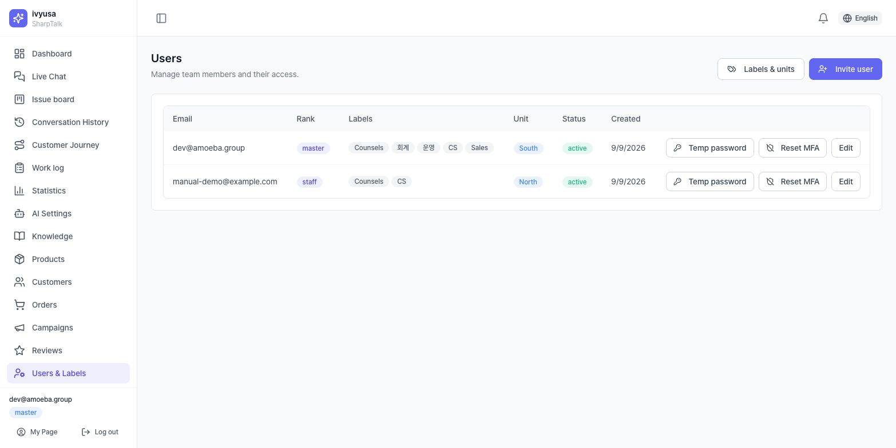

⚠️ **Agents who haven't accepted the invite yet (`invited`) are not assigned.** If a rule's unit has 0 active agents, that rule is skipped (warning in §4.4).

### 2.2 Creating units and labels
**[Labels & units]** → add by code and name on the *Job labels* / *Units* tab. The code can't be changed once created; the name can be changed any time.

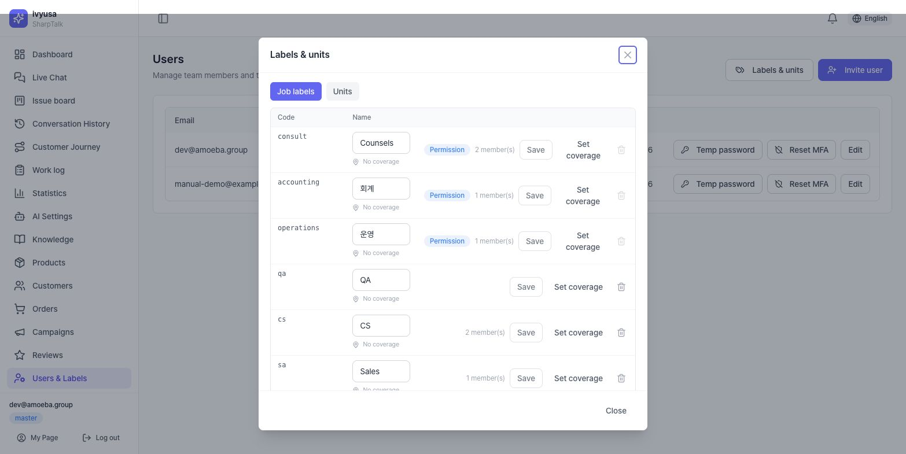

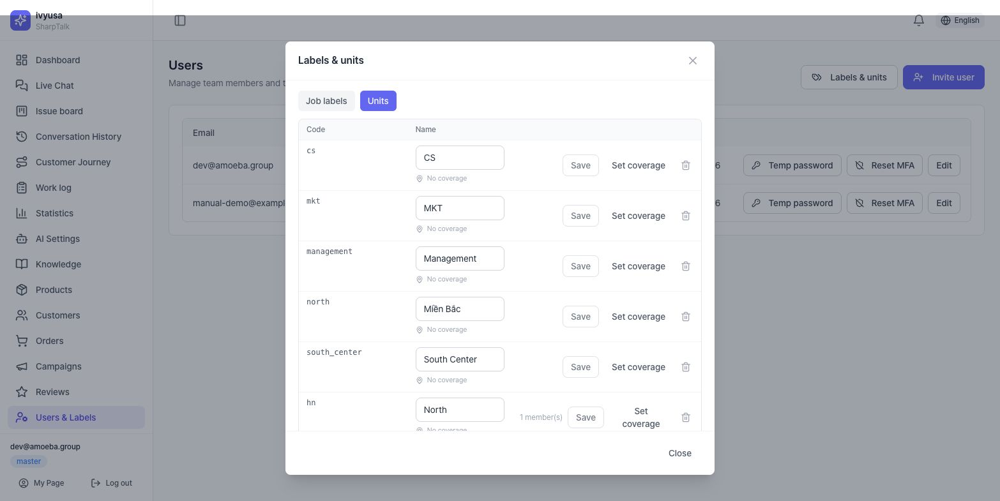

💡 **Tip**: *Consult*, *Accounting* and *Operations* are built-in labels tied to permissions and can't be deleted. For routing, create separate labels such as CS and Sales so they don't get mixed up with permissions.

### 2.3 Assigning units and labels to agents
Click **[Edit]** in the list → check *Job labels*, pick a *Unit*, and save. To handle live chat an agent must also have the **Counsels** label.

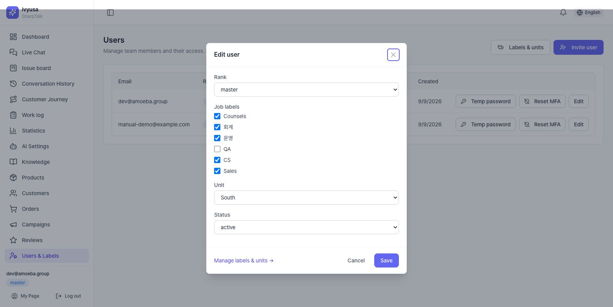

---

## 3. Setup ② Consult categories
*(**[Tenant Settings] → Agent handoff** tab → **[Manage consult categories]** in the routing rules header)*

1. In the bottom row, enter a **code** (letters, digits, _) and a **name**, leave *Show to customers* checked, and click **[Add]**
2. In each row's ▸ **Per-language names**, enter the name for each customer language (empty = the default name)
3. Set what customers should see to **Shown** and internal ones to **Hidden**, then click **[Save changes]**

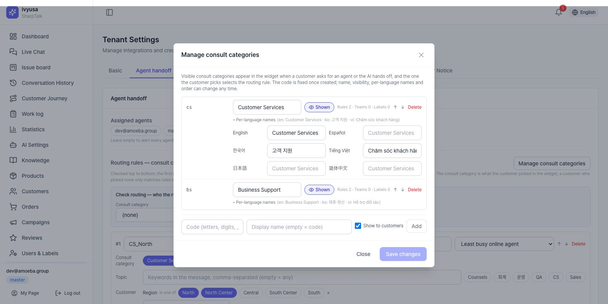

- The code can't be changed once created (rules reference it by code). Name, order and visibility can be changed any time.
- A consult category used by a rule, unit or label can't be deleted; you're told where it's used.
- If **no** consult category is Shown, the widget shows no card and connects directly.

---

## 4. Setup ③ Routing rules
*(**[Tenant Settings] → Agent handoff** tab → *Routing rules — consult category × topic*)*

### 4.1 Creating a rule
**[Add rule]** → each rule sets the following.

| Field | What it sets | Example (CS_South) |
|---|---|---|
| Name | Name shown in logs and alarms | CS_South |
| Assignment | Least busy online agent / Alert the whole group | Least busy online agent |
| Consult category | The value the customer picked (empty = any) | Customer Services |
| Topic | Question keywords (empty = any) | — |
| Customer | Region, province, language etc. (empty = any) | Region = South Center, South |
| People | Group assignment (unit × label) or specific people | Unit South × Label CS |

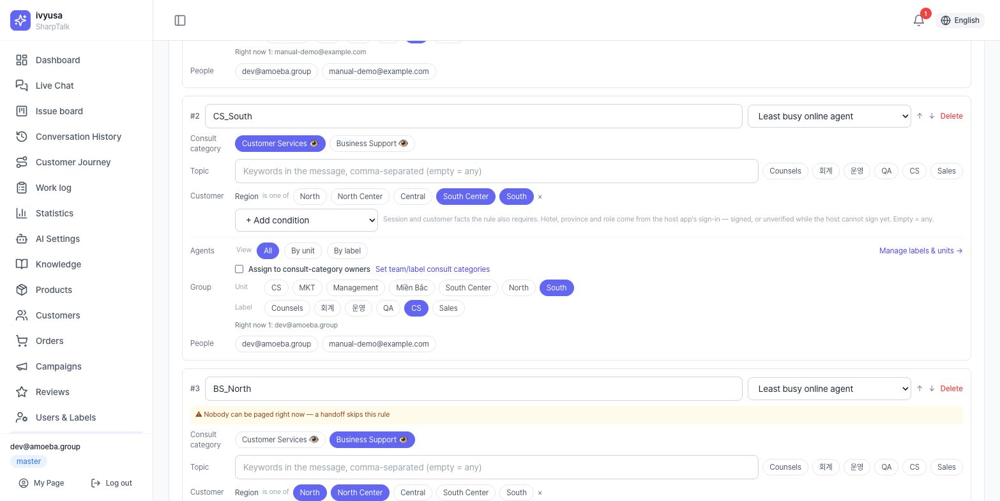

⚠️ **The label chips in the Topic row are for something else.** They only match conversations handed off by a *policy force-handoff (deny)* rule. Pick agent-group labels under **People › Group assignment › Label** below.

### 4.2 Rule order and the default rule
Rules are checked **top to bottom**, and the first rule where all conditions match is used. Reorder with ↑↓. This guide's example uses these 5 rules.

| # | Rule | Consult category | Region | People |
|---|---|---|---|---|
| 1 | CS_North | Customer Services | North, North Center | Unit North × CS |
| 2 | CS_South | Customer Services | South Center, South | Unit South × CS |
| 3 | BS_North | Business Support | North, North Center | Unit North × Sales |
| 4 | BS_South | Business Support | South Center, South | Unit South × Sales |
| 5 | Default | (any) | (any) | Label CS |

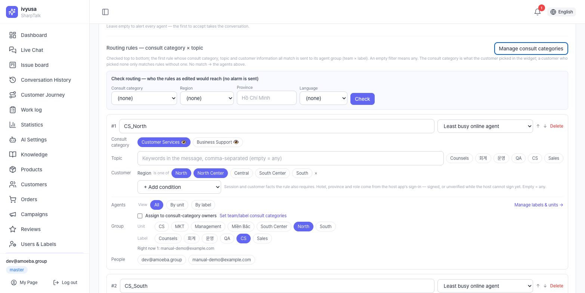

💡 **Tip**: Put a **default rule** with no conditions at the bottom. Customers who didn't pick a consult category, or whose region is unknown, still go to a set person (without it, the *Assigned agents*; without those, an alarm to everyone).

### 4.3 Check routing — test before saving
Enter a consult category, region, province and language in the **Check routing** box above the rules and click **[Check]**. It shows who would be connected using **the rules as currently edited (unsaved)**, and why rules were skipped. No alarm is sent.

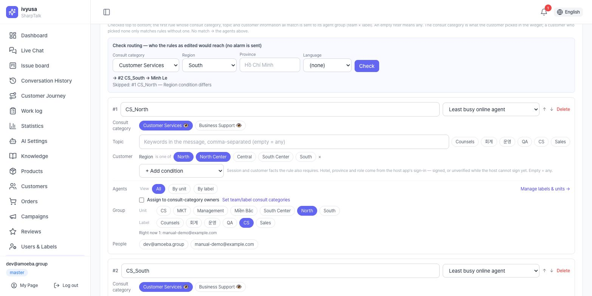

When you're done checking, click **[Save]** at the bottom of the card.

### 4.4 Reading the warnings
Yellow warnings at the top of a rule card don't block saving, but they mean **the rule won't assign anyone as it stands**.

| Warning | Meaning | Fix |
|---|---|---|
| The topic label (…) filter only matches conversations handed off by a policy (deny) rule… | Label chip used in the Topic row by mistake | Clear it in the Topic row; pick under People › Label |
| The name mentions a region but there is no region/province condition | Customers from every region match | Add Customer › Region |
| Nobody can be paged right now (n invited, not yet active) | No active agent in the unit × label | Ask them to accept the invite; check label and unit assignments |

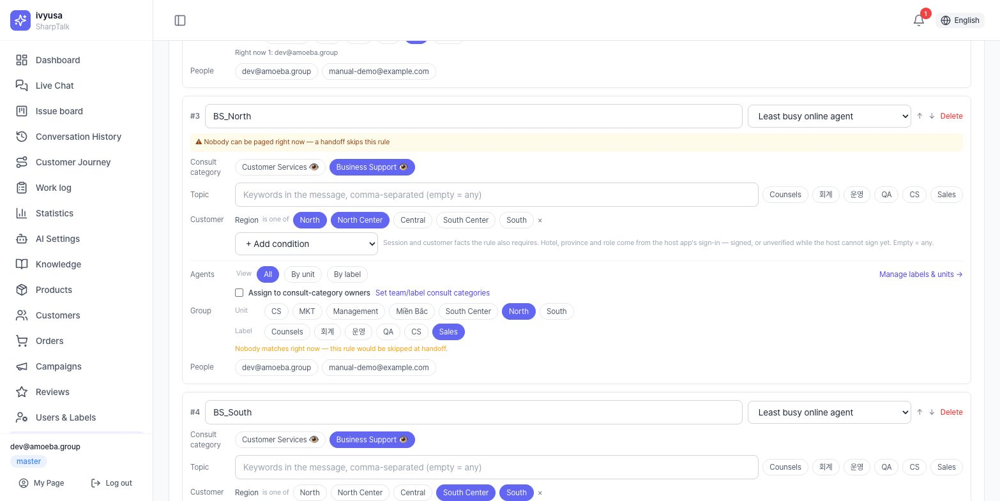

---

## 5. Customer view — requesting an agent and choosing a consult category

There are two ways a customer reaches an agent, and both show the same **consult category card**.

### 5.1 When the customer taps [Talk to an agent]
When the customer taps the **Talk to an agent** chip below an answer (or *Chat with an agent* on the contact card, or a scenario's agent handoff button), a card appears first instead of connecting right away.

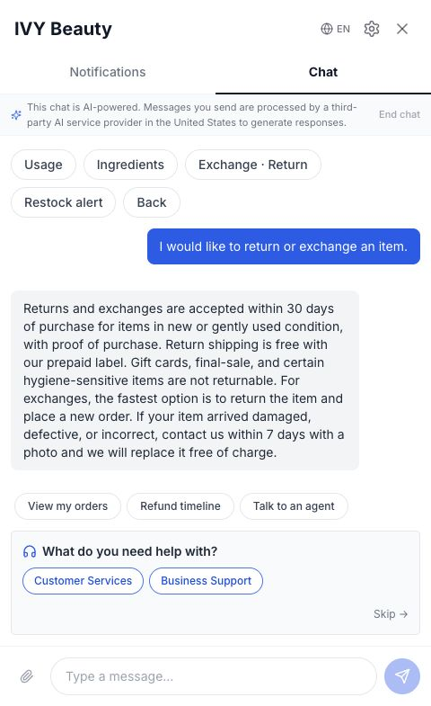

When the customer picks a consult category, routing rules are matched with that value, the line "Got it — I'll connect you with our ○○ team. Please wait a moment." is added to the chat, and the chat goes into waiting.

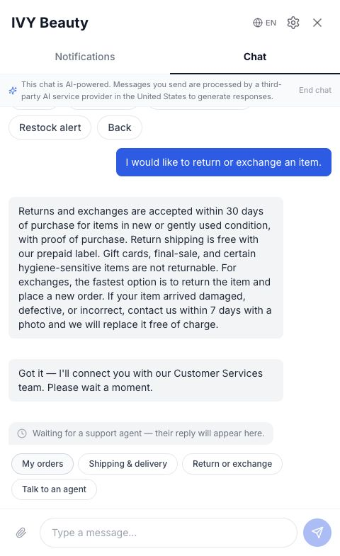

### 5.2 When the AI hands off to an agent
If the AI can't find a confident answer, or the customer says "Connect me to an agent", the AI **pages an agent right away** and shows the same card below its notice. When the customer picks, **if no one has accepted yet**, the chat is **re-routed** to that consult category's group (the first alarm is cleared).

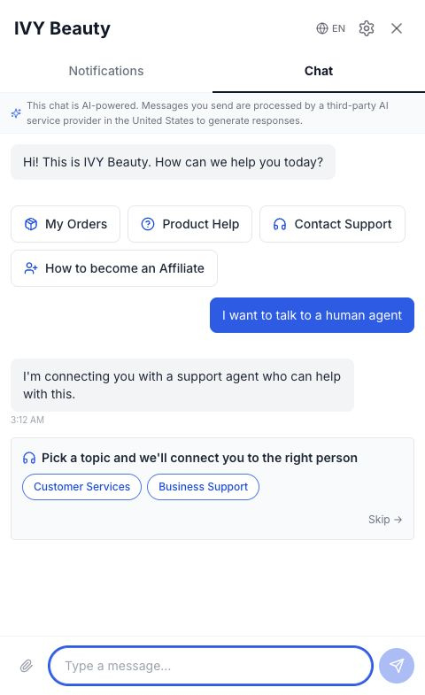

- **[Skip]**: connects as before without picking (using rules with no consult category condition).
- The card appears only once per conversation.
- The names on the card are the *per-language names* for the customer's language.

---

## 6. Routing decision — who gets it

With the example rules (§4.2) and agents (Linh Tran = unit North · CS / Minh Le = unit South · CS · Sales):

| Customer (hotel region) | Consult category picked | Matching rule | Who gets it |
|---|---|---|---|
| Saigon Riverside Hotel (South) | Customer Services | #2 CS_South | Minh Le |
| Hanoi Garden Hotel (North) | Customer Services | #1 CS_North | Linh Tran |
| Hanoi Garden Hotel (North) | Business Support | #3 BS_North → 0 people, skipped → #5 Default | Least busy agent with the CS label |
| Region unknown | (Skip) | #5 Default | Least busy agent with the CS label |

Rules to know:
- **The consult category condition looks only at what the customer picked.** A customer who picked nothing only matches rules with an empty consult category.
- **Region** is the hotel's region sent by the host app (e.g. Go2Joy HA) with the sign-in info. If no region comes but a province name does, it's filled in from the tenant's *region map* (province → region).
- Even if a rule matches, if it has **0 online, active agents**, the next rule is tried.
- When the customer picks a consult category, the rules take precedence over *previous agent first*. If they don't pick, the agent who handled the same account's previous chat gets it first, as long as that agent is among this assignment's candidates.
- **Outside business hours** (when business hours are set), the request goes to the *Off-hours email* instead of agents.

---

## 7. Agent view — alarms

### 7.1 Alarms assigned to me
Wherever you are in the console, a **Chat escalation** popup appears within 10 seconds. It shows the hotel, region, consult category, **Assigned: me**, the rule name, the reason, and the customer's last message.

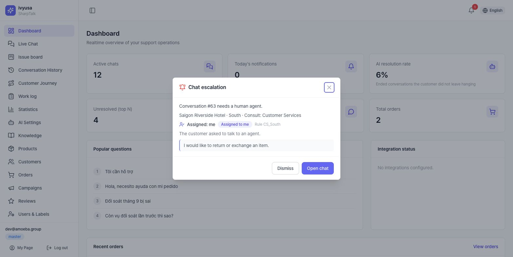

- **[Open chat]**: goes to the conversation and **acknowledges** it (stops reminders).
- **[Dismiss]**: hides it on your screen only (read). It isn't an acknowledgement, so unaccepted reminders continue.

### 7.2 Alarms assigned to another agent
All agents see alarms. An alarm assigned to someone else is marked **Assigned to someone else**, and opening it doesn't turn off that agent's alarm.

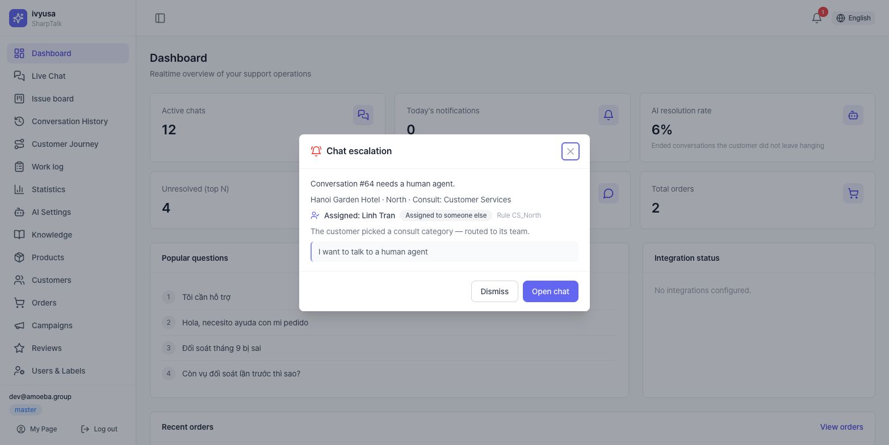

### 7.3 🔔 and the Alarm center
The header 🔔 shows the number of unread alarms. Click it for recent alarms; click *View all* to open the **Alarm center** (`/live-chat/alerts`). Filter by All / Assigned to me / Everyone, status, period and consult category; click a row to go to the conversation.

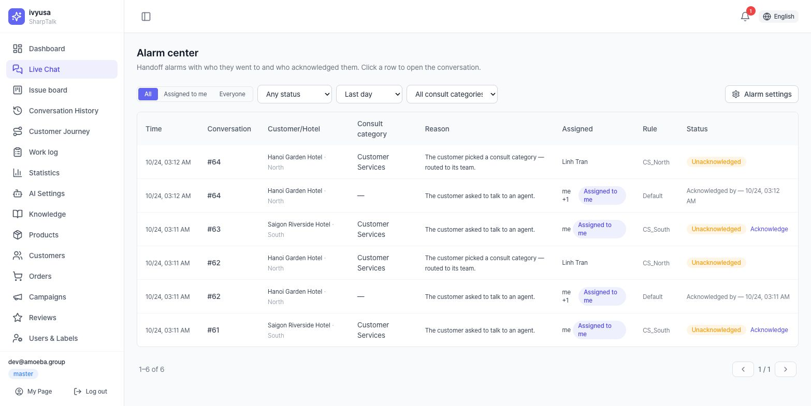

---

## 8. Responding — Open chat
In the live chat conversation opened via **[Open chat]**, the header shows the hotel info, region and a **Consult: Customer Services** badge, and the chat keeps the system line "Got it — I'll connect you with our Customer Services team. Please wait a moment." Click **[Accept]** to start responding.

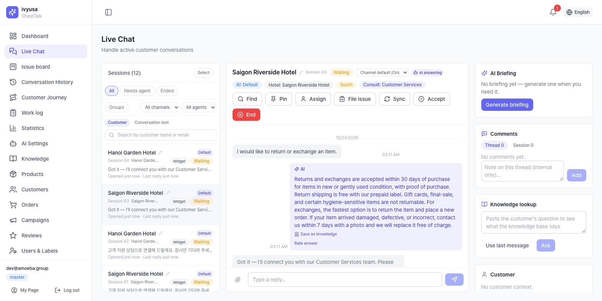

---

## 9. Alarm settings (personal)
Each person sets these under **Alarm settings** in the Alarm center or the 🔔 drawer.

| Item | Options |
|---|---|
| Popup | All alarms / Only those assigned to me (incl. everyone) / Off |
| Sound | On/off, *Play* |
| Browser desktop notifications | When turned on, the browser asks for permission |
| Email | Email me when assigned |

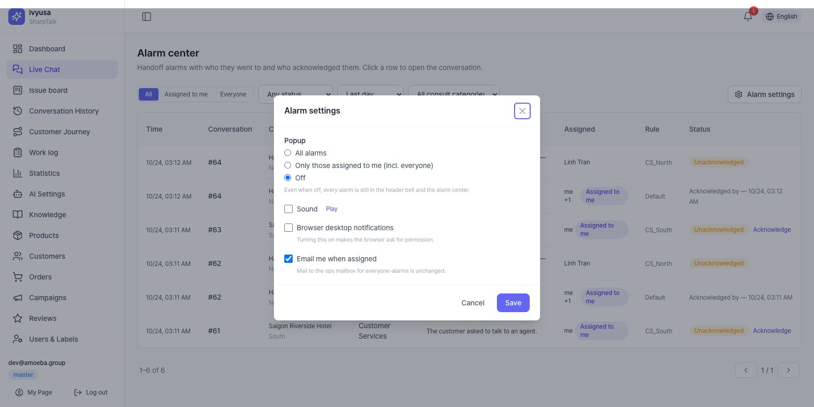

💡 **Tip**: Even with popups off, every alarm stays in 🔔 and the Alarm center. Busy team leads should use *Only those assigned to me*.

---

## 10. Operations checklist

- [ ] All agents have accepted their invites (status `active`)
- [ ] Every agent has the Counsels label + a routing label (CS, Sales etc.) + a unit
- [ ] Consult categories for customers are **Shown** and have per-language names
- [ ] Each routing rule has the right consult category and region conditions and unit × label
- [ ] There is a default rule with no conditions at the bottom
- [ ] No rule card shows a warning
- [ ] All representative combinations (category × region) have been tested with **Check routing**
- [ ] A real request was made from the widget and the alarm reached the right agent

---

## 11. FAQ / Troubleshooting

**Q. A customer asked for an agent, but no consult category card appeared.**
Check that at least one consult category is **Shown** in [Agent handoff → Manage consult categories]. If none is, the chat connects directly without a card. The card doesn't reappear in a conversation where a category was already picked.

**Q. The alarm goes to someone else (or everyone), not the unit I set.**
Enter the same consult category and region in **Check routing** above the rules. It shows the skipped rules and why. Common causes: ① label chips used in the Topic row ② missing region condition ③ unit members haven't accepted their invites (0 people assignable) ④ rule order (a broader rule above matches first).

**Q. Alarms go to every agent.**
If no rule matches and *Assigned agents* is also empty, everyone is alerted. Add a default rule or set assigned agents.

**Q. I dismissed another agent's alarm — does that affect them?**
No. [Dismiss] only hides it on your screen; the assigned agent has to acknowledge it (stopping reminders) themselves.

**Q. The region is empty.**
The host app didn't send a region and the province name isn't in the region map. Run *Update region map* on the [Customers] screen (with the Go2Joy integration), or use a *Province* condition instead of a region condition.
