# 샵톡 상담원 배정 가이드 — 상담원 요청부터 담당 상담원 알람까지

> 버전 1.0 · 2026-10-24 최초 · 코드 기준 작성
> 대상: 테넌트 운영자(master — 팀·라벨·배정 규칙 설정) · 상담원(알람·응대)
> 온라인판: https://shoptalk.amoeba.site/manual (HTML판 및 EN·VI 번역 제공)
> 함께 보기: [통합 사용자 매뉴얼](user-manual.ko.md) 4.4절(알람)·14.1절(상담원 연결), [지식·AI 매뉴얼](knowledge-ai.ko.md) 5장

이 문서는 **고객이 상담원을 찾을 때 누구에게 연결되는지**를 처음부터 끝까지 따라갑니다. 앞부분(2~4장)은 운영자가 한 번 해 두는 설정이고, 뒷부분(5~9장)은 실제로 고객이 요청했을 때 고객 화면과 상담원 화면에서 일어나는 일입니다. 화면 예시는 호텔 파트너 상담을 가정한 시연 데이터입니다(호텔·상담원 이름은 가상).

---

## 목차
1. [한눈에 보기](#1-한눈에-보기)
2. [준비 ① 상담원·팀·라벨](#2-준비--상담원팀라벨)
3. [준비 ② 상담카테고리](#3-준비--상담카테고리)
4. [준비 ③ 배정 규칙](#4-준비--배정-규칙)
5. [고객 화면 — 상담원 요청과 상담카테고리 선택](#5-고객-화면--상담원-요청과-상담카테고리-선택)
6. [배정 판단 — 누가 받나](#6-배정-판단--누가-받나)
7. [상담원 화면 — 알람](#7-상담원-화면--알람)
8. [응대 — 상담 열기](#8-응대--상담-열기)
9. [알람 설정(개인)](#9-알람-설정개인)
10. [운영 체크리스트](#10-운영-체크리스트)
11. [FAQ / 문제 해결](#11-faq--문제-해결)

---

## 1. 한눈에 보기

```
고객 위젯                       샵톡 서버                              상담원 콘솔
──────────                      ─────────                              ──────────
[상담원 연결] 또는 AI 인계  ──▶  상담카테고리 카드 표시
"어떤 상담이 필요하세요?"
  (고객 지원) 선택          ──▶  배정 규칙을 위에서부터 확인
                                  상담카테고리 = 고객 지원 ?
                                  고객 정보 › 권역 = 남부 ?   (호텔 로그인 정보)
                                  → 첫 번째로 모두 맞는 규칙
                                  → 그 규칙의 팀 × 라벨에서 접속 중인 상담원
"○○ 상담으로 연결해 드릴게요" ◀─  배정                             ──▶  🔔 알람 팝업 "배정: 나"
                                                                       [상담 열기] → 응대
```

| 용어 | 뜻 |
|---|---|
| 상담카테고리 | 고객이 위젯에서 고르는 상담 주제(예: 고객 지원·제휴·정산). 운영자가 만들고 노출 여부를 정합니다 |
| 팀 | 상담원의 소속(1인 1팀). 예: North(하노이)·South(호찌민) |
| 라벨 | 상담원의 업무 표시(여러 개 가능). 예: CS·Sales. *상담(Counsels)* 라벨이 있어야 라이브챗을 처리합니다 |
| 배정 규칙 | "상담카테고리 + 고객 정보(권역 등) → 팀 × 라벨" 묶음. 위에서부터 확인해 **처음 모두 맞는 규칙**을 씁니다 |
| 권역 | 고객(호텔)의 위치: 북부·중북부·중부·중남부·남부. 호스트 앱이 로그인 정보로 보내거나, 성(省) 이름으로 채웁니다 |
| 담당 상담원 | 맞는 규칙이 없을 때 받는 사람(상담원 연결 탭 맨 위). 비우면 상담원 전원에게 알립니다 |

---

## 2. 준비 ① 상담원·팀·라벨
*(콘솔 **[사용자 및 라벨]** — master)*

배정 규칙은 사람을 직접 고르기보다 **팀 × 라벨**로 고르는 것을 권장합니다. 사람이 바뀌어도 규칙을 고칠 필요가 없습니다.

### 2.1 상담원 초대와 수락
1. **[사용자 초대]** → 이메일·직급·라벨·팀 선택 → 초대
2. 초대받은 사람이 임시 비밀번호로 **처음 로그인**하면 상태가 `active`가 됩니다
3. 목록에서 **라벨·팀·상태**를 확인합니다

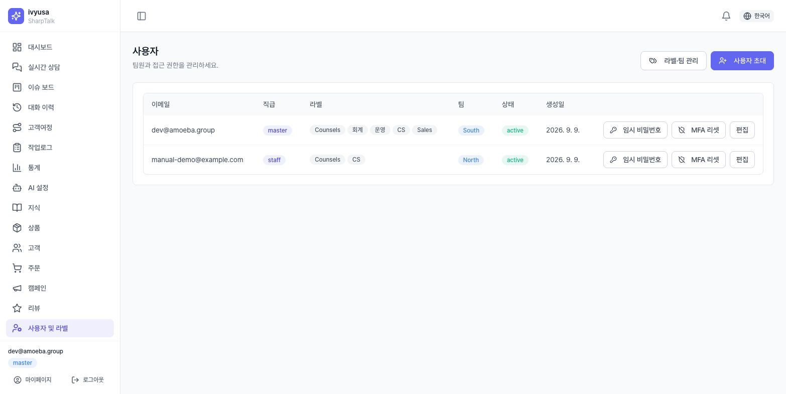

⚠️ **초대 수락 전(`invited`)인 상담원은 배정되지 않습니다.** 규칙의 팀에 활성 상담원이 0명이면 그 규칙은 건너뜁니다(4.4절 경고).

### 2.2 팀·라벨 만들기
**[라벨·팀 관리]** → *직무 라벨* / *팀* 탭에서 코드와 이름으로 추가합니다. 코드는 만든 뒤 바꿀 수 없고 이름은 언제든 바꿀 수 있습니다.

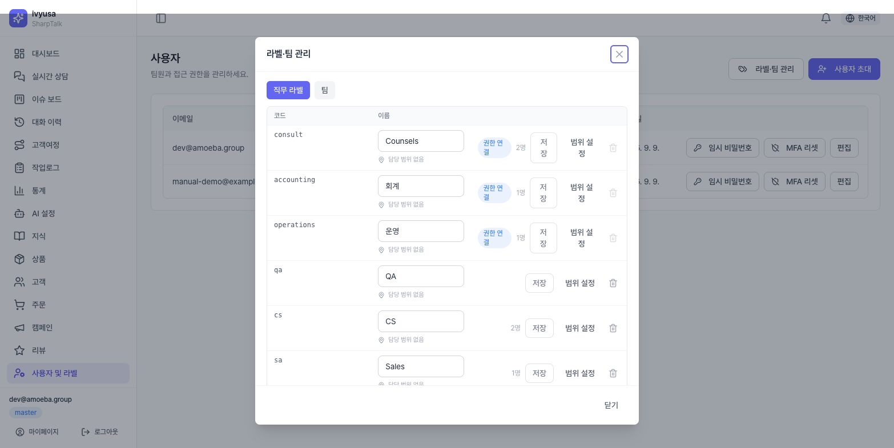

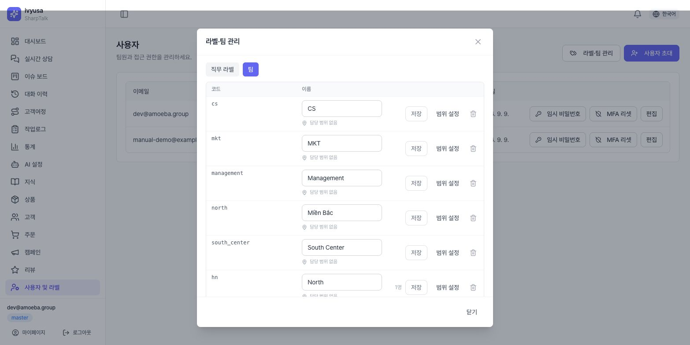

💡 **팁**: *상담(consult)*·*회계*·*운영*은 권한과 연결된 기본 라벨이라 삭제할 수 없습니다. 배정용으로는 CS·Sales처럼 별도 라벨을 만들어 쓰면 권한과 섞이지 않습니다.

### 2.3 상담원에게 팀·라벨 지정
목록의 **[편집]** → *직무 라벨*을 체크하고 *팀*을 고른 뒤 저장합니다. 상담원이 라이브챗을 처리하려면 **Counsels(상담)** 라벨이 함께 있어야 합니다.

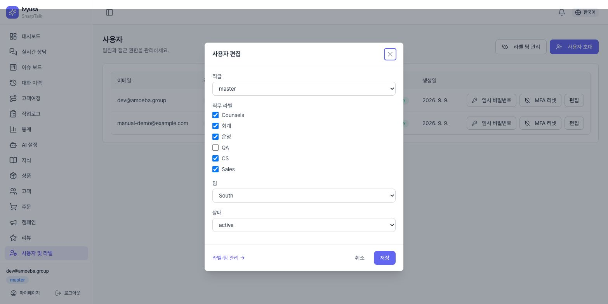

---

## 3. 준비 ② 상담카테고리
*(**[테넌트 설정] → 상담원 연결** 탭 → 배정 규칙 머리글의 **[상담카테고리 관리]**)*

1. 아래 줄에 **코드**(영문·숫자·_)와 **이름**을 넣고 *고객에게 노출*을 체크한 채 **[추가]**
2. 각 행의 ▸ **언어별 이름**에 고객 언어별 이름을 넣습니다(비우면 기본 이름)
3. 고객에게 보일 것은 **노출함**, 내부용은 **노출 안 함**으로 두고 **[변경 저장]**

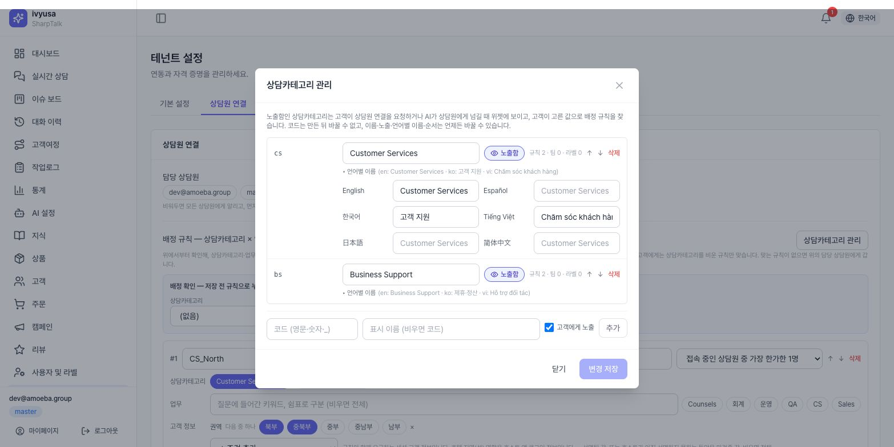

- 코드는 만든 뒤 바꿀 수 없습니다(규칙이 코드로 참조). 이름·순서·노출은 언제든 바꿀 수 있습니다.
- 규칙·팀·라벨이 쓰고 있는 상담카테고리는 삭제되지 않고, 어디서 쓰는지 안내합니다.
- 노출함인 상담카테고리가 **하나도 없으면** 위젯에 카드가 뜨지 않고 바로 연결됩니다.

---

## 4. 준비 ③ 배정 규칙
*(**[테넌트 설정] → 상담원 연결** 탭 → *배정 규칙*)*

### 4.1 규칙 만들기
**[규칙 추가]** → 한 규칙에 다음을 정합니다.

| 칸 | 정하는 것 | 예 (CS_South) |
|---|---|---|
| 이름 | 로그·알람에 보일 이름 | CS_South |
| 배정 방식 | 접속 중 가장 한가한 1명 / 그룹 전원 알림 | 가장 한가한 1명 |
| 상담카테고리 | 고객이 고른 값 (비우면 전체) | Customer Services |
| 업무 | 질문 키워드 (비우면 전체) | — |
| 고객 정보 | 권역·지역(성)·언어 등 (비우면 전체) | 권역 = 중남부·남부 |
| 담당자 | 그룹 배정(팀 × 라벨) 또는 개인 지정 | 팀 South × 라벨 CS |

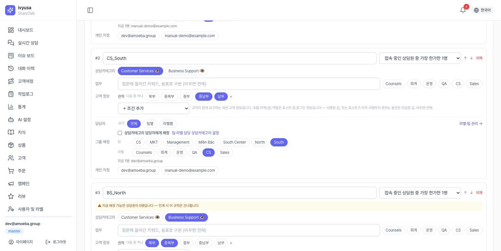

⚠️ **업무 줄의 라벨 칩은 다른 용도입니다.** *정책 강제 핸드오프(deny)* 규칙으로 넘어온 대화에만 맞습니다. 상담원 그룹 라벨은 아래 **담당자 › 그룹 배정 › 라벨**에서 고르세요.

### 4.2 규칙 순서와 기본 규칙
규칙은 **위에서부터** 확인해 처음으로 모든 조건이 맞는 규칙을 씁니다. ↑↓로 순서를 바꿉니다. 이 가이드의 예시는 다음 5개입니다.

| # | 규칙 | 상담카테고리 | 권역 | 담당자 |
|---|---|---|---|---|
| 1 | CS_North | Customer Services | 북부·중북부 | 팀 North × CS |
| 2 | CS_South | Customer Services | 중남부·남부 | 팀 South × CS |
| 3 | BS_North | Business Support | 북부·중북부 | 팀 North × Sales |
| 4 | BS_South | Business Support | 중남부·남부 | 팀 South × Sales |
| 5 | Default | (전체) | (전체) | 라벨 CS |

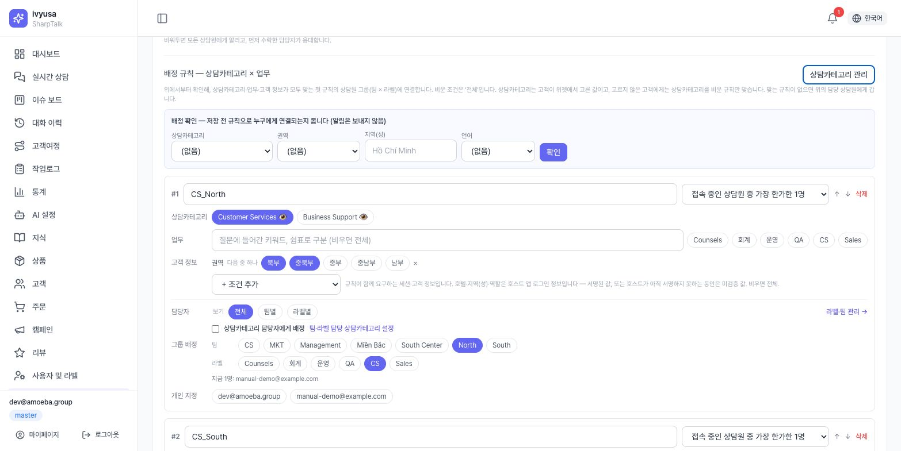

💡 **팁**: 맨 아래에 조건 없는 **기본 규칙**을 두세요. 상담카테고리를 고르지 않은 고객이나 권역을 모르는 고객도 정해진 사람에게 갑니다(없으면 *담당 상담원*, 그것도 없으면 전원 알람).

### 4.3 배정 확인 — 저장 전에 시험하기
규칙 위 **배정 확인** 상자에 상담카테고리·권역·성·언어를 넣고 **[확인]** 을 누르면, **지금 편집 중인(저장 전) 규칙**으로 누구에게 연결되는지와 건너뛴 규칙의 이유가 나옵니다. 알림은 보내지 않습니다.

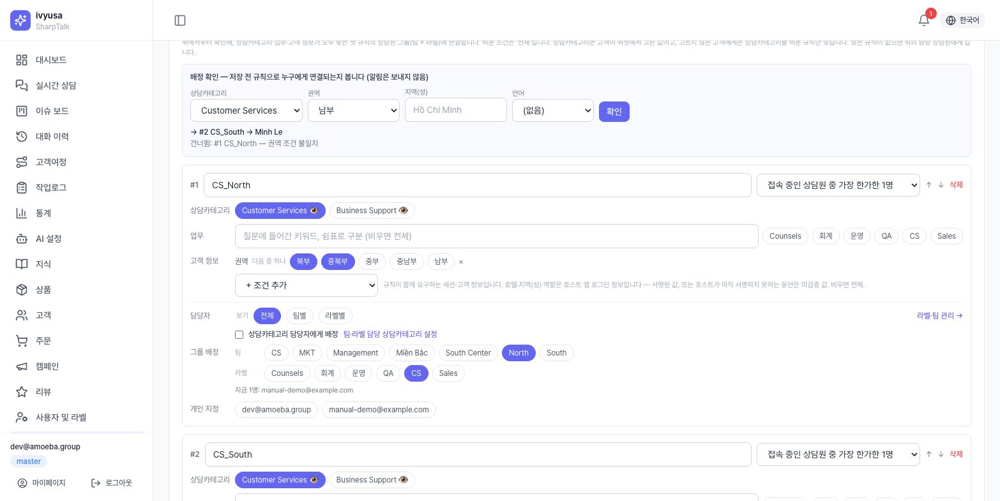

확인이 끝나면 카드 맨 아래 **[저장]** 을 누릅니다.

### 4.4 경고 읽기
규칙 카드 위쪽의 노란 경고는 저장을 막지 않지만 **그대로 두면 배정되지 않는다**는 뜻입니다.

| 경고 | 뜻 | 조치 |
|---|---|---|
| 업무 라벨(…) 조건은 정책(deny) 규칙… | 업무 줄 라벨 칩을 잘못 씀 | 업무 줄에서 해제, 담당자 › 라벨에서 선택 |
| 이름에 지역명이 있지만 권역·성 조건이 없습니다 | 모든 지역 고객이 맞음 | 고객 정보 › 권역 추가 |
| 지금 배정 가능한 상담원이 0명입니다 (초대 수락 전 n명) | 팀 × 라벨에 활성 상담원이 없음 | 초대 수락 안내, 라벨·팀 지정 확인 |

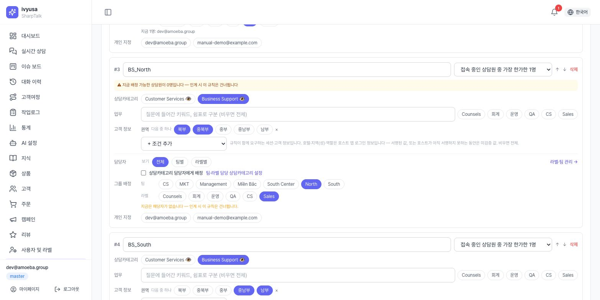

---

## 5. 고객 화면 — 상담원 요청과 상담카테고리 선택

고객이 상담원을 찾는 길은 두 가지이고, 둘 다 같은 **상담카테고리 카드**를 보여줍니다.

### 5.1 고객이 직접 [상담원 연결]을 누를 때
답변 아래 **상담원 연결** 칩(또는 문의 카드의 *상담원과 채팅*, 시나리오의 상담원 연결 버튼)을 누르면 바로 연결하지 않고 카드가 먼저 뜹니다.

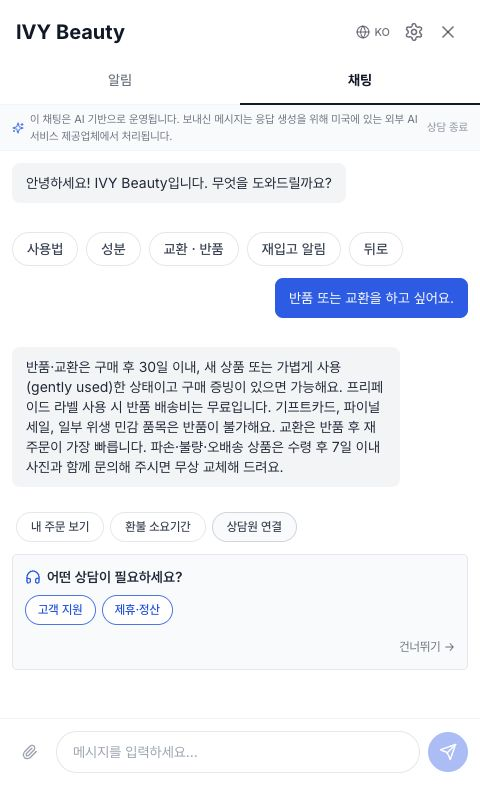

고객이 상담카테고리를 고르면 그 값으로 배정 규칙을 찾고, 대화에 "○○ 상담으로 연결해 드릴게요" 줄이 남은 뒤 대기 상태가 됩니다.

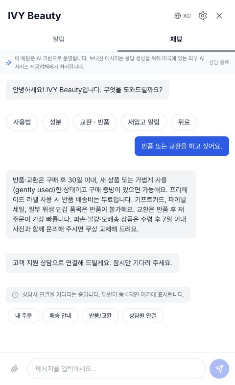

### 5.2 AI가 상담원에게 넘길 때
AI가 확실한 답을 찾지 못했거나 고객이 "상담원 연결해 주세요"라고 하면, AI는 **바로 상담원을 호출**하고 안내 아래에 같은 카드를 띄웁니다. 고객이 고르면, **아직 아무도 수락하지 않은 경우** 그 상담카테고리의 담당 그룹으로 **다시 연결**합니다(처음 호출된 알람은 정리됩니다).

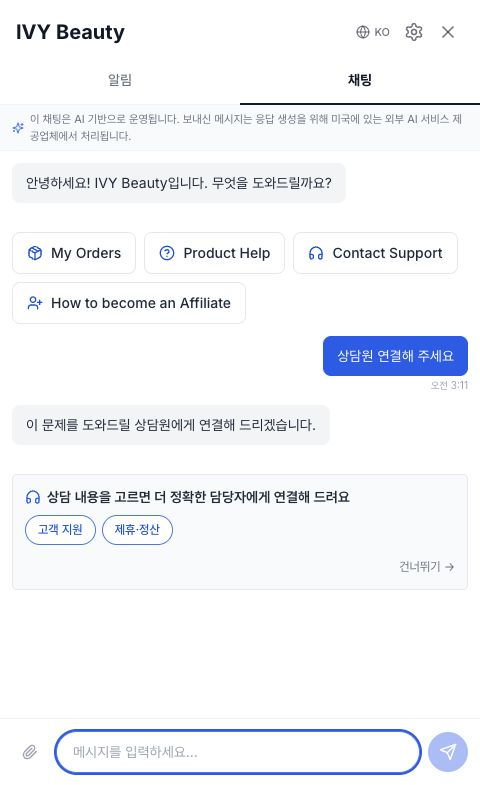

- **[건너뛰기]**: 고르지 않고 기존처럼 연결합니다(상담카테고리 조건이 없는 규칙으로).
- 한 대화에서 카드는 한 번만 뜹니다.
- 카드에 보이는 이름은 고객 언어의 *언어별 이름*입니다.

---

## 6. 배정 판단 — 누가 받나

예시 규칙(4.2절)과 상담원(Linh Tran = 팀 North·CS / Minh Le = 팀 South·CS·Sales)일 때:

| 고객(호텔 권역) | 고른 상담카테고리 | 맞는 규칙 | 받는 사람 |
|---|---|---|---|
| Saigon Riverside Hotel (남부) | Customer Services | #2 CS_South | Minh Le |
| Hanoi Garden Hotel (북부) | Customer Services | #1 CS_North | Linh Tran |
| Hanoi Garden Hotel (북부) | Business Support | #3 BS_North → 0명이라 건너뜀 → #5 Default | CS 라벨 중 가장 한가한 1명 |
| 권역 모름 | (건너뛰기) | #5 Default | CS 라벨 중 가장 한가한 1명 |

알아둘 규칙:
- **상담카테고리 조건은 고객이 고른 값만** 봅니다. 고르지 않은 고객에게는 상담카테고리가 빈 규칙만 맞습니다.
- **권역**은 호스트 앱(예: Go2Joy HA)이 로그인 정보로 보낸 호텔 권역입니다. 권역이 없고 성(省) 이름만 오면 테넌트의 *지역표*(성 → 권역)로 채웁니다.
- 규칙이 맞아도 **접속 중·활성 상담원이 0명**이면 다음 규칙으로 넘어갑니다.
- 고객이 상담카테고리를 고르면 *직전 상담원 우선 연결*보다 규칙이 우선합니다. 고르지 않으면 같은 계정의 직전 대화를 맡았던 상담원이 이번 배정 대상에 들어 있을 때 그 상담원에게 먼저 갑니다.
- **근무시간 밖**(근무시간 설정 시)에는 상담원 대신 *근무시간 외 전달 이메일*로 접수됩니다.

---

## 7. 상담원 화면 — 알람

### 7.1 내게 배정된 알람
콘솔 어디에 있든 10초 안에 **상담 이관 알림** 팝업이 뜹니다. 호텔·권역·상담카테고리, **배정: 나**, 규칙 이름, 사유, 고객의 마지막 말이 보입니다.

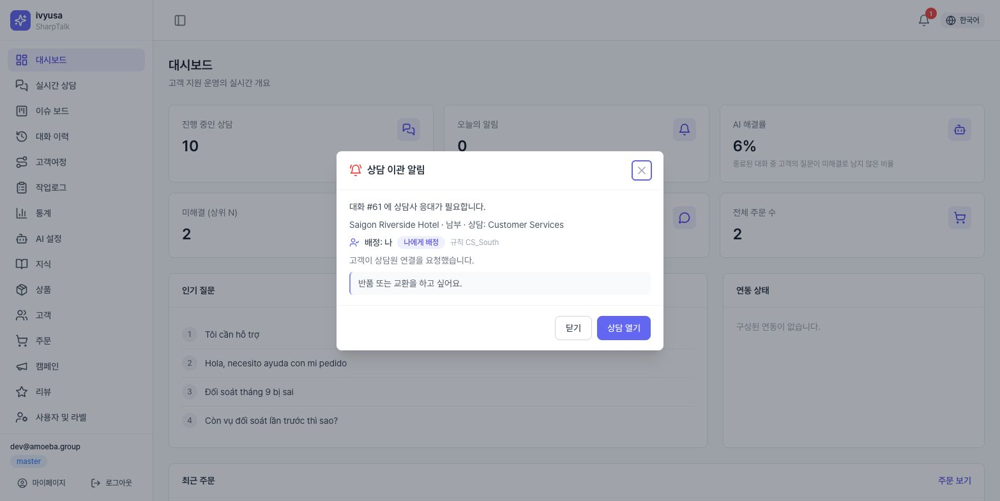

- **[상담 열기]**: 대화로 이동하고 **확인 처리**(재알림 중지)됩니다.
- **[닫기]**: 내 화면에서만 숨깁니다(읽음). 확인 처리는 아니므로 미수락 재알림은 계속됩니다.

### 7.2 다른 상담원에게 배정된 알람
알람은 상담원 모두에게 보입니다. 다른 사람에게 배정된 알람에는 **다른 상담원 배정** 표시가 붙고, 내가 열어도 그 상담원의 알람은 꺼지지 않습니다.

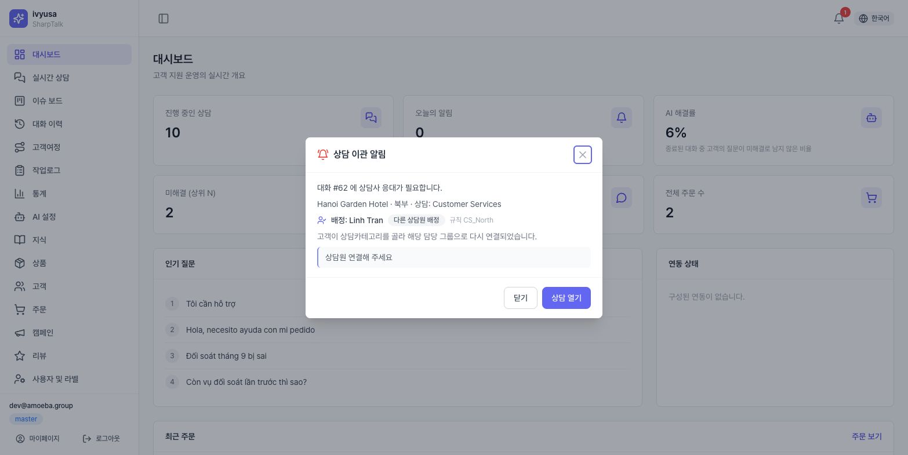

### 7.3 🔔와 알람센터
헤더 🔔에 읽지 않은 알람 수가 뜹니다. 누르면 최근 알람이, *전체 보기*를 누르면 **알람센터**(`/live-chat/alerts`)가 열립니다. 전체/내 배정/전원 대상, 상태, 기간, 상담카테고리로 걸러 보고, 행을 누르면 대화로 갑니다.

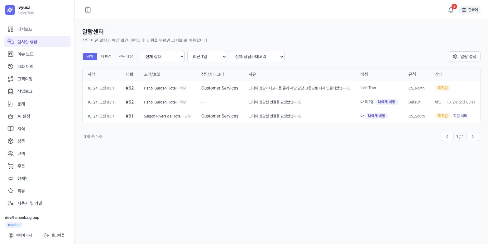

---

## 8. 응대 — 상담 열기
**[상담 열기]** 로 들어간 라이브챗 대화의 헤더에 호텔 정보·권역과 **상담: Customer Services** 배지가 보이고, 대화에는 "고객 지원 상담으로 연결해 드릴게요" 시스템 줄이 남아 있습니다. **[수락]** 을 눌러 응대를 시작합니다.

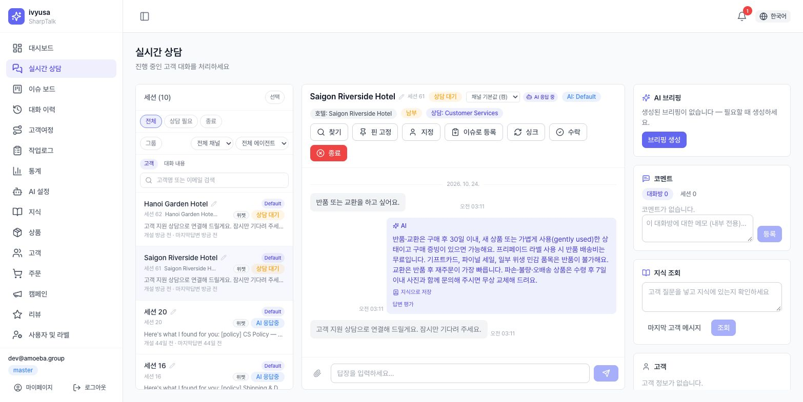

---

## 9. 알람 설정(개인)
알람센터나 🔔 드로어의 **알람 설정**에서 각자 정합니다.

| 항목 | 선택 |
|---|---|
| 팝업 | 모든 알람 / 내게 배정된 것만(전원 대상 포함) / 끄기 |
| 소리 | 켬·끔, *들어보기* |
| 브라우저 데스크톱 알림 | 켜면 브라우저가 권한을 묻습니다 |
| 메일 | 내게 배정되면 메일 받기 |

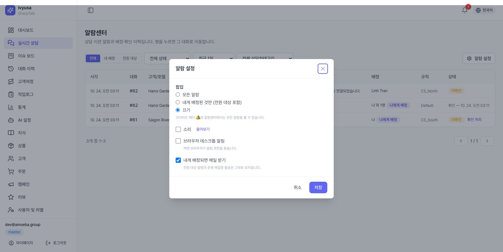

💡 **팁**: 팝업을 꺼도 🔔와 알람센터에는 모든 알람이 남습니다. 바쁜 팀장은 *내게 배정된 것만*을 권장합니다.

---

## 10. 운영 체크리스트

- [ ] 상담원이 모두 초대를 수락했다(상태 `active`)
- [ ] 상담원마다 Counsels(상담) 라벨 + 배정용 라벨(CS·Sales 등) + 팀이 지정되어 있다
- [ ] 고객에게 보일 상담카테고리가 **노출함**이고, 언어별 이름이 들어가 있다
- [ ] 배정 규칙마다 상담카테고리·권역 조건과 팀 × 라벨이 맞게 걸려 있다
- [ ] 맨 아래에 조건 없는 기본 규칙이 있다
- [ ] 규칙 카드에 경고가 없다
- [ ] **배정 확인**으로 대표 조합(카테고리 × 권역)을 모두 시험했다
- [ ] 위젯에서 실제로 요청해 보고, 담당 상담원에게 알람이 가는지 확인했다

---

## 11. FAQ / 문제 해결

**Q. 고객이 상담원을 불렀는데 상담카테고리 카드가 안 나옵니다.**
[상담원 연결 → 상담카테고리 관리]에서 **노출함**인 상담카테고리가 있는지 확인하세요. 하나도 없으면 카드 없이 바로 연결합니다. 이미 고른 대화에는 다시 뜨지 않습니다.

**Q. 지정한 팀이 아니라 다른 사람(또는 전원)에게 알람이 갑니다.**
규칙 위 **배정 확인**에 같은 상담카테고리·권역을 넣어 보세요. 건너뛴 규칙과 이유가 나옵니다. 흔한 원인은 ① 업무 줄의 라벨 칩 사용 ② 권역 조건 누락 ③ 팀원이 초대를 수락하지 않음(배정 가능 0명) ④ 규칙 순서(위의 더 넓은 규칙이 먼저 맞음)입니다.

**Q. 알람이 모든 상담원에게 갑니다.**
맞는 규칙이 없고 *담당 상담원*도 비어 있으면 전원 알람이 됩니다. 기본 규칙을 두거나 담당 상담원을 지정하세요.

**Q. 다른 상담원 알람을 닫았는데 그 상담원에게 영향이 있나요?**
없습니다. [닫기]는 내 화면에서만 숨기고, 확인 처리(재알림 중지)는 배정된 상담원이 해야 합니다.

**Q. 권역이 비어 있습니다.**
호스트 앱이 권역을 보내지 않고 성 이름도 지역표에 없는 경우입니다. [고객] 화면의 *지역표 갱신*(Go2Joy 연동 시)을 하거나, 권역 조건 대신 *지역(성)* 조건을 쓰세요.
