# Sổ tay vận hành Go2Joy: CS và Sales Admin — Làm việc hằng ngày với hàng chờ chuyển người, vùng, quyền xem tri thức và số liệu thí điểm

> Phiên bản 1.0 (bản nháp để Go2Joy rà soát) · 2026-10-13 · Biên soạn dựa trên mã nguồn và báo cáo triển khai PLN-261012 (SG-85)
> Đối tượng: **nhân viên CS và Sales Admin (SA)** (chương 1–4 và 10) · **trưởng nhóm** (thêm chương 9) · **master/director của Go2Joy** (chương 5–8) · bản tóm tắt tiếng Anh cho Amoeba: [go2joy-ops.en.md](go2joy-ops.en.md) và phụ lục A
> Nhãn **in đậm** là đúng chữ trên giao diện tiếng Việt hiện tại; `mã` là giá trị kỹ thuật. Cài đặt ở các chương 5–8 nằm ở menu **Cài đặt gian hàng** và **Cài đặt AI**.
> Bản trực tuyến: đường dẫn /manual của console (có bản HTML và Markdown). Tài liệu liên quan: [Sổ tay tri thức và cài đặt AI](knowledge-ai.vi.md) · [Sổ tay tổng hợp](user-manual.vi.md)

Sổ tay này dành cho hai nhóm người ở Go2Joy: **nhân viên CS và Sales Admin** trực hàng chờ chuyển người từ khách sạn đối tác, và **master/director** cấu hình cho hàng chờ đó chạy đúng. Mọi nhãn, đường dẫn menu và thông báo trích trong sổ tay được đối chiếu với giao diện tiếng Việt của bản console hiện tại; mọi hành vi được dẫn về mã nguồn hoặc báo cáo triển khai (phụ lục D). Phần nào chưa kiểm chứng trên môi trường thật được ghi rõ ở §0.3.

---

## Mục lục
0. [Trước khi bắt đầu](#0-trước-khi-bắt-đầu)
1. [Bắt đầu một ca trực](#1-bắt-đầu-một-ca-trực)
2. [Đọc một hội thoại](#2-đọc-một-hội-thoại)
3. [Hỏi đội và định tuyến](#3-hỏi-đội-và-định-tuyến)
4. [Ngoài giờ làm việc](#4-ngoài-giờ-làm-việc)
5. [Người dùng và nhãn (master)](#5-người-dùng-và-nhãn-master)
6. [Cài đặt chuyển cho nhân viên](#6-cài-đặt-chuyển-cho-nhân-viên)
7. [Khách chưa đăng nhập, quyền xem tri thức, phiên bản giao diện](#7-khách-chưa-đăng-nhập-quyền-xem-tri-thức-phiên-bản-giao-diện)
8. [Đăng nhập có chữ ký, phạm vi thí điểm, dữ liệu đối tác, quyền riêng tư](#8-đăng-nhập-có-chữ-ký-phạm-vi-thí-điểm-dữ-liệu-đối-tác-quyền-riêng-tư)
9. [Thống kê thí điểm](#9-thống-kê-thí-điểm)
10. [Xử lý sự cố](#10-xử-lý-sự-cố)
11. [Bộ tài liệu đào tạo](#11-bộ-tài-liệu-đào-tạo)
12. [Phụ lục](#12-phụ-lục)

---

## 0. Trước khi bắt đầu

### 0.1 Ai đọc chương nào

| Bạn là | Đọc | Ghi chú |
|---|---|---|
| Nhân viên CS hoặc SA (cấp bậc staff) | Chương 1, 2, 3, 4, 10, rồi làm bài tập ở chương 11 | Bạn cần nhãn công việc **CS** hoặc **SA** thì mới thấy **Trò chuyện trực tiếp** (xem §5) |
| Trưởng nhóm CS/SA (manager) | Thêm chương 9 | Cấp manager mở được **Thống kê** và **Cài đặt AI**, nhưng mặc định không mở được **Cài đặt gian hàng** |
| master hoặc director | Toàn bộ, nhất là chương 5–8 | Chương 6 (chuyển người) và các thẻ quyền riêng tư: master và director đều sửa được. Chỉ master sửa được **Chính sách đăng nhập có chữ ký (SSO)** và **Phạm vi pilot theo khách sạn**; thẻ **Tra cứu dữ liệu đối tác** chỉ master nhìn thấy |

### 0.2 Năm điều cần nhớ

1. **Bật Đang trực khi bắt đầu ca, tắt khi hết ca.** Chỉ người đang trực và để console mở mới được hệ thống báo trước (§1).
2. **Nhìn dấu "đã ký" trước khi tin khách sạn và vai trò.** "hết hạn" nghĩa là chữ ký đã quá 8 giờ và khách được coi như khách vãng lai; "tự khai" (hiếm gặp) nghĩa là chưa ai xác nhận (§2).
3. **Hội thoại chọn nhầm đội không cần bắt khách làm lại.** Dùng **Chuyển sang…** để chuyển cho đội đúng; khách không nhận thông báo nào (§3.6).
4. **Bộ lọc "Vùng của tôi" có thể giấu hội thoại.** Hội thoại của vùng khác, hoặc chưa xác định vùng, không hiện cho tới khi bạn chọn **Tất cả vùng** (§3.7).
5. **Ngoài giờ, nhân viên không bị gọi dậy.** Hội thoại ngoài giờ chờ đến sáng; việc đầu tiên của ca sáng là xử lý chúng (§4).

### 0.3 Tình trạng của các tính năng trong sổ tay

- Mọi tính năng được xây và kiểm thử cục bộ; **chưa triển khai** lên máy chủ nào của Go2Joy. Khi lên staging hoặc UAT, các kiểm tra khói vẫn phải làm lại (xem checklist ở phụ lục B).
- **API dữ liệu đối tác thật của Go2Joy chưa được giao** (yêu cầu R8/R9): tra cứu dữ liệu đối tác (§8.3) mới chạy với dữ liệu mẫu. Giữ nó **tắt** cho tới khi Amoeba xác nhận chế độ dữ liệu thật.
- **Chức năng "thử với tư cách" (Khách / Lễ tân / Quản lý) trong Kho tri thức chưa có** ở bản này; nó sẽ đến cùng bộ mô phỏng cổng khách đang được xây. Hiện chỉ có thể kiểm bằng chat thật với tài khoản thử (§7.4).
- **Chưa hiệu chỉnh ngưỡng của cổng khách với embedding thật** (Voyage). Hãy hiệu chỉnh trên staging trước khi bật **Chỉ hướng dẫn đăng nhập hoặc đăng ký** cho khách hàng thật (§7.1).
- Câu chữ pháp lý của thông báo quyền riêng tư (§8.4) và bản dịch tiếng Việt trên giao diện là **bản nháp**, cần luật sư và người bản ngữ rà soát.
- Ảnh chụp màn hình trong sổ tay lấy từ môi trường thử nghiệm của Amoeba với **dữ liệu mẫu hư cấu** (khách sạn "(demo)", email `@go2joy.example`) và AI giả: các con số (ví dụ ở **Thống kê › Thí điểm**) và nội dung câu trả lời trong ảnh **không phải kết quả thật**. Tên khách hàng trong console được che (`L* t*n C*a S**g`).

### 0.4 Thuật ngữ tối thiểu

| Từ | Nghĩa |
|---|---|
| Đối tác | Nhân viên của khách sạn đang chat từ **Hotel Admin** (lễ tân, quản lý, nhân viên nội bộ) |
| Hệ thống chủ | Chính Hotel Admin, nơi "ký" danh tính người dùng gửi cho widget |
| Đã ký | Hệ thống chủ đã ký xác nhận mã khách sạn (`hotelSn`) và vai trò của người đang chat |
| Đội | Lựa chọn khách chọn khi xin gặp nhân viên: **Hỗ trợ khách hàng** (CS) hoặc **Hỗ trợ kinh doanh** (Business, do SA phụ trách) |
| Vùng | Đội Bắc hoặc đội Nam, suy ra từ tỉnh của khách sạn |
| Trực | Công tắc **Đang trực / Không trực** ở đầu trang **Trò chuyện trực tiếp** |

Bảng thuật ngữ Việt - Anh đầy đủ ở §11.3.

---

## 1. Bắt đầu một ca trực

*(Dành cho: nhân viên CS và SA, mọi cấp bậc có nhãn CS hoặc SA)*

### 1.1 Đăng nhập

- Mở địa chỉ đăng nhập của gian hàng (dạng `/user/<slug>`; theo hồ sơ triển khai Go2Joy thì slug là `go2joy`). Nhập **Email** và **Mật khẩu** rồi bấm **Đăng nhập**.
- Lần đầu đăng nhập bằng mật khẩu tạm, màn hình **Bạn cần đổi mật khẩu** hiện ra: mật khẩu mới tối thiểu 10 ký tự, có ít nhất 3 trong 4 loại (chữ thường, chữ hoa, chữ số, ký tự đặc biệt), không phải mật khẩu phổ biến.
- Khi gian hàng bật bắt buộc xác thực hai yếu tố (hiện áp dụng cho cấp bậc master và director), console yêu cầu thiết lập ở **Trang của tôi** (mã 6 chữ số từ ứng dụng xác thực).

### 1.2 Công tắc Đang trực / Không trực

Ở góc phải trên cùng trang **Trò chuyện trực tiếp** có một nút tròn dạng công tắc:

- **Đang trực** (nút xanh): bạn nằm trong nhóm được báo khi có yêu cầu chuyển người mới. Bấm bật sẽ hiện thông báo: *Bạn đã bật trực. Các yêu cầu chuyển người mới của đội bạn sẽ báo cho bạn trước.*
- **Không trực** (nút xám): bạn không được báo trước. Bấm tắt sẽ hiện: *Bạn đã tắt trực. Các yêu cầu chuyển người mới sẽ báo cho nhân viên khác.*

Rê chuột lên nút để đọc chú thích: *Khi đang trực, bạn được báo trước với các yêu cầu chuyển người mới. Hãy giữ console này mở: sau khi đóng khoảng 90 giây bạn sẽ tự rời trạng thái trực.* (90 giây là giá trị mặc định; IT đổi được bằng `AGENT_PRESENCE_TTL_SEC`, còn chú thích trên giao diện luôn ghi 90.)

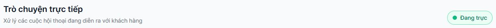

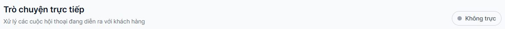

**Quy tắc hiện diện (rất quan trọng):** hệ thống chỉ coi bạn là **online** khi đồng thời

1. công tắc ở **Đang trực**, **và**
2. console của bạn gửi tín hiệu trong vòng **90 giây** gần nhất.

Tín hiệu là lần console hỏi danh sách cảnh báo, khoảng **10 giây một lần**, ở bất kỳ trang nào của console (kể cả tab đang ở nền), miễn là tài khoản bạn có quyền xử lý hội thoại. Đóng tab, tắt máy hoặc để máy ngủ thì sau khoảng 90 giây bạn không còn được tính.

Hai điều ít ai ngờ:

- Công tắc được **lưu theo tài khoản**: nếu hôm qua bạn quên tắt, sáng nay mở console là bạn đã **Đang trực** và được tính ngay. Hãy nhìn công tắc đầu mỗi ca.
- Tài khoản chưa từng bật công tắc được coi là **Không trực**; lần bật đầu tiên tự tạo hồ sơ.

### 1.3 Vì sao hàng chờ có yêu cầu "chưa ai nhận" dù mọi người đang ngồi máy

Không có thông báo nào ghi "không ai trực". Điều bạn thấy là hội thoại ở trạng thái **Đang chờ** với dòng **N chưa ai nhận · lâu nhất mm:ss** phía trên danh sách (§3.8). Hãy kiểm tra theo thứ tự:

| Kiểm tra | Cách xem |
|---|---|
| Có ai thực sự đang trực | **Người dùng & nhãn**: cột **Trực** phải là **Đang trực · thấy N giây trước** (xanh) |
| Người trực bị gạch vì mất kết nối | Cột **Trực** hiện **Đang trực · không kết nối** (vàng): đã bật trực nhưng console không gửi tín hiệu gần đây, nên yêu cầu mới **bỏ qua người này** |
| Người trực có đúng nhãn và đúng vùng | Yêu cầu **Hỗ trợ kinh doanh** chỉ báo trước cho người có nhãn **SA**; yêu cầu **Hỗ trợ khách hàng** cho người có nhãn **CS**. Khách sạn ở miền Nam báo trước cho người **Miền Nam** (§3.2) |
| Người trực đã đủ số hội thoại | Mỗi người giữ tối đa **3** hội thoại cùng lúc (mặc định); đủ 3 thì không được báo và bấm **Nhận** không thành (§3.9) |
| Tài khoản bị tạm ngưng | Chỉ người dùng ở trạng thái đang hoạt động mới được báo |

Nếu không ai đạt điều kiện ở các bước của §3.2 (kể cả khi danh sách **Nhân viên được phân công** để trống), yêu cầu **phát chung** cho mọi người có quyền xử lý hội thoại (ở chế độ **Nghiêm ngặt** chỉ trong vùng), và sau 5 phút (mặc định) hệ thống báo lại (§3.4). Vì vậy tình huống "không ai trực" làm chậm chứ không làm mất yêu cầu.

### 1.4 Hộp thoại báo (alarm) và nhận hội thoại

Khi có yêu cầu chuyển người cho bạn (hoặc phát chung), console bật hộp thoại **Chuyển tiếp hội thoại** ở bất kỳ trang nào:

- Dòng đầu: **Hội thoại #<số> cần nhân viên hỗ trợ.** Dòng thứ hai là lý do, ví dụ **Khách hàng yêu cầu gặp nhân viên.**, **Chưa ai nhận cuộc trò chuyện này.**, **Một nhân viên đã chuyển cuộc trò chuyện này sang đội của bạn.**, **Công cụ AI tạm thời không hoạt động nên không trả lời được. Cần nhân viên tiếp nhận.**
- Khung chi tiết (chỉ hiện dòng có dữ liệu): **Đội**, **Vùng**, **Khách sạn** (tên, mã và vai trò; vai trò ở đây hiện bằng chữ tiếng Anh như `manager`, `receptionist`), **Đang chờ** (đồng hồ đếm), **Thông báo cho** (ví dụ **Chỉ đội Nam**) và đoạn xem trước tin nhắn của khách. Đoạn xem trước là **tin cuối cùng của khách**: khi khách vừa bấm chip chọn đội thì đó chính là tên đội (ví dụ *Hỗ trợ kinh doanh*), không phải câu hỏi; hãy mở hội thoại để đọc câu hỏi thật.
- Hai nút: **Mở hội thoại** (đưa bạn tới đúng hội thoại) và **Bỏ qua**.

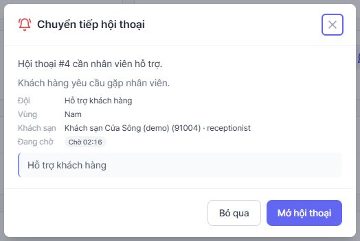

⚠️ **Lưu ý**: **Bỏ qua** (và cả **Mở hội thoại**, khi bạn chưa **Nhận**) chỉ xác nhận đã xem thông báo và **đóng thông báo đó cho mọi đồng nghiệp** (một thông báo phát chung chỉ có một bản); nó **không** nhận hội thoại. Hội thoại vẫn ở **Đang chờ**; nếu không ai nhận, hệ thống tạo thông báo mới sau 5 phút (§3.4). Hộp thoại không hiện khi bạn đang mở đúng hội thoại đó.

**Nhận hội thoại:** mở hội thoại rồi bấm **Nhận** (hàng nút phía trên khung tin nhắn). Hội thoại chuyển sang **Nhân viên xử lý**, tên bạn xuất hiện ở **Phụ trách**, và các thông báo đang mở về hội thoại này được đóng cho đồng nghiệp. Khi xong việc: **Kết thúc**. Muốn trả hội thoại cho AI mà không kết thúc: **Trả lại cho AI**.

💡 **Mẹo**: nếu bấm **Nhận** mà không có gì xảy ra, rất có thể bạn đang giữ đủ 3 hội thoại. Console hiện không hiện lỗi trong trường hợp này (xem §3.9).

---

## 2. Đọc một hội thoại

*(Dành cho: nhân viên CS và SA)*

### 2.1 Một dòng trong danh sách

Danh sách bên trái của **Trò chuyện trực tiếp** có các tab **Tất cả**, **Cần nhân viên** (đang chờ hoặc đang có nhân viên xử lý), **Đã kết thúc** và **Nhóm**. Mỗi dòng gồm:

| Phần tử | Ý nghĩa |
|---|---|
| Dòng khách sạn: tên · mã hiển thị, kèm **đã ký** (xanh), **hết hạn** (vàng) hoặc, hiếm gặp, **tự khai** (vàng) | Khách sạn đối tác của phiên và độ tin cậy của thông tin đó (§2.3) |
| Huy hiệu đội: **Hỗ trợ khách hàng** hoặc **Kinh doanh** | Đội khách đã chọn khi xin gặp nhân viên |
| Huy hiệu vùng: **Bắc** hoặc **Nam** | Đội vùng phụ trách khách sạn này |
| Huy hiệu **?** màu cam | Tỉnh của khách sạn **không có** trong bảng vùng (§2.4) |
| **Chờ mm:ss** | Đã chờ nhân viên bao lâu. Sau 5 phút chuyển đỏ kèm ⚠ |
| **AI tắt** | AI không trả lời phiên này và chưa có nhân viên nào nhận |
| Trạng thái: **AI đang trả lời**, **Đang chờ**, **Nhân viên xử lý**, **Đã kết thúc** | Ai đang giữ hội thoại |

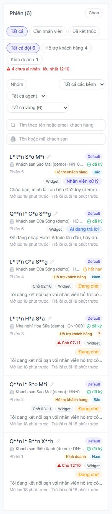

Ô **Tên hoặc mã khách sạn** (dưới ô tìm khách hàng) lọc theo **`hotelSn`** chính xác (số trong ngoặc ở dải đối tác, ví dụ 91001) hoặc một phần tên; **không** tìm theo mã hiển thị như `SM-01`. Chỉ tìm trong các phiên đối tác đã ký.

### 2.2 Dải ngữ cảnh đối tác ở đầu hội thoại

Mở một hội thoại sẽ thấy hàng huy hiệu (trạng thái, **AI: <tên>**, **Đội: …**, **Vùng: …**, **?**, **Chờ …**, **Phụ trách: …**) và bên dưới là dải đối tác:

`Quản lý @ Khách sạn Sao Mai · SM-01 (hotelSn 91001) · Hà Nội  [đã ký]  <giờ xác minh>`

- Vai trò hiển thị bằng tiếng Việt: **Quản lý**, **Lễ tân**, **Nhân viên nội bộ**.
- Chữ ký chỉ bao gồm **`hotelSn`**, vai trò và tỉnh. **Tên khách sạn và mã hiển thị (như `SM-01`) không nằm trong chữ ký**, chỉ là chữ hiển thị và có thể sai. Khi cần xác nhận khách sạn, hãy dựa vào mã `hotelSn`.
- Tỉnh hiện sau dấu chấm giữa nếu hệ thống chủ gửi kèm.
- Nút **Mở trong hệ thống** (nếu có) mở trang khách sạn đó trong hệ thống của Go2Joy; chỉ có khi master đã đặt mẫu link (§7.1).

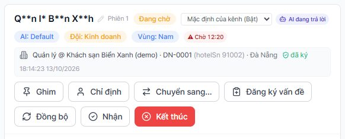

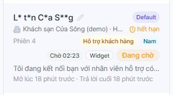

Hàng nút bên dưới: **Ghim**, **Chỉ định** (giao cho AI agent hoặc, từ cấp manager, cho một nhân viên), **Chuyển sang…** (§3.6), **Đăng ký vấn đề**, **Đồng bộ**, **Nhận**, **Trả lại cho AI** (chỉ khi đang có nhân viên xử lý) và **Kết thúc**.

### 2.3 "đã ký", "tự khai", "hết hạn" nghĩa là gì

| Dấu | Nghĩa | Bạn nên |
|---|---|---|
| **đã ký** (chú thích: *Hệ thống chủ đã ký khách sạn và vai trò này.*) | Hotel Admin đã dùng khoá bí mật dùng chung để ký `hotelSn` và vai trò (và tỉnh nếu có) của người chat. Hệ thống tin `hotelSn` và vai trò này; tên khách sạn thì không được ký | Xử lý bình thường theo vai trò. Tra cứu dữ liệu và định tuyến theo vùng chỉ dùng thông tin **đã ký** |
| **tự khai** (chú thích: *Do trang tự khai, chưa ký — hãy xác minh trước khi xử lý.*) | **Hiếm gặp**: máy chủ từ chối thông tin đối tác không có chữ ký hợp lệ khi người dùng đăng nhập vào widget, nên dấu này chủ yếu thuộc về dữ liệu cũ hoặc bất thường | Xác minh qua kênh khác trước khi chia sẻ thông tin nhạy cảm và báo IT. Tỉnh chưa ký **không** được dùng để chọn đội vùng |
| **hết hạn** (chú thích: *Phiên đăng nhập này đã quá thời hạn cho phép. Khách được xem là khách vãng lai cho đến khi hệ thống chủ ký lại.*) | Chữ ký đã cũ hơn thời hạn (mặc định **8 giờ**; master đổi được từ 1 đến 720 giờ, §8.1) | Coi người chat là chưa đăng nhập: trợ lý có thể nhắc đăng nhập lại, tra cứu dữ liệu đối tác bị từ chối, yêu cầu mới không chọn đội theo vùng. Nhờ họ tải lại hoặc đăng nhập lại Hotel Admin |

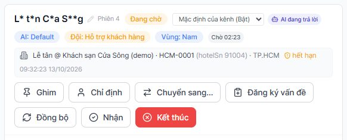

Khi Hotel Admin đã tích hợp đúng, widget phát sự kiện `identity-expired` và hệ thống chủ ký lại **ngầm**, nên người dùng đang làm việc thường không bị gián đoạn. Dấu **hết hạn** trong console chủ yếu xuất hiện với phiên bị bỏ quên lâu.

💡 **Mẹo**: hội thoại vẫn giữ tên khách sạn dù đã hết hạn (đó là lịch sử), nhưng dấu **đã ký** được thay bằng **hết hạn** để bạn không tin nhầm vào một phiên đã cũ.

### 2.4 Huy hiệu "?" và tỉnh chưa ánh xạ

Huy hiệu **?** màu cam nghĩa là khách sạn có tỉnh đã ký nhưng **tỉnh đó không có trong bảng vùng** của gian hàng, nên hội thoại không có đội vùng. Rê chuột để đọc: *Chưa xác định vùng — tỉnh "<tên tỉnh>" không có trong bảng vùng*. Trong hộp thoại báo, dòng vùng ghi **? (chưa ánh xạ: <tên tỉnh>)**.

Việc cần làm:

- Bạn vẫn xử lý bình thường; hội thoại chỉ được chọn đội theo nhãn (CS hoặc SA), không theo vùng.
- Báo cho master/director để thêm đúng cách viết của tỉnh đó vào bảng vùng (§6.4). Nguyên nhân hay gặp: bảng chưa nạp bộ tỉnh có sẵn hoặc thiếu tỉnh, tên tỉnh viết khác (sai chính tả, thêm chữ thừa). Việc so khớp đã bỏ qua dấu, hoa thường và tiền tố như "TP.", và bộ có sẵn đã có cả tên cũ trước sáp nhập tháng 7/2025 lẫn cách viết thường gặp như "TP.HCM".
- Có thể lọc nhanh: ở ô chọn vùng, mục **Tỉnh chưa ánh xạ** (chỉ hiện khi đang có hội thoại như vậy).

Hội thoại **không có vùng** vì lý do khác (khách sạn chưa gửi tỉnh, tính năng vùng đang tắt, người chat chưa ký) hiện trong ô chọn vùng ở mục **Chưa xác định vùng**.

---

## 3. Hỏi đội và định tuyến

*(Dành cho: nhân viên CS và SA; thiết lập ở chương 6)*

### 3.1 Khách đối tác nhìn thấy gì

Khi người dùng Hotel Admin xin gặp nhân viên (bấm chip **Gặp nhân viên hỗ trợ** hoặc nút **Kết nối nhân viên hỗ trợ**, hoặc gõ yêu cầu), nếu gian hàng bật **Hỏi khách chọn đội** thì trợ lý hỏi trước:

- Câu hỏi mặc định: **Bạn cần hỗ trợ về việc gì?** (master sửa được).
- Hai lựa chọn mặc định: **Hỗ trợ khách hàng** (phục vụ bởi nhân viên có nhãn CS) và **Hỗ trợ kinh doanh** (nhân viên có nhãn SA).
- Lựa chọn của khách được ghi vào hội thoại như một tin của chính họ, để nhân viên đọc lại biết khách đã xin gì.
- Trong giờ làm việc, khách đọc: **Tôi đang kết nối bạn với nhân viên hỗ trợ có thể giúp việc này.** Ngoài giờ: xem chương 4.

Mọi lối vào do **khách chủ động** (chip, nút, kịch bản kết nối nhân viên, gõ tay "gặp nhân viên") đều đi qua cùng một câu hỏi đội. Chuyển người **tự động** do hệ thống (AI không đủ căn cứ, quy tắc chuyển bắt buộc theo chủ đề, AI lỗi, kiểm duyệt chặn) **không** hỏi đội: hội thoại không có huy hiệu đội, dùng giờ làm việc chung, và người nhận được chọn theo nhãn CS nếu đã biết vùng, nếu không thì theo danh sách phân công hoặc phát chung.

### 3.2 Ai được báo: thang chọn người

Khi khách chọn xong đội, hệ thống tìm người nhận theo thứ tự (chế độ mặc định **Báo đội của khách sạn trước, sau đó báo tất cả**):

1. Người có **nhãn của đội** (CS với **Hỗ trợ khách hàng**, SA với **Hỗ trợ kinh doanh**), **cùng vùng** với khách sạn, đang **online** (§1.2) và còn dưới giới hạn 3 hội thoại. Nếu có nhiều người, chọn người **ít việc nhất** (số hội thoại đang giữ cộng số thông báo đã gửi mà họ chưa xác nhận); hòa thì chọn người có mã nhỏ hơn.
2. Nếu không có: người có nhãn đó và để **Khu vực: Toàn quốc**, đang online.
3. Nếu không có: **người đầu tiên** trong danh sách **Nhân viên được phân công** do master chọn ở mục chuyển người. Bước này **không** kiểm tra online, giới hạn 3 hội thoại, trạng thái tài khoản hay vùng; ở chế độ **Nghiêm ngặt** (§3.3) chỉ lấy người đang hoạt động thuộc vùng đó hoặc **Toàn quốc**.
4. Nếu vẫn không có: **phát chung** cho mọi người có quyền xử lý hội thoại.

Quy tắc đi kèm:

- Người của **vùng bên kia không bao giờ** được chọn ở bước 1–2.
- Ở bước 1–2 chỉ tài khoản **đang hoạt động** mới được chọn (không phải bị tạm ngưng hay chưa nhận lời mời).
- Nếu khách sạn chưa xác định được vùng (§2.4), bước chọn chỉ dùng nhãn.
- Một thông báo **gửi riêng cho một người** chỉ hiện cho người đó. Thông báo **phát chung** hiện cho mọi người trong gian hàng. Ngoài hộp thoại báo, nếu IT đã cấu hình, tóm tắt còn đi qua Slack và email với các dòng **Reason, Team, Region, Partner**.

Vùng được suy ra từ tỉnh đã ký của khách sạn: miền Bắc và Bắc Trung Bộ (đến Huế) thuộc **đội Bắc**; Nam Trung Bộ (từ Đà Nẵng) và miền Nam thuộc **đội Nam**. Tên gọi chi tiết của bảng ở §6.4.

### 3.3 Chế độ nghiêm ngặt (nếu master bật)

Ở chế độ **Nghiêm ngặt — không tự ra khỏi vùng của khách sạn**, chỉ nhân viên cùng vùng và nhân viên **Toàn quốc** được báo và nhìn thấy thông báo. Hội thoại chỉ sang đội còn lại sau số phút đặt ở **Mở rộng sang vùng còn lại sau (phút)**; để trống hoặc 0 là không bao giờ mở rộng. Việc mở rộng chỉ xảy ra ở **lần nhắc "chưa ai nhận" đầu tiên sau mốc đó** (§3.4), nên cần bộ nhắc đang bật; cho tới lúc đó các lần nhắc cũng chỉ dành cho đội của vùng và nhân viên **Toàn quốc**. Thông báo hiển thị dòng **Thông báo cho: Chỉ đội Nam** (hoặc Bắc).

### 3.4 Báo lại khi chưa ai nhận

Thông báo gửi riêng chỉ người được gửi mới thấy, nên một hội thoại có thể nằm đó mà không ai nhìn. Vì vậy:

- Nếu hội thoại **Đang chờ**, **chưa ai nhận** sau **5 phút** (mặc định), hệ thống tạo **thông báo mới phát chung** (ở chế độ **Nghiêm ngặt**: chỉ cho vùng đó và **Toàn quốc**, cho tới khi mở rộng) và gửi tin lên Slack và email. Tin gồm dòng **Reason: UNCLAIMED — nobody has taken this conversation yet**, dòng **Waiting: N min (reminder k of m)** và các dòng Team, Region, Partner; tiêu đề email dạng `[IVY Chat] UNCLAIMED — conversation #N` (tin gửi cho nhân viên bằng tiếng Anh). Trong console, hộp thoại báo hiện lý do **Chưa ai nhận cuộc trò chuyện này.**
- Nhắc lại sau mỗi 5 phút, **tối đa 3 lần** cho một lượt chờ. Sau đó hệ thống thôi nhắc, nhưng đồng hồ **Chờ** và dòng **chưa ai nhận** vẫn còn đó.
- Số phút và số lần là **cài đặt phía máy chủ** (IT), không chỉnh được trong console. Trong console, master chọn **Tự động / Bật / Tắt** ở mục **Báo lại khi chưa ai nhận cuộc trò chuyện** (§6.1). **Tự động** nghĩa là bật khi gian hàng đã chọn người nhận, định tuyến theo đội hoặc theo vùng; Go2Joy có hai mục này nên mặc định là bật.
- Hội thoại ngoài giờ đang chờ trả lời bằng email **không** bị nhắc (§4), để không đánh thức ai lúc nửa đêm.

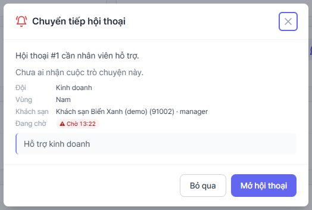

### 3.5 Nhận hội thoại

Trong lúc hội thoại **Đang chờ** mà **chưa ai nhận**, **AI vẫn tiếp tục trả lời** các câu hỏi tiếp theo của khách (để khách không phải chờ trong im lặng); ở đầu hội thoại, nhãn **AI đang trả lời** cùng ô **Mặc định của kênh (Bật)** cho biết điều này. Vì vậy hãy đọc cả phần AI đã trả lời trước khi bạn viết. Khi một nhân viên **Nhận**, AI giữ im lặng (*Một nhân viên đang phụ trách hội thoại này nên AI giữ im lặng.*).

**Nhận** gán hội thoại cho bạn và đóng các thông báo còn mở của nó. Việc nhận không phụ thuộc bạn có phải người được báo hay không: bất kỳ ai có quyền (nhãn CS hoặc SA) đều nhận được.

### 3.6 Chuyển hội thoại sang đội khác: Chuyển sang…

Dùng khi khách chọn nhầm đội (ví dụ chọn **Hỗ trợ khách hàng** nhưng hỏi về hợp đồng) hoặc bạn thấy hội thoại thuộc người khác.

1. Mở hội thoại, bấm **Chuyển sang…** ở hàng nút (có chú thích *Chuyển cuộc trò chuyện này sang đội khác*).
2. Hộp thoại **Chuyển cuộc trò chuyện** nói rõ: *Cuộc trò chuyện quay lại hàng chờ của đội bạn chọn và đội đó được báo. Khách hàng không nhận được thông báo nào.* Dòng **Hiện tại: <đội> · <vùng>** cho biết trạng thái hiện hành.
3. Chọn **Chuyển sang** (một trong các đội của gian hàng). Nếu có định tuyến theo vùng, chọn thêm **Vùng**: **Giữ vùng hiện tại**, **Bắc**, **Nam** hoặc **Không có vùng**.
4. Bấm **Chuyển**. Hộp thoại xác nhận tồn tại để một cú bấm nhầm trên ô chọn không gọi nhầm đội khác. Lưu ý hộp thoại mở sẵn với **đội hiện tại**, nên nút **Chuyển** bấm được ngay; bấm mà không đổi gì vẫn gọi lại đội đó và tính lại đồng hồ chờ, vì vậy hãy chọn đội mới trước.

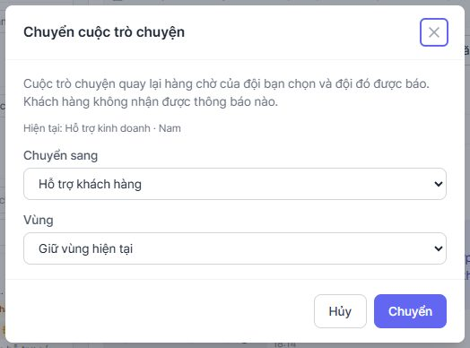

Điều gì xảy ra:

- Hội thoại về trạng thái **Đang chờ** của đội mới; người đang giữ nó (nếu có) bị gỡ; đồng hồ **Chờ** và bộ nhắc "chưa ai nhận" tính lại từ đầu.
- Thang chọn người ở §3.2 chạy lại; thông báo mới với lý do **Một nhân viên đã chuyển cuộc trò chuyện này sang đội của bạn.** được gửi cho người nhận mới. Thông báo cũ của hội thoại bị thay thế.
- Console hiện thông báo thành công cho biết **ai đã được báo**: *Đã chuyển sang <đội>. Tất cả người có thể nhận đã được báo.*, hoặc (chế độ **Nghiêm ngặt**) *Đã chuyển sang <đội>. Đội <vùng> đã được báo.*. Có một câu thứ ba, *Đã chuyển sang <đội>. <tên> đã được báo.*, chỉ hiện khi người được báo có **tên hiển thị**; hiện tài khoản người dùng **không có chỗ nhập tên** (lời mời không hỏi tên, và không có màn hình sửa tên), nên trên thực tế bạn luôn thấy câu đầu, **kể cả khi chỉ một người được báo**. Muốn biết chính xác ai nhận, hỏi người đó hoặc xem hộp thoại báo trên máy họ.
- Một **ghi chú nội bộ** (thẻ **Ghi chú** ở cột bên phải, mục **Cuộc trò chuyện**; chỉ nhân viên thấy) ghi lại ai đã chuyển sang đội nào. Nội dung ghi bằng tiếng Anh, ví dụ "Routed to Business Support (South) by user #2" (tên người chuyển hiện dạng mã số vì tài khoản chưa có tên, và tác giả hiện là **Không rõ**); ghi chú chỉ hiện sau khi bạn tải lại trang; nhật ký kiểm toán cũng ghi `agent.conversation_rerouted`. Khách không nhận tin nhắn nào; nếu trước đó đã có nhân viên nhận, widget chỉ đổi lại sang chỉ báo *Đang chờ nhân viên hỗ trợ — câu trả lời sẽ hiển thị tại đây.*
- Chuyển sang đội khác **không áp dụng quy tắc ngoài giờ**: bạn gọi đội đó ngay lúc này, nên đội được báo ngay thay vì đi theo luồng hộp thư ngoài giờ. Slack và email tóm tắt (nếu IT đã cấu hình) vẫn được gửi như một yêu cầu mới. Một hội thoại ngoài giờ cũ vẫn giữ kênh trả lời qua email (§4).

Ai làm được: **bất kỳ nhân viên có nhãn CS hoặc SA, kể cả cấp bậc staff**, không cần là manager (giao hội thoại cho một **người cụ thể** bằng **Chỉ định** thì từ cấp manager). Nút ẩn khi gian hàng không bật câu hỏi đội và mờ khi hội thoại đã **Đã kết thúc** (*Cuộc trò chuyện đã kết thúc*).

Các lỗi bạn có thể gặp: *Cuộc trò chuyện đã kết thúc nên không thể chuyển.* · *Đội hoặc vùng đó không khả dụng.* · *Chưa bật định tuyến theo đội.*

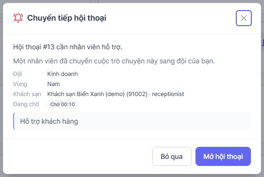

### 3.7 Bộ lọc vùng "Vùng của tôi"

Ở hàng bộ lọc phía trên danh sách (cạnh ô chọn kênh và ô chọn AI agent) có một ô chọn vùng. Nếu tài khoản của bạn có khu vực (**Miền Bắc** hoặc **Miền Nam**), ô này **mặc định là "Vùng của tôi (Nam)"** (hoặc Bắc): chỉ hiện hội thoại đã được xếp đúng vùng của bạn.

⚠️ **Lưu ý**: bộ lọc mặc định này **giấu** hội thoại của vùng kia, hội thoại **Chưa xác định vùng** và hội thoại **Tỉnh chưa ánh xạ**. Nếu bạn nghi hàng chờ "thiếu" hội thoại (hoặc khi vùng bạn không có ai trực), chọn **Tất cả vùng**. Nhân viên **Toàn quốc** không có mục "Vùng của tôi", mặc định xem tất cả.

Ô chọn còn có các mục kèm số đếm: **Tất cả vùng**, **Bắc**, **Nam**, **Chưa xác định vùng**, **Tỉnh chưa ánh xạ**.

Bộ lọc áp dụng theo **vùng của hội thoại**, kể cả hội thoại **bạn đang giữ**: nếu bạn ở Miền Nam nhưng đang giữ một hội thoại của khách sạn miền Bắc (ví dụ do nhận hộ), hội thoại đó cũng biến mất khỏi danh sách cho tới khi bạn chọn **Tất cả vùng**.

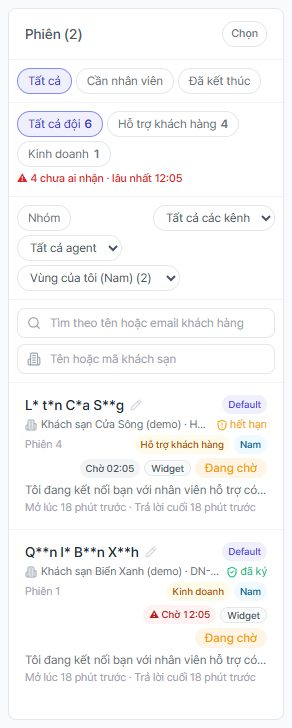

### 3.8 Bộ đếm hàng chờ và tuổi hội thoại

Phía trên danh sách là các **chip đội**: **Tất cả đội N**, rồi mỗi đội một chip kèm số (ví dụ **Hỗ trợ khách hàng 9**, **Kinh doanh 5**). Bấm chip để lọc theo đội, bấm lần nữa để bỏ lọc. Dưới chip là dòng:

**N chưa ai nhận · lâu nhất mm:ss**

đếm các hội thoại **Đang chờ** mà **không ai giữ**, kèm thời gian của hội thoại chờ lâu nhất. Khi quá 5 phút, dòng này chuyển **đỏ kèm ⚠**. Trên từng dòng hội thoại, huy hiệu **Chờ mm:ss** (xám) cũng chuyển đỏ sau 5 phút; rê chuột sẽ thấy *Chưa ai nhận cuộc trò chuyện này* hoặc *Đang chờ nhân viên từ <giờ>*. Số đếm làm mới khoảng 5 giây một lần. Các chip đội theo tab (**Tất cả**, **Cần nhân viên**, **Đã kết thúc**) và kênh đang chọn, và chỉ hiện cho đội có ít nhất một hội thoại; chúng **không** theo bộ lọc vùng, ô tìm khách hàng hay ô khách sạn. Dòng **chưa ai nhận** đếm mọi hội thoại **Đang chờ** chưa ai giữ của gian hàng, không theo tab hay kênh. Vì vậy khi bộ lọc **Vùng của tôi** đang bật, số trên chip có thể lớn hơn số dòng trong danh sách.

💡 **Mẹo**: ngưỡng 5 phút của huy hiệu đỏ là cố định trong console; còn ngưỡng nhắc lại bằng Slack/email là cài đặt máy chủ. Hai số này mặc định khớp nhau.

### 3.9 Giới hạn số hội thoại cùng lúc

Mỗi nhân viên **đã có hồ sơ trực** (tức đã từng bật **Đang trực**) giữ tối đa **3** hội thoại đang xử lý (giá trị mặc định của hồ sơ; chưa chỉnh được trên giao diện). Người chưa từng bật trực thì **Nhận** không bị giới hạn. Đủ 3 thì:

- không còn được chọn khi định tuyến;
- bấm **Nhận** bị máy chủ từ chối (mã 409).

Ở bản console hiện tại, thao tác **Nhận** **không** hiện thông báo lỗi khi bị từ chối. Cách xử lý: **Kết thúc** hoặc **Trả lại cho AI** bớt một hội thoại rồi nhận lại. Đây là điểm cần cải thiện, đã ghi ở phụ lục C.

---

## 4. Ngoài giờ làm việc

*(Dành cho: nhân viên CS và SA; thiết lập giờ ở §6.1)*

### 4.1 Giờ nào được tính là ngoài giờ

Master đặt **Giờ làm việc** ở thẻ **Chuyển cho nhân viên**: **Múi giờ** (ví dụ `Asia/Ho_Chi_Minh`), **Từ**, **Đến**, **Các ngày** (T2 đến CN), và tùy chọn **Giờ nghỉ (không có ai trực)**: *Câu hỏi trong giờ nghỉ được xử lý như ngoài giờ.* Mỗi đội có thể có **giờ làm việc riêng** (CS và SA khác nhau); đội không đặt thì theo giờ chung.

⚠️ **Lưu ý**: hệ thống chỉ biết **thứ trong tuần và giờ**, **không có lịch ngày lễ**. Vào ngày lễ (ví dụ Tết) trùng khung giờ làm việc thường lệ, hệ thống vẫn coi là "trong giờ" và báo nhân viên. Master cần chủ động đổi **Các ngày** hoặc giờ trước kỳ nghỉ.

### 4.2 Khách nhìn thấy gì

Khi xin gặp nhân viên ngoài giờ (và đã chọn đội nếu có hỏi đội), hội thoại **không** hứa có người trực:

- Nếu hệ thống **chưa có email** của khách, trợ lý nói: *Hiện tại đang ngoài giờ hỗ trợ. Bạn hãy để lại địa chỉ email muốn nhận câu trả lời, đội ngũ của chúng tôi sẽ phản hồi ngay khi làm việc trở lại.* Widget hiện khung **Chúng tôi nên gửi câu trả lời tới đâu?** (ô email, nút **Lưu**, chú thích *Chỉ dùng để trả lời câu hỏi này.*). Lưu xong, khách đọc: *Cảm ơn bạn — chúng tôi sẽ gửi câu trả lời tới địa chỉ đó.* Lưu email yêu cầu khách đã đồng ý thông báo quyền riêng tư.
- Nếu đã có email, khách đọc câu mặc định: *Hiện tại đang ngoài giờ hỗ trợ. Tôi đã chuyển tin nhắn của bạn cho đội ngũ của chúng tôi — họ sẽ trả lời qua email ngay khi làm việc trở lại.* (master thay được bằng **Thông báo ngoài giờ gửi cho khách hàng**).

### 4.3 Phía nhân viên: điều gì đã xảy ra trong đêm

- Hội thoại ở trạng thái **Đang chờ** và được đánh dấu nội bộ là "trả lời qua email" (console không hiển thị dấu này).
- Bản tóm tắt (lý do, đội, vùng, khách sạn, đoạn xem trước tối đa 300 ký tự) gửi tới **Email ngoài giờ** (hoặc hộp thư riêng của đội Bắc/Nam nếu master đã đặt, §6.4). Slack không bị gọi.
- Một thông báo vẫn được tạo trong console ngay lúc khách yêu cầu (ai đang mở console lúc đó thấy ngay; ở chế độ **Nghiêm ngặt** chỉ đội vùng và **Toàn quốc**). Khi một người bấm **Bỏ qua** thì thông báo đóng cho mọi người, nên **sáng hôm sau, người mở console đầu tiên có thể thấy hộp thoại báo** cho các yêu cầu đêm qua mà chưa ai xác nhận (đọc từ mã nguồn, chưa chạy thực tế; xem phụ lục E).
- Nếu master **chưa** đặt **Email ngoài giờ**, hệ thống không có nơi để chuyển nên **vẫn báo nhân viên** ngay cả ngoài giờ (cảnh báo trong cài đặt: *Nếu không có email, các yêu cầu ngoài giờ vẫn sẽ báo cho nhân viên.*).
- Hội thoại ngoài giờ **không** bị nhắc "chưa ai nhận" (§3.4).

### 4.4 Việc đầu tiên của ca sáng

1. Mở hộp thư **Email ngoài giờ** và console. Bật **Đang trực**.
2. Ở tab **Cần nhân viên**, đặt vùng về **Tất cả vùng**, lọc theo đội của bạn; hội thoại cũ nhất đứng ở **Chờ** lớn nhất.
3. Mở từng hội thoại, đọc cả lịch sử, bấm **Nhận**.
4. Trả lời ngay trong console. Với hội thoại này, **câu trả lời được gửi tới email khách** nếu khách đã có hồ sơ kèm email và máy chủ gửi được thư; tiêu đề theo ngôn ngữ của phiên (với khách dùng tiếng Việt: *[SharpTalk] Phản hồi cho câu hỏi của bạn*), và trong luồng xuất hiện ghi chú hệ thống *Phản hồi này đã được gửi tới email của khách hàng.* **Nếu không thấy ghi chú này, email chưa đi**: hãy kiểm tra với IT. Tệp đính kèm không đi theo email: email chỉ nhắc khách mở khung chat để xem tệp.
5. Xong thì **Kết thúc**. Nếu trong lúc đó khách nhắn lại ngay trong widget **trong giờ làm việc**, hội thoại trở về kênh widget.

💡 **Mẹo**: vì nhân viên không bị đánh thức, hãy đặt lịch kiểm tra hộp thư và hàng chờ vào đầu ca và sau giờ nghỉ trưa (giờ nghỉ cũng được coi là ngoài giờ).

---

## 5. Người dùng và nhãn (master)

*(Dành cho: master. Mặc định chỉ master thấy menu này; director không có trừ khi master cấp)*

Menu **Người dùng & nhãn** (trang **Người dùng**). Bảng có các cột **Email**, **Cấp bậc**, **Vai trò**, **Khu vực**, **Trực**, **Trạng thái**, **Ngày tạo**; có hai bộ lọc **Lọc theo vai trò** và **Lọc theo khu vực**.

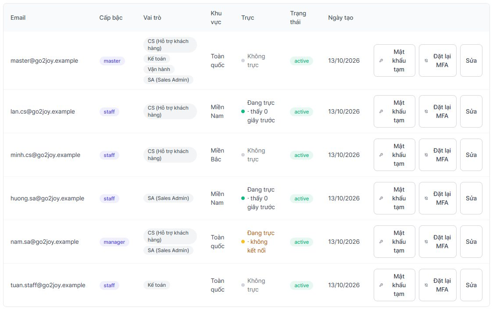

### 5.1 Mời người dùng

**Mời người dùng** → nhập **Email**, chọn **Cấp bậc**, tick **Vai trò**, chọn **Khu vực** → **Gửi lời mời**. Màn hình hiện **Mật khẩu tạm thời** (chỉ một lần); gửi cho người đó qua kênh an toàn, họ phải đổi mật khẩu ở lần đăng nhập đầu. Muốn cấp lại: nút **Mật khẩu tạm** trên dòng người dùng.

### 5.2 Vai trò: CS, SA và "Khác"

Mỗi vai trò là một **nhãn công việc**. Với Go2Joy:

| Vai trò | Mã | Dùng để |
|---|---|---|
| **CS** | `consult` | Nhận câu hỏi **Hỗ trợ khách hàng**; vào **Trò chuyện trực tiếp**, **Bảng yêu cầu**, **Hành trình** (**Lịch sử** chỉ từ cấp manager trở lên) |
| **SA** (Sales Admin) | `sales_admin` | Nhận câu hỏi **Hỗ trợ kinh doanh**; làm được mọi việc của CS trong chat, cộng thêm **Đơn hàng** (và **Khách hàng** từ cấp manager trở lên) |
| Kế toán, Vận hành | `accounting`, `operations` | Không liên quan tới hàng chờ chuyển người; nhãn **Vận hành** mở **Kho tri thức**, **Sản phẩm**, **Chiến dịch** cho cấp bậc được phép (riêng sửa tri thức cần quyền từ cấp director) |
| **Khác** | (không chọn gì) | *Không chọn vai trò = Khác (không nhận hội thoại chuyển người, không mở màn hình theo vai trò).* |

⚠️ **Lưu ý về tên nhãn**: tên hiển thị của nhãn là dữ liệu trong cơ sở dữ liệu, **mặc định bằng tiếng Hàn** (ví dụ 상담, 영업관리). Console **không có màn hình đổi tên nhãn**; việc này làm qua API `PATCH /api/v1/job-labels/<id>` bằng tài khoản master (tên 1 đến 64 ký tự). Amoeba sẽ đổi tên thành CS và SA trước khi go-live (mục checklist C).

### 5.3 Khu vực

**Khu vực** của người dùng: **Toàn quốc**, **Miền Bắc**, **Miền Nam**. Khu vực quyết định ai được báo trước cho khách sạn vùng nào (§3.2). **Toàn quốc** là người dự phòng của cả hai vùng. Thay khu vực có hiệu lực ngay cho các thông báo **chưa xử lý** đang gửi riêng cho người đó: hệ thống chọn lại người khác nếu họ không còn thuộc vùng.

### 5.4 Cột Trực

Cột **Trực** làm mới 15 giây một lần:

- **Đang trực · thấy N giây trước** (xanh): đang được tính.
- **Đang trực · không kết nối** (vàng): đã bật trực nhưng gần đây không thấy console (*Đã bật trực nhưng gần đây không thấy console, nên các yêu cầu chuyển người mới sẽ bỏ qua người này.*).
- **Không trực** (xám).

### 5.5 Cấp bậc và việc liên quan tới hàng chờ

| Cấp bậc | Làm được trong phạm vi sổ tay này |
|---|---|
| staff | **Trò chuyện trực tiếp** (cần nhãn CS hoặc SA): bật trực, nhận, trả lời, **Chuyển sang…**, kết thúc |
| manager | Như staff, thêm **Chỉ định** hội thoại cho người cụ thể, **Thống kê** (kể cả **Thí điểm**), **Cài đặt AI** |
| director | Như manager, thêm **Cài đặt gian hàng** (xem nhiều thẻ), **Kho tri thức** đầy đủ, xuất CSV thí điểm, tra cứu và xóa dữ liệu theo yêu cầu (§8.5). Không mở **Người dùng & nhãn** theo mặc định |
| master | Mọi thứ, **chỉ master** sửa được các thẻ chính sách đăng nhập, phạm vi thí điểm, tra cứu dữ liệu đối tác |

Cột **Cấp bậc** hiện bằng chữ tiếng Anh (`master`, `director`, `manager`, `staff`) vì giao diện chưa có bản dịch cho các giá trị này.

---

## 6. Cài đặt chuyển cho nhân viên

*(Dành cho: master, director. Menu **Cài đặt gian hàng** → tab **Cơ bản** → thẻ **Chuyển cho nhân viên**)*

Toàn bộ thẻ lưu bằng **một nút Lưu** ở cuối thẻ (riêng **Bảng khách sạn → tỉnh** tác dụng ngay, §6.5). Lưu thành công hiện thông báo bằng **tiếng Anh**: *AI configuration saved.* (chuỗi này chưa được dịch). Lưu sai cấu hình hiện lỗi cụ thể, ví dụ *Chưa lưu bảng vùng: …* hoặc *Chưa lưu cài đặt chuyển người: …*. Trong trang **Cài đặt AI**, cuối trang có dòng chỉ dẫn tới đây (*Giờ làm việc và định tuyến ngoài giờ nay nằm trong phần Cài đặt gian hàng.*).

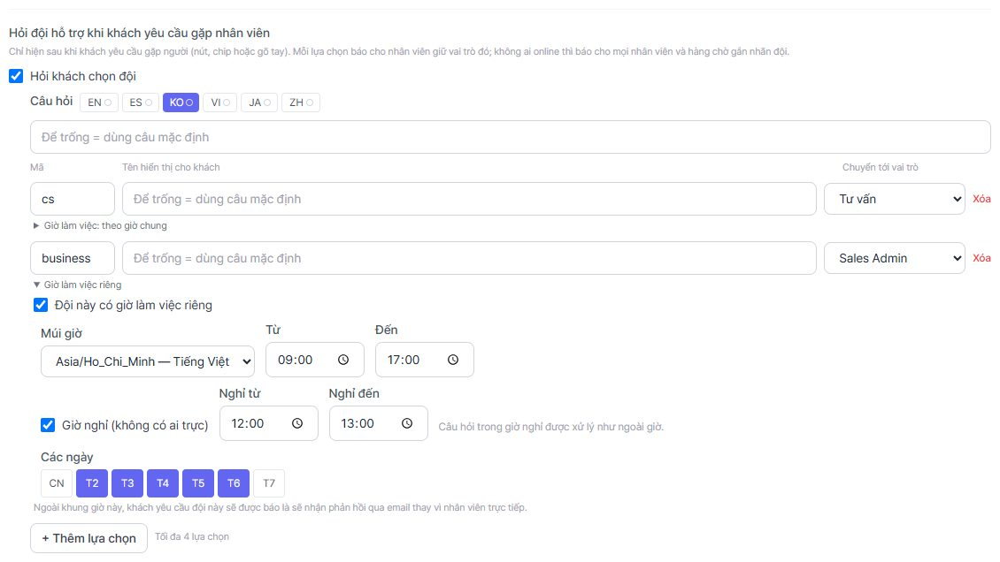

### 6.1 Nhân viên được phân công, báo lại, giờ làm việc

- **Nhân viên được phân công**: chip theo email của người có nhãn tư vấn. *Để trống để báo cho tất cả nhân viên — ai nhận trước sẽ phụ trách cuộc hội thoại.* Đây là bước thứ 3 của thang ở §3.2.
- **Báo lại khi chưa ai nhận cuộc trò chuyện**: **Tự động (bật khi đã chọn người nhận, định tuyến theo đội hoặc theo vùng)**, **Bật**, **Tắt**. Số phút do IT đặt (`ALERT_UNCLAIMED_MINUTES`, mặc định 5; đặt 0 là tắt toàn hệ thống).
- **Chỉ chuyển cho nhân viên trong giờ làm việc**: tick để bật **Múi giờ**, **Từ**, **Đến**, **Giờ nghỉ (không có ai trực)**, **Các ngày** (T2 đến T7, CN). Không tick = lúc nào cũng "trong giờ".
- **Mục tiêu SLA của bảng yêu cầu** (**Thông thường (giờ)**, **Khẩn (giờ)**, 1–168 giờ; mặc định 24 giờ và 4 giờ) chỉ liên quan **Bảng yêu cầu**, không liên quan hàng chờ chat.
- **Bắt buộc chuyển tiếp theo chính sách (danh sách chặn)**: mỗi dòng gồm các từ khóa (cách nhau bằng dấu phẩy), một **loại** yêu cầu, một **nhãn** nhận (**Tư vấn**, **Sales Admin**, **Kế toán**, **Vận hành**) và cách khách được báo: **Không trả lời** (chuyển cho nhân viên mà không phản hồi) hoặc **Trả lời rồi chuyển** (trả lời từ kho tri thức trước rồi vẫn chuyển). *Tin nhắn khớp bất kỳ từ khóa nào sẽ được chuyển thẳng cho nhân viên — không hỏi AI.* Loại và nhãn được gán cho yêu cầu được tạo, và quy tắc này vẫn ưu tiên hơn cổng khách (§7.1). Dùng cho chủ đề bạn muốn luôn có người xử lý, ví dụ đổi tài khoản ngân hàng.

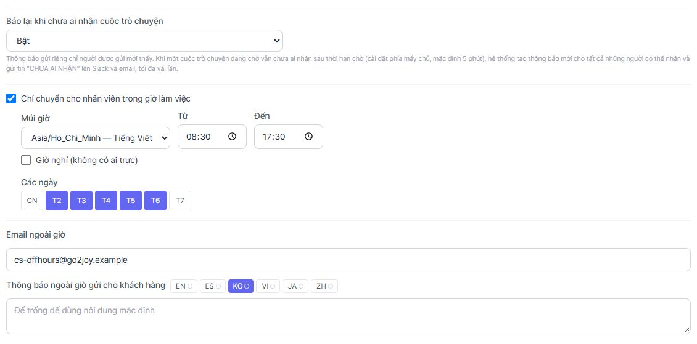

### 6.2 Email ngoài giờ và thông báo ngoài giờ

- **Email ngoài giờ**: hộp thư nhận bản tóm tắt ngoài giờ. Để một hộp thư **có người xem mỗi sáng** (hộp thư nhóm, không phải email cá nhân). Cần cấu hình SMTP phía máy chủ.
- **Thông báo ngoài giờ gửi cho khách hàng**: có **tab ngôn ngữ**; để trống dùng câu mặc định ở §4.2.

💡 **Mẹo**: ở các ô có tab ngôn ngữ trong thẻ này (thông báo ngoài giờ, **Câu hỏi** và **Tên hiển thị cho khách** của đội), tab đang chọn lúc mở trang là **KO** (tiếng Hàn), không phải **VI**. Hãy bấm tab **VI** trước khi gõ câu tiếng Việt, nếu không câu bạn gõ được lưu cho tiếng Hàn.

### 6.3 Hỏi đội hỗ trợ khi khách yêu cầu gặp nhân viên

Mục **Hỏi đội hỗ trợ khi khách yêu cầu gặp nhân viên** (*Chỉ hiện sau khi khách yêu cầu gặp người… Mỗi lựa chọn báo cho nhân viên giữ vai trò đó; không ai online thì báo cho mọi nhân viên và hàng chờ gắn nhãn đội.*):

1. Tick **Hỏi khách chọn đội**. Lần bật đầu tự điền cặp mặc định.
2. **Câu hỏi**: theo ngôn ngữ (tab); để trống = câu mặc định (*Để trống = dùng câu mặc định*).
3. Bảng lựa chọn: **Mã**, **Tên hiển thị cho khách**, **Chuyển tới vai trò** (**Tư vấn**, **Sales Admin**, **Kế toán**, **Vận hành**). Tối đa **4** lựa chọn (**+ Thêm lựa chọn**).
4. Mỗi lựa chọn có thể có **giờ làm việc riêng** (mục xổ **Giờ làm việc: theo giờ chung** hoặc **Giờ làm việc riêng**): *Ngoài khung giờ này, khách yêu cầu đội này sẽ được báo là sẽ nhận phản hồi qua email thay vì nhân viên trực tiếp.*

Cặp mặc định: mã `cs` → vai trò **Tư vấn** (CS), tên cho khách **Hỗ trợ khách hàng**; mã `business` → vai trò **Sales Admin**, tên **Hỗ trợ kinh doanh**. Tên các vai trò trong ô **Chuyển tới vai trò** là cố định (**Tư vấn** = nhãn CS, **Sales Admin** = nhãn SA), không đổi theo tên nhãn bạn đặt ở màn hình **Người dùng**.

💡 **Mẹo**: giữ nguyên **Mã** `cs` và `business`. Chip đội và hộp thoại báo của console chỉ có tên tiếng Việt cho hai mã này (**Hỗ trợ khách hàng**, **Kinh doanh**); mã khác sẽ hiện nguyên chữ mã.

### 6.4 Chuyển theo vùng của khách sạn

Mục **Chuyển theo vùng của khách sạn**. Tick **Chuyển hội thoại cho đội phụ trách vùng của khách sạn**. Cần Hotel Admin gửi **tỉnh của khách sạn kèm chữ ký** khi người dùng đăng nhập vào trợ lý (*Cần hệ thống của đối tác gửi tỉnh của khách sạn, có chữ ký…*), hoặc dùng bảng khách sạn → tỉnh ở §6.5.

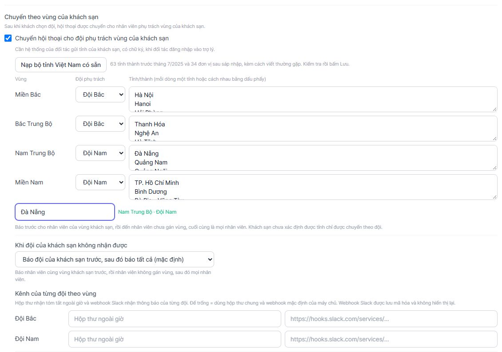

**Nạp bộ tỉnh Việt Nam có sẵn:**

1. Bấm **Nạp bộ tỉnh Việt Nam có sẵn**. Bộ gồm 63 tỉnh thành trước tháng 7/2025 và 34 đơn vị sau sáp nhập, kèm các cách viết thường gặp (ví dụ "Sài Gòn", "HCMC", "TT Huế").
2. Nếu bảng đã có tỉnh, console hỏi xác nhận vì thao tác **thay** toàn bộ tỉnh và đội phụ trách của cả bốn vùng.
3. Xuất hiện thông báo *Đã nạp bộ Việt Nam (N tên). Kiểm tra rồi bấm Lưu.* **Chưa lưu gì** cho đến khi bạn bấm **Lưu** ở cuối thẻ.

Bảng có 4 dòng:

| Vùng | Đội phụ trách mặc định | Gồm (theo bộ có sẵn) |
|---|---|---|
| **Miền Bắc** | **Đội Bắc** | Đồng bằng sông Hồng, Đông Bắc, Tây Bắc (Hà Nội, Hải Phòng, Quảng Ninh…) |
| **Bắc Trung Bộ** | **Đội Bắc** | Thanh Hóa, Nghệ An, Hà Tĩnh, Quảng Trị (kèm Quảng Bình), Huế |
| **Nam Trung Bộ** | **Đội Nam** | Đà Nẵng (kèm Quảng Nam), Quảng Ngãi, Gia Lai, Đắk Lắk, Khánh Hòa, Lâm Đồng… và Tây Nguyên |
| **Miền Nam** | **Đội Nam** | TP. Hồ Chí Minh, Đồng Nai, Tây Ninh, Cần Thơ, Vĩnh Long, Đồng Tháp, Cà Mau, An Giang |

- Chỉ có **hai đội** (Bắc, Nam); Tây Nguyên, Đông Nam Bộ và đồng bằng sông Cửu Long không phải vùng riêng mà là tỉnh nằm trong các vùng trên. Cột **Đội phụ trách** đổi được cho từng vùng.
- Mỗi dòng nhập tỉnh **mỗi dòng một tỉnh hoặc cách nhau bằng dấu phẩy**. So khớp **không phân biệt hoa thường và dấu**, bỏ tiền tố hành chính ("Tỉnh", "TP.").
- Một tỉnh có ở nhiều vùng: cảnh báo *Có trong nhiều vùng (vùng đứng trước được dùng): …*.
- **Thử một tỉnh**: gõ một tên tỉnh vào ô, ví dụ *Đà Nẵng*; kết quả xanh **<Vùng> · <Đội>** hoặc cam *Chưa có trong bảng, nên các khách sạn này chỉ được chuyển theo đội.* Hãy thử với cách viết thật mà Hotel Admin gửi, đặc biệt tên cũ và viết tắt.
- Thứ tự báo, theo chữ trên giao diện: nhân viên của vùng khách sạn, rồi nhân viên chưa gán vùng (**Toàn quốc**), cuối cùng là mọi nhân viên. Khách sạn chưa xác định được tỉnh chỉ được chuyển theo đội.

**Chế độ khi đội vùng không nhận được** (ô **Khi đội của khách sạn không nhận được**):

- **Báo đội của khách sạn trước, sau đó báo tất cả (mặc định)**;
- **Nghiêm ngặt — không tự ra khỏi vùng của khách sạn**: thêm ô **Mở rộng sang vùng còn lại sau (phút)**. Việc mở rộng chỉ chạy qua bộ nhắc "chưa ai nhận" (§3.4): nếu **Báo lại khi chưa ai nhận cuộc trò chuyện** đang **Tắt**, hoặc IT đặt `ALERT_UNCLAIMED_MINUTES=0`, hội thoại không bao giờ sang vùng còn lại.

**Kênh của từng đội theo vùng**: với mỗi đội (Bắc, Nam) có hai ô tùy chọn **Hộp thư ngoài giờ — <Đội>** và **Webhook Slack — <Đội>** (`https://hooks.slack.com/services/…`). Webhook được lưu mã hóa, **không hiển thị lại** (*Đã lưu một webhook. Dán URL mới để thay thế, hoặc xóa trống ô này để gỡ.*). Để trống = dùng hộp thư chung và webhook mặc định của máy chủ. Lưu webhook cần khoá mã hóa `CRED_ENC_KEY` phía máy chủ.

### 6.5 Bảng khách sạn → tỉnh (tệp CSV)

Dùng khi Hotel Admin ký khách sạn nhưng **không** gửi tỉnh. Thẻ nằm ngay dưới bảng vùng và chỉ hiện khi đã tick **Chuyển hội thoại cho đội phụ trách vùng của khách sạn**. Nếu bạn vừa tick mà chưa bấm **Lưu** (hoặc vùng đã lưu đang tắt), kết quả **Xem trước** báo *Đang tắt định tuyến theo vùng. Bảng vẫn được lưu nhưng chưa có tác dụng cho đến khi bật.*; hãy **Lưu** bảng vùng trước. Tệp tối đa 2 MB và 20.000 dòng.

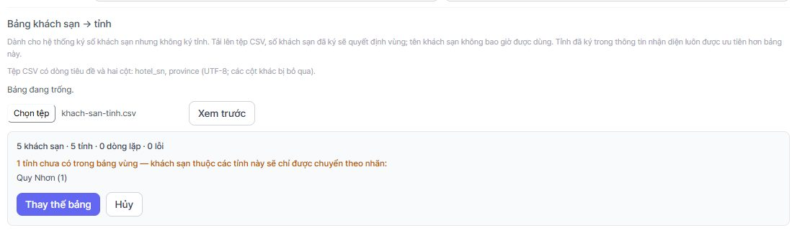

1. Chuẩn bị tệp **CSV, UTF-8, có dòng tiêu đề và hai cột `hotel_sn`, `province`** (các cột khác bị bỏ qua).
2. **Chọn tệp** (nút chọn tệp của trình duyệt) → **Xem trước**. Kết quả: *N khách sạn · N tỉnh · N dòng lặp · N lỗi*, kèm danh sách *N tỉnh chưa có trong bảng vùng — khách sạn thuộc các tỉnh này sẽ chỉ được chuyển theo nhãn*.
3. Lỗi trong tệp (`hotel_sn` trống hoặc dài quá 64 ký tự, `province` trống hoặc dài quá 80 ký tự, ký tự điều khiển, cùng `hotel_sn` xuất hiện với tỉnh khác) **chặn** việc thay bảng: *Hãy sửa các dòng này trong tệp rồi xem trước lại; tệp còn lỗi không thể thay thế bảng.*
4. **Thay thế bảng**: *Thay N khách sạn hiện có trong bảng bằng N khách sạn trong tệp này.* Hành động có hiệu lực ngay, không cần bấm **Lưu**. **Xóa bảng** để xóa toàn bộ.
5. Quy tắc dùng: tỉnh đã ký trong thông tin nhận diện **luôn thắng** bảng này; bảng chỉ tra bằng **số khách sạn đã ký**, tên khách sạn không bao giờ được dùng.

---

## 7. Khách chưa đăng nhập, quyền xem tri thức, phiên bản giao diện

*(Dành cho: master, director; một số mục từ cấp manager. Menu **Cài đặt AI** và **Kho tri thức**)*

### 7.1 Khách chưa đăng nhập: "Chỉ hướng dẫn đăng nhập"

Mỗi **Nhân viên AI** (AI agent; đừng nhầm với nhân viên là người) có ô **Khách chưa đăng nhập** (Cài đặt AI → thẻ **Nhân viên AI** → sửa agent):

- **Trả lời như bình thường**;
- **Chỉ hướng dẫn đăng nhập hoặc đăng ký**.

Với lựa chọn thứ hai, một người **chưa đăng nhập hoặc có chữ ký đã hết hạn** chỉ được trả lời từ các danh mục **Công khai** (§7.2) khi trợ lý đủ căn cứ. Câu hỏi khác nhận lời nhắc đăng nhập mà **không gọi mô hình AI**. Khách vẫn chào hỏi được và vẫn xin gặp nhân viên được. Quy tắc **Bắt buộc chuyển tiếp theo chính sách (danh sách chặn)** (§6.1) vẫn ưu tiên. Có hiệu lực từ tin nhắn kế tiếp, không cần triển khai lại.

Nội dung khách đọc nằm ở thẻ **Hướng dẫn khách (chưa đăng nhập)** (Cài đặt AI): **URL đăng nhập**, **URL đăng ký** (phải bắt đầu bằng `https://`), **Lời nhắc đăng nhập** (câu mặc định: *Nội dung này dành cho đối tác đã đăng nhập. Vui lòng đăng nhập tài khoản đối tác để tôi hướng dẫn chi tiết.*), **Lời nhắc chỉ dành cho Quản lý** (§7.2) và **Mẫu link "Mở trong hệ thống của bạn"** (phải bắt đầu bằng `https://` và chứa `{hotelSn}`; để trống thì ẩn nút **Mở trong hệ thống** ở §2.2). Trong widget khách thấy **Đăng nhập**, **Đăng ký trở thành đối tác**, **Tiếp tục với tư cách khách**.

⚠️ **Lưu ý**: ngưỡng quyết định "đủ căn cứ" của cổng này **chưa được hiệu chỉnh với embedding thật**. Chưa bật **Chỉ hướng dẫn đăng nhập hoặc đăng ký** cho khách hàng thật cho tới khi Amoeba chạy hiệu chỉnh trên staging.

### 7.2 Quyền xem của danh mục: Công khai, Đối tác đã đăng nhập, Chỉ Quản lý

Menu **Kho tri thức** → thẻ **Danh mục** (danh mục chia theo tab nhóm **Thông tin tư vấn**, **Thông tin sản phẩm**, `OperationInfo`; chọn đúng tab chứa danh mục cần chỉnh). Mỗi danh mục có một ô chọn quyền xem (rê chuột để đọc chú thích **Ai được xem**; chữ hiển thị là mức đang chọn) với ba mức:

| Mức | Ai đọc được |
|---|---|
| **Công khai** | Cả người chưa đăng nhập (khi agent đặt hướng dẫn đăng nhập, đây là phần duy nhất họ được trả lời) |
| **Đối tác đã đăng nhập** | Mọi đối tác đã đăng nhập, kể cả **Lễ tân**. **Mặc định của mọi danh mục mới** |
| **Chỉ Quản lý** | Chỉ tài khoản **Quản lý** hoặc nội bộ của khách sạn |

⚠️ **Lưu ý**: sự khác nhau giữa **Công khai** và **Đối tác đã đăng nhập** chỉ có tác dụng khi agent được đặt **Chỉ hướng dẫn đăng nhập hoặc đăng ký** (§7.1). Với lựa chọn mặc định **Trả lời như bình thường**, người chưa đăng nhập vẫn được trả lời từ cả hai mức; **chỉ mức Chỉ Quản lý luôn bị giữ lại** với mọi người dưới cấp Quản lý. Danh mục bị khóa (biểu tượng ổ khóa, sinh từ danh mục sản phẩm) và danh mục chưa đăng ký không có ô **Ai được xem**.

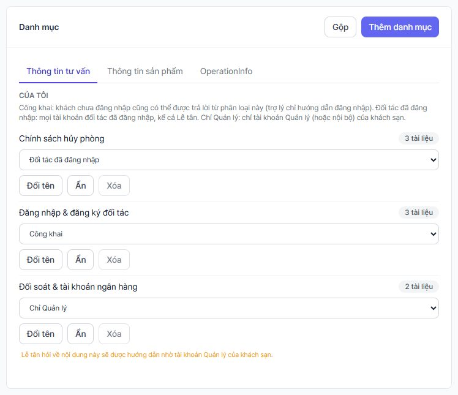

Ai thuộc mức nào: người chưa đăng nhập, hoặc có chữ ký đã **hết hạn**, được tính là **Công khai**; **quản lý** hoặc **nhân viên nội bộ** đã **ký** là mức Quản lý; mọi người đã đăng nhập khác (lễ tân, đăng nhập không kèm khách sạn và vai trò, thông tin **tự khai** không có chữ ký) là mức đối tác. Thông tin tự khai không bao giờ nâng người dùng lên mức Quản lý.

Điều cần biết khi đổi mức:

- **Mở rộng** quyền xem hỏi xác nhận: *Cho phép đọc N tài liệu mà không cần đăng nhập?* hoặc *Cho phép mọi đối tác đã đăng nhập, kể cả Lễ tân, đọc N tài liệu hiện chỉ dành cho Quản lý?*
- Chọn **Chỉ Quản lý** hiện dòng cảnh báo *Lễ tân hỏi về nội dung này sẽ được hướng dẫn nhờ tài khoản Quản lý của khách sạn.* và thông báo *Phân loại chỉ còn dành cho Quản lý. Các câu trả lời đã lưu đã được xóa.* (mọi câu trả lời đã lưu của gian hàng bị xóa để không phát lại cho lễ tân).
- Gộp một danh mục **Chỉ Quản lý** vào danh mục ít hạn chế hơn bị từ chối (*Hãy đặt phân loại đích thành "Chỉ Quản lý" trước.*).
- Nhập hàng loạt bằng CSV **không** ghi mức: danh mục mới từ tệp nhập luôn là **Đối tác đã đăng nhập** cho tới khi bạn chỉnh trong console. Chuyển một tài liệu sang danh mục **Chỉ Quản lý** không xóa các câu trả lời đã lưu trước đó; chúng hết hạn sau khoảng 30 ngày, nên hãy đặt mức trước khi nạp nội dung.
- Mọi thay đổi mức đều được ghi vào nhật ký kiểm toán (`kb.category_access_changed`).

**Lễ tân hỏi một chủ đề của Quản lý (ví dụ đổi tài khoản ngân hàng đối soát)** sẽ thấy:

*Nội dung này chỉ được cung cấp cho tài khoản Quản lý của khách sạn. Bạn vui lòng nhờ Quản lý khách sạn tra cứu giúp, hoặc cho tôi biết nếu bạn muốn được kết nối với nhân viên hỗ trợ.*

kèm chip **Gặp nhân viên hỗ trợ**. Master thay lời nhắc ở **Lời nhắc chỉ dành cho Quản lý** (§7.1). Điều này **không** tạo thông báo cho CS: chỉ khi khách bấm chip mới có yêu cầu chuyển người. Câu trả lời này chỉ xuất hiện khi trợ lý **không** tìm được nội dung phù hợp ở mức lễ tân **và** nội dung Quản lý lại khớp; nó cho lễ tân biết rằng có chủ đề như vậy tồn tại (chủ ý của thiết kế). Trong **Thống kê › Thí điểm** lý do này hiện là **Chỉ dành cho Quản lý**.

Ai đổi mức: master hoặc director.

### 7.3 Phiên bản giao diện: gán phiên bản, phiên bản tham chiếu, lưu ý

Mục đích: tài liệu hướng dẫn mô tả giao diện Hotel Admin ở một **phiên bản** nào đó; nếu người dùng đang dùng phiên bản khác, trợ lý nên báo trước.

**1. Gán phiên bản cho tài liệu**: Kho tri thức → mở tài liệu → ô **Phiên bản giao diện** (ví dụ `v23.3.0` hoặc `0.12.0`; 1–16 ký tự: chữ, số và `. _ + -`). Danh sách tài liệu có cột phiên bản, huy hiệu (**Chưa gán**, hoặc phiên bản; xanh khi khớp, vàng khi khác) và bộ lọc **Phiên bản: tất cả / Phiên bản khác / Chưa gán phiên bản** (bộ lọc "khác" cần đã đặt phiên bản tham chiếu). Nhập CSV: cột `ui_version`; **tệp không có cột này thì không đụng tới phiên bản**, còn **ô trống trong cột này sẽ xóa** phiên bản.

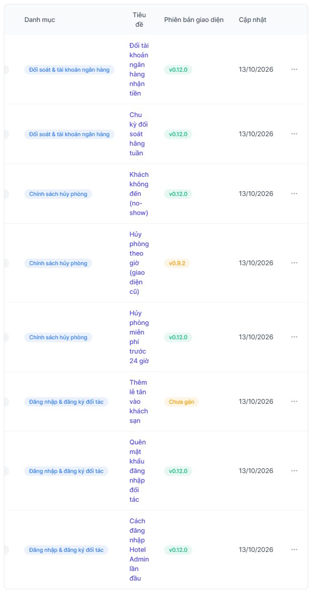

**2. Đặt phiên bản tham chiếu**: Cài đặt AI → thẻ **Phiên bản giao diện tham chiếu**:

- **Phiên bản hiện hành**: phiên bản người dùng đang dùng.
- **Khi tài liệu được gán phiên bản khác**: **Thêm lưu ý vào câu trả lời** / **Ẩn tài liệu** / **Tắt**.
- **Nội dung lưu ý** (chỉ hiện khi chọn **Thêm lưu ý vào câu trả lời**; có tab ngôn ngữ): để trống thì dùng câu mặc định tiếng Việt *Lưu ý: hướng dẫn này được viết cho một phiên bản giao diện khác, nên một số màn hình hoặc nút bấm có thể khác với những gì bạn đang thấy.* (màu xám, một câu).

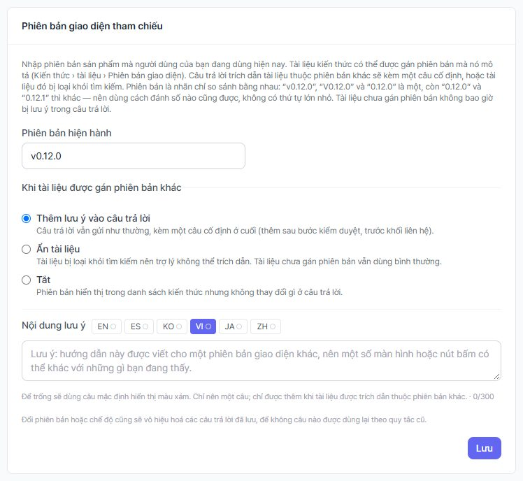

**3. Hành vi**:

- Mức **lưu ý**: câu trả lời gửi như thường, thêm **một câu cố định** ở cuối, **sau bước kiểm duyệt**, trước khối liên hệ cuối câu (§7.5). Chỉ thêm khi tài liệu được trích dẫn có phiên bản **khác** phiên bản tham chiếu.
- Mức **Ẩn tài liệu**: tài liệu khác phiên bản bị loại khỏi tìm kiếm (tài liệu chưa gán phiên bản vẫn dùng bình thường).
- **Tài liệu chưa gán phiên bản không bao giờ gây lưu ý** (console chỉ đánh dấu **Chưa gán**, và chỉ khi đã đặt phiên bản tham chiếu); vì vậy hãy gán phiên bản cho mọi tài liệu về giao diện.
- So sánh chỉ là **bằng nhau** sau khi chuẩn hóa (bỏ hoa/thường và một chữ `v` đứng đầu): `v0.12.0` = `V0.12.0` = `0.12.0`, còn `0.12.0` khác `0.12.1`. **Không có thứ tự lớn nhỏ**.
- Đổi phiên bản tham chiếu hoặc chế độ sẽ **vô hiệu hóa các câu trả lời đã lưu**.

⚠️ **Lưu ý (chưa chốt)**: bảng chính sách của Go2Joy ghi giao diện Hotel Admin **v23.3.0/v23.4.0**, còn yêu cầu nghiệp vụ nhắc **v0.4.1 – v0.12.0**. Hệ thống không chọn trục nào; Go2Joy cần quyết định và gán đúng. Trong bảng tính, hãy ghi kèm chữ `v` (ví dụ `v0.10`) để Excel không đổi `0.10` thành `0.1`.

Ai làm: gán phiên bản cho tài liệu cần quyền Kho tri thức; đặt tham chiếu cần quyền Cài đặt AI (manager trở lên).

### 7.4 Kiểm tra câu trả lời: thẻ "Hỏi kho tri thức"

Trên **Kho tri thức** có thẻ **Hỏi kho tri thức**: gõ câu hỏi, xem câu trả lời, **Nguồn đã dùng**, **độ tin cậy**, **độ khớp**, cảnh báo **Có mâu thuẫn**, **Bị kiểm duyệt chặn**, huy hiệu phiên bản và câu lưu ý phiên bản. Thẻ này **hỏi như người quản trị**, thấy cả nội dung **Chỉ Quản lý** (ô chọn AI agent **Tất cả (chế độ quản trị)** chỉ hiện khi gian hàng có nhiều hơn một agent; thẻ luôn hỏi ở chế độ quản trị), nên **không** cho biết lễ tân hay khách sẽ thấy gì.

Chức năng **thử với tư cách** Khách / Lễ tân / Quản lý **chưa có ở bản này**; nó sẽ đến cùng bộ mô phỏng cổng khách. Cho đến lúc đó, kiểm bằng chat thật: đăng nhập thử vào Hotel Admin với một tài khoản lễ tân, một tài khoản quản lý và một phiên chưa đăng nhập, rồi hỏi cùng một câu.

### 7.5 Chân trang liên hệ của câu trả lời

Thẻ **Chân trang liên hệ cho câu trả lời** (Cài đặt AI): tick **Bật**, nhập nội dung theo ngôn ngữ (ví dụ email hỗ trợ, hotline, giờ làm việc). Hệ thống **gắn cùng một khối liên hệ vào cuối mọi câu trả lời tri thức** của AI, để AI không tự viết thông tin liên hệ nữa (số điện thoại không bị đổi hay che). Mục **Liên hệ chính thức (không che)**: email và số điện thoại trong chân trang tự được thêm; mỗi giá trị một dòng. Thứ tự cuối câu: câu trả lời → câu lưu ý phiên bản (nếu có) → chân trang.

---

## 8. Đăng nhập có chữ ký, phạm vi thí điểm, dữ liệu đối tác, quyền riêng tư

*(Dành cho: master và director; quyền chi tiết ghi ở từng mục. Menu **Cài đặt gian hàng**)*

### 8.1 Chính sách đăng nhập có chữ ký (SSO)

Tab **Widget** → thẻ **Chính sách đăng nhập có chữ ký (SSO)**:

- **Tin cậy đăng nhập đã ký trong**: **Mặc định của nền tảng (8 giờ)** hoặc **Tùy chỉnh** (1 đến 720 giờ). Sau thời gian này, người đó được xem là khách vãng lai cho đến khi Hotel Admin ký lại; widget phát sự kiện `identity-expired` để `ShopTalk.identify()` chạy ngầm. Dòng **Đang áp dụng: N giờ** cho biết giá trị hiệu lực.
- **Từ chối đăng nhập không có khách sạn và vai trò (v1)**: *Chữ ký v1 không bao giờ hết hạn và không cho biết người dùng thao tác cho khách sạn nào, với vai trò gì. Hãy bật khi ứng dụng của bạn đã ký kèm claims (v2).* Chỉ bật sau khi Hotel Admin đã chuyển sang ký v2.
- Chỉ **master** đổi được (*Chỉ tài khoản chủ (master) mới đổi được mục này.*); director xem.

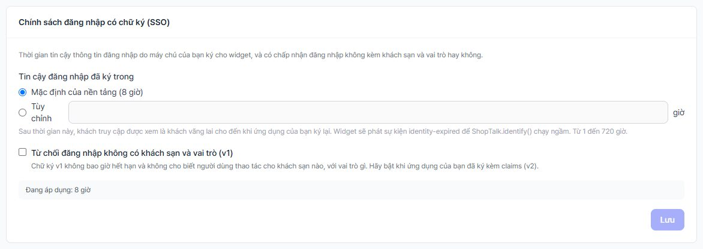

Máy chủ lưu đệm chính sách khoảng 15 giây (và danh sách thí điểm khoảng 60 giây), nên thay đổi có thể mất tối đa khoảng 1 phút mới có hiệu lực ở mọi lượt chat.

### 8.2 Phạm vi thí điểm theo khách sạn

Tab **Widget** → thẻ **Phạm vi pilot theo khách sạn** (cạnh thẻ **Giới hạn hiển thị (chế độ thử nghiệm)** theo IP/URL, là cơ chế khác). Huy hiệu ở góc thẻ: **Đang bật — N khách sạn** hoặc **Đang tắt — phục vụ mọi khách sạn**.

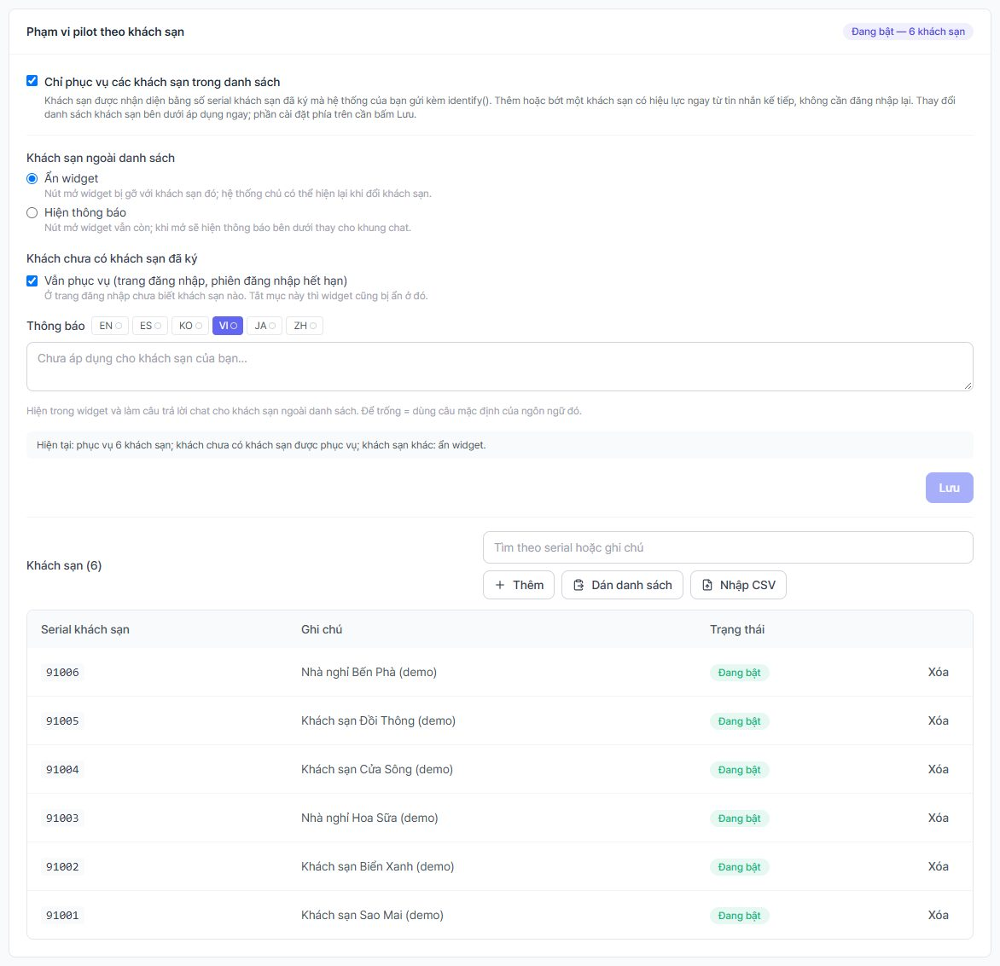

Cài đặt (cần bấm **Lưu**; thay đổi danh sách khách sạn thì **có tác dụng ngay**):

- Tick **Chỉ phục vụ các khách sạn trong danh sách**.
- **Khách sạn ngoài danh sách**: **Ẩn widget** (nút mở widget bị gỡ với khách sạn đó) hoặc **Hiện thông báo** (nút còn, mở ra thấy thông báo thay cho khung chat).
- **Khách chưa có khách sạn đã ký**: tick **Vẫn phục vụ (trang đăng nhập, phiên đăng nhập hết hạn)**; bỏ tick thì widget cũng ẩn ở trang đăng nhập.
- **Thông báo** (theo ngôn ngữ): để trống thì dùng câu mặc định *Chưa áp dụng cho khách sạn của bạn. Nếu cần hỗ trợ, vui lòng liên hệ quản lý tài khoản của bạn.*
- **Khách sạn (N)**: nút **Thêm**, **Dán danh sách**, **Nhập CSV** (mỗi dòng một số serial kèm ghi chú; **Xem trước** rồi **Thêm N khách sạn**), và ở từng dòng: bấm huy hiệu trạng thái (**Đang bật** / **Tạm dừng**) để tạm dừng hoặc bật lại khách sạn đó (chú thích *Tạm dừng khách sạn này* / *Bật lại khách sạn này*); nút **Xóa** có hộp xác nhận. Mỗi thay đổi có thông báo và ghi nhật ký. Director mở được thẻ nhưng mọi nút lưu sẽ bị từ chối (chỉ master sửa được).

Cách hoạt động: máy chủ so **số khách sạn đã ký** với danh sách ở **mỗi lượt chat**, nên thêm một khách sạn có hiệu lực ngay ở tin kế tiếp, không cần đăng nhập lại. Khách sạn ngoài danh sách cũng **không** gọi được **Gặp nhân viên hỗ trợ**. Phiên **tự khai**, **hết hạn** hoặc không có khách sạn được coi là khách (theo công tắc **Khách chưa có khách sạn đã ký**).

⚠️ **Lưu ý**: bật mà **danh sách trống** nghĩa là **mọi khách sạn đã đăng nhập đều bị từ chối** (thẻ có cảnh báo màu vàng). Việc "nhận diện" khách sạn ngoài danh sách vẫn lưu một hồ sơ khách hàng; đây là điểm quyền riêng tư cần DPO biết (RPT-261013-w2b §6.d).

### 8.3 Tra cứu dữ liệu đối tác

Tab **Cài đặt khác** → thẻ **Tra cứu dữ liệu đối tác** (master).

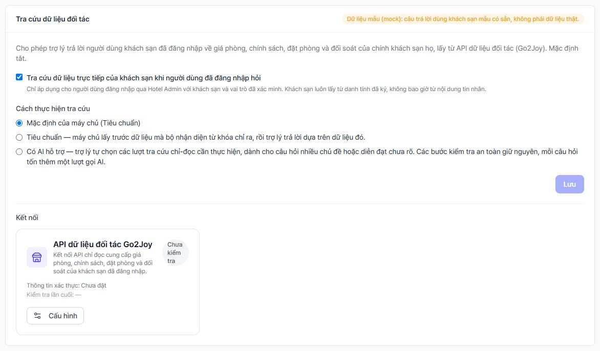

- **Là gì**: trợ lý trả lời người dùng khách sạn đã đăng nhập về **giá phòng, chính sách, đặt phòng và đối soát của chính khách sạn họ**, lấy từ API dữ liệu đối tác. **Chỉ đọc** (hệ thống chỉ gửi yêu cầu lấy dữ liệu, không ghi gì vào hệ thống của Go2Joy).
- **Khách sạn luôn lấy từ danh tính đã ký**, không bao giờ từ nội dung tin nhắn: hỏi về khách sạn khác sẽ bị từ chối (*Tôi chỉ tra cứu được dữ liệu của khách sạn bạn đang đăng nhập…*).
- **Theo vai trò**: lễ tân hỏi đối soát nhận *Thông tin này chỉ dành cho tài khoản Quản lý. Vui lòng nhờ quản lý của khách sạn tra cứu, hoặc yêu cầu gặp nhân viên để được hỗ trợ.*
- **Công tắc**: **Tra cứu dữ liệu trực tiếp của khách sạn khi người dùng đã đăng nhập hỏi** (mặc định tắt); thêm công tắc toàn máy chủ `PARTNER_DATA_ENABLED`. Nếu máy chủ chưa bật, thẻ báo *Đang tắt trên toàn máy chủ (PARTNER_DATA_ENABLED)…*
- **Huy hiệu ở góc thẻ**: **Dữ liệu mẫu (mock): câu trả lời dùng khách sạn mẫu có sẵn, không phải dữ liệu thật.** hoặc **Dữ liệu thật: câu trả lời dùng API đối tác thực tế.**
- **Kết nối**: ở mục **Kết nối** có ô **API dữ liệu đối tác Go2Joy** (trạng thái **Chưa kiểm tra** khi chưa cấu hình). Bấm **Cấu hình** để nhập **URL gốc**, **Khóa API**, **Khóa ký yêu cầu (tùy chọn)** và dùng nút **Kiểm tra kết nối**. Thông tin lưu mã hóa.
- **Cách thực hiện tra cứu**: ba lựa chọn **Mặc định của máy chủ (…)**, **Tiêu chuẩn** (máy chủ lấy trước dữ liệu mà bộ nhận diện từ khóa chỉ ra, rồi AI trả lời dựa trên đó) hoặc **Có AI hỗ trợ** (AI tự chọn các lượt tra cứu chỉ-đọc cần thiết, cho câu hỏi nhiều chủ đề; tốn thêm một lượt gọi AI mỗi câu). Nếu AI engine không hỗ trợ, hệ thống tự dùng cách tiêu chuẩn và thẻ nói rõ.
- Số tiền trong câu trả lời **do máy chủ tính và kiểm lại**; nếu AI viết ra một số không có trong dữ liệu, câu trả lời bị hạ xuống "sẽ xác nhận lại" và chuyển cho nhân viên.

⚠️ **Lưu ý**: ở chế độ **mock**, câu trả lời dùng **khách sạn mẫu, không phải dữ liệu thật**. **Không bật** cho đối tác thật cho tới khi Amoeba xác nhận chế độ dữ liệu thật đã chạy và đã kiểm chứng với API Go2Joy.

**Khi API đối tác bị gián đoạn, khách và nhân viên thấy gì**:

- Khách đọc: *Hiện tôi chưa tra cứu được dữ liệu khách sạn từ hệ thống nên sẽ không đoán số liệu. Chúng tôi sẽ xác nhận lại và nhân viên sẽ hỗ trợ bạn ngay tại đây.*
- Hội thoại được chuyển cho nhân viên theo thang ở §3.2. Hộp thoại báo hiện lý do chung **AI không tìm được câu trả lời trong kho tri thức.** (chưa có dòng riêng cho lỗi dữ liệu đối tác); nguyên nhân thật nằm ở tin hệ thống cuối cùng trong hội thoại (trong giờ làm việc; ngoài giờ tin cuối là thông báo ngoài giờ, hãy đọc tin hệ thống ngay trước đó). Trong **Thống kê › Thí điểm** lý do này hiện là **Không tra cứu được dữ liệu đối tác**.
- Nhân viên **không đoán số liệu**; kiểm tra trực tiếp trong hệ thống của Go2Joy rồi trả lời.
- Các lỗi khách tự sửa được (sai vai trò, đăng nhập hết hạn, hỏi khách sạn khác) chỉ hiện thông báo cho khách, **không** gọi nhân viên.

### 8.4 Thông báo quyền riêng tư (vn_pdpl)

Tab **Thông báo quyền riêng tư** (master, director). Chọn **Văn bản theo ngành**: **Việt Nam (luật dữ liệu cá nhân)** (mã `vn_pdpl`). Có các dòng chỉnh theo ngôn ngữ: **Tiêu đề**, **Nội dung**, **Chúng tôi thu thập**, **Mục đích**, **Thời gian lưu**, **Xử lý bằng AI**, **Bên kiểm soát dữ liệu & liên hệ**, **Chuyển dữ liệu ra nước ngoài**, **Quyền của chủ thể dữ liệu**.

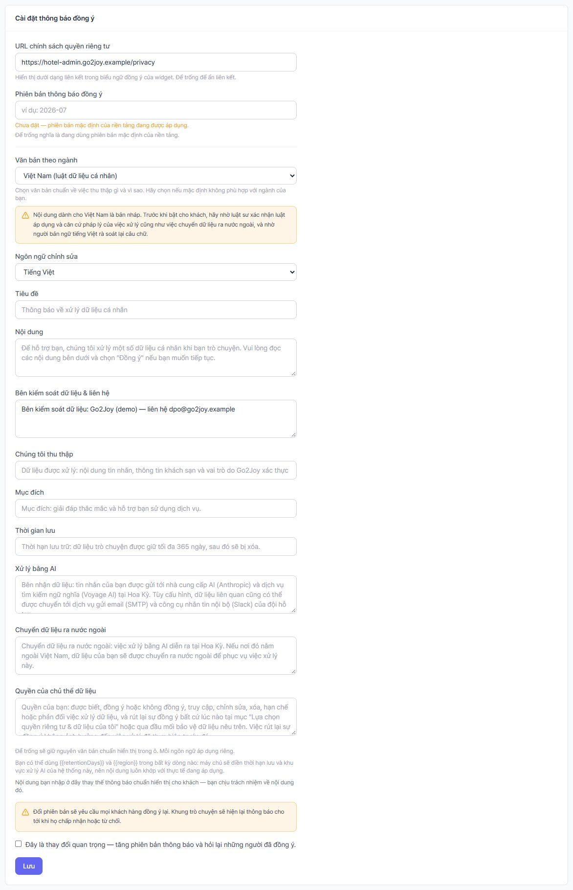

- Ô **Ngôn ngữ chỉnh sửa** mở ra ở **한국어** (tiếng Hàn). **Chọn Tiếng Việt trước** khi đọc hoặc sửa các dòng: mỗi ngôn ngữ được lưu riêng, nên câu bạn gõ khi đang ở KO chỉ áp dụng cho khách dùng tiếng Hàn. Với `vn_pdpl`, văn bản chuẩn có sẵn bằng tiếng Việt và tiếng Anh (các ngôn ngữ khác hiện dòng tiếng Anh); hãy điền dòng **Bên kiểm soát dữ liệu & liên hệ** cho **từng** ngôn ngữ mà khách sẽ đọc.
- Dùng `{{retentionDays}}` và `{{region}}` trong dòng bất kỳ: máy chủ điền **thời hạn lưu** và **khu vực xử lý AI** thật của hệ thống.
- **Bản nháp**: *Nội dung dành cho Việt Nam là bản nháp. Trước khi bật cho khách, hãy nhờ luật sư xác nhận luật áp dụng và căn cứ pháp lý…* và **người bản ngữ tiếng Việt** rà soát câu chữ.
- Nếu dòng **Bên kiểm soát dữ liệu & liên hệ** còn chỗ trống dạng `[[…]]`, thẻ cảnh báo *Thông báo khách sẽ đọc vẫn còn chỗ trống dạng [[…]]…*. Điền pháp nhân, địa chỉ và đầu mối bảo vệ dữ liệu trước khi dùng. Cảnh báo **liệt kê từng ngôn ngữ còn `[[…]]`** (ví dụ ES, KO, JA, ZH): nó chỉ biến mất khi dòng này được điền cho **mọi** ngôn ngữ được liệt kê, kể cả khi khách của bạn chỉ dùng tiếng Việt.
- **Phiên bản thông báo đồng ý**: đổi phiên bản (ô **Phiên bản thông báo đồng ý**, hoặc tick *Đây là thay đổi quan trọng — tăng phiên bản thông báo và hỏi lại những người đã đồng ý.*; chỉ sửa chữ thì phiên bản không đổi) **buộc mọi khách đồng ý lại** (*Đổi phiên bản sẽ yêu cầu mọi khách hàng đồng ý lại…*). Sau khi chốt câu chữ pháp lý, hãy đổi phiên bản một lần để mọi người xác nhận bản mới.
- Việc đồng ý, từ chối, rút lại được ghi bằng chứng vào nhật ký kiểm toán (không ghi IP, không ghi thông tin cá nhân).
- Cho tới khi chọn `vn_pdpl`, banner đồng ý trong widget dùng văn bản chuẩn của sản phẩm với nội dung kiểu Hoa Kỳ (CCPA, 365 ngày, Google Analytics): **không phù hợp cho Go2Joy**.
- Thời hạn lưu hội thoại do IT đặt (`CONVERSATION_LOG_RETENTION_DAYS`; để trống hoặc 0 là **365 ngày**, không phải "mãi mãi"; hồ sơ nháp của Go2Joy ghi 180 ngày). Hai bộ dọn tùy chọn cho hồ sơ khách hàng và nhật ký kiểm toán mặc định **tắt**.

### 8.5 Yêu cầu dữ liệu (DSAR phía vận hành)

Tab **Yêu cầu dữ liệu** (master, director): tra cứu, **xuất** hoặc **xóa** dữ liệu cá nhân của một khách khi họ yêu cầu qua email hoặc điện thoại. Mọi bước được ghi nhật ký kiểm toán (`dsar.lookup`, `dsar.export`, `dsar.delete`; từ khóa tìm **không** được lưu).

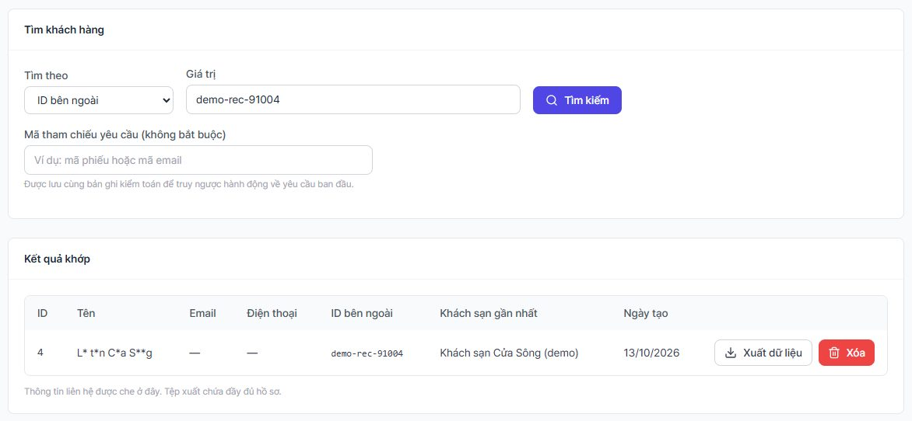

Quy trình:

1. **Xác minh danh tính người yêu cầu trước, theo quy trình của Go2Joy.** Màn hình không thể biết người yêu cầu có đúng là chủ dữ liệu hay không (*Hãy xác minh danh tính người yêu cầu trước…*).
2. Chọn **Tìm theo**: **Địa chỉ email**, **Số điện thoại** hoặc **ID bên ngoài**; nhập ít nhất 3 ký tự; có thể nhập **Mã tham chiếu yêu cầu** (mã phiếu hoặc email) để truy ngược về yêu cầu gốc. Bấm **Tìm kiếm**.
3. Kết quả (**Kết quả khớp**) hiện thông tin liên hệ **bị che**. Tìm theo **email** và **ID bên ngoài** là khớp chính xác; tìm theo **số điện thoại** (ít nhất 6 chữ số) phải quét từng hồ sơ nên chỉ quét tối đa 20.000 khách có số điện thoại, **từ khách cũ nhất**, và khách mới hơn có thể không được quét. Nếu thông báo *Có nhiều khách hàng khớp hơn số đang hiển thị, hoặc tìm theo số điện thoại đã dừng sớm* thì hãy thu hẹp điều kiện.
4. **Xuất dữ liệu**: tải về tệp đầy đủ hồ sơ của khách (có chứa thông tin không che; xử lý tệp như dữ liệu nhạy cảm).
5. **Xóa**: hộp thoại **Xóa dữ liệu của khách hàng này?**: khách và các tin nhắn trò chuyện của họ bị **ẩn danh vĩnh viễn, không hoàn tác**: tên, email, số điện thoại, ID bên ngoài bị gỡ; tin nhắn và tệp đính kèm bị che hoặc xóa; danh tính được ghi nhớ để lần đồng bộ sau không tạo lại hồ sơ. Phải **nhập đúng ID khách hàng** rồi bấm **Xóa dữ liệu**.
6. **Ghi chú về khoá pháp lý (legal hold)**: hộp thoại nhắc *Hãy kiểm tra xem có yêu cầu lưu giữ theo pháp luật hoặc yêu cầu đang chờ từ cơ quan chức năng hay không trước khi tiếp tục.* Sản phẩm **chưa có cờ "giữ lại theo pháp luật" cho từng khách**; việc kiểm tra này là thủ tục của người xử lý. Nếu có hold, **không xóa**.
7. Ghi vào **sổ DSAR ngoài hệ thống** của Go2Joy (ngày nhận, người yêu cầu, ngày xử lý, ai xử lý). Khôi phục bản sao lưu sẽ hoàn tác cả việc xóa, nên sau mỗi lần khôi phục cần xử lý lại các yêu cầu đã hoàn tất sau ngày của bản sao lưu (RUNBOOK §11).

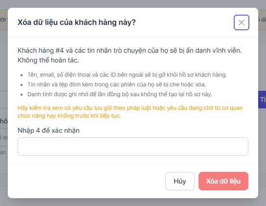

---

## 9. Thống kê thí điểm

*(Dành cho: manager trở lên xem; master, director xuất CSV. Menu **Thống kê** → tab **Thí điểm**)*

Tab **Thí điểm** trả lời câu hỏi "trợ lý hoạt động ra sao theo từng khách sạn và vai trò trong đợt thí điểm". Chọn khoảng ngày bằng bộ chọn phía trên (mặc định 30 ngày; tối đa **92 ngày mỗi lần xem**, dài hơn thì trang báo *Chế độ xem thí điểm chỉ đọc tối đa N ngày mỗi lần…* chứ không cắt ngầm). **Nhóm theo**: **Khách sạn**, **Vai trò** hoặc **Ngày** (ngày tính theo múi giờ của gian hàng; hội thoại tính vào ngày bắt đầu). Số liệu được tính trực tiếp từ nhật ký hội thoại, nên **chỉ truy được đến giới hạn lưu giữ của nhật ký** (dòng ghi chú xám phía trên bảng: *Tính trực tiếp từ nhật ký hội thoại, nên chỉ truy được đến giới hạn lưu trữ của nhật ký.*).

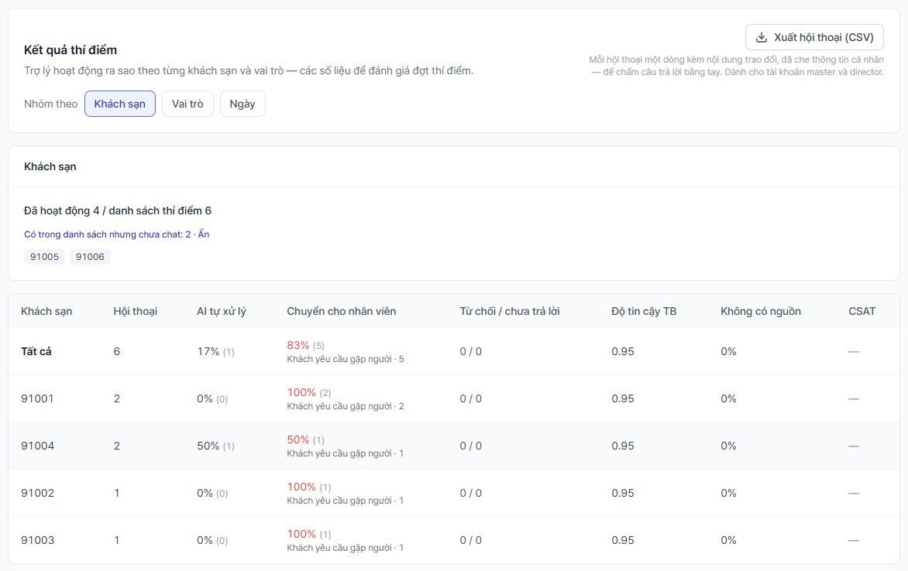

### 9.1 Đọc bảng kết quả

| Cột | Ý nghĩa |
|---|---|
| **Hội thoại** | Số hội thoại trong nhóm |
| **AI tự xử lý** | Tỉ lệ (và số) hội thoại **không có ai trong nhóm tham gia** (không chuyển người, không có tin của nhân viên) **và** trợ lý đã đưa ra ít nhất một câu trả lời **có căn cứ** (màn hình ghi "trong kho tri thức"; thực tế hệ thống đếm mọi câu trả lời của AI có điểm tin cậy, kể cả câu dựa trên dữ liệu đối tác hoặc câu phát lại từ kho câu trả lời đã lưu) |
| **Chuyển cho nhân viên** | Hội thoại đã được chuyển tiếp, hoặc nhân viên đã nhắn, hoặc thông báo chuyển người đã hiện ra; kèm hai lý do hàng đầu (mỗi lý do tính một lần mỗi hội thoại) |
| **Từ chối / chưa trả lời** | Hai số: **từ chối** (chỉ hiện thông báo yêu cầu đăng nhập hoặc không đủ quyền) và **chưa trả lời** (chưa có câu nào có căn cứ: xã giao hoặc đang chờ) |
| **Độ tin cậy TB**, **Không có nguồn** | Tính theo từng câu trả lời; "không có nguồn" là câu không dẫn tài liệu nào |
| **CSAT** | Điểm trung bình (số lượt đánh giá) |

Bốn kết quả **AI tự xử lý + Chuyển cho nhân viên + Từ chối + Chưa trả lời** cộng lại bằng tổng số hội thoại. **"AI tự xử lý" không phải tỉ lệ "đã giải quyết" của tab Kết quả**, vì tab đó còn tính cả hội thoại do nhân viên đã đóng. Bảng thứ hai có **Lần yêu cầu đăng nhập**, **Từ chối khác**, **Kiểm duyệt (chặn / chỉnh sửa)**, **Tra cứu đối tác (ổn / từ chối / lỗi)**, **Người dùng** (đã đăng nhập và phiên khách) và **Thời gian trả lời P50 / P95**. Mục **Cách đọc các số liệu này** ở cuối trang nhắc lại các định nghĩa.

### 9.2 Khách sạn "im lặng"

Thẻ **Khách sạn** ở đầu tab:

- **Đã hoạt động X / danh sách thí điểm Y**: X là số khách sạn **trong danh sách** đã có hội thoại trong khoảng ngày; Y chỉ đếm khách sạn **đang bật** (khách sạn tạm dừng không tính, nên nếu nó vẫn chat sẽ hiện trong dòng "ngoài danh sách").
- **Khách sạn ngoài danh sách cũng đã chat: N** (nếu có).
- **Có trong danh sách nhưng chưa chat: N** và liên kết **Xem các khách sạn này** hiện danh sách số serial (**và N khách sạn nữa** nếu nhiều).

"Im lặng" nghĩa là **không có hội thoại nào** trong khoảng ngày được chọn; một khách sạn đã đăng nhập Hotel Admin nhưng không mở chat cũng tính là im lặng. Nếu danh sách thí điểm đang tắt, thẻ ghi *Danh sách thí điểm đang tắt nên mọi khách sạn đều được phục vụ…*.

### 9.3 Những gì không đếm được

Lượt bị từ chối do **chưa đồng ý quyền riêng tư** hoặc **khách sạn ngoài thí điểm** không được lưu nên **không có số đếm**; trang ghi chú dòng *Không được ghi lại (không lưu nên không có số đếm): …* thay vì in số 0. Thời gian trả lời P50/P95 chỉ tính các lượt AI trả lời, không tính lượt từ chối hay chuyển người.

### 9.4 Xuất CSV để chấm tay

Nút **Xuất hội thoại (CSV)** (chỉ **master, director**): mỗi hội thoại một dòng, kèm nội dung trao đổi đã che thông tin cá nhân, để chấm câu trả lời bằng tay. Các cột theo thứ tự: `conversation_id, started_at, hotel_sn, role, ai_agent_id, language, outcome, handoff_reason, refusals, csat, message_count, avg_confidence, transcript`.

- `outcome` là một trong `ai_only`, `handoff`, `refused`, `no_answer` (đúng bốn kết quả ở §9.1).
- Tệp UTF-8 có BOM (mở được bằng Excel với tiếng Việt), tối đa **5.000 hội thoại** mỗi lần; quá thì có thông báo và bạn thu hẹp khoảng ngày để lấy phần còn lại.
- Mỗi lần xuất được ghi nhật ký kiểm toán (chỉ số lượng và khoảng ngày, không ghi nội dung).
- Tệp chứa nội dung hội thoại: gửi và lưu theo quy định dữ liệu của Go2Joy.

---

## 10. Xử lý sự cố

*(Dành cho: nhân viên CS và SA, và người phụ trách vận hành)*

### 10.1 AI gián đoạn

**Khách thấy**: khi động cơ AI không trả lời được (lỗi, quá tải, ngắt mạch tự động sau nhiều lần lỗi), khách nhận thông báo riêng, không phải câu "không tìm được đáp án" như trước:

*Trợ lý tự động hiện đang tạm thời gián đoạn nên tôi chưa thể trả lời ngay. Tôi đã chuyển câu hỏi của bạn cho đội hỗ trợ — chúng tôi sẽ xác nhận lại với bạn trong giây lát và sẽ có nhân viên hỗ trợ bạn ngay tại đây.*

Hội thoại **tự chuyển cho nhân viên**. Nếu lỗi xảy ra lúc gửi tin, widget báo *Rất tiếc, tin nhắn chưa gửi được. Vui lòng thử lại.* và cho thử lại hoặc gặp nhân viên.

**Nhân viên thấy**: hộp thoại báo với lý do **Công cụ AI tạm thời không hoạt động nên không trả lời được. Cần nhân viên tiếp nhận.** Bạn nhận và trả lời trực tiếp. Trong **Thống kê › Thí điểm**, lý do là **Sự cố hệ thống AI**.

**Khi chỉ phần tìm kiếm vector gián đoạn**: trợ lý vẫn trả lời bằng tìm kiếm từ khóa nếu câu hỏi có căn cứ rõ trong tài liệu (độ tin cậy bị giới hạn ở mức thấp hơn), nếu không thì chuyển người. Tình trạng này chỉ ghi trong vết truy xuất của câu trả lời; **Thống kê chưa có dòng riêng** cho trường hợp này.

**Cần làm**: nhận các hội thoại bị chuyển, báo cho đầu mối vận hành (§10.3 và danh bạ), ghi lại giờ bắt đầu và kết thúc sự cố. Nếu IT đã cài kênh cảnh báo vận hành (email hoặc webhook), cảnh báo đi theo kênh đó. Hệ thống tự thử lại và tự phục hồi sau khi dịch vụ AI trở lại (đã thử cục bộ với nhà cung cấp AI giả, chưa thử với Anthropic hay Voyage thật).

### 10.2 Kiểm duyệt chặn

- **Câu trả lời của AI bị chặn**: hội thoại chuyển cho nhân viên, lý do **Câu trả lời của AI bị kiểm duyệt chặn.**
- **Tin nhắn của bạn bị chặn khi gửi**: console hiện **Tin nhắn bị kiểm duyệt chặn.** và **giữ nguyên chữ bạn vừa gõ** trong ô soạn để bạn sửa. Nếu bạn nghĩ chặn nhầm, báo cho người quản lý cài đặt AI (quy tắc ở **Cài đặt AI** → **Quy tắc kiểm duyệt**); không tìm cách lách qua.
- Hệ thống an toàn theo hướng chặn: nếu bộ kiểm duyệt gặp lỗi, nội dung bị giữ lại chứ không đi ra, và hội thoại chuyển cho nhân viên với lý do **Công cụ AI tạm thời không hoạt động…** (tính vào **Sự cố hệ thống AI**), không phải lý do kiểm duyệt.

### 10.3 Nghi ngờ lộ dữ liệu

Ví dụ: hội thoại cho thấy dữ liệu của khách sạn khác; trả lời nhầm cho người khác; gửi nhầm tệp CSV hoặc bản xuất DSAR; nội dung **Chỉ Quản lý** xuất hiện với lễ tân.

1. **Dừng ngay**: không chuyển tiếp, không sao chép, không xóa gì.
2. Ghi lại **giờ phát hiện**, mã hội thoại, mã khách sạn (`hotelSn`) và điều bạn thấy.
3. Báo ngay cho **người chỉ huy sự cố** của Go2Joy theo danh bạ dưới đây. Đồng hồ **72 giờ** của việc thông báo cơ quan chuyên trách (Cục A05, Bộ Công an theo Nghị định 13/2023/NĐ-CP) tính **từ lúc phát hiện**; điều khoản, biểu mẫu và kênh nộp do **pháp chế Go2Joy xác nhận**, sổ tay này không thay thế tư vấn pháp lý.
4. Chi tiết xử lý kỹ thuật và quy trình đầy đủ: `docs/guide/INCIDENT-RESPONSE.md` (thang SEV1–SEV3, cách ly, bằng chứng, thông báo) và `docs/guide/RUNBOOK-261013-Go2Joy-SelfHosted.md` mục 10 (sự cố khả dụng và dữ liệu cá nhân) và mục 10.4 (danh bạ).

| Vai trò | Họ tên | Điện thoại / email |
|---|---|---|
| Chỉ huy sự cố Go2Joy | 〔cần chỉ định〕 | |
| DPO / pháp chế Go2Joy (thông báo A05) | 〔cần chỉ định〕 | |
| Hạ tầng trực của Go2Joy | 〔cần chỉ định〕 | |
| Đầu mối hỗ trợ của Amoeba | 〔cần chỉ định〕 | |

⚠️ **Lưu ý**: các ô trên đang để trống có chủ ý. **Cho tới khi Go2Joy điền, quy trình chưa thể bảo đảm kịp thời hạn 72 giờ**; đây là mục bắt buộc trong checklist trước go-live (phụ lục B).

### 10.4 Bảng khắc phục nhanh

| Hiện tượng | Nguyên nhân thường gặp | Cách xử lý |
|---|---|---|
| Hàng chờ có hội thoại "chưa ai nhận" | Không ai online đúng nhãn, đúng vùng | §1.3; sau 5 phút hệ thống phát chung |
| Hàng chờ "thiếu" hội thoại so với chip | Bộ lọc **Vùng của tôi** hoặc chip đội đang bật | Chọn **Tất cả vùng**, bỏ chọn chip (§3.7) |
| Bấm **Nhận** không có gì xảy ra | Đang giữ đủ 3 hội thoại | Kết thúc hoặc trả lại bớt một hội thoại (§3.9) |
| Thấy **?** cam | Tỉnh chưa có trong bảng vùng | Báo master thêm tên tỉnh (§2.4, §6.4) |
| Thấy **hết hạn** | Chữ ký quá 8 giờ | Nhờ người dùng tải lại hoặc đăng nhập lại Hotel Admin (§2.3) |
| Không thấy nút **Chuyển sang…** | Gian hàng chưa bật câu hỏi đội | Nhờ master (§6.3) |
| Không thấy menu **Cài đặt gian hàng** | Cấp bậc staff/manager không có quyền | Nhờ master/director |
| Trang **Tổng quan** toàn số 0 | Cấp bậc staff không có quyền xem các số liệu đó (lỗi bị bỏ qua, không hiện thông báo) | Bình thường; làm việc ở **Trò chuyện trực tiếp**, đừng coi các số 0 là hệ thống không có hội thoại |
| Hội thoại ngoài giờ không thấy ai nhắc | Bình thường: ngoài giờ không nhắc | Kiểm tra hộp thư và hàng chờ đầu ca (§4.4) |
| Nút **Xuất hội thoại (CSV)** mờ hoặc không thấy | Khoảng ngày quá 92 ngày (nút mờ kèm cảnh báo) hoặc tài khoản không phải master/director (nút ẩn) | Thu hẹp khoảng ngày; nhờ master/director xuất |

---

## 11. Bộ tài liệu đào tạo

Dành cho buổi đào tạo CS và SA (khoảng 2 giờ) trên môi trường thử nghiệm: 10 bài tập thực hành, một bảng tóm tắt một trang, bảng thuật ngữ và một bài kiểm tra ngắn.

### 11.1 Mười bài tập thực hành

Mỗi bài có **Chuẩn bị**, **Cách làm** và **Kết quả mong đợi**. Người hướng dẫn tạo sẵn các hội thoại mẫu (khách sạn "(demo)").

**Bài 1. Bắt đầu ca trực.** Chuẩn bị: tài khoản CS có khu vực **Miền Nam**. Cách làm: đăng nhập, mở **Trò chuyện trực tiếp**, bật **Đang trực**, mở **Người dùng & nhãn** bằng tài khoản master và xem cột **Trực**. Kết quả: thông báo *Bạn đã bật trực…*, cột **Trực** hiện **Đang trực · thấy vài giây trước** (xanh). Đóng tab trên 90 giây, cột chuyển **Đang trực · không kết nối** (vàng).

**Bài 2. Khách ở Đà Nẵng xin hỗ trợ kinh doanh: ai được báo, bạn thấy gì?** Chuẩn bị: bảng vùng đã nạp bộ tỉnh Việt Nam; hai người dùng SA (một **Miền Nam** đang trực, một **Miền Bắc** đang trực); một quản lý của khách sạn ở Đà Nẵng đã ký. Cách làm: quản lý bấm **Gặp nhân viên hỗ trợ**, chọn **Hỗ trợ kinh doanh**. Kết quả: Đà Nẵng thuộc **Nam Trung Bộ** nên đội phụ trách là **Đội Nam**; **chỉ SA Miền Nam** nhận hộp thoại báo (SA Miền Bắc **không** được chọn). Hộp thoại hiện **Đội: Kinh doanh**, **Vùng: Nam**, **Khách sạn: <tên> (<mã>) · manager**. Trong danh sách thấy huy hiệu **Kinh doanh**, **Nam**, và **Chờ** đang đếm. Bấm **Nhận** để nhận.

**Bài 3. Chuyển lại hội thoại chọn nhầm đội.** Chuẩn bị: một hội thoại khách đã chọn **Hỗ trợ khách hàng** nhưng hỏi về điều khoản hợp đồng. Cách làm: nhận hội thoại, bấm **Chuyển sang…**, chọn **Hỗ trợ kinh doanh**, để vùng **Giữ vùng hiện tại**, bấm **Chuyển**. Kết quả: thông báo *Đã chuyển sang Hỗ trợ kinh doanh. Tất cả người có thể nhận đã được báo.* (xem §3.6 về lý do câu này hiện ngay cả khi chỉ một người được báo); hội thoại về **Đang chờ** của đội Kinh doanh, mất **Phụ trách**, đồng hồ **Chờ** về 00:00; thẻ **Ghi chú** có ghi chú nội bộ (sau khi tải lại trang); khách không nhận thông báo nào.

**Bài 4. Lễ tân hỏi về đổi tài khoản ngân hàng.** Chuẩn bị: danh mục **Đối soát & tài khoản ngân hàng** ở mức **Chỉ Quản lý**; một phiên lễ tân đã ký. Cách làm: lễ tân hỏi "Tôi muốn đổi tài khoản ngân hàng nhận tiền đối soát". Kết quả: lễ tân nhận câu *Nội dung này chỉ được cung cấp cho tài khoản Quản lý của khách sạn…* kèm chip **Gặp nhân viên hỗ trợ**; **không** có hộp thoại báo nào cho CS cho tới khi lễ tân bấm chip. Lặp lại với phiên quản lý: quản lý nhận câu trả lời nội dung. Giải thích: khác nhau vì mức **Ai được xem**. Lưu ý cho người hướng dẫn: kết quả phụ thuộc độ khớp của tìm kiếm; với AI giả hoặc tài liệu quá ít, hệ thống có thể chuyển người như thường thay vì trả lời "nhờ Quản lý".

**Bài 5. Phiên đăng nhập đã ký bị hết hạn.** Chuẩn bị: một hội thoại có dấu **hết hạn** (trên môi trường học, người hướng dẫn chỉnh thời điểm xác minh của phiên mẫu về hơn 8 giờ trước, hoặc tạm đặt thời hạn ở §8.1 là 1 giờ rồi chờ). Cách làm: mở hội thoại, đọc dải đối tác, rồi để khách nhắn tiếp. Kết quả: dải đối tác hiện **hết hạn** thay vì **đã ký**; nếu agent đặt **Chỉ hướng dẫn đăng nhập**, khách nhận lời nhắc đăng nhập; tra cứu dữ liệu đối tác (nếu bật) nhận thông báo *…cần phiên đăng nhập còn hiệu lực…*. Việc cần làm: nhờ khách đăng nhập lại Hotel Admin, không chia sẻ thông tin nhạy cảm cho tới khi thấy lại dấu **đã ký**.

**Bài 6. Tìm các khách sạn thí điểm "im lặng".** Chuẩn bị: danh sách thí điểm gồm 6 khách sạn, 4 khách sạn đã chat. Cách làm: **Thống kê → Thí điểm**, chọn khoảng 30 ngày, đọc thẻ **Khách sạn**, bấm **Xem các khách sạn này**. Kết quả: **Đã hoạt động 4 / danh sách thí điểm 6**; dòng **Có trong danh sách nhưng chưa chat: 2** và hai số serial. Câu hỏi thêm: khách sạn nào "ngoài danh sách cũng đã chat"? Nó có bị phục vụ không (chỉ khi công tắc **Chỉ phục vụ các khách sạn trong danh sách** đang tắt).

**Bài 7. Huy hiệu "?".** Chuẩn bị: khách sạn có tỉnh "Tp Quy Nhơn" (không có trong bảng). Cách làm: mở hội thoại, rê chuột vào **?**, rồi bằng tài khoản master vào **Cài đặt gian hàng → Cơ bản**, dùng **Thử một tỉnh** với "Quy Nhơn". Kết quả: chú thích *Chưa xác định vùng — tỉnh "Tp Quy Nhơn" không có trong bảng vùng*; ô thử báo *Chưa có trong bảng…*. Sửa: thêm "Tp Quy Nhơn" vào dòng **Nam Trung Bộ** rồi **Lưu**; hội thoại **mới** của khách sạn này được xếp vào **Đội Nam** (hội thoại cũ giữ nguyên hoặc dùng **Chuyển sang…** để chọn vùng).

**Bài 8. Ca sáng sau đêm có yêu cầu ngoài giờ.** Chuẩn bị: một hội thoại tạo lúc 22:00 (ngoài giờ), khách đã để email. Cách làm: 08:30 bật **Đang trực**, mở tab **Cần nhân viên**, chọn **Tất cả vùng**, mở hội thoại, **Nhận**, trả lời. Kết quả: hội thoại có dấu chờ lâu; câu trả lời của bạn được gửi tới email khách và trong luồng có ghi chú *Phản hồi này đã được gửi tới email của khách hàng.*; bạn **Kết thúc** sau khi xong.

**Bài 9. Khi API dữ liệu đối tác không trả lời.** Chuẩn bị: bật tra cứu dữ liệu đối tác ở chế độ mock và tắt kết nối (người hướng dẫn mô phỏng). Cách làm: quản lý hỏi "giá phòng theo giờ của khách sạn tôi". Kết quả: khách nhận *Hiện tôi chưa tra cứu được dữ liệu khách sạn…* và hội thoại chuyển cho nhân viên; hộp thoại báo hiện lý do **AI không tìm được câu trả lời trong kho tri thức.**; bạn đọc tin hệ thống cuối để biết nguyên nhân, **không đoán số liệu**, rồi kiểm tra trong hệ thống của Go2Joy.

**Bài 10. Yêu cầu xóa dữ liệu của một khách.** Chuẩn bị: một khách mẫu có email `khach.demo@go2joy.example`; quy trình xác minh danh tính (bước giả định đã xong). Cách làm: master **Cài đặt gian hàng → Yêu cầu dữ liệu**, **Tìm theo Địa chỉ email**, gõ email, **Tìm kiếm**, bấm **Xuất dữ liệu** (kiểm tra tệp), rồi bấm **Xóa**, đọc hộp thoại, **dừng ở bước nhập ID** (không xóa trên môi trường học). Kết quả: bảng kết quả chỉ hiện thông tin đã che; hộp thoại liệt kê ba tác động, nhắc kiểm tra khoá pháp lý và đòi nhập đúng ID; nút **Xóa dữ liệu** chỉ bật khi ID khớp.

### 11.2 Bảng tóm tắt một trang cho nhân viên

| Tình huống | Làm gì | Ở đâu |
|---|---|---|
| Vào ca | Bật **Đang trực**, mở console, giữ tab mở | Đầu trang **Trò chuyện trực tiếp** |
| Có hộp thoại **Chuyển tiếp hội thoại** | **Mở hội thoại** rồi **Nhận**; **Bỏ qua** chỉ là đã xem | Hộp thoại báo |
| Muốn thấy mọi hội thoại | Đặt **Lọc theo vùng** = **Tất cả vùng**, bỏ chip đội | Trên danh sách |
| Chờ quá 5 phút | Huy hiệu **Chờ** đỏ, hệ thống nhắc lại Slack/email tối đa 3 lần | Danh sách, dòng **chưa ai nhận** |
| Khách chọn nhầm đội | **Chuyển sang…** → chọn đội → **Chuyển** | Hàng nút của hội thoại |
| Thấy **tự khai** | Xác minh qua kênh khác trước khi xử lý | Dải đối tác |
| Thấy **hết hạn** | Coi như chưa đăng nhập; nhờ đăng nhập lại Hotel Admin | Dải đối tác |
| Thấy **?** | Báo master thêm tên tỉnh | Huy hiệu cam |
| Ngoài giờ | Không bị gọi dậy; đầu ca xử lý hộp thư và hàng chờ | Email ngoài giờ, tab **Cần nhân viên** |
| AI gián đoạn | Nhận hội thoại, trả lời trực tiếp, báo vận hành | Lý do **Công cụ AI tạm thời không hoạt động…** |
| API dữ liệu đối tác lỗi | Không đoán số liệu, kiểm tra trong hệ thống Go2Joy | Tin hệ thống cuối trong hội thoại |
| Nghi lộ dữ liệu | Dừng, ghi giờ phát hiện, báo chỉ huy sự cố; đồng hồ 72 giờ | §10.3 |
| Hết ca | Tắt **Đang trực**, **Kết thúc** hoặc bàn giao hội thoại đang giữ | Công tắc trực |

### 11.3 Bảng thuật ngữ Việt - Anh (theo giao diện)

| Tiếng Việt trên giao diện | Tiếng Anh trên giao diện | Ghi chú |
|---|---|---|
| Trò chuyện trực tiếp | Live Chat | Trang chính của CS/SA |
| Đang trực / Không trực | On duty / Off duty | Công tắc hiện diện |
| Chuyển tiếp hội thoại | Chat escalation | Hộp thoại báo (alarm) |
| Mở hội thoại / Bỏ qua | Open chat / Dismiss | Nút của hộp thoại báo |
| Nhận | Accept | Nhận hội thoại |
| Cần nhân viên | Needs agent | Tab hàng chờ (đang chờ hoặc có nhân viên xử lý) |
| Chuyển sang… | Hand over to… | Chuyển đội/vùng |
| Trả lại cho AI | Hand back to AI | Bỏ giữ mà không kết thúc |
| Hỗ trợ khách hàng / Kinh doanh | Customer Service / Business | Hai đội mặc định (khách thấy "Hỗ trợ kinh doanh") |
| Vùng của tôi | My region | Bộ lọc vùng |
| Tỉnh chưa ánh xạ | Unlisted province | Tỉnh không có trong bảng vùng |
| đã ký / tự khai / hết hạn | signed / self-declared / expired | Độ tin cậy của danh tính |
| Hệ thống chủ | Host system | Hotel Admin |
| Quản lý / Lễ tân / Nhân viên nội bộ | Manager / Receptionist / Internal | Vai trò đối tác |
| Chuyển cho nhân viên | Agent handoff | Thẻ cấu hình chuyển người |
| Hỏi khách chọn đội | Ask which team (checkbox) | Câu hỏi đội |
| Chuyển theo vùng của khách sạn | Route by the hotel's region | Bảng vùng |
| Nạp bộ tỉnh Việt Nam có sẵn | Load Vietnam preset | Điền bảng vùng |
| Thử một tỉnh | Try a province | Ô thử tỉnh |
| Nghiêm ngặt | Strict | Chế độ vùng nghiêm ngặt |
| Bảng khách sạn → tỉnh | Hotel → province table | Tệp CSV |
| Báo lại khi chưa ai nhận cuộc trò chuyện | Alert again when nobody takes a conversation | Nhắc UNCLAIMED |
| Giờ làm việc / Email ngoài giờ | Business hours / Off-hours email | Ngoài giờ |
| Khách chưa đăng nhập | Visitors who are not signed in | Chính sách của AI agent |
| Chỉ hướng dẫn đăng nhập hoặc đăng ký | Only guide them to sign in or register | Cổng khách |
| Ai được xem | Who can read | Quyền xem danh mục |
| Công khai / Đối tác đã đăng nhập / Chỉ Quản lý | Public / Signed-in partners / Managers only | Ba mức quyền |
| Phiên bản giao diện (tham chiếu) | UI version / Reference UI version | Phiên bản tài liệu |
| Chân trang liên hệ cho câu trả lời | Answer contact footer | Khối liên hệ cuối câu |
| Chính sách đăng nhập có chữ ký (SSO) | Signed sign-in (SSO) policy | Hạn tin cậy 8 giờ |
| Phạm vi pilot theo khách sạn | Pilot scope by hotel | Danh sách thí điểm |
| Tra cứu dữ liệu đối tác | Partner data lookup | Chỉ đọc |
| Thông báo quyền riêng tư | Privacy Notice | Hồ sơ vn_pdpl |
| Yêu cầu dữ liệu | Data requests | DSAR của vận hành |
| Thí điểm | Pilot | Tab thống kê |
| AI tự xử lý | AI-only resolved | Không có người tham gia |

### 11.4 Bài kiểm tra ngắn (12 câu)

1. Điều kiện để hệ thống coi bạn là "online" khi chọn người nhận? 
2. Bấm **Bỏ qua** trên hộp thoại báo có nghĩa là gì?
3. Ba tình huống khiến hàng chờ có hội thoại "chưa ai nhận" dù mọi người đang ở bàn làm việc?
4. Một khách sạn ở Huế và một khách sạn ở Đà Nẵng cùng xin hỗ trợ kinh doanh. Mỗi nơi thuộc đội nào?
5. Dấu **tự khai** khác **đã ký** ở điểm nào? Điều gì **không** dùng thông tin tự khai?
6. Chữ ký hết hạn sau bao lâu theo mặc định, và ai đổi được?
7. Ai được dùng **Chuyển sang…**? Khách có biết hội thoại bị chuyển không?
8. Bạn mở console, thấy dòng danh sách khá ít so với chip **Tất cả đội 14**. Nên kiểm tra điều gì đầu tiên?
9. Lễ tân hỏi về nội dung của Quản lý: họ thấy gì, CS có bị gọi không?
10. "AI tự xử lý" khác gì với tỉ lệ "đã giải quyết" ở tab **Kết quả**?
11. Khách sạn "im lặng" nghĩa là gì và xem ở đâu?
12. Bạn nghi một bản xuất CSV đã gửi nhầm người. Việc đầu tiên, và đồng hồ nào bắt đầu chạy?

**Đáp án**

1. Công tắc **Đang trực** bật **và** console gửi tín hiệu trong 90 giây gần nhất (§1.2).
2. Chỉ xác nhận đã xem và đóng thông báo cho mọi đồng nghiệp; không nhận hội thoại. Hội thoại vẫn **Đang chờ** và hệ thống tạo thông báo mới sau 5 phút nếu chưa ai nhận (§1.4, §3.4).
3. Ví dụ: không ai online có đúng nhãn/vùng; người online đang giữ đủ 3 hội thoại; người trực mất kết nối (**Đang trực · không kết nối**) hoặc tài khoản bị tạm ngưng; vì thế yêu cầu phát chung (§1.3).
4. Huế thuộc **Bắc Trung Bộ** → **Đội Bắc**; Đà Nẵng thuộc **Nam Trung Bộ** → **Đội Nam** (bộ tỉnh có sẵn, §6.4).
5. **đã ký**: Hotel Admin ký `hotelSn` và vai trò (không ký tên khách sạn). **tự khai**: không có chữ ký, hiếm gặp vì máy chủ từ chối đăng nhập thiếu chữ ký. Chọn đội theo vùng và tra cứu dữ liệu đối tác chỉ dùng thông tin **đã ký** (§2.3).
6. **8 giờ**; master đổi được (1–720 giờ) ở **Chính sách đăng nhập có chữ ký (SSO)** (§8.1).
7. Bất kỳ nhân viên có nhãn CS/SA, kể cả staff. Khách **không** nhận thông báo (§3.6).
8. Bộ lọc **Vùng của tôi** đang bật; chọn **Tất cả vùng** và kiểm tra chip đội (§3.7).
9. Họ thấy câu *Nội dung này chỉ được cung cấp cho tài khoản Quản lý…* kèm chip gặp nhân viên; CS **không** bị gọi trừ khi khách bấm chip (§7.2).
10. "AI tự xử lý" đòi hỏi **không có người tham gia và có ít nhất một câu có căn cứ**; tỉ lệ "đã giải quyết" tính cả hội thoại do nhân viên đã đóng (§9.1).
11. Khách sạn **có trong danh sách thí điểm nhưng không có hội thoại** trong khoảng ngày; xem ở thẻ **Khách sạn** của **Thống kê → Thí điểm** (§9.2).
12. Dừng, ghi giờ phát hiện, báo chỉ huy sự cố của Go2Joy; đồng hồ **72 giờ** thông báo cơ quan chuyên trách bắt đầu từ lúc phát hiện (§10.3).

---

## 12. Phụ lục

### Phụ lục A. English summary (for Amoeba)

| Feature | Where in the console | Who may use it | One-line behaviour |
|---|---|---|---|
| On duty / Off duty switch | Live Chat, page header | Any user with the CS or SA label | Counts you for routing only while on duty AND the console polled within 90 s; persisted per account |
| Escalation alarm + Accept | Modal on any page; Live Chat header buttons | CS / SA (CONVERSATION_HANDLE) | Directed alert shows only to its addressee; broadcast to everyone; Dismiss only acknowledges |
| Partner context header | Live Chat, list row and conversation header | CS / SA | Role @ hotel (hotelSn) · province with signed / self-declared / expired mark; claims lapse after 8 h |
| Team question | Widget (customer); Tenant Settings > Basic > Agent handoff | Customer; master/director configure | Asks CS or Business after an agent request; choice stored on the conversation |
| Routing ladder | Automatic | System | Label + region + online, then label + nationwide, then configured assignees, then broadcast |
| Unclaimed sweep | Automatic; Tenant Settings > Basic (Auto/On/Off) | System; master/director toggle | After ALERT_UNCLAIMED_MINUTES (5) re-broadcasts and posts UNCLAIMED to Slack/email, max 3 times |
| Hand over to… | Live Chat conversation header | CS / SA, staff rank included | Moves the conversation to another team/region, pages them, internal note + audit, customer not told |
| Queue counters, My region | Live Chat list | CS / SA | Team chips, unclaimed summary, waiting age (red after 5 min); My region hides other and unknown regions |
| Off-hours handling | Widget; Tenant Settings > Basic hours and mailbox | Customer; master/director | Customer asked for an email; summary to off-hours mailbox; agent reply is emailed; no re-alert |
| Users & Labels | Users & Labels | Master (default) | Roles CS/SA/Others, Region North/South/Nationwide, presence column; label names are DB data (default Korean) |
| Agent handoff settings | Tenant Settings > Basic > Agent handoff | Master, director (AI_SETTINGS_MANAGE) | Assignees, hours, mailbox, team table, region table with Load Vietnam preset and Try a province, strict mode, regional mailbox/webhook |
| Hotel → province CSV | Same card, under the region table | Master, director | Preview then replace-all; matched by signed hotelSn only; signed province wins |
| Guest policy | AI Settings > AI agents > Visitors who are not signed in | Master, director, manager | Only guide to sign in; answers only from Public categories; calibration of the gate threshold still open |
| KB category access | Knowledge > Categories > Who can read | Master, director | Public / Signed-in partners / Managers only; receptionist asking a manager topic gets the manager-account line |
| KB UI version stamping | Knowledge document editor; AI Settings > Reference UI version | Knowledge managers; manager+ for the reference | Equality-only match; caveat sentence after moderation or hide; unversioned never flagged; axis (v23.x vs v0.x) undecided |
| "Test as" gate simulator | Knowledge > Ask the knowledge base | n/a | NOT in this build; arrives with the gate simulator (in development) |
| Signed sign-in (SSO) policy | Tenant Settings > Widget | Master edits, director views | Claims max age (default 8 h, 1 to 720) and refuse-v1 switch |
| Pilot scope by hotel | Tenant Settings > Widget | Master edits, director views | Allow-list by signed hotelSn each turn; hide widget or notice; list actions apply immediately |
| Partner data lookup | Tenant Settings > Other settings | Master | Read-only; hotel from signed identity; mock until Go2Joy API (R8/R9) exists; notice + hand-off when down |
| Answer footer | AI Settings | Manager+ | Fixed contact block on every KB answer, after moderation |
| Privacy notice (vn_pdpl) | Tenant Settings > Privacy Notice | Master, director | Vietnam profile with server-filled retention/region; changing the version forces re-consent; wording is draft |
| Operator DSAR | Tenant Settings > Data requests | Master, director | Lookup, export, erase (anonymise) with typed-ID confirmation; no per-customer legal-hold flag |
| Statistics > Pilot | Statistics > Pilot | Manager+ view; master/director CSV | AI-only resolved vs handoff vs refused vs no answer; silent hotels; per-conversation CSV for manual grading |

The English edition of this manual (summary, go-live checklist, verification status, open questions) is [go2joy-ops.en.md](go2joy-ops.en.md).

### Phụ lục B. Checklist trước go-live (dành cho Go2Joy)

**A. Liên hệ và sự cố**
- [ ] Điền danh bạ ở §10.3 (chỉ huy sự cố, DPO/pháp chế, hạ tầng, đầu mối Amoeba) và `INCIDENT-RESPONSE.md` mục 6, `RUNBOOK` mục 10.4; xác nhận kênh nộp thông báo cho cơ quan chuyên trách và đồng hồ 72 giờ với pháp chế
- [ ] Chỉ định người xử lý DSAR và lập sổ DSAR ngoài hệ thống (§8.5)
- [ ] Quyết định kênh cảnh báo vận hành (email hoặc webhook) cho IT: sự cố AI, sao lưu, dịch vụ phụ

**B. Giờ làm việc và hộp thư**
- [ ] Xác nhận giờ làm việc của CS và của SA (có thể khác nhau), múi giờ `Asia/Ho_Chi_Minh`, giờ nghỉ, và quy trình đổi giờ cho kỳ nghỉ lễ (hệ thống không có lịch ngày lễ)
- [ ] **Email ngoài giờ** là hộp thư nhóm có người xem mỗi sáng; nếu dùng hộp thư riêng theo vùng thì cung cấp địa chỉ Bắc và Nam
- [ ] SMTP (và Slack nếu dùng, kể cả webhook theo vùng) đã cấu hình và thử gửi
- [ ] Câu **Thông báo ngoài giờ gửi cho khách hàng** bằng tiếng Việt do Go2Joy duyệt (hoặc chấp nhận câu mặc định)

**C. Nhân sự**
- [ ] Đổi tên nhãn thành **CS** và **SA** qua API (§5.2); xác nhận tên hai nút tiếng Việt khách thấy (**Hỗ trợ khách hàng**, **Hỗ trợ kinh doanh**)
- [ ] Tạo tài khoản, chọn cấp bậc, vai trò, **Khu vực** (Bắc/Nam/Toàn quốc), ghi nhận rằng chưa có chỗ nhập tên hiển thị (thông báo chuyển đội sẽ không nêu tên người nhận, §3.6); mọi người đã đổi mật khẩu tạm; MFA nếu bắt buộc
- [ ] Có ít nhất một CS và một SA cho mỗi vùng trong từng ca; quyết định cách xử lý khi **không có SA** trực
- [ ] Mọi người đã làm bài tập 1–10 (§11.1) và đạt bài kiểm tra (§11.4)

**D. Khách sạn và vùng**
- [ ] Danh sách khách sạn thí điểm (số serial) đã nhập; chọn **Ẩn widget** hay **Hiện thông báo**; duyệt câu thông báo tiếng Việt
- [ ] Hotel Admin ký danh tính v2 gồm khách sạn, vai trò và (nếu có) tỉnh; xác nhận khi nào gọi lại `identify`
- [ ] Nếu Hotel Admin không gửi tỉnh: tệp CSV khách sạn → tỉnh đã tải lên
- [ ] **Bảng vùng**: đã nạp bộ tỉnh Việt Nam, đối chiếu với cách viết tỉnh thực tế của Hotel Admin (tên cũ, viết tắt); quyết định chế độ mặc định hay **Nghiêm ngặt** và số phút mở rộng

**E. Tri thức**
- [ ] Danh mục và **Ai được xem**: liệt kê các chủ đề **Chỉ Quản lý** (ví dụ đối soát, tài khoản ngân hàng) và đặt mức trước khi nạp tài liệu
- [ ] Chọn trục phiên bản giao diện (v23.x hay v0.x), gán phiên bản cho tài liệu, đặt **Phiên bản hiện hành** và chế độ **Thêm lưu ý** hay **Ẩn tài liệu**
- [ ] Nhập **Chân trang liên hệ cho câu trả lời** và **Hướng dẫn khách** (URL đăng nhập, URL đăng ký, lời nhắc)
- [ ] Hiệu chỉnh ngưỡng cổng khách với embedding thật **trước** khi bật **Chỉ hướng dẫn đăng nhập hoặc đăng ký**

**F. Quyền riêng tư và pháp lý**
- [ ] Chọn `vn_pdpl`, điền dòng **Bên kiểm soát dữ liệu & liên hệ** (không còn `[[…]]`), luật sư và người bản ngữ đã rà soát toàn bộ văn bản
- [ ] Quyết định thời hạn lưu (hội thoại, hồ sơ khách hàng, nhật ký kiểm toán) và đặt biến môi trường tương ứng
- [ ] Sau khi chốt câu chữ: đổi **Phiên bản thông báo đồng ý** một lần để mọi người đồng ý lại
- [ ] Quyết định và ghi nhận về chuyển dữ liệu ra nước ngoài (AI xử lý ở Hoa Kỳ), hồ sơ đánh giá tác động, hợp đồng với bên xử lý

**G. Đăng nhập và dữ liệu đối tác**
- [ ] Chốt thời hạn tin cậy chữ ký (mặc định 8 giờ); quyết định thời điểm bật **Từ chối đăng nhập không có khách sạn và vai trò (v1)**
- [ ] **Tra cứu dữ liệu đối tác** giữ **tắt** cho tới khi Go2Joy giao API và Amoeba xác nhận chế độ dữ liệu thật
- [ ] Giá trị hiển thị trong thẻ **Liên hệ hỗ trợ** của widget (điện thoại, email, giờ) là của Go2Joy (xem phụ lục C)

### Phụ lục C. Nhãn và hành vi tiếng Việt cần lưu ý (phát hiện khi viết sổ tay)

| # | Điểm cần lưu ý | Ghi chú |
|---|---|---|
| 1 | Tên nhãn công việc mặc định bằng tiếng Hàn, console không có màn hình đổi tên | Đổi qua API trước go-live (§5.2) |
| 2 | Cột **Cấp bậc** và trạng thái hiển thị chữ tiếng Anh (`master`, `director`, `manager`, `staff`, `active`) | Chưa dịch trên giao diện |
| 3 | Chữ **Nhân viên AI** (AI agent) và **nhân viên** (người) dễ nhầm | Sổ tay luôn viết "nhân viên AI" cho AI |
| 4 | Gợi ý của ô **Khách chưa đăng nhập** vẫn nói "phân loại đánh dấu **Công khai cho khách**", nhưng nhãn hiện tại ở Kho tri thức là **Công khai** (ô **Ai được xem**) | Chuỗi cũ chưa cập nhật (cả tiếng Anh lẫn tiếng Việt) |
| 5 | Chip đội của console ghi **Kinh doanh**, còn khách thấy **Hỗ trợ kinh doanh** | Khác nhau có chủ ý hai chỗ; chỉ có tên cho mã `cs` và `business` |
| 6 | Nhãn vùng ở hội thoại là **Bắc / Nam**, ở Người dùng là **Miền Bắc / Miền Nam** | Nhất quán nội bộ nhưng hai kiểu |
| 7 | Hộp thoại báo hiện **AI không tìm được câu trả lời trong kho tri thức.** khi dữ liệu đối tác không tra cứu được | Chưa có dòng riêng; nguyên nhân ở tin hệ thống cuối |
| 8 | Thao tác **Nhận**, **Kết thúc**, **Trả lại cho AI** không có thông báo lỗi; bị từ chối (ví dụ đủ 3 hội thoại) thì im lặng | Cần bổ sung thông báo |
| 9 | Banner đồng ý mặc định trong widget (tiếng Việt) còn nội dung CCPA, Google Analytics, 365 ngày, Hoa Kỳ cho tới khi chọn `vn_pdpl` | Chọn hồ sơ trước go-live (§8.4) |
| 10 | Thẻ **Liên hệ hỗ trợ** trong widget dùng giá trị mặc định của IVY (số `1588-0000`, email `help@ivy.com`) và chưa cấu hình được theo gian hàng | Không bật nút/kịch bản Liên hệ hỗ trợ cho Go2Joy, hoặc nhờ Amoeba thay giá trị |
| 11 | Hộp thoại báo hiện vai trò của đối tác bằng mã tiếng Anh (`manager`, `receptionist`), trong khi dải đối tác ở hội thoại hiện **Quản lý**, **Lễ tân** | Chưa dịch ở hộp thoại báo |
| 12 | Các tab ngôn ngữ trong thẻ **Chuyển cho nhân viên** mở ra ở **KO**, và tab nhóm của **Danh mục** có tên `OperationInfo` chưa dịch | Dễ nhập nhầm tiếng Hàn; nên mặc định theo ngôn ngữ giao diện |
| 13 | `RUNBOOK` mục 11.1/11.3 vẫn ghi chưa có công cụ DSAR phía vận hành và hai bảng chưa nằm trong cửa sổ lưu giữ | Đã lỗi thời: công cụ đã có (§8.5) và các bộ dọn tùy chọn đã có |
| 14 | Tài khoản người dùng không có tên hiển thị và không có chỗ nhập tên (lời mời không hỏi tên, không có màn hình sửa tên) | Thông báo chuyển đội nêu tên người nhận không bao giờ hiện; ghi chú chuyển đội hiện "user #N", tác giả "Không rõ" |
| 15 | Thông báo lưu thành công của thẻ **Chuyển cho nhân viên** là tiếng Anh *AI configuration saved.*; một số thông báo thành công khác của Kho tri thức cũng chưa dịch | Cần dịch; không phải lỗi lưu |
| 16 | Đoạn xem trước trong hộp thoại báo là tin cuối của khách, thường là tên đội khi khách vừa chọn chip | Dễ tưởng là câu hỏi; hãy mở hội thoại |
| 17 | Cột **Hạng** ở panel khách bên phải hiện chữ `guest` và dòng `(hotelSn …)` ở dải đối tác là chữ tiếng Anh cố định | Chưa dịch |
| 18 | Ô **Chuyển tới vai trò** trong bảng đội dùng tên cố định (**Tư vấn**, **Sales Admin**…), không theo tên nhãn đã đổi | Dễ nhầm CS với Tư vấn |
| 19 | Email và Slack báo chuyển người, nhắc "chưa ai nhận" và thông báo ngoài giờ gửi cho nhân viên bằng tiếng Anh, tiêu đề email dạng `[IVY Chat] …` | Nhãn thương hiệu IVY còn trong tiêu đề cảnh báo |

### Phụ lục D. Nguồn (truy vết từng chương)

| Chương | Nguồn |
|---|---|
| 1 (trực, hiện diện, hộp thoại báo) | PLN-261012 §3.3 SG-60; `apps/web/src/domain/live-chat/DutyToggle.tsx`, `EscalationAlarm.tsx`; `apps/api/src/domain/agent/agent-alert.service.ts` (`leastLoadedOnline`, `touchPresence`), `agent-console.controller.ts` (`alerts`), `global/util/presence.util.ts`; CONFIG.md §4.2 |
| 2 (đọc hội thoại, đã ký, hết hạn, "?") | RPT-261013-s1b-identity-audit §1 (SG-03), RPT-261007-Hotel-Region-Routing §1; `PartnerContext.tsx`, `QueueBadges.tsx`, `LiveChatPage.tsx`; locale `livechat.json` (`partner.*`, `region.*`) |
| 3 (đội, thang chọn người, quét, chuyển, vùng, bộ đếm) | RPT-261007-Handoff-Team-Routing §1; RPT-261007-Hotel-Region-Routing §1; RPT-261013-s3b-Routing-Extras §1, §3; `handoff-router.service.ts` (`teamQuestion`, `route`), `agent-alert.service.ts` (`chooseTarget`, `pickLabelAgent`), `unclaimed-sweep.service.ts`, `unclaimed-plan.util.ts`, `agent-routing.service.ts` (`reroute`, `queueCounts`), `packages/types/src/common/routing-queue.ts`, `RerouteControl.tsx` |
| 3.9 (giới hạn 3, Nhận im lặng) | `agent.service.ts` (`accept`, `upsertProfile`), `entity/agent-profile.entity.ts`, `live-chat.hooks.ts` (`useConversationActions`) |
| 4 (ngoài giờ) | `chat.service.ts` (`handoff`, `escalate`, `saveContactEmail`, `SYSTEM_MESSAGES`), `handoff-router.service.ts` (`route`, `withinBusinessHours`), `agent.service.ts` (`mailReplyIfOffHoursThread`, `REPLY_EMAIL_COPY`); widget `i18n/locales/vi.ts` (`chat.contactEmail`) |
| 5 (người dùng, nhãn, khu vực) | RPT-261007 PLN/TCR User-Role-Region; `UsersPage.tsx`, `job-label.controller.ts`, `tenant.service.ts` (`DEFAULT_JOB_LABELS`), `packages/common/src/rbac/permission-matrix.ts`, `menu-access.ts` |
| 6 (cài đặt chuyển người) | RPT-261013-s3b §1; RPT-261007-Handoff-Team-Routing; RPT-261007-Hotel-Region-Routing; `HandoffSection.tsx`, `RegionStrictFields.tsx`, `HotelProvinceCard.tsx`, `region-vn.ts`; CONFIG.md §4.2 |
| 7.1 (cổng khách) | PLN-261012 §3.2 SG-51 và §8 (rủi ro hiệu chỉnh); `chat.service.ts` (`guestGated`), `GuestGuidanceSection.tsx` |
| 7.2 (quyền xem danh mục) | RPT-261013-w2a-access-tiers §1, §3, §6; `CategoryAccessSelect.tsx`, `kb-category.service.ts`, `chat.service.ts` (`managerOnly`); locale `knowledge.json` (`categoryAccess*`) |
| 7.3 (phiên bản giao diện) | RPT-261013-s2b-KB-UI-Version §1, §4, §8; `KbVersionSection.tsx`, `KbVersionBadge.tsx`, `packages/types/src/common/kb-version.ts` |
| 7.4, 7.5 | `KnowledgeQaPanel.tsx`, `AnswerFooterSection.tsx`; RPT-261013-w2a §3 mục 10 (mô phỏng chưa có) |
| 8.1 | RPT-261013-s1b §1 (SG-03/04); `IdentityPolicyCard.tsx`; CONFIG.md §4.2 |
| 8.2 | RPT-261013-s5d-pilot-flag §1, §6, §7; `PilotAccessCard.tsx`, `pilot.controller.ts` |
| 8.3 | RPT-261013-Partner-Data §1, §6, §7; RPT-261013-w2c-tool-loop; `PartnerDataCard.tsx`, `partner-messages.ts`, `chat.service.ts` (`answerWithPartnerNotice`); CONFIG.md §4.2 |
| 8.4, 8.5 | RPT-261013-s5a-Compliance-Embed-NFR §1, §3; GUIDE-261013-Go2Joy-PDPL-Checklist; `PrivacyNoticePage.tsx`, `DsarPage.tsx`, `operator-dsar.controller.ts`; RUNBOOK-261013 §11 |
| 9 | RPT-261013-w2b-analytics-pilot §1, §4, §6, §8; `PilotSection.tsx`, `analytics-pilot.controller.ts` |
| 10.1 | RPT-261013-Resilience-Observability §1, §3; `chat.service.ts` (`SYSTEM_MESSAGES.engineUnavailable`), `EscalationAlarm.tsx`; GUIDE-261013-Observability-Alerting |
| 10.2 | `LiveChatPage.tsx` (`onSend`), `chat.service.ts`, `moderation.service.ts` |
| 10.3 | `docs/guide/INCIDENT-RESPONSE.md` §3.5, §6; `docs/guide/RUNBOOK-261013-Go2Joy-SelfHosted.md` mục 10 |
| 11 | Tổng hợp từ các chương trên; không thêm hành vi mới |
| Ảnh chụp và chạy thử | `scripts/manual-screenshots-go2joy-ops.mjs` (nạp dữ liệu mẫu và chụp trên cơ sở dữ liệu `scratch_w3b`); TCR-261013-w3b-ops-manual §4–§5; RPT-261013-w3b-ops-manual §4 |

### Phụ lục E. Điều chưa kiểm chứng

- Không có lần chạy nào trên máy chủ thật của Go2Joy hoặc staging; mọi tính năng chỉ chạy cục bộ với AI giả (stub) và dữ liệu mẫu.
- Slack và email thật chưa được thử cho thông báo UNCLAIMED, ngoài giờ và cảnh báo vận hành. Các thao tác trong chương 1–4 và các màn hình ở chương 5–9 đã được chạy trên môi trường thử cục bộ (hai bộ rà soát độc lập và một lần chạy trình duyệt, xem báo cáo RPT-261013-w3b), nhưng với AI giả.
- Hành vi "sáng hôm sau người mở console đầu tiên thấy hộp thoại báo cho các yêu cầu ngoài giờ" (§4.3) suy ra từ mã nguồn, chưa chạy thực tế.
- Hiện diện hoạt động thế nào khi tab chạy nền lâu hoặc máy ngủ trên các trình duyệt cụ thể chưa được đo.
- API dữ liệu đối tác thật chưa tồn tại: hợp đồng, mã lỗi và chữ ký đều là giả định của Amoeba.
- Bản dịch tiếng Việt trên giao diện và trong sổ tay cần người bản ngữ ở Go2Joy rà soát.
