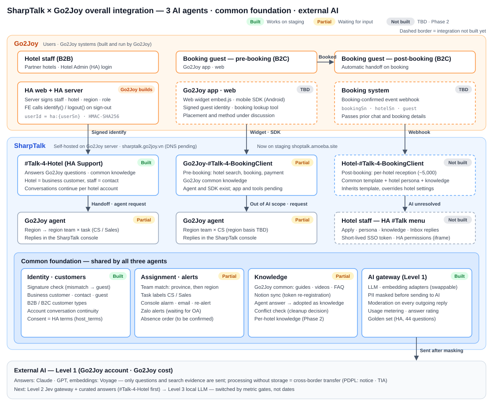
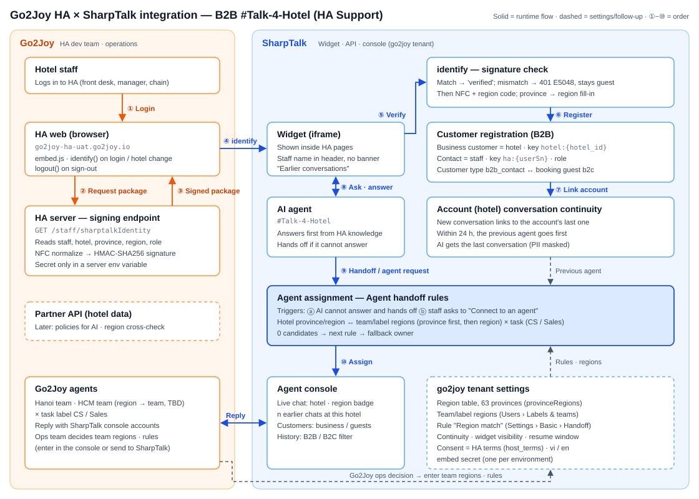

# SharpTalk × Go2Joy — Integration Structure · Requests to Go2Joy · Work Checklist

> All SharpTalk-side Phase 1 (#Talk-4-Hotel) features work on staging. Most of what remains is **what Go2Joy needs to provide** (servers, HA signing, the assigned teams and agent roster, terms of use).
> This document gathers the scattered requests into one list, shows the overall integration structure as diagrams, and splits the work of each side into checklists.

| Item | Details |
|---|---|
| To | Go2Joy PM · HA dev team (back end · FE) · Infrastructure · Operations (CS) · Legal |
| From | SharpTalk (Amoeba) |
| Date / version | 2026-10-22 · v1.1 (phases aligned with plan v1.2) |
| References | SharpTalk × Go2Joy channel structure (2026-10-21) · Go2Joy-SharpTalk AI operating strategy Level 1·2·3 (2026-10-22) · Integration checklist & schedule (2026-10-12) · Project plan PLN-261015 · HA integration guide v1.3 (sent together) |

## Summary
- **Phase 1 scope is B2B `#Talk-4-Hotel` (HA Support).** SharpTalk has deployed and verified on staging: signature verification, registering the hotel as a business customer, conversation continuity per hotel account, hotel region → team assignment, agent notifications, answer rating and the golden evaluation set (3.2).
- **What is blocking is Go2Joy input.**
  - **G1 production server · DNS**: as of 10/22 there is no DNS record for `sharptalk.go2joy.vn`.
  - **G10·G11 HA signing · embed**: not built yet.
  - **G20~G23 teams · roster · task rules · absence order**: not received yet.
  - **G4·G5 terms · privacy notice**: not received yet.

  In the project plan (PLN-261015) the deadline for these items was 10/22. Past it, 10/31 becomes a **staging opening instead of a production opening** (section 4).
- **Phases 2 and 3 (B2C pre-/post-booking, HA menu iframe, booking-confirmed webhook, point billing)** are listed as discussion items only (2.5). Per plan v1.2, **Phase 2 is Go2Joy Philippines** (booking guest support + HA support, run by Go2Joy) and **Phase 3 is per-hotel AI agents** (hotels answer directly — HA menu, point billing). Once we get answers, it starts as a separate requirements document.
- **AI operation**: we are at Level 1 (external AI + RAG). Under the contract Go2Joy bears infrastructure and AI API costs, so **the production AI key must be in Go2Joy's name** (G2). Of the 5 things Level 1 must build, 4 already exist; only per-message AI logging needs to be added (3.2 S30).

## 1. Overall integration structure

*Figure 1. Three AI agents, split by user and booking stage, answer first; people join only on handoff. The three agents share a common foundation (identity · assignment · knowledge · AI gateway). All of SharpTalk is installed on the Go2Joy server, and the only things sent out are masked questions and search evidence.*

| Type | Agent | Entry | Human handoff | Status |
|---|---|---|---|---|
| B2B | `#Talk-4-Hotel` (HA Support) | Widget after HA login + signed identify | Go2Joy agent of hotel region → region team × task (CS / Sales) | **Built on SharpTalk** · waiting for HA signing and agent roster |
| B2C pre-booking | `Go2Joy-#Talk-4-BookingClient` | Go2Joy app · web (web widget / mobile SDK) | Go2Joy agent of region team × CS | Agent and mobile SDK exist · app integration and booking tools under discussion |
| B2C post-booking | `Hotel-#Talk-4-BookingClient` | Automatic handoff on the booking-confirmed event | Hotel staff (HA #Talk menu) or Go2Joy CS — to be confirmed | Phase 3 · not built |

### 1.1 B2B `#Talk-4-Hotel` detailed flow

*Figure 2. ①~③ HA signs the logged-in staff member's information on its server. ④~⑦ When the widget passes it on, SharpTalk verifies it, registers the hotel as a business customer and links the conversation to the hotel account. ⑧~⑩ AI answers first; if it cannot answer or the staff member asks, the conversation is assigned to an agent of the team that matches the hotel's region. The specification is in HA integration guide v1.3.*

### 1.2 Responsibility boundaries
| Work | Go2Joy | SharpTalk (Amoeba) |
|---|---|---|
| Servers · domain · TLS · backups, AI API accounts · costs | **Owner** (owns infrastructure and bears costs under the contract) | Provides specs and procedures |
| SharpTalk installation · updates | Approval · runtime environment | **Owner** (remote support, provides releases) |
| HA signing endpoint · widget embed | **Owner** (server signing code) | Guide · test vectors · verification |
| Terms · privacy notice, PDPL judgment | **Owner** (Legal) | Draft notice wording, masking implementation |
| Region teams · task rules · agent roster · working hours | **Owner** (decision) | Provides settings screens and input support |
| Knowledge content (policies · guides · FAQ) | **Owner** (final content) | Conversion · registration · conflict-check tools |
| AI settings · quality measurement · tuning | Review | **Owner** |
| First-line incident response | Infrastructure | Application |

## 2. Requests to Go2Joy
Priorities:
- **P0**: Phase 1 cannot open in production without it.
- **P1**: needed for Phase 1 operating quality.
- **P2**: needed from Phase 2 onward.

Status is as checked by SharpTalk on 2026-10-22.

### 2.1 Infrastructure · contract · privacy
| # | Request | Details | Owner | Priority | Status |
|---|---|---|---|---|---|
| G1 | **Production server + SSH + DNS** | `sharptalk.go2joy.vn`, TLS, Vietnam region. Specs: pilot 4 vCPU / 8 GB / 80 GB, production 8 vCPU / 16 GB / 200 GB or more. Storage for daily backups | Infrastructure | P0 | **Not received** — no DNS record on 10/22 |
| G2 | **AI API accounts · keys (in Go2Joy's name and billing)** | Answer LLM (Anthropic Claude recommended, OpenAI possible) and embeddings (Voyage). A person to receive monthly usage limits and exhaustion alerts | Infrastructure · Finance | P0 | Production keys not received |
| G3 | Mail sending account | Go2Joy SMTP for agent notification email | Infrastructure | P1 | Not received |
| G4 | **Privacy · PDPL review** | Cross-border transfer notice (processors Anthropic · Voyage, processing location), whether an impact assessment (TIA) is needed, masking scope, conversation retention (draft 180 days), breach notification procedure | Legal | P0 | No reply |
| G5 | **HA terms URL + version, AI use notice wording** | Basis for recording HA terms consent as widget consent (consent banner skipped) | Legal · HA | P0 | Not received |
| G6 | Confirm contacts · channel | PM, HA back end · FE, infrastructure, operations (CS lead), legal, daily check-in channel (10/12 request R13) | PM | P0 | To be confirmed |
| G7 | Service contract clauses | Ownership of trained assets: curated answers are Go2Joy data; Jev, the training pipeline and the generic base model are Amoeba IP; ownership of weights fine-tuned on Go2Joy data. How cost savings are shared, who runs Level 3 (MLOps) | Management · Legal | P2 | Under discussion |

### 2.2 HA integration (`#Talk-4-Hotel`) — specification in guide v1.3
| # | Request | Details | Owner | Priority | Status |
|---|---|---|---|---|---|
| G10 | **HA server signing endpoint** | `userId = "ha:" + userSn`. 5 attributes `hotel_id`·`hotel_name`·`province`·`region` (region code)·`role`, signed with HMAC-SHA256 after NFC normalization. **Send back the results of test vectors T1~T5** (guide 5.2·5.4) | HA back end | P0 | Not built |
| G11 | **HA FE embed** | embed.js + `locale`. Call `identify` once login is confirmed and whenever the hotel changes; call `logout` on sign-out. Allow SharpTalk domains in CSP (`script-src`·`frame-src`·`connect-src`) and CORS (guide 5.3) | HA FE | P0 | Not built |
| G12 | **Signing key option** | A: embed secret issued by SharpTalk (recommended, issued on staging) / B: shared Go2Joy client secret | HA back end | P0 | Decision pending |
| G13 | UAT test accounts | 1 `Quản lý` (multi-hotel) + 1 `Lễ tân` (single hotel). Include at least 2 hotels in different regions | HA | P0 | To be confirmed |
| G14 | Widget visibility (Q2) | Whether to show other staff of the same hotel's conversations in the widget. **Current default: own conversations + "n earlier inquiries from this hotel" count.** Agents and AI see the whole hotel | Operations | P1 | Default applied, awaiting confirmation |
| G15 | Resume window (Q3) | How long after a conversation ends the same agent is assigned first. **Current default 24 hours** | Operations | P1 | Default applied, awaiting confirmation |
| G16 | Signature expiry (`ts`) | Prevents package reuse. If adopted, both sides change the spec together (guide section 7) | HA back end | P1 | Decision pending |
| G17 | Role differences (Q5) · hotel address · district (Q6) | Is different handling for `Quản lý` / `Lễ tân` needed? Address (`settingList.address`) · district (`districtName`) are Phase 3 | Operations | P2 | Decision pending |

### 2.3 Assignment · operations (Go2Joy operations team)
| # | Request | Details | Owner | Priority | Status |
|---|---|---|---|---|---|
| G20 | **Region → team mapping, assignment region unit** | Are teams split by region (4) · province · district? Proposal: `north`·`north_center` → Hanoi team, `south`·`south_center` → Ho Chi Minh team. Da Nang · Central Highlands (13 provinces of `south_center`) need confirmation | Operations | P0 | No reply |
| G21 | **Agent roster** | Name · email · team · task label (CS / Sales) · rank. We issue console accounts once received | Operations | P0 | Not received |
| G22 | **Sales inquiry rules** | Which inquiries are Sales (e.g. settlement · contract · commission). Keywords and 5~10 example inquiries. Without them everything goes to CS | Operations | P0 | Not received |
| G23 | **Working hours · absence order · fallback owner** | Proposal: backup owner → team queue → offline message. Who receives when the region is unknown (no hotel selected) | Operations | P0 | No reply |
| G24 | Zalo OA + ZNS template approval | For sending agent notifications via Zalo as well | Operations | P1 | Not received |
| G25 | New province names in the region table | Send a new table once names after the 2025-07 merger (63 → 34 provinces) come into use | Operations | P1 | Waiting |
| G26 | Supported languages | Any languages beyond Vietnamese and English | Operations | P2 | Decision pending |

> Go2Joy's master account can also enter team regions and assignment rules directly in the SharpTalk console. The place is **Settings › Agent handoff › Routing rules** (reorganized 2026-10-24). Each rule takes the **consult category** the customer picked (e.g. Customer Services / Business Support) and **Customer information › Region** (e.g. South · South Center) as conditions, and picks a **team × label** as the assignee (e.g. South × cs). Use **Check routing** above the rules to see which agent a conversation would go to before saving. Team members are assigned only after they accept their invitation.

### 2.4 Knowledge · AI quality
| # | Request | Details | Owner | Priority | Status |
|---|---|---|---|---|---|
| G30 | **Re-register the Notion knowledge source** | On 10/21 the source and token were deleted together, so the HA guide (#2501) · FAQ (#3599) are inactive. Reconnecting the same pages restores them automatically (fix deployed) | Operations | P0 | Waiting |
| G31 | Decide on knowledge conflict cleanup | 78 pairs classified on 10/15: 3 real fixes, 3 duplicated policy documents, 32 FAQ copies. Decide which to keep | Operations | P1 | Decision pending |
| G32 | Review the golden evaluation set | Confirm the correct answers of the 44 `#Talk-4-Hotel` questions. Provide representative questions when building the pre-booking agent's set. This is the regression baseline for engine changes and level transitions | Operations | P1 | Review pending |
| G33 | Quality labels in operation | Agents rate AI answers as accurate/inaccurate and adopt corrected answers as knowledge. This is the data for the Level 2 (curated answers) transition gate | Operations | P1 | After opening |
| G34 | Partner API (follow-up) | Production client key, SharpTalk server IP allowlist, Hotel Feed coverage (all HA hotels), fix the behavior that returns everything when no hotel matches, a test environment that verifies signatures (guide 7.1) | HA back end | P2 | Only test key received (10/21) |

### 2.5 Phases 2 and 3 — B2C pre-/post-booking (discussion items)
G40–G43 and G47 are needed for Phase 2 (Philippines booking guest support); G44–G46 for Phase 3 (per-hotel AI agents).

| # | Request | Details | Priority |
|---|---|---|---|
| G40 | Booking-confirmed event webhook | Handoff point. `bookingSn`·`hotelSn`·guest identity·signature, link to the earlier conversation session, a thread per booking (hotel) when several hotels are booked | P2 |
| G41 | Go2Joy app · web embed | Web widget / Android SDK (verified on device) / iOS. Signed identity for logged-in guests (separated from HA staff by a `userId` prefix), booking lookup tool API | P2 |
| G42 | Region basis for pre-booking guests | The region of the hotel being searched or booked, or the guest's location | P2 |
| G43 | Post-booking handoff · scope · retention | Human handoff target (hotel staff / Go2Joy CS / split rule), whether booking changes · cancellations · refunds go to Go2Joy, when to close conversations after check-out and how long to keep them | P2 |
| G44 | HA menu (iframe) | Add a SharpTalk menu to HA (apply · persona · knowledge · Inbox), a **short-lived SSO token** issued by the server (never passing the HA token as is), permission link (`Quản lý` settings / `Lễ tân` Inbox) | P2 |
| G45 | Reception agent operation | Common template content (managed by Go2Joy), application approval process, onboarding order for about 5,000 hotels | P2 |
| G46 | Billing | Token → point conversion rate, what happens when points run out (pause / connect to staff), where top-ups and balance are shown | P2 |
| G47 | Zalo channel support | Scope of receiving and answering Zalo conversations in the console | P2 |

> Items from the 10/12 request (R1~R16) not repeated in this document (staging access, existing API list, operational data samples, pilot hotels, release · incident process) will be checked for receipt at the next meeting.

## 3. Work checklist

### 3.1 Go2Joy
**Before Phase 1 production opening (P0)**

- [ ] G1 Production server · SSH · DNS `sharptalk.go2joy.vn` · TLS · backup storage
- [ ] G2 Production AI API keys (in Go2Joy's name) — answer LLM + embeddings
- [ ] G4 PDPL review (cross-border transfer notice · TIA · retention) and G5 HA terms URL · version · AI notice wording
- [ ] G6 Confirm contacts · daily check-in channel
- [ ] G10 HA server signing endpoint (v1.2 spec) + send back T1~T5 results
- [ ] G11 HA FE embed (identify / call again on hotel change / logout, CSP · CORS)
- [ ] G12 Decide signing key option (A recommended)
- [ ] G13 UAT test accounts (`Quản lý` · `Lễ tân`, including hotels in different regions)
- [ ] G20 Region → team mapping and assignment region unit
- [ ] G21 Agent roster (name · email · team · task label · rank)
- [ ] G22 Sales inquiry rules
- [ ] G23 Working hours · absence order · fallback owner
- [ ] G30 Re-register the Notion knowledge source

**UAT (guide v1.3 §8.2)**

- [ ] Not logged in · logged in · logged out · no hotel selected · value tampered without re-signing
- [ ] Business customer registration · same staff logs in again · other staff of the same hotel
- [ ] Ask again after a conversation ends · another PC · next day
- [ ] AI handoff · "Connect to an agent" · assignment results for hotels in all 4 regions
- [ ] UAT sign-off and production opening approval

**Operating quality (P1)**

- [ ] Confirm G14 widget visibility · G15 resume window · G16 signature expiry
- [ ] G24 Zalo OA · G25 new province names in the region table
- [ ] G31 knowledge conflict decision · G32 golden set review · G33 agent rating and answer adoption in operation

**Phase 2 and 3 discussion (P2)**

- [ ] Answers to G40~G47 (booking-confirmed webhook, app · web embed, region basis, post-booking handoff · scope · retention, HA menu iframe · SSO, reception operation, billing, Zalo)
- [ ] G7 service contract clauses · G17 role differences · address · district · G26 languages · G34 Partner API

### 3.2 SharpTalk
**Done (working on the staging go2joy tenant)**

- [x] S1 Signed identify verification, session "verified", HA terms consent mode, staff name in header (#637 · #642 · #656)
- [x] S2 Assignment rules: region × task, two triggers — AI handoff and "Connect to an agent" (#638)
- [x] S3 Agent personal email · re-alert when not accepted (#639)
- [x] S4 Answer accuracy rating (#640), automatic scoring of the 44-question HA golden set (#611)
- [x] S5 Widget design, satisfaction survey, languages fixed to vi / en (#650 ~ #662)
- [x] S6 Region code · NFC normalization, region fill-in from 63 provinces of the region table, team · label regions, "Region match" assignment rule (#687)
- [x] S7 Business customer (hotel) · contact (staff) registration, B2B / B2C split, conversation continuity per hotel account, previous agent assigned first, previous conversation summary for AI (#689)
- [x] S8 Updated schema for new server installs (#692) — ready for the Go2Joy server install
- [x] S9 HA integration guide v1.3, this document

**Once Go2Joy input arrives**

| # | Work | Input needed | Effort (est.) |
|---|---|---|---|
| S20 | Send the staging embed secret over a secure channel | G12 (A) | Same day |
| S21 | Issue agent console accounts, set teams · task labels | G21 | Same day |
| S22 | Enter team regions · "Region match" rules · Sales keywords · fallback · working hours, check with the rule preview | G20 · G22 · G23 | Half a day |
| S23 | Enter HA terms URL · version (consent mode is already HA terms) | G5 | Same day |
| S24 | **Install on the Go2Joy server** (VN profile), migrate staging knowledge · settings (region table · conversation continuity · rules), reindex, connect the golden-set deploy gate | G1 · G2 · G3 | 4 days |
| S25 | Confirm Notion resync, run knowledge conflict cleanup | G30 · G31 | 1~2 days |
| S26 | Zalo agent notifications | G24 | 4 days |
| S27 | Joint UAT → test result report | G10 · G11 · G13 | 3 days |

**What SharpTalk keeps working on**

- [ ] S28 Show the handoff reason in the console, conflict check before adopting knowledge (PLN-261015 D5 · D6)
- [ ] S29 Signature expiry (`ts`), receiving hotel address · district — after G16 · G17 decisions
- [ ] S30 **AI Level 1 additions**: per-message AI log (model · tokens · latency · rewritten question · outcome). Today there is only a daily usage total. Add Go2Joy booking numbers to masking once we get their format. Extend golden sets per agent
- [ ] S31 Requirements documents for Phase 2 (Philippines) and Phase 3 (per-hotel AI agents) (B2C pre-booking integration, reception agent template, HA menu iframe · SSO, receiving the booking webhook, point billing) — after the 2.5 answers

### 3.3 AI operation Level 1 — prerequisite check
The AI operating strategy says Level 1 must build these 5 things before moving to Level 2·3.

| Prerequisite | SharpTalk today | Remaining |
|---|---|---|
| ① LLM · embedding ports | Exists — engine adapters (Anthropic · OpenAI · Voyage · stub), per-tenant engine selection. Changing engines is a settings change | — |
| ② Conversation log schema | Partial — message text · language · intent · search evidence, conversation outcome (resolved · handed off), daily token usage | Per-message model · tokens · latency · rewritten question (S30) |
| ③ Quality labels | Exists — answer accuracy rating, handoff flag, agent answer → knowledge adoption | Accumulate in operation (G33) |
| ④ PII masking | Exists — phone · email · order numbers etc. masked before sending to AI and in logs | Add the Go2Joy booking number format (S30) |
| ⑤ Golden evaluation set | Exists — 44 `#Talk-4-Hotel` questions scored automatically | Go2Joy review (G32), extend to other agents |

## 4. Schedule impact
The PLN-261015 decision: **if Go2Joy's prerequisites (server · DNS, HA embed · signing, agent roster) are not ready by 10/22, 10/31 becomes a "staging opening"**. As of 10/22 these items have not been received.

| Path | Conditions | Result |
|---|---|---|
| Staging opening (10/31) | G10 · G11 · G13 · G20 ~ G23 | HA UAT points at SharpTalk staging and real agents respond. Operating data is still outside the Go2Joy server (on staging) |
| Production opening | Above + G1 · G2 · G4 · G5 | Install on the Go2Joy server (S24, 4 days) → UAT (S27, 3 days) → opening. **About 7 business days from the day G1 arrives** |

## 5. Decisions needed — meeting summary
| Decision | SharpTalk proposal / current default | Related |
|---|---|---|
| Signing key | A — embed secret issued by SharpTalk | G12 |
| Region → team | `north`·`north_center` → Hanoi, `south`·`south_center` → Ho Chi Minh | G20 |
| Absence order | Backup owner → team queue → offline message | G23 |
| Widget visibility | Own conversations + count of the hotel's earlier inquiries (applied) | G14 |
| Resume window | 24 hours (applied) | G15 |
| Signature expiry | Recommended | G16 |
| Post-booking handoff target | Hotel staff first, Go2Joy CS if no response (proposal) | G43 |
| Ownership of trained assets | Curated answers = Go2Joy, Jev · pipeline · generic model = Amoeba, fine-tuned weights stated in the contract | G7 |
