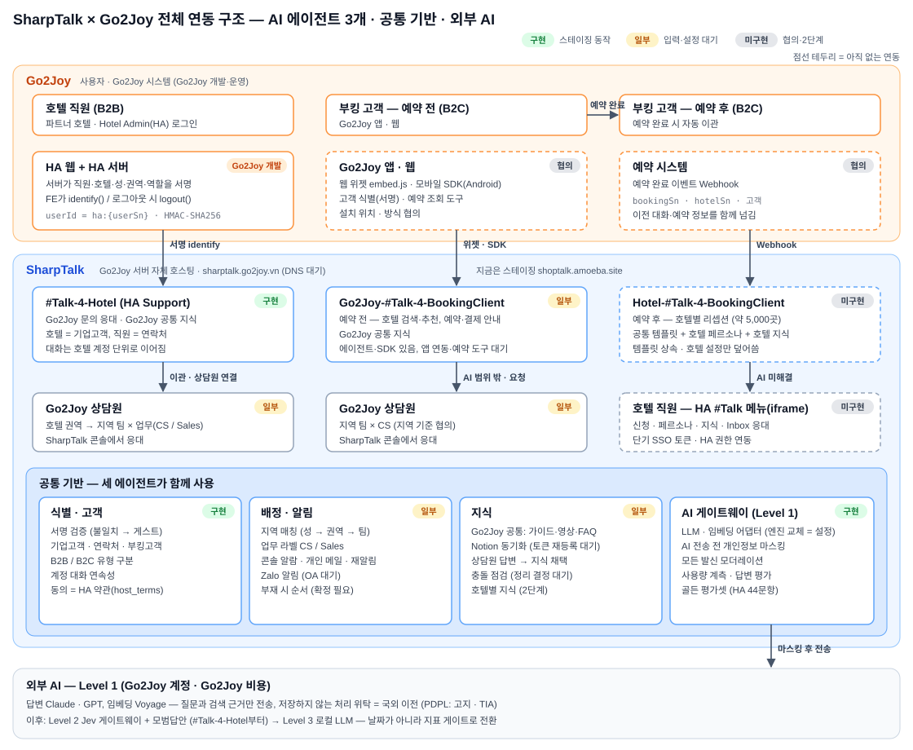
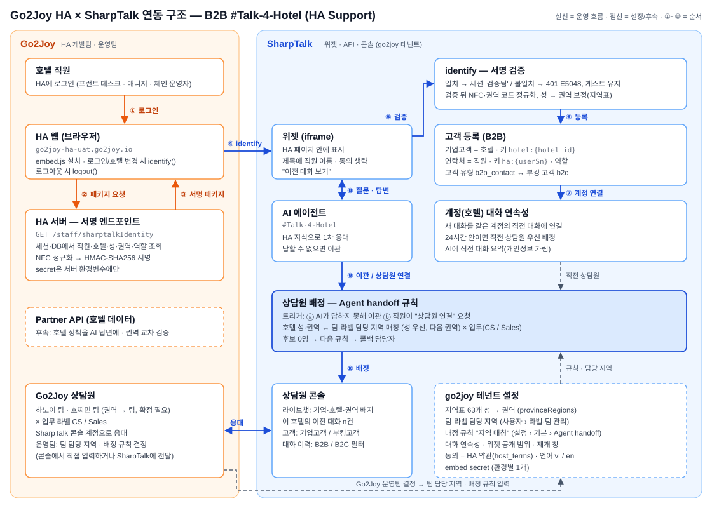

# SharpTalk × Go2Joy — 연동 구조 · Go2Joy 요청 사항 · 작업 체크리스트

> SharpTalk 쪽 1단계(#Talk-4-Hotel) 기능은 스테이징에서 모두 동작합니다. 남은 것은 대부분 **Go2Joy가 주어야 하는 것**(서버, HA 서명, 담당 팀과 상담원 명단, 약관)입니다.
> 이 문서는 흩어져 있던 요청을 한 목록으로 다시 정리하고, 전체 연동 구조를 그림으로 보이며, 양쪽이 할 일을 체크리스트로 나눕니다.

| 항목 | 내용 |
|---|---|
| 수신 | Go2Joy PM · HA 개발팀(백엔드·FE) · 인프라 · 운영팀(CS) · 법무 |
| 발신 | SharpTalk (Amoeba) |
| 일자 / 버전 | 2026-10-22 · v1.0 |
| 참고 | SharpTalk × Go2Joy 채널 구조(2026-10-21) · Go2Joy-SharpTalk AI 운용 전략 Level 1·2·3(2026-10-22) · 연동 체크리스트 및 일정표(2026-10-12) · 프로젝트 계획서 PLN-261015 · HA 연동 가이드 v1.3(함께 전달) |

## 요약
- **1단계 범위는 B2B `#Talk-4-Hotel`(HA Support)입니다.** SharpTalk은 서명 검증, 호텔 = 기업고객 등록, 호텔 계정 단위 대화 연속성, 호텔 지역 → 팀 배정, 담당자 알림, 답변 평가, 골든 평가셋을 스테이징에 배포해 검증했습니다(3.2).
- **막힌 곳은 Go2Joy 입력입니다.**
  - **G1 운영 서버·DNS**: 10/22 현재 `sharptalk.go2joy.vn`에 DNS 레코드가 없습니다.
  - **G10·G11 HA 서명·임베드**: 아직 구현되지 않았습니다.
  - **G20~G23 팀·명단·업무 기준·부재 순서**: 아직 받지 못했습니다.
  - **G4·G5 약관·개인정보 고지**: 아직 받지 못했습니다.

  프로젝트 계획(PLN-261015)에서 이 항목들의 기한은 10/22였고, 넘기면 10/31은 **운영 오픈이 아니라 스테이징 오픈**으로 바뀝니다(4절).
- **2단계(B2C 예약 전·후, HA 메뉴 iframe, 예약 완료 Webhook, 포인트 과금)** 는 협의 항목만 정리했습니다(2.5). 회신을 받으면 별도 요구사항 문서로 시작합니다.
- **AI 운용**: 지금은 Level 1(외부 AI + RAG)입니다. 계약상 인프라와 AI API 비용은 Go2Joy가 부담하므로 **운영용 AI 키는 Go2Joy 명의**여야 합니다(G2). Level 1에서 만들어 둘 5가지 중 4가지는 이미 있고, 메시지 단위 AI 로그만 보강하면 됩니다(3.2 S30).

## 1. 전체 연동 구조

*그림 1. AI 에이전트 3개가 사용자와 예약 단계로 나뉘어 먼저 응대하고, 사람은 이관할 때만 들어옵니다. 세 에이전트는 공통 기반(식별·배정·지식·AI 게이트웨이)을 함께 씁니다. SharpTalk 전체는 Go2Joy 서버에 설치되고, 외부로 나가는 것은 마스킹한 질문과 검색 근거뿐입니다.*

| 구분 | 에이전트 | 진입 | 사람 이관 | 상태 |
|---|---|---|---|---|
| B2B | `#Talk-4-Hotel` (HA Support) | HA 로그인 후 위젯 + 서명 identify | 호텔 권역 → 지역 팀 × 업무(CS / Sales)의 Go2Joy 상담원 | **SharpTalk 구현 완료** · HA 서명·담당자 명단 대기 |
| B2C 예약 전 | `Go2Joy-#Talk-4-BookingClient` | Go2Joy 앱·웹(웹 위젯 / 모바일 SDK) | 지역 팀 × CS의 Go2Joy 상담원 | 에이전트·모바일 SDK 있음 · 앱 연동·예약 도구 협의 |
| B2C 예약 후 | `Hotel-#Talk-4-BookingClient` | 예약 완료 이벤트로 자동 이관 | 호텔 직원(HA #Talk 메뉴) 또는 Go2Joy CS — 확인 필요 | 2단계 · 미구현 |

### 1.1 B2B `#Talk-4-Hotel` 상세 흐름

*그림 2. ①~③ HA가 로그인 직원의 정보를 서버에서 서명합니다. ④~⑦ 위젯이 넘기면 SharpTalk이 검증하고, 호텔을 기업고객으로 등록한 뒤 대화를 호텔 계정에 잇습니다. ⑧~⑩ AI가 먼저 답하고, 답하지 못하거나 직원이 요청하면 호텔 권역에 맞는 팀의 상담원에게 배정합니다. 규격은 HA 연동 가이드 v1.3에 있습니다.*

### 1.2 책임 경계
| 업무 | Go2Joy | SharpTalk (Amoeba) |
|---|---|---|
| 서버·도메인·TLS·백업, AI API 계정·비용 | **책임**(계약상 인프라 소유·비용 부담) | 사양·절차 제공 |
| SharpTalk 설치·업데이트 | 승인·실행 환경 | **책임**(원격 지원, 릴리스 제공) |
| HA 서명 엔드포인트·위젯 임베드 | **책임**(서버 서명 코드) | 가이드·테스트 벡터·검증 |
| 약관·개인정보 고지, PDPL 판단 | **책임**(법무) | 고지 문구 초안, 마스킹 구현 |
| 지역 팀·업무 기준·상담원 명단·근무시간 | **책임**(결정) | 설정 화면 제공·입력 지원 |
| 지식 내용(정책·가이드·FAQ) | **책임**(내용 확정) | 변환·등록·충돌 점검 도구 |
| AI 설정·품질 측정·튜닝 | 검토 | **책임** |
| 장애 1차 대응 | 인프라 | 애플리케이션 |

## 2. Go2Joy 요청 사항
우선순위는 다음과 같습니다.
- **P0**: 없으면 1단계를 운영 오픈할 수 없습니다.
- **P1**: 1단계 운영 품질에 필요합니다.
- **P2**: 2단계 이후에 필요합니다.

상태는 2026-10-22에 SharpTalk이 확인한 기준입니다.

### 2.1 인프라·계약·개인정보
| # | 요청 | 상세 | 담당 | 우선 | 상태 |
|---|---|---|---|---|---|
| G1 | **운영 서버 + SSH + DNS** | `sharptalk.go2joy.vn`, TLS, 베트남 리전. 사양: 시범 4 vCPU / 8 GB / 80 GB, 운영 8 vCPU / 16 GB / 200 GB 이상. 일 1회 백업 저장소 | 인프라 | P0 | **미수령** — 10/22 DNS 레코드 없음 |
| G2 | **AI API 계정·키(Go2Joy 명의·결제)** | 답변 LLM(Anthropic Claude 권장, OpenAI 가능)과 임베딩(Voyage). 월 사용 한도와 소진 알림을 받을 담당자 | 인프라·재무 | P0 | 운영용 미수령 |
| G3 | 메일 발신 계정 | 담당자 알림 메일용 Go2Joy SMTP | 인프라 | P1 | 미수령 |
| G4 | **개인정보·PDPL 확인** | 국외 이전 고지(수탁자 Anthropic·Voyage, 처리 지역), 영향평가(TIA) 필요 여부, 마스킹 범위, 대화 보존 기간(초안 180일), 침해 통지 절차 | 법무 | P0 | 미회신 |
| G5 | **HA 약관 URL + 버전, AI 이용 고지 문구** | HA 약관 동의를 위젯 동의로 기록하는 근거(동의 배너 생략) | 법무·HA | P0 | 미수령 |
| G6 | 담당자·채널 확인 | PM, HA 백엔드·FE, 인프라, 운영(CS 리드), 법무, 일일 점검 채널(10/12 요청 R13) | PM | P0 | 확인 필요 |
| G7 | 서비스 계약 조항 | 학습 결과물 소유권: 모범답안은 Go2Joy 데이터, Jev·학습 파이프라인·범용 기본 모델은 Amoeba IP, Go2Joy 데이터로 만든 파인튜닝 가중치의 귀속. 비용 절감분 회수 방식, Level 3 운영 주체(MLOps) | 경영·법무 | P2 | 협의 |

### 2.2 HA 연동 (`#Talk-4-Hotel`) — 규격은 가이드 v1.3
| # | 요청 | 상세 | 담당 | 우선 | 상태 |
|---|---|---|---|---|---|
| G10 | **HA 서버 서명 엔드포인트** | `userId = "ha:" + userSn`. 속성은 `hotel_id`·`hotel_name`·`province`·`region`(권역 코드)·`role` 5개, NFC 정규화 후 HMAC-SHA256 서명. **테스트 벡터 T1~T5 결과 회신**(가이드 5.2·5.4) | HA 백엔드 | P0 | 미구현 |
| G11 | **HA FE 임베드** | embed.js + `locale`. 로그인이 확정되면, 그리고 호텔을 바꾸면 `identify`, 로그아웃하면 `logout`. CSP(`script-src`·`frame-src`·`connect-src`)와 CORS에 SharpTalk 도메인 허용(가이드 5.3) | HA FE | P0 | 미구현 |
| G12 | **서명 키 방안** | A: SharpTalk이 발급한 embed secret(권장, 스테이징 발급됨) / B: Go2Joy client secret 공용 | HA 백엔드 | P0 | 결정 대기 |
| G13 | UAT 테스트 계정 | `Quản lý`(다중 호텔) 1개 + `Lễ tân`(단일 호텔) 1개. 권역이 다른 호텔 2곳 이상 포함 | HA | P0 | 확인 필요 |
| G14 | 위젯 공개 범위(Q2) | 같은 호텔 다른 직원의 대화를 위젯에 보여줄지. **현재 기본값: 본인 대화 + "이 호텔의 이전 문의 n건" 건수.** 상담원과 AI는 호텔 전체를 봅니다 | 운영 | P1 | 기본값 적용, 확인 대기 |
| G15 | 재개 창(Q3) | 끝난 대화 뒤 같은 상담원을 먼저 배정하는 시간. **현재 기본값 24시간** | 운영 | P1 | 기본값 적용, 확인 대기 |
| G16 | 서명 유효기간(`ts`) | 패키지 재사용 방지. 적용하면 양쪽 규격을 함께 바꿈(가이드 7절) | HA 백엔드 | P1 | 결정 대기 |
| G17 | 역할별 차이(Q5) · 호텔 주소·군(Q6) | `Quản lý` / `Lễ tân` 응대 차이가 필요한가. 주소(`settingList.address`)·군(`districtName`)은 3단계 | 운영 | P2 | 결정 대기 |

### 2.3 배정·운영 (Go2Joy 운영팀)
| # | 요청 | 상세 | 담당 | 우선 | 상태 |
|---|---|---|---|---|---|
| G20 | **권역 → 팀 매핑, 배정 지역 단위** | 팀은 권역(4개)·성·군 중 어느 단위로 나누는가. 제안: `north`·`north_center` → 하노이 팀, `south`·`south_center` → 호찌민 팀. 다낭·중부 고원(`south_center` 13개 성)은 확인 필요 | 운영 | P0 | 미회신 |
| G21 | **상담원 명단** | 이름 · 이메일 · 팀 · 업무 라벨(CS / Sales) · 직급. 받으면 콘솔 계정을 발급합니다 | 운영 | P0 | 미수령 |
| G22 | **Sales 문의 기준** | 어떤 문의가 Sales인가(예: 정산·계약·수수료). 키워드와 예시 문의 5~10개. 없으면 모두 CS로 갑니다 | 운영 | P0 | 미수령 |
| G23 | **근무시간·부재 처리 순서·폴백 담당자** | 제안: 대체 담당자 → 팀 큐 → 오프라인 메시지. 권역을 모를 때(호텔 미선택) 받을 담당자 | 운영 | P0 | 미회신 |
| G24 | Zalo OA + ZNS 템플릿 승인 | 상담원 알림을 Zalo로도 보낼 때 | 운영 | P1 | 미수령 |
| G25 | 지역표 신 명칭 | 2025-07 통폐합(63 → 34개 성) 이후 이름을 쓰기 시작하면 새 표 전달 | 운영 | P1 | 대기 |
| G26 | 지원 언어 | 베트남어·영어 외 추가 여부 | 운영 | P2 | 결정 대기 |

> 팀 담당 지역과 배정 규칙은 SharpTalk 콘솔에서 Go2Joy 마스터 계정이 직접 입력할 수도 있습니다. 위치는 **사용자 › 라벨·팀 관리 › 담당 지역**과 **설정 › 기본 › Agent handoff › 지역 매칭**입니다. 권역 → 팀 매핑이 바뀌면 팀의 담당 지역만 고치면 되고, 규칙은 그대로 둡니다.

### 2.4 지식·AI 품질
| # | 요청 | 상세 | 담당 | 우선 | 상태 |
|---|---|---|---|---|---|
| G30 | **Notion 지식 소스 재등록** | 10/21 소스와 토큰이 함께 삭제되어 HA 가이드(#2501)·FAQ(#3599)가 비활성입니다. 같은 페이지를 다시 연결하면 자동 복구됩니다(수정 배포 완료) | 운영 | P0 | 대기 |
| G31 | 지식 충돌 정리 결정 | 10/15 분류 78건: 실제 수정 3, 정책 문서 2벌 3, FAQ 복제 32. 어느 쪽을 남길지 결정 | 운영 | P1 | 결정 대기 |
| G32 | 골든 평가셋 검수 | `#Talk-4-Hotel` 44문항의 정답 확인. 예약 전 에이전트 세트를 만들 때 대표 질문 제공. 엔진 교체·레벨 전환의 회귀 기준입니다 | 운영 | P1 | 검수 대기 |
| G33 | 운영 중 품질 라벨 | 상담원이 AI 답변을 정확/부정확으로 평가하고, 고친 답변을 지식으로 채택. Level 2(모범답안) 전환 게이트의 데이터입니다 | 운영 | P1 | 오픈 후 |
| G34 | Partner API(후속) | 운영 client key, SharpTalk 서버 IP 화이트리스트, Hotel Feed 범위(HA 호텔 전체), 일치하는 호텔이 없을 때 전체를 돌려주는 동작 수정, 서명을 검증하는 테스트 환경(가이드 7.1) | HA 백엔드 | P2 | 테스트 키만 수령(10/21) |

### 2.5 2단계 — B2C 예약 전·후 (협의 항목)
| # | 요청 | 상세 | 우선 |
|---|---|---|---|
| G40 | 예약 완료 이벤트 Webhook | 이관 시점. `bookingSn`·`hotelSn`·고객 식별·서명, 앞선 대화 세션과의 연결, 여러 호텔 예약 시 예약(호텔)별 스레드 | P2 |
| G41 | Go2Joy 앱·웹 임베드 | 웹 위젯 / Android SDK(실기기 검증됨) / iOS. 로그인 고객의 서명 식별(`userId` 접두어로 HA 직원과 분리), 예약 조회 도구 API | P2 |
| G42 | 예약 전 고객의 지역 기준 | 검색·예약 중인 호텔의 지역인가, 고객 위치인가 | P2 |
| G43 | 예약 후 이관·범위·보관 | 사람 이관 대상(호텔 직원 / Go2Joy CS / 분담 기준), 예약 변경·취소·환불을 Go2Joy로 넘길지, 체크아웃 후 대화 종료 시점·보관 기간 | P2 |
| G44 | HA 메뉴(iframe) | HA에 SharpTalk 메뉴(신청·페르소나·지식·Inbox) 추가, 서버가 발급하는 **단기 SSO 토큰**(HA 토큰을 그대로 넘기지 않음), 권한 연동(`Quản lý` 설정 / `Lễ tân` Inbox) | P2 |
| G45 | 리셉션 에이전트 운영 | 공통 템플릿 내용(Go2Joy 관리), 신청 승인 절차, 약 5,000개 호텔 온보딩 순서 | P2 |
| G46 | 과금 | 토큰 → 포인트 환산 기준, 포인트 소진 시 처리(중지 / 직원 연결), 충전·잔액 화면 위치 | P2 |
| G47 | Zalo 채널 상담 | 콘솔에서 Zalo 대화를 받고 답하는 범위 | P2 |

> 10/12 요청서(R1~R16) 가운데 이 문서에 다시 넣지 않은 항목(스테이징 접속, 기존 API 목록, 운영 데이터 샘플, 파일럿 호텔, 배포·장애 절차)은 수령 여부를 다음 회의에서 확인합니다.

## 3. 작업 체크리스트

### 3.1 Go2Joy
**1단계 운영 오픈 전 (P0)**

- [ ] G1 운영 서버·SSH·DNS `sharptalk.go2joy.vn`·TLS·백업 저장소
- [ ] G2 운영용 AI API 키(Go2Joy 명의) — 답변 LLM + 임베딩
- [ ] G4 PDPL 확인(국외 이전 고지·TIA·보존 기간)과 G5 HA 약관 URL·버전·AI 고지 문구
- [ ] G6 담당자·일일 점검 채널 확인
- [ ] G10 HA 서버 서명 엔드포인트(v1.2 규격) + T1~T5 결과 회신
- [ ] G11 HA FE 임베드(identify / 호텔 변경 시 재호출 / logout, CSP·CORS)
- [ ] G12 서명 키 방안 결정(A 권장)
- [ ] G13 UAT 테스트 계정(`Quản lý` · `Lễ tân`, 권역이 다른 호텔 포함)
- [ ] G20 권역 → 팀 매핑과 배정 지역 단위
- [ ] G21 상담원 명단(이름·이메일·팀·업무 라벨·직급)
- [ ] G22 Sales 문의 기준
- [ ] G23 근무시간·부재 처리 순서·폴백 담당자
- [ ] G30 Notion 지식 소스 재등록

**UAT (가이드 v1.3 §8.2)**

- [ ] 미로그인 · 로그인 · 로그아웃 · 호텔 미선택 · 재서명 없이 값 변조
- [ ] 기업고객 등록 · 같은 직원 재로그인 · 같은 호텔 다른 직원
- [ ] 대화 종료 후 재질문 · 다른 PC · 다음 날
- [ ] AI 이관 · "상담원 연결" · 권역별 호텔 4곳의 배정 결과
- [ ] UAT 승인과 운영 오픈 승인

**운영 품질 (P1)**

- [ ] G14 위젯 공개 범위 · G15 재개 창 · G16 서명 유효기간 확인
- [ ] G24 Zalo OA · G25 지역표 신 명칭
- [ ] G31 지식 충돌 정리 결정 · G32 골든셋 검수 · G33 상담원 평가·답변 채택 운영

**2단계 협의 (P2)**

- [ ] G40~G47 회신(예약 완료 Webhook, 앱·웹 임베드, 지역 기준, 예약 후 이관·범위·보관, HA 메뉴 iframe·SSO, 리셉션 운영, 과금, Zalo)
- [ ] G7 서비스 계약 조항 · G17 역할 차이·주소·군 · G26 언어 · G34 Partner API

### 3.2 SharpTalk
**완료 (스테이징 go2joy 테넌트에서 동작)**

- [x] S1 서명 identify 검증, 세션 '검증됨', HA 약관 동의 모드, 헤더에 직원 이름 (#637 · #642 · #656)
- [x] S2 배정 규칙: 지역 × 업무, AI 이관과 "상담원 연결" 두 트리거 (#638)
- [x] S3 담당자 개인 메일 · 미수락 재알림 (#639)
- [x] S4 답변 정확성 평가 (#640), HA 골든셋 44문항 자동 채점 (#611)
- [x] S5 위젯 디자인, 만족도 설문, 언어 vi / en 고정 (#650 ~ #662)
- [x] S6 권역 코드·NFC 정규화, 지역표 63개 성 → 권역 보정, 팀·라벨 담당 지역, "지역 매칭" 배정 규칙 (#687)
- [x] S7 기업고객(호텔) · 연락처(직원) 등록, B2B / B2C 구분, 호텔 계정 대화 연속성, 직전 상담원 우선 배정, AI에 직전 대화 요약 (#689)
- [x] S8 새 서버 설치용 스키마 최신화 (#692) — Go2Joy 서버 설치 준비
- [x] S9 HA 연동 가이드 v1.3, 이 문서

**Go2Joy 입력을 받으면**

| # | 작업 | 필요한 입력 | 소요(안) |
|---|---|---|---|
| S20 | 스테이징 embed secret을 보안 채널로 전달 | G12 (A) | 당일 |
| S21 | 상담원 콘솔 계정 발급, 팀·업무 라벨 지정 | G21 | 당일 |
| S22 | 팀 담당 지역·"지역 매칭" 규칙·Sales 키워드·폴백·근무시간 입력, 규칙 미리보기로 확인 | G20 · G22 · G23 | 반나절 |
| S23 | HA 약관 URL·버전 입력(동의 방식은 이미 HA 약관) | G5 | 당일 |
| S24 | **Go2Joy 서버 설치**(VN 프로필), 스테이징 지식·설정 이관(지역표·대화 연속성·규칙), 재색인, 골든셋 배포 게이트 연결 | G1 · G2 · G3 | 4일 |
| S25 | Notion 재동기화 확인, 지식 충돌 정리 실행 | G30 · G31 | 1~2일 |
| S26 | Zalo 담당자 알림 | G24 | 4일 |
| S27 | UAT 공동 점검 → 테스트 결과 보고 | G10 · G11 · G13 | 3일 |

**SharpTalk이 계속 진행할 것**

- [ ] S28 이관 사유를 콘솔에 표시, 지식 채택 전 충돌 점검 (PLN-261015 D5 · D6)
- [ ] S29 서명 유효기간(`ts`), 호텔 주소·군 수신 — G16 · G17 결정 후
- [ ] S30 **AI Level 1 보강**: 메시지 단위 AI 로그(모델 · 토큰 · 지연 · 재작성 질문 · 결과). 지금은 일별 사용량 집계뿐입니다. Go2Joy 예약번호 형식을 받으면 마스킹에 추가합니다. 에이전트별 골든셋도 늘립니다
- [ ] S31 2단계 요구사항 문서(B2C 예약 전 연동, 리셉션 에이전트 템플릿, HA 메뉴 iframe·SSO, 예약 Webhook 수신, 포인트 과금) — 2.5 회신 후

### 3.3 AI 운용 Level 1 — 선행 조건 대조
AI 운용 전략은 Level 2·3으로 넘어가기 전에 Level 1에서 다음 5가지를 만들어 두라고 정합니다.

| 선행 조건 | SharpTalk 현재 | 남은 일 |
|---|---|---|
| ① LLM · 임베딩 포트 | 있음 — 엔진 어댑터(Anthropic · OpenAI · Voyage · stub), 테넌트별 엔진 지정. 엔진 교체는 설정 변경 | — |
| ② 대화 로그 스키마 | 일부 — 메시지 원문·언어·의도·검색 근거, 대화 결과(해결·이관), 일별 토큰 사용량 | 메시지 단위 모델 · 토큰 · 지연 · 재작성 질문 (S30) |
| ③ 품질 라벨 | 있음 — 답변 정확성 평가, 이관 여부, 상담원 답변 → 지식 채택 | 운영 중 쌓기 (G33) |
| ④ PII 마스킹 | 있음 — AI 전송 전과 로그에서 전화 · 이메일 · 주문번호 등 마스킹 | Go2Joy 예약번호 형식 추가 (S30) |
| ⑤ 골든 평가셋 | 있음 — `#Talk-4-Hotel` 44문항 자동 채점 | Go2Joy 검수 (G32), 다른 에이전트로 확장 |

## 4. 일정 영향
PLN-261015의 결정은 다음과 같습니다. **Go2Joy 선행 항목(서버·DNS, HA 임베드·서명, 담당자 명단)이 10/22까지 준비되지 않으면 10/31은 "스테이징 오픈"으로 대체**합니다. 10/22 현재 이 항목들은 받지 못했습니다.

| 경로 | 조건 | 결과 |
|---|---|---|
| 스테이징 오픈(10/31) | G10 · G11 · G13 · G20 ~ G23 | HA UAT가 SharpTalk 스테이징을 바라보고 실제 상담원이 응대합니다. 운영 데이터는 아직 Go2Joy 서버 밖(스테이징)에 있습니다 |
| 운영 오픈 | 위 조건 + G1 · G2 · G4 · G5 | Go2Joy 서버 설치(S24, 4일) → UAT(S27, 3일) → 오픈. **G1을 받은 날로부터 약 7영업일** |

## 5. 결정 요청 — 회의용 요약
| 결정 | SharpTalk 제안 / 현재 기본값 | 관련 |
|---|---|---|
| 서명 키 | A — SharpTalk 발급 embed secret | G12 |
| 권역 → 팀 | `north`·`north_center` → 하노이, `south`·`south_center` → 호찌민 | G20 |
| 부재 처리 순서 | 대체 담당자 → 팀 큐 → 오프라인 메시지 | G23 |
| 위젯 공개 범위 | 본인 대화 + 호텔 이전 문의 건수 (적용됨) | G14 |
| 재개 창 | 24시간 (적용됨) | G15 |
| 서명 유효기간 | 적용 권장 | G16 |
| 예약 후 이관 대상 | 1차 호텔 직원, 미응답 시 Go2Joy CS (제안) | G43 |
| 학습 결과물 소유권 | 모범답안 = Go2Joy, Jev·파이프라인·범용 모델 = Amoeba, 파인튜닝 가중치는 계약에 명시 | G7 |
