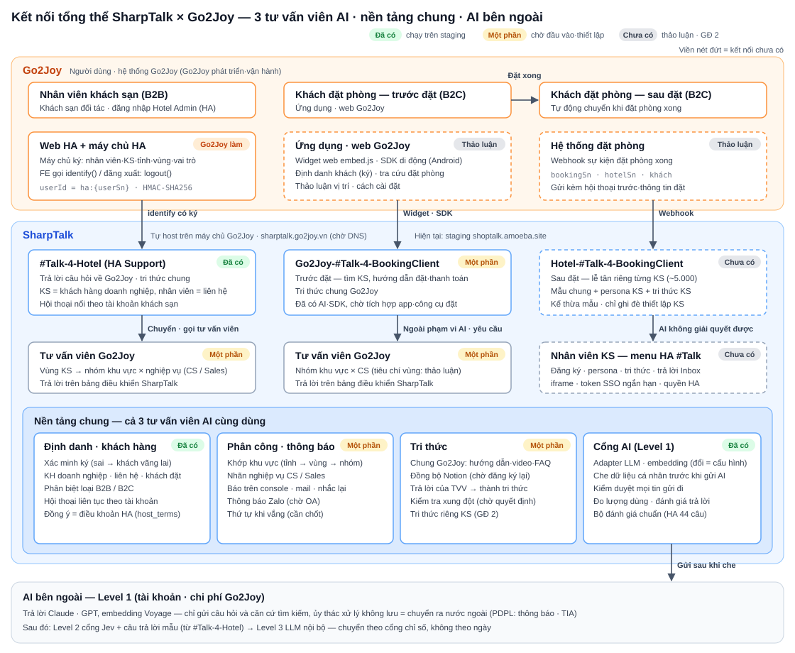
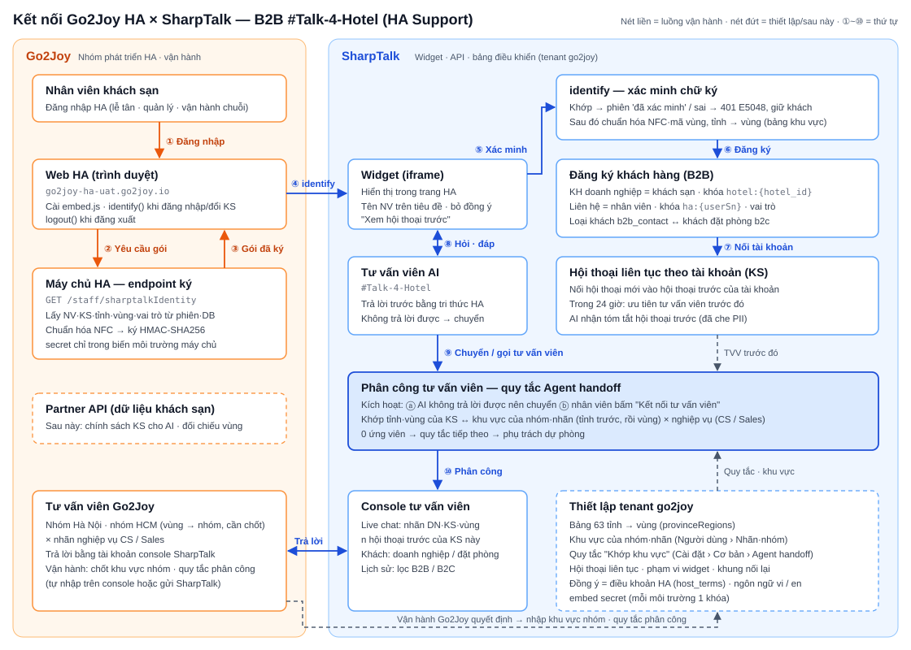

# SharpTalk × Go2Joy — Cấu trúc kết nối · Yêu cầu gửi Go2Joy · Danh sách công việc

> Các chức năng giai đoạn 1 (#Talk-4-Hotel) phía SharpTalk đều đã chạy trên staging. Phần còn lại chủ yếu là **những thứ Go2Joy cần cung cấp** (máy chủ, chữ ký HA, danh sách nhóm phụ trách và nhân viên tư vấn, điều khoản).
> Tài liệu này gom các yêu cầu đang rải rác thành một danh sách, minh họa toàn bộ cấu trúc kết nối bằng hình vẽ, và chia việc của hai bên thành danh sách kiểm tra.

| Hạng mục | Nội dung |
|---|---|
| Người nhận | Go2Joy PM · Nhóm phát triển HA (backend·FE) · Hạ tầng · Nhóm vận hành (CS) · Pháp chế |
| Người gửi | SharpTalk (Amoeba) |
| Ngày / Phiên bản | 2026-10-22 · v1.1 (giai đoạn khớp với kế hoạch v1.2) |
| Tham khảo | Cấu trúc kênh SharpTalk × Go2Joy (2026-10-21) · Chiến lược vận hành AI Go2Joy-SharpTalk Level 1·2·3 (2026-10-22) · Danh sách kiểm tra và lịch trình kết nối (2026-10-12) · Kế hoạch dự án PLN-261015 · Hướng dẫn kết nối HA v1.3 (gửi kèm) |

## Tóm tắt
- **Phạm vi giai đoạn 1 là B2B `#Talk-4-Hotel` (HA Support).** SharpTalk đã triển khai lên staging và kiểm chứng: xác minh chữ ký, đăng ký khách sạn = khách hàng doanh nghiệp, hội thoại liên tục theo tài khoản khách sạn, phân công theo khu vực khách sạn → nhóm, thông báo cho phụ trách, đánh giá câu trả lời, bộ đánh giá chuẩn (golden set) (3.2).
- **Điểm đang bị chặn là đầu vào từ Go2Joy.**
  - **G1 Máy chủ vận hành·DNS**: tính đến 10/22, `sharptalk.go2joy.vn` vẫn chưa có bản ghi DNS.
  - **G10·G11 Chữ ký·nhúng widget HA**: chưa được triển khai.
  - **G20~G23 Nhóm·danh sách·tiêu chí nghiệp vụ·thứ tự xử lý khi vắng mặt**: chưa nhận được.
  - **G4·G5 Điều khoản·thông báo dữ liệu cá nhân**: chưa nhận được.

  Trong kế hoạch dự án (PLN-261015), hạn của các mục này là 10/22; nếu quá hạn, mốc 10/31 sẽ đổi **từ mở vận hành chính thức thành mở trên staging** (mục 4).
- **Giai đoạn 2·3 (B2C trước·sau đặt phòng, menu iframe trong HA, Webhook hoàn tất đặt phòng, tính phí theo điểm)** hiện chỉ tổng hợp các mục cần thảo luận (2.5). Theo kế hoạch v1.2, **giai đoạn 2 là Go2Joy Philippines** (tư vấn khách đặt phòng + tư vấn HA, do Go2Joy vận hành) và **giai đoạn 3 là tư vấn viên AI theo khách sạn** (khách sạn tự phản hồi — menu HA, tính phí theo điểm). Khi nhận được phản hồi, chúng tôi sẽ bắt đầu bằng một tài liệu yêu cầu riêng.
- **Vận hành AI**: hiện ở Level 1 (AI bên ngoài + RAG). Theo hợp đồng, Go2Joy chịu chi phí hạ tầng và AI API, nên **khóa AI dùng cho vận hành phải đứng tên Go2Joy** (G2). Trong 5 hạng mục cần chuẩn bị ở Level 1 thì đã có 4; chỉ cần bổ sung nhật ký AI theo từng tin nhắn (3.2 S30).

## 1. Toàn bộ cấu trúc kết nối

*Hình 1. Ba tư vấn viên AI được chia theo người dùng và giai đoạn đặt phòng, trả lời trước; con người chỉ tham gia khi được chuyển tiếp. Cả ba dùng chung nền tảng (định danh·phân công·tri thức·cổng AI). Toàn bộ SharpTalk được cài trên máy chủ Go2Joy; thứ duy nhất đi ra bên ngoài là câu hỏi đã che thông tin và căn cứ tìm kiếm.*

| Loại | Tư vấn viên AI | Điểm vào | Chuyển cho người | Trạng thái |
|---|---|---|---|---|
| B2B | `#Talk-4-Hotel` (HA Support) | Widget sau khi đăng nhập HA + identify có chữ ký | Nhân viên tư vấn Go2Joy thuộc nhóm khu vực × nghiệp vụ (CS / Sales) theo vùng của khách sạn | **SharpTalk đã triển khai xong** · chờ chữ ký HA·danh sách phụ trách |
| B2C trước đặt phòng | `Go2Joy-#Talk-4-BookingClient` | Ứng dụng·web Go2Joy (widget web / SDK di động) | Nhân viên tư vấn Go2Joy thuộc nhóm khu vực × CS | Đã có tư vấn viên AI·SDK di động · đang thảo luận tích hợp ứng dụng·công cụ đặt phòng |
| B2C sau đặt phòng | `Hotel-#Talk-4-BookingClient` | Tự động chuyển khi có sự kiện hoàn tất đặt phòng | Nhân viên khách sạn (menu HA #Talk) hoặc CS Go2Joy — cần xác nhận | Giai đoạn 3 · chưa triển khai |

### 1.1 Luồng chi tiết B2B `#Talk-4-Hotel`

*Hình 2. ①~③ Máy chủ HA ký thông tin của nhân viên đang đăng nhập. ④~⑦ Widget chuyển gói này đi, SharpTalk xác minh, đăng ký khách sạn thành khách hàng doanh nghiệp rồi nối hội thoại vào tài khoản khách sạn. ⑧~⑩ AI trả lời trước; nếu không trả lời được hoặc nhân viên yêu cầu, hội thoại được phân công cho nhân viên tư vấn của nhóm phù hợp với vùng của khách sạn. Đặc tả nằm trong Hướng dẫn kết nối HA v1.3.*

### 1.2 Phân định trách nhiệm
| Công việc | Go2Joy | SharpTalk (Amoeba) |
|---|---|---|
| Máy chủ·tên miền·TLS·sao lưu, tài khoản·chi phí AI API | **Chịu trách nhiệm** (theo hợp đồng sở hữu hạ tầng·chịu chi phí) | Cung cấp cấu hình·quy trình |
| Cài đặt·cập nhật SharpTalk | Phê duyệt·môi trường chạy | **Chịu trách nhiệm** (hỗ trợ từ xa, cung cấp bản phát hành) |
| Endpoint ký HA·nhúng widget | **Chịu trách nhiệm** (mã ký phía máy chủ) | Hướng dẫn·vector kiểm thử·xác minh |
| Điều khoản·thông báo dữ liệu cá nhân, đánh giá PDPL | **Chịu trách nhiệm** (pháp chế) | Bản nháp nội dung thông báo, triển khai che thông tin |
| Nhóm khu vực·tiêu chí nghiệp vụ·danh sách nhân viên tư vấn·giờ làm việc | **Chịu trách nhiệm** (quyết định) | Cung cấp màn hình thiết lập·hỗ trợ nhập |
| Nội dung tri thức (chính sách·hướng dẫn·FAQ) | **Chịu trách nhiệm** (chốt nội dung) | Công cụ chuyển đổi·đăng ký·kiểm tra xung đột |
| Thiết lập AI·đo chất lượng·tinh chỉnh | Xem xét | **Chịu trách nhiệm** |
| Xử lý sự cố cấp 1 | Hạ tầng | Ứng dụng |

## 2. Yêu cầu gửi Go2Joy
Mức ưu tiên như sau.
- **P0**: Thiếu thì không thể mở vận hành giai đoạn 1.
- **P1**: Cần cho chất lượng vận hành giai đoạn 1.
- **P2**: Cần từ giai đoạn 2 trở đi.

Trạng thái là theo kiểm tra của SharpTalk ngày 2026-10-22.

### 2.1 Hạ tầng·hợp đồng·dữ liệu cá nhân
| # | Yêu cầu | Chi tiết | Phụ trách | Ưu tiên | Trạng thái |
|---|---|---|---|---|---|
| G1 | **Máy chủ vận hành + SSH + DNS** | `sharptalk.go2joy.vn`, TLS, region Việt Nam. Cấu hình: thử nghiệm 4 vCPU / 8 GB / 80 GB, vận hành từ 8 vCPU / 16 GB / 200 GB trở lên. Kho lưu sao lưu mỗi ngày 1 lần | Hạ tầng | P0 | **Chưa nhận** — 10/22 chưa có bản ghi DNS |
| G2 | **Tài khoản·khóa AI API (đứng tên·thanh toán bởi Go2Joy)** | LLM trả lời (khuyến nghị Anthropic Claude, có thể dùng OpenAI) và embedding (Voyage). Người nhận thông báo về hạn mức sử dụng hằng tháng và khi sắp hết | Hạ tầng·Tài chính | P0 | Chưa nhận khóa vận hành |
| G3 | Tài khoản gửi mail | SMTP của Go2Joy để gửi mail thông báo cho phụ trách | Hạ tầng | P1 | Chưa nhận |
| G4 | **Xác nhận dữ liệu cá nhân·PDPL** | Thông báo chuyển dữ liệu ra nước ngoài (bên nhận xử lý Anthropic·Voyage, khu vực xử lý), có cần đánh giá tác động (TIA) không, phạm vi che thông tin, thời hạn lưu hội thoại (dự thảo 180 ngày), quy trình thông báo khi có sự cố rò rỉ | Pháp chế | P0 | Chưa phản hồi |
| G5 | **URL + phiên bản điều khoản HA, nội dung thông báo sử dụng AI** | Căn cứ để ghi nhận đồng ý điều khoản HA thành đồng ý trên widget (bỏ banner đồng ý) | Pháp chế·HA | P0 | Chưa nhận |
| G6 | Xác nhận đầu mối·kênh liên lạc | PM, backend·FE HA, hạ tầng, vận hành (trưởng CS), pháp chế, kênh kiểm tra hằng ngày (yêu cầu R13 ngày 10/12) | PM | P0 | Cần xác nhận |
| G7 | Điều khoản hợp đồng dịch vụ | Quyền sở hữu kết quả huấn luyện: câu trả lời mẫu là dữ liệu của Go2Joy; Jev·pipeline huấn luyện·mô hình nền đa dụng là IP của Amoeba; quy định quyền sở hữu trọng số fine-tune tạo từ dữ liệu Go2Joy. Cách thu hồi phần chi phí tiết kiệm được, bên vận hành Level 3 (MLOps) | Ban điều hành·Pháp chế | P2 | Đang thảo luận |

### 2.2 Kết nối HA (`#Talk-4-Hotel`) — đặc tả trong hướng dẫn v1.3
| # | Yêu cầu | Chi tiết | Phụ trách | Ưu tiên | Trạng thái |
|---|---|---|---|---|---|
| G10 | **Endpoint ký phía máy chủ HA** | `userId = "ha:" + userSn`. 5 thuộc tính `hotel_id`·`hotel_name`·`province`·`region` (mã vùng)·`role`, chuẩn hóa NFC rồi ký HMAC-SHA256. **Gửi lại kết quả vector kiểm thử T1~T5** (hướng dẫn 5.2·5.4) | Backend HA | P0 | Chưa triển khai |
| G11 | **Nhúng widget ở FE HA** | embed.js + `locale`. Gọi `identify` khi đã xác nhận đăng nhập và khi đổi khách sạn, gọi `logout` khi đăng xuất. Cho phép tên miền SharpTalk trong CSP (`script-src`·`frame-src`·`connect-src`) và CORS (hướng dẫn 5.3) | FE HA | P0 | Chưa triển khai |
| G12 | **Phương án khóa ký** | A: embed secret do SharpTalk cấp (khuyến nghị, đã cấp cho staging) / B: dùng chung client secret của Go2Joy | Backend HA | P0 | Chờ quyết định |
| G13 | Tài khoản kiểm thử UAT | 1 tài khoản `Quản lý` (nhiều khách sạn) + 1 tài khoản `Lễ tân` (một khách sạn). Gồm ít nhất 2 khách sạn ở các vùng khác nhau | HA | P0 | Cần xác nhận |
| G14 | Phạm vi hiển thị trên widget (Q2) | Có hiển thị hội thoại của nhân viên khác cùng khách sạn trên widget không. **Mặc định hiện tại: hội thoại của chính mình + số lượng "n câu hỏi trước đây của khách sạn này".** Nhân viên tư vấn và AI thấy toàn bộ của khách sạn | Vận hành | P1 | Đã áp dụng mặc định, chờ xác nhận |
| G15 | Khung thời gian nối lại (Q3) | Khoảng thời gian sau khi hội thoại kết thúc mà cùng nhân viên tư vấn được ưu tiên phân công. **Mặc định hiện tại 24 giờ** | Vận hành | P1 | Đã áp dụng mặc định, chờ xác nhận |
| G16 | Thời hạn hiệu lực chữ ký (`ts`) | Chống dùng lại gói. Nếu áp dụng, hai bên cùng đổi đặc tả (hướng dẫn mục 7) | Backend HA | P1 | Chờ quyết định |
| G17 | Khác biệt theo vai trò (Q5) · địa chỉ·quận/huyện khách sạn (Q6) | Có cần phản hồi khác nhau giữa `Quản lý` / `Lễ tân` không. Địa chỉ (`settingList.address`)·quận/huyện (`districtName`) thuộc giai đoạn 3 | Vận hành | P2 | Chờ quyết định |

### 2.3 Phân công·vận hành (Nhóm vận hành Go2Joy)
| # | Yêu cầu | Chi tiết | Phụ trách | Ưu tiên | Trạng thái |
|---|---|---|---|---|---|
| G20 | **Ánh xạ vùng → nhóm, đơn vị khu vực phân công** | Nhóm được chia theo đơn vị nào: vùng (4)·tỉnh·quận/huyện. Đề xuất: `north`·`north_center` → nhóm Hà Nội, `south`·`south_center` → nhóm Hồ Chí Minh. Đà Nẵng·Tây Nguyên (13 tỉnh `south_center`) cần xác nhận | Vận hành | P0 | Chưa phản hồi |
| G21 | **Danh sách nhân viên tư vấn** | Họ tên · email · nhóm · nhãn nghiệp vụ (CS / Sales) · cấp bậc. Khi nhận được, chúng tôi cấp tài khoản bảng điều khiển | Vận hành | P0 | Chưa nhận |
| G22 | **Tiêu chí câu hỏi Sales** | Câu hỏi nào là Sales (ví dụ: đối soát·hợp đồng·hoa hồng). Từ khóa và 5~10 câu hỏi mẫu. Nếu không có, mọi câu hỏi sẽ đi vào CS | Vận hành | P0 | Chưa nhận |
| G23 | **Giờ làm việc·thứ tự xử lý khi vắng mặt·phụ trách dự phòng** | Đề xuất: phụ trách thay thế → hàng chờ của nhóm → tin nhắn ngoài giờ. Người nhận khi không biết vùng (chưa chọn khách sạn) | Vận hành | P0 | Chưa phản hồi |
| G24 | Zalo OA + phê duyệt mẫu ZNS | Khi muốn gửi thông báo cho nhân viên tư vấn qua cả Zalo | Vận hành | P1 | Chưa nhận |
| G25 | Tên tỉnh mới trong bảng khu vực | Gửi bảng mới khi bắt đầu dùng tên sau sáp nhập 2025-07 (63 → 34 tỉnh) | Vận hành | P1 | Đang chờ |
| G26 | Ngôn ngữ hỗ trợ | Có thêm ngôn ngữ ngoài tiếng Việt·tiếng Anh không | Vận hành | P2 | Chờ quyết định |

> Tài khoản master của Go2Joy cũng có thể tự nhập khu vực phụ trách của nhóm và quy tắc phân công trên bảng điều khiển SharpTalk. Vị trí: **Người dùng › Quản lý nhãn·nhóm › Khu vực phụ trách** và **Cài đặt › Cơ bản › Agent handoff › Khớp khu vực**. Khi ánh xạ vùng → nhóm thay đổi, chỉ cần sửa khu vực phụ trách của nhóm, quy tắc giữ nguyên.

### 2.4 Tri thức·chất lượng AI
| # | Yêu cầu | Chi tiết | Phụ trách | Ưu tiên | Trạng thái |
|---|---|---|---|---|---|
| G30 | **Đăng ký lại nguồn tri thức Notion** | Ngày 10/21 nguồn và token bị xóa cùng lúc nên hướng dẫn HA (#2501)·FAQ (#3599) đang ở trạng thái không hoạt động. Kết nối lại cùng trang sẽ tự khôi phục (bản sửa đã triển khai) | Vận hành | P0 | Đang chờ |
| G31 | Quyết định chỉnh lý xung đột tri thức | 78 cặp phân loại ngày 10/15: 3 cần sửa thật, 3 tài liệu chính sách có 2 bản, 32 FAQ trùng lặp. Quyết định giữ bên nào | Vận hành | P1 | Chờ quyết định |
| G32 | Rà soát bộ đánh giá chuẩn | Xác nhận đáp án 44 câu của `#Talk-4-Hotel`. Cung cấp câu hỏi tiêu biểu khi xây bộ cho tư vấn viên AI trước đặt phòng. Đây là chuẩn hồi quy khi đổi engine·chuyển level | Vận hành | P1 | Chờ rà soát |
| G33 | Nhãn chất lượng trong vận hành | Nhân viên tư vấn đánh giá câu trả lời AI là đúng/sai và chấp nhận câu trả lời đã sửa thành tri thức. Đây là dữ liệu cho cổng chuyển sang Level 2 (câu trả lời mẫu) | Vận hành | P1 | Sau khi mở |
| G34 | Partner API (giai đoạn sau) | Client key vận hành, whitelist IP máy chủ SharpTalk, phạm vi Hotel Feed (toàn bộ khách sạn HA), sửa hành vi trả về tất cả khi không có khách sạn khớp, môi trường kiểm thử có xác minh chữ ký (hướng dẫn 7.1) | Backend HA | P2 | Mới nhận khóa thử (10/21) |

### 2.5 Giai đoạn 2·3 — B2C trước·sau đặt phòng (các mục cần thảo luận)
G40~G43·G47 cần cho giai đoạn 2 (tư vấn khách đặt phòng tại Philippines), G44~G46 cần cho giai đoạn 3 (tư vấn viên AI theo khách sạn).

| # | Yêu cầu | Chi tiết | Ưu tiên |
|---|---|---|---|
| G40 | Webhook sự kiện hoàn tất đặt phòng | Thời điểm chuyển tiếp. `bookingSn`·`hotelSn`·định danh khách·chữ ký, liên kết với phiên hội thoại trước đó, mỗi lượt đặt (khách sạn) một luồng hội thoại riêng khi đặt nhiều khách sạn | P2 |
| G41 | Nhúng vào ứng dụng·web Go2Joy | Widget web / Android SDK (đã kiểm chứng trên máy thật) / iOS. Định danh có chữ ký cho khách đã đăng nhập (tách khỏi nhân viên HA bằng tiền tố `userId`), API công cụ tra cứu đặt phòng | P2 |
| G42 | Tiêu chí khu vực của khách trước đặt phòng | Là khu vực của khách sạn đang tìm·đặt, hay vị trí của khách | P2 |
| G43 | Chuyển tiếp·phạm vi·lưu trữ sau đặt phòng | Đối tượng nhận khi chuyển cho người (nhân viên khách sạn / CS Go2Joy / tiêu chí phân chia), có chuyển đổi·hủy·hoàn tiền về Go2Joy không, thời điểm kết thúc hội thoại sau check-out·thời hạn lưu | P2 |
| G44 | Menu HA (iframe) | Thêm menu SharpTalk vào HA (đăng ký·persona·tri thức·Inbox), **token SSO ngắn hạn** do máy chủ cấp (không chuyển nguyên token HA), liên kết quyền (`Quản lý` thiết lập / `Lễ tân` Inbox) | P2 |
| G45 | Vận hành tư vấn viên lễ tân | Nội dung mẫu chung (Go2Joy quản lý), quy trình duyệt đăng ký, thứ tự onboarding khoảng 5.000 khách sạn | P2 |
| G46 | Tính phí | Tỷ lệ quy đổi token → điểm, xử lý khi hết điểm (dừng / chuyển cho nhân viên), vị trí màn hình nạp·số dư | P2 |
| G47 | Tư vấn qua kênh Zalo | Phạm vi nhận và trả lời hội thoại Zalo trên bảng điều khiển | P2 |

> Trong yêu cầu ngày 10/12 (R1~R16), các mục không được đưa lại vào tài liệu này (truy cập staging, danh sách API hiện có, mẫu dữ liệu vận hành, khách sạn thí điểm, quy trình triển khai·xử lý sự cố) sẽ được xác nhận đã nhận hay chưa trong cuộc họp tới.

## 3. Danh sách công việc

### 3.1 Go2Joy
**Trước khi mở vận hành giai đoạn 1 (P0)**

- [ ] G1 Máy chủ vận hành·SSH·DNS `sharptalk.go2joy.vn`·TLS·kho sao lưu
- [ ] G2 Khóa AI API cho vận hành (đứng tên Go2Joy) — LLM trả lời + embedding
- [ ] G4 Xác nhận PDPL (thông báo chuyển dữ liệu ra nước ngoài·TIA·thời hạn lưu) và G5 URL·phiên bản điều khoản HA·nội dung thông báo AI
- [ ] G6 Xác nhận đầu mối·kênh kiểm tra hằng ngày
- [ ] G10 Endpoint ký phía máy chủ HA (đặc tả v1.2) + gửi lại kết quả T1~T5
- [ ] G11 Nhúng widget ở FE HA (identify / gọi lại khi đổi khách sạn / logout, CSP·CORS)
- [ ] G12 Quyết định phương án khóa ký (khuyến nghị A)
- [ ] G13 Tài khoản kiểm thử UAT (`Quản lý` · `Lễ tân`, gồm khách sạn ở các vùng khác nhau)
- [ ] G20 Ánh xạ vùng → nhóm và đơn vị khu vực phân công
- [ ] G21 Danh sách nhân viên tư vấn (họ tên·email·nhóm·nhãn nghiệp vụ·cấp bậc)
- [ ] G22 Tiêu chí câu hỏi Sales
- [ ] G23 Giờ làm việc·thứ tự xử lý khi vắng mặt·phụ trách dự phòng
- [ ] G30 Đăng ký lại nguồn tri thức Notion

**UAT (hướng dẫn v1.3 §8.2)**

- [ ] Chưa đăng nhập · đăng nhập · đăng xuất · chưa chọn khách sạn · sửa giá trị mà không ký lại
- [ ] Đăng ký khách hàng doanh nghiệp · cùng nhân viên đăng nhập lại · nhân viên khác cùng khách sạn
- [ ] Hỏi lại sau khi kết thúc hội thoại · máy tính khác · ngày hôm sau
- [ ] AI chuyển tiếp · "Kết nối nhân viên tư vấn" · kết quả phân công cho 4 khách sạn ở 4 vùng
- [ ] Phê duyệt UAT và phê duyệt mở vận hành

**Chất lượng vận hành (P1)**

- [ ] Xác nhận G14 phạm vi hiển thị widget · G15 khung thời gian nối lại · G16 thời hạn hiệu lực chữ ký
- [ ] G24 Zalo OA · G25 tên tỉnh mới trong bảng khu vực
- [ ] G31 Quyết định chỉnh lý xung đột tri thức · G32 rà soát bộ đánh giá chuẩn · G33 vận hành đánh giá của nhân viên tư vấn·chấp nhận câu trả lời

**Thảo luận giai đoạn 2·3 (P2)**

- [ ] Phản hồi G40~G47 (Webhook hoàn tất đặt phòng, nhúng ứng dụng·web, tiêu chí khu vực, chuyển tiếp·phạm vi·lưu trữ sau đặt phòng, menu HA iframe·SSO, vận hành lễ tân, tính phí, Zalo)
- [ ] G7 Điều khoản hợp đồng dịch vụ · G17 khác biệt vai trò·địa chỉ·quận/huyện · G26 ngôn ngữ · G34 Partner API

### 3.2 SharpTalk
**Đã xong (đang chạy trên tenant go2joy ở staging)**

- [x] S1 Xác minh identify có chữ ký, phiên 'đã xác minh', chế độ đồng ý theo điều khoản HA, tên nhân viên trên tiêu đề (#637 · #642 · #656)
- [x] S2 Quy tắc phân công: khu vực × nghiệp vụ, hai điểm kích hoạt là AI chuyển tiếp và "Kết nối nhân viên tư vấn" (#638)
- [x] S3 Mail cá nhân cho phụ trách · nhắc lại khi chưa nhận (#639)
- [x] S4 Đánh giá độ chính xác câu trả lời (#640), chấm tự động bộ chuẩn HA 44 câu (#611)
- [x] S5 Thiết kế widget, khảo sát mức độ hài lòng, cố định ngôn ngữ vi / en (#650 ~ #662)
- [x] S6 Chuẩn hóa mã vùng·NFC, bổ sung vùng từ 63 tỉnh trong bảng khu vực, khu vực phụ trách theo nhóm·nhãn, quy tắc phân công "Khớp khu vực" (#687)
- [x] S7 Đăng ký khách hàng doanh nghiệp (khách sạn) · liên hệ (nhân viên), phân biệt B2B / B2C, hội thoại liên tục theo tài khoản khách sạn, ưu tiên nhân viên tư vấn trước đó, tóm tắt hội thoại trước cho AI (#689)
- [x] S8 Cập nhật schema dùng cho cài đặt máy chủ mới (#692) — chuẩn bị cài đặt trên máy chủ Go2Joy
- [x] S9 Hướng dẫn kết nối HA v1.3, tài liệu này

**Khi nhận được đầu vào từ Go2Joy**

| # | Công việc | Đầu vào cần có | Thời gian (dự kiến) |
|---|---|---|---|
| S20 | Gửi embed secret của staging qua kênh bảo mật | G12 (A) | Trong ngày |
| S21 | Cấp tài khoản bảng điều khiển cho nhân viên tư vấn, gán nhóm·nhãn nghiệp vụ | G21 | Trong ngày |
| S22 | Nhập khu vực phụ trách của nhóm·quy tắc "Khớp khu vực"·từ khóa Sales·dự phòng·giờ làm việc, kiểm tra bằng xem trước quy tắc | G20 · G22 · G23 | Nửa ngày |
| S23 | Nhập URL·phiên bản điều khoản HA (cách đồng ý đã là điều khoản HA) | G5 | Trong ngày |
| S24 | **Cài đặt trên máy chủ Go2Joy** (profile VN), chuyển tri thức·thiết lập từ staging (bảng khu vực·hội thoại liên tục·quy tắc), lập chỉ mục lại, kết nối cổng triển khai bằng bộ chuẩn | G1 · G2 · G3 | 4 ngày |
| S25 | Xác nhận đồng bộ lại Notion, thực hiện chỉnh lý xung đột tri thức | G30 · G31 | 1~2 ngày |
| S26 | Thông báo Zalo cho phụ trách | G24 | 4 ngày |
| S27 | Cùng kiểm tra UAT → báo cáo kết quả kiểm thử | G10 · G11 · G13 | 3 ngày |

**SharpTalk tiếp tục thực hiện**

- [ ] S28 Hiển thị lý do chuyển tiếp trên bảng điều khiển, kiểm tra xung đột trước khi chấp nhận tri thức (PLN-261015 D5 · D6)
- [ ] S29 Thời hạn hiệu lực chữ ký (`ts`), nhận địa chỉ·quận/huyện khách sạn — sau khi quyết định G16 · G17
- [ ] S30 **Bổ sung AI Level 1**: nhật ký AI theo từng tin nhắn (mô hình · token · độ trễ · câu hỏi đã viết lại · kết quả). Hiện chỉ có tổng hợp sử dụng theo ngày. Khi nhận được định dạng mã đặt phòng của Go2Joy, chúng tôi sẽ thêm vào phần che thông tin. Đồng thời mở rộng bộ chuẩn cho từng tư vấn viên AI
- [ ] S31 Tài liệu yêu cầu giai đoạn 2 (Philippines) · giai đoạn 3 (tư vấn viên AI theo khách sạn) (tích hợp B2C trước đặt phòng, mẫu tư vấn viên lễ tân, menu HA iframe·SSO, nhận Webhook đặt phòng, tính phí theo điểm) — sau khi có phản hồi mục 2.5

### 3.3 Vận hành AI Level 1 — đối chiếu điều kiện tiên quyết
Chiến lược vận hành AI quy định cần chuẩn bị 5 hạng mục sau ở Level 1 trước khi chuyển sang Level 2·3.

| Điều kiện tiên quyết | SharpTalk hiện tại | Việc còn lại |
|---|---|---|
| ① Port LLM · embedding | Đã có — adapter engine (Anthropic · OpenAI · Voyage · stub), chỉ định engine theo tenant. Đổi engine chỉ là thay đổi thiết lập | — |
| ② Schema nhật ký hội thoại | Một phần — nội dung gốc·ngôn ngữ·ý định·căn cứ tìm kiếm của tin nhắn, kết quả hội thoại (giải quyết·chuyển tiếp), lượng token theo ngày | Mô hình · token · độ trễ · câu hỏi đã viết lại theo từng tin nhắn (S30) |
| ③ Nhãn chất lượng | Đã có — đánh giá độ chính xác câu trả lời, có chuyển tiếp hay không, câu trả lời của nhân viên tư vấn → chấp nhận thành tri thức | Tích lũy trong vận hành (G33) |
| ④ Che thông tin cá nhân (PII) | Đã có — che điện thoại · email · mã đơn hàng v.v. trước khi gửi cho AI và trong nhật ký | Thêm định dạng mã đặt phòng Go2Joy (S30) |
| ⑤ Bộ đánh giá chuẩn | Đã có — chấm tự động 44 câu của `#Talk-4-Hotel` | Go2Joy rà soát (G32), mở rộng sang tư vấn viên AI khác |

## 4. Ảnh hưởng đến lịch trình
Quyết định trong PLN-261015 như sau: **nếu các mục tiên quyết của Go2Joy (máy chủ·DNS, nhúng·ký HA, danh sách phụ trách) chưa sẵn sàng trước 10/22 thì mốc 10/31 được thay bằng "mở trên staging"**. Tính đến 10/22, chúng tôi chưa nhận được các mục này.

| Lộ trình | Điều kiện | Kết quả |
|---|---|---|
| Mở trên staging (10/31) | G10 · G11 · G13 · G20 ~ G23 | HA UAT trỏ tới staging SharpTalk và nhân viên tư vấn thật trả lời. Dữ liệu vận hành vẫn nằm ngoài máy chủ Go2Joy (trên staging) |
| Mở vận hành | Các điều kiện trên + G1 · G2 · G4 · G5 | Cài đặt trên máy chủ Go2Joy (S24, 4 ngày) → UAT (S27, 3 ngày) → mở. **Khoảng 7 ngày làm việc kể từ ngày nhận G1** |

## 5. Các quyết định cần đưa ra — tóm tắt cho cuộc họp
| Quyết định | Đề xuất của SharpTalk / mặc định hiện tại | Liên quan |
|---|---|---|
| Khóa ký | A — embed secret do SharpTalk cấp | G12 |
| Vùng → nhóm | `north`·`north_center` → Hà Nội, `south`·`south_center` → Hồ Chí Minh | G20 |
| Thứ tự xử lý khi vắng mặt | Phụ trách thay thế → hàng chờ của nhóm → tin nhắn ngoài giờ | G23 |
| Phạm vi hiển thị widget | Hội thoại của chính mình + số câu hỏi trước đây của khách sạn (đã áp dụng) | G14 |
| Khung thời gian nối lại | 24 giờ (đã áp dụng) | G15 |
| Thời hạn hiệu lực chữ ký | Khuyến nghị áp dụng | G16 |
| Đối tượng chuyển tiếp sau đặt phòng | Trước tiên là nhân viên khách sạn, nếu không phản hồi thì CS Go2Joy (đề xuất) | G43 |
| Quyền sở hữu kết quả huấn luyện | Câu trả lời mẫu = Go2Joy, Jev·pipeline·mô hình đa dụng = Amoeba, trọng số fine-tune ghi rõ trong hợp đồng | G7 |
