# SharpTalk for Go2Joy — Project Plan

> **One-line summary** — Install SharpTalk on a Go2Joy server (`sharptalk.go2joy.vn`) and add an **AI agent to Hotel Admin**.
> The AI answers first. Questions beyond its knowledge go to the Go2Joy staff member assigned by **hotel region × inquiry type**.
> That staff member's answer is **saved back as knowledge**, so next time the AI answers. Each turn of this loop widens what the AI can answer.

| Item | Details |
|---|---|
| Phase 1 scope | AI first-line support for logged-in Hotel Admin users (hotel staff) + human agent assignment by region and inquiry type + knowledge loop |
| Phase 2 scope | Go2Joy Philippines — per-hotel booking guest support (booking clients) + Hotel Admin support |
| Phase 3 scope | Per-hotel AI agents — each hotel answers inquiries from its booking guests |
| Source documents | [REQ-260831 Requirements](../analysis/REQ-260831-SharpTalk-Go2Joy-Requirements.md) · [AN-260907 Side impact](../analysis/AN-260907-SharpTalk-Go2Joy-Side-Impact.md) · [REQ-260825 Business model](../analysis/REQ-260825-Go2Joy-ChatAgent-BizModel.md) · [VN-Go2Joy setup guide](../guide/GUIDE-260913-SharpTalk-VN-Go2Joy-Staging.md) |
| Integration requests and checklist | [Go2Joy integration requests and checklist](../../apps/web/public/manual/go2joy/integration.en.md) (2026-10-22) — channel structure, requests to Go2Joy G1–G47, task lists for both sides |
| Screenshot source | Real screens of the go2joy tenant on Korean staging (captured 2026-10-15). Staff emails are hidden. Figures 9–12 come from live tests, so test names (`E2E`, `example.com`) are visible |

### Progress (as of 2026-10-22)

| Area | Status |
|---|---|
| Amoeba development | **D2·D3·D4·D5·D7·D9 done** (PR #637–#643, 10/15). Added 10/19–22 — widget design, satisfaction survey and fixed languages (#650–#662), region codes and "region match" routing (#687), hotel = business customer registration, conversation continuity per hotel account and B2B/B2C split (#689), schema for new server installs (#692). Passed live tests on staging, released to Korean production (no go2joy tenant there → no behavior change) |
| Knowledge cleanup (D8) | go2joy default language `vi` and time zone `Asia/Ho_Chi_Minh` set. 78 knowledge conflicts classified — 3 need real fixes, 35 cleanups wait for a Go2Joy decision ([RPT-261015 Conflict triage](../report/RPT-261015-Go2Joy-KB-Conflict-Triage.md)) On 10/21 the Notion source was deleted, so the HA guide and FAQ are inactive — waiting for re-registration (G30) |
| Waiting on Go2Joy | **Not received by the 10/22 deadline** — server and DNS (G1), HA signing and embed (G10, G11), team and agent list, inquiry type rules, absence order (G20–G23), terms and privacy notice (G4, G5). Per the §8 decision, 10/31 becomes a **staging opening**. Item-by-item status is in [Integration requests and checklist](../../apps/web/public/manual/go2joy/integration.en.md) |
| Remaining Amoeba work | D1 install (after server is provided), Zalo notifications (after OA is provided), D6 conflict check before adoption, D5 handoff reason display, D10 quality gate hookup, per-message AI log (AI operations Level 1 follow-up) |

### Change history
| Version | Date | Details |
|---|---|---|
| 1.0.0 | 2026-10-15 | First draft, reflects the decision to finish Phase 1 by 10/31 |
| 1.1.0 | 2026-10-15 | Implementation results added — signed attribute keys and signing string finalized (§6.3), inquiry type detection finalized as keyword/label based (§6.5.2), re-notification is a tenant-wide setting (§6.6), accuracy rating screen (§6.9), triage of 78 conflicts (§6.10), per-item status (§7), progress (§8), new decision items (§12) |
| 1.2.0 | 2026-10-22 | Phase 2 and Phase 3 swapped — Phase 2 = Go2Joy Philippines (booking guest support + Hotel Admin support), Phase 3 = per-hotel AI agents (§1.4, §11). Channel structure and discussion items G40–G47 from the integration requests and checklist (10/22) added, progress updated as of 10/22 |

---

## Contents
1. [Project overview](#1-project-overview)
2. [About SharpTalk](#2-about-sharptalk)
3. [Development stack and structure](#3-development-stack-and-structure)
4. [Overall service architecture](#4-overall-service-architecture)
5. [Users and roles](#5-users-and-roles)
6. [Phase 1 user scenarios](#6-phase-1-user-scenarios)
7. [Gaps vs. current state and Phase 1 development items](#7-gaps-vs-current-state-and-phase-1-development-items)
8. [Schedule](#8-schedule)
9. [Success metrics](#9-success-metrics)
10. [Privacy and security](#10-privacy-and-security)
11. [Future work — Phase 2 and Phase 3](#11-future-work--phase-2-and-phase-3)
12. [Risks and open decisions](#12-risks-and-open-decisions)

---

## 1. Project overview

### 1.1 Background
- Go2Joy is a Vietnamese hourly-hotel booking platform with about 5,500 partner properties. Hotel staff (manager `Quản lý`, reception `Lễ tân`) use Hotel Admin for bookings, check-in, settlement, rates, coupons and ads.
- Today Go2Joy CS handles hotel staff inquiries by hand (email, Hotline, Zalo, with separate North/South numbers). The same questions repeat. Many inquiries cause direct financial loss if answered wrongly, such as the **settlement dispute deadline** or **choosing a cancellation reason**.
- SharpTalk has been tested since 2026-08 with the go2joy tenant on Korean staging. 63 Hotel Admin video guides, FAQs and operating rules are loaded as knowledge (270 KB items, 204 board items). Answer quality is measured every time with an auto-graded set of 44 partner FAQ questions.

### 1.2 Goals
| # | Goal | Description |
|---|---|---|
| P1 | **Solve external personal-data transfer by design** | Install SharpTalk on a Go2Joy server and run it for Go2Joy only. Conversations, hotel staff data and knowledge stay inside Go2Joy infrastructure and never go to Amoeba servers |
| P2 | **AI notice and consent through Go2Joy terms** | Add AI support (and AI processing outsourcing) to the Hotel Admin terms of use and privacy policy. Go2Joy runs the consent process. The SharpTalk widget shows only a notice banner instead of a consent popup |
| P3 | **Lower CS workload, 24-hour response** | AI answers repeat questions instantly. People focus only on inquiries outside the knowledge |
| P4 | **Human answers become company knowledge** | Human agent answers are saved as knowledge, so the AI answers the same question next time. Answer accuracy rating and knowledge conflict checks keep quality up |

### 1.3 Targets (first month after Phase 1 ends on 2026-10-31)
| Metric | Target (draft) | Measured by |
|---|---|---|
| AI self-resolution rate (conversations closed without handoff) | **70% or more** | Statistics › Journey & handling |
| Beyond-knowledge → staff assignment success rate | **100%** (0 unassigned) | Handoff log |
| Assignment → human agent first response (business hours) | **Median under 10 minutes** | Statistics › Agents |
| Human agent answers added to knowledge | **50% or more** of resolved handoffs reviewed as knowledge candidates | Knowledge-gap suggestions |
| AI answer accuracy (rated by human agents) | **85% or more accurate** | New accuracy rating |
| Golden regression set | Keep 0 failures out of 44 questions | Auto-grading after deploy |

> Targets will be reset from real data in the first 2 weeks of the pilot. Current staging 30-day values: 18 of 149 conversations handed off to human agents (12%).

### 1.4 Scope
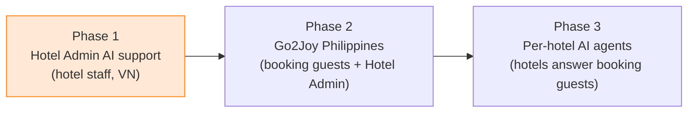

| In scope (Phase 1) | Out of scope (later) |
|---|---|
| Self-hosted install of `sharptalk.go2joy.vn` and handover to operations | Booking guest (B2C) channels and Philippines deployment (Phase 2), per-hotel AI agents (Phase 3) |
| Hotel Admin widget embed + signed logged-in user data (hotel, region, role) | API integration for the AI to read booking/settlement data directly (after separate agreement) |
| AI first response (vi/en), knowledge scope check, region × inquiry type assignment | AI performing Hotel Admin actions on the user's behalf (forbidden by design) |
| Human agent notifications (email, Zalo, SharpTalk alarm), human agent replies | Move to AI operations Level 2 and 3 (model answers, own model) |
| Answer → knowledge, accuracy rating, knowledge conflict check | Voice channel |

---

## 2. About SharpTalk

SharpTalk (Korean nickname 샵톡) is a **multi-tenant AI chat and customer support platform** built by Amoeba (BitBiz). Add the chat widget to a website or app, and the AI agent answers from company knowledge. Inquiries it cannot answer go to a human agent. The human agent takes over the conversation in the console, and the result is stored back as knowledge.

| Area | Main features | Go2Joy Phase 1 use |
|---|---|---|
| Chat widget | Web embed (`embed.js`), mobile WebView SDK (Android AAR), 6 languages (en/es/ko/vi/ja/zh), brand theme, quick question buttons | Hotel Admin web embed, vi/en |
| AI agent | Multiple AI agents (persona, greeting, response rules), hybrid search (RAG), 12-message conversation context, source and video link display | `Hotel Admin` AI agent |
| Safeguards | Moderation of all AI and human agent outbound messages (block first), PII masking (logs, AI, screen), deny-list immediate handoff | Used as is |
| Agent console | Live chat, accept/assign/return/close, AI briefing and draft answer, knowledge lookup, issue board | Used by Go2Joy CS |
| Knowledge management | Knowledge sources (Notion, Google Drive, files), Smart Knowledge Board (adopt after review), bulk import, **knowledge-gap suggestions**, **knowledge conflict review**, revision history | Used as is |
| Quality & statistics | Customer journey, question analysis, impressions/visits, channel, agent and satisfaction statistics, golden question auto-grading, AI coaching | Used as is + accuracy rating added |
| Operations | Tenant, plan and menu permissions, users and labels (RBAC), audit log, MFA, AI engines and usage metering | Managed by Go2Joy operators |


*Figure 0. [AI settings]. The go2joy tenant has 6 AI agents for different uses. Phase 1 uses the `Hotel Admin` AI agent. Each AI agent has its own greeting, persona, response rules, quick question buttons and knowledge scope.*

---

## 3. Development stack and structure

### 3.1 Tech stack
| Layer | Technology |
|---|---|
| Backend API | **NestJS 11 + TypeORM** (Node.js 20), REST `/api/v1`, Swagger `/api/v1/docs` |
| Data | **MySQL 8** (business data), **Redis** (sessions, cache, rate limits), **RabbitMQ** (events, async jobs), **Qdrant** (vector search) |
| AI | Pluggable AI gateway — Anthropic Claude (answers, classification, conflict judgment), Voyage (embeddings). AI engine keys can be registered per tenant |
| Frontend | **React 18 + Vite + Tailwind + Zustand + React Query + react-i18next** — console (`apps/web`), widget (`apps/widget`) |
| Mobile | Android Kotlin SDK (`sdk/android`, WebView `?mode=app`) |
| Deployment | Docker Compose self-hosted package (`docker/self-hosted`) + country/customer profile (`deploy/profiles/SharpTalk-VN-Go2Joy`) |
| Security | bcrypt passwords, AES-256-GCM credentials, JWT + RBAC (rank × work label), HMAC-SHA256 signed widget identity, audit log |

### 3.2 Repository structure
```text
btbz-sharptalk/                    Turborepo monorepo
├─ apps/
│  ├─ api/        NestJS — src/domain/{chat, ai-engine, knowledge, agent, embed, session, ...}
│  ├─ web/        Console (tenant console + platform admin)
│  └─ widget/     Chat widget + loader embed.js
├─ packages/
│  ├─ types/      Shared types and language list (language.ts)
│  └─ common/     Shared logic such as the permission matrix
├─ sdk/android/   Kotlin WebView SDK
├─ docker/self-hosted/   Self-hosted compose, nginx, Dockerfile
├─ deploy/profiles/SharpTalk-VN-Go2Joy/   Go2Joy profile (env sample, checklist, tenant snapshot)
└─ sql/           Schema change SQL (applied manually before deploy)
```

### 3.3 Backend module map (Phase 1 related)
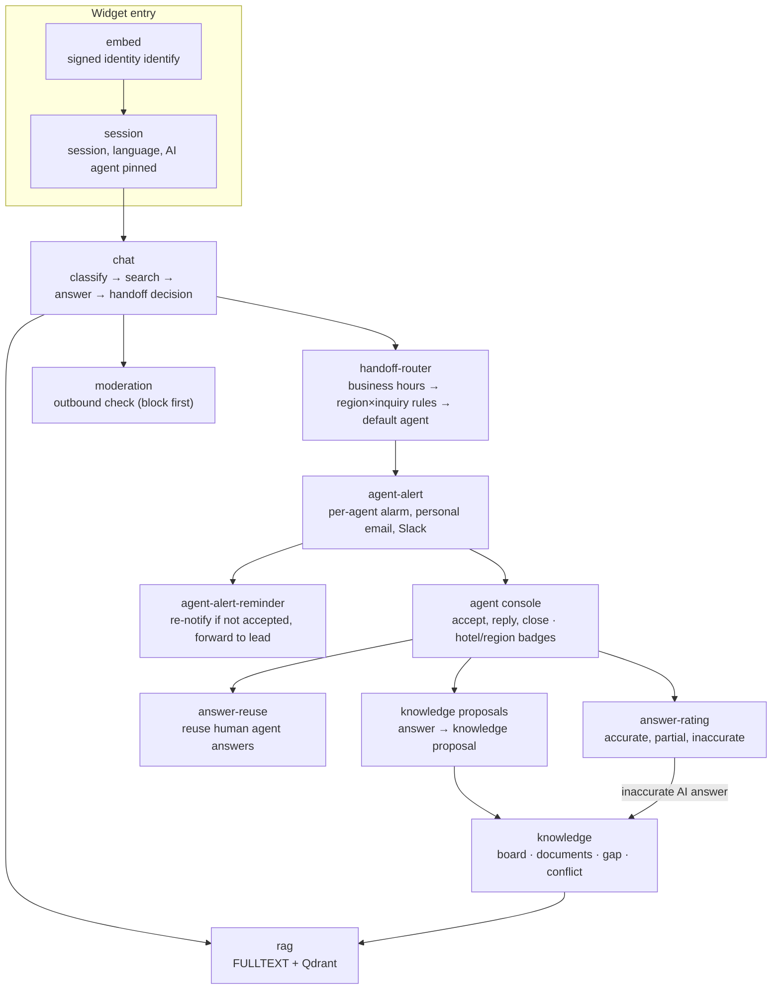

---

## 4. Overall service architecture

### 4.1 System overview
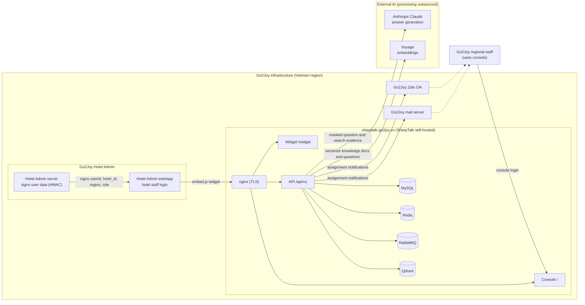

**Data boundary** — Conversation text, hotel staff data, knowledge and audit logs are all stored in MySQL and Qdrant on the Go2Joy server. Only two things leave: **question text and search evidence for AI answer generation** (after PII masking), and **text for embeddings**. Both are outsourced processing (API calls) with no storage. This outsourcing is disclosed in the Go2Joy terms (§10).

### 4.2 Deployment layout
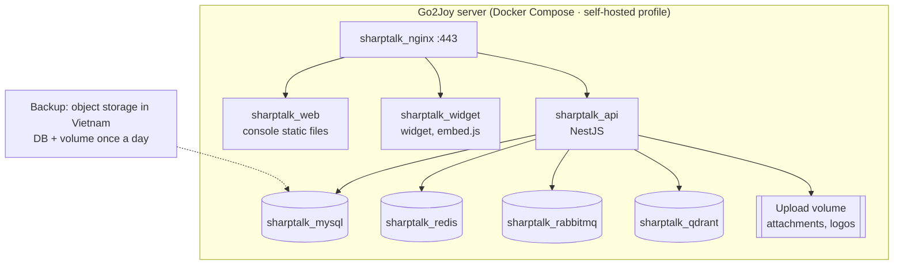

| Item | Value (draft) |
|---|---|
| Domain | `sharptalk.go2joy.vn` — console `/`, widget `/widget/`, API `/api/v1` on one origin |
| Server spec | Pilot 4 vCPU / 8 GB / 80 GB → production 8 vCPU / 16 GB / 200 GB or more |
| Install | Copy env from the `deploy/profiles/SharpTalk-VN-Go2Joy` profile → pass `--check` → schema SQL → confirm boot (`successfully started`) |
| Handover | Move go2joy tenant settings and knowledge from Korean staging by snapshot and bulk export (no direct DB copy) |
| Updates | Amoeba provides a release tag → deploy script runs on the Go2Joy server (schema changes: apply SQL first) |

### 4.3 Responsibilities
| Task | Go2Joy | Amoeba |
|---|---|---|
| Server, domain, TLS, backup | **Owner** | Provides spec and procedure |
| SharpTalk install and updates | Approval and runtime environment | **Owner** (remote support) |
| Hotel Admin widget embed and user signing | **Owner** (server signing code) | Guide and verification |
| Terms and AI use consent | **Owner** | Draft notice wording |
| Regional/inquiry type staff assignment, business hours | **Owner** | Provides settings screen |
| Knowledge content (policies, guides, FAQ) | **Owner** (final content) | Conversion and import tools |
| AI settings, quality measurement, tuning | Review | **Owner** |
| First-line incident response | Infrastructure | Application |

---

## 5. Users and roles

| User | Where | What they do |
|---|---|---|
| **Hotel staff** (manager `Quản lý` / reception `Lễ tân`) | Chat widget inside Hotel Admin | Ask about Hotel Admin usage, bookings, settlement, rates, coupons, ads |
| **AI agent** `Hotel Admin` AI agent | SharpTalk | First-line answers from knowledge, handoff when out of scope |
| **Regional staff** (Go2Joy CS, human agents) | SharpTalk console | Reply to assigned conversations, propose answers as knowledge candidates, rate AI answers |
| **Knowledge manager** (Go2Joy CS lead) | SharpTalk console › Knowledge | Approve knowledge candidates, resolve knowledge conflicts, review accuracy ratings |
| **Tenant admin** (Go2Joy master) | SharpTalk console › Settings | Manage routing rules, staff, business hours, notification channels |
| **Platform operator** (Amoeba) | Platform admin | AI engines, updates, monitoring |

---

## 6. Phase 1 user scenarios

### 6.0 Overall flow
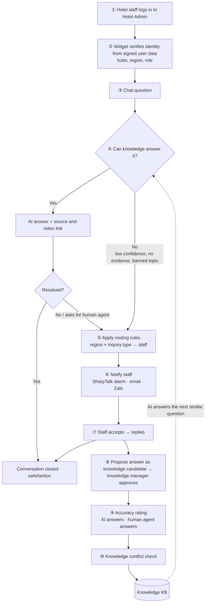

### 6.1 Event scenarios
| EV | Event | Trigger | System processing | Resulting state | Status (10/15) |
|---|---|---|---|---|---|
| EV-01 | Login and widget load | Hotel staff logs in to Hotel Admin | Hotel Admin server signs `userId + attributes` → widget `identify` → hotel, region and role saved to session | Session `VERIFIED` | **Implemented** (D2) — Hotel Admin signing is built by Go2Joy |
| EV-02 | Question received | Message sent | Language detection → intent classification → hybrid search → answer generation → moderation | `AI answering` | Exists (default language `vi` set 10/15) |
| EV-03 | AI answer | Enough evidence, confidence ≥ threshold | Answer + source and video link + next question buttons | `AI answering` | Exists |
| EV-04 | Beyond knowledge scope | Confidence < threshold / no evidence / deny topic / human agent requested | Handoff reason recorded, user told they are being connected | `Waiting for agent` | Exists |
| EV-05 | Staff assignment | EV-04 | **Region × inquiry type rules** (first match from the top) → 1 person with least load, or the whole group → default agent if no rule matches | Assignee decided | **Implemented** (D3) |
| EV-06 | Staff notification | EV-05 | SharpTalk alarm (console) + staff email + Zalo; re-notify and forward up if not accepted | Notification sent and logged | **Implemented** (D4) — Zalo after OA is provided |
| EV-07 | Accept and reply | Staff clicks [Accept] | Take over conversation, use AI briefing, knowledge lookup and draft answer, send reply (moderated) | `In conversation` | Exists |
| EV-08 | Outside business hours | EV-05 happens outside business hours | After-hours notice (vi/en) + queue for next business hours, forwarded to set email | `Waiting for agent` | Exists |
| EV-09 | Answer → knowledge | Staff clicks [Propose as knowledge] or resolves and closes | Question-answer pair registered as knowledge candidate → knowledge manager review → reindex on adoption | Knowledge `Adopted` | Exists |
| EV-10 | Accuracy rating | Human agent or admin rates an answer | Accurate / partial / inaccurate + reason per AI or human agent answer; inaccurate AI answers go to knowledge gaps | Rating recorded | **Implemented** (D7) |
| EV-11 | Knowledge conflict check | Knowledge adoption, periodic scan | Similar document pairs → AI judgment (duplicate/contradiction) → admin resolves | Conflict `Resolved` | Exists — 78 pending classified (D8) |
| EV-12 | Close | User/human agent closes, idle auto-close | Satisfaction request, statistics aggregation | `Closed` | Exists |

### 6.2 Conversation states
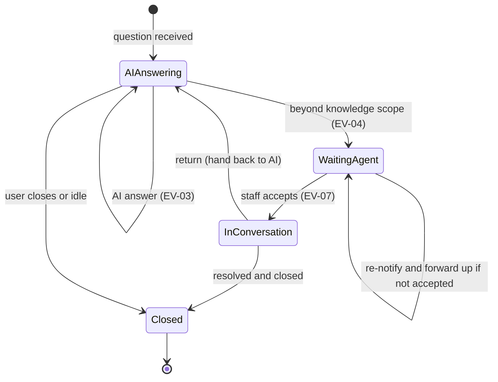

---

### 6.3 [EV-01] Hotel Admin login → logged-in user verification

Hotel staff do not log in to SharpTalk separately. **The Hotel Admin server signs** the user data Hotel Admin already knows and passes it to the widget. SharpTalk verifies the signature and opens the conversation as that user.

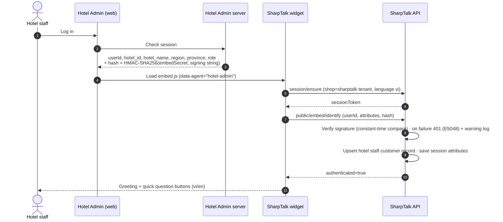

| Received attributes (final) | Purpose | Notes |
|---|---|---|
| `userId` | User identification | Already signed |
| `hotel_id`, `hotel_name` | Conversation screen badge, key for hotel-level expansion in Phase 3 | New |
| `region` (`north`/`central`/`south`) | **Basis for staff assignment** | New — Go2Joy derives it from the hotel address |
| `province` | Province/city for display and statistics | New |
| `role` (`manager`/`reception`) | Conversation screen badge | New |

- **Signing string**: with no attributes, it is just `userId` (same as before). With attributes, add one `key=value` per line after `userId`, **in alphabetical key order**. Example: `u-1024\nhotel_id=H77\nhotel_name=Joy Hotel\nregion=north\nrole=reception`. The format and sample code are in the Embed SDK guide §3.4.
- Keys other than these 5, values with line breaks, and values over 120 characters are dropped, not stored. If attributes are sent but only `userId` was signed, the request is rejected with 401.
- The response language is set by the widget `locale`, not by an attribute. If not set, the conversation starts in the tenant default language `vi` (set 10/15).

> Unsigned profile values (name, email) are for display only. **Any value used for assignment must be part of the signature** (so a forged region cannot route the conversation to a different staff member).


*Figure 1. Hotel Admin widget home (app mode). AI notice banner at the top, Go2Joy brand, 4 quick questions (view today's bookings, how to check in, booking dispute, settlement inquiry).*

---

### 6.4 [EV-02·03] Chat question → AI answer

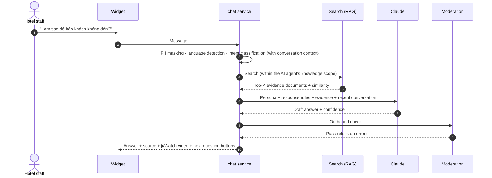

- The AI answers **only from retrieved evidence**. With no evidence it does not make things up. It hands off (EV-04).
- For Hotel Admin actions (confirming settlement, processing cancellations, etc.) it **only explains how**. It never clicks for the user.
- Each answer ends with a Go2Joy support contact footer (numbers by region).


*Figure 2. AI answer to "how to report a no-show". It shows step-by-step instructions, the source (Video 22) with a ▶Watch video link, the support contact footer and next question buttons.*

---

### 6.5 [EV-04·05] Beyond knowledge scope → human agent assignment

#### 6.5.1 Beyond-scope decision (current logic kept)
| Order | Condition | Handoff reason |
|---|---|---|
| 1 | deny-list topic (e.g. contract termination, legal dispute, large refund) | `policy` — immediately, before search |
| 2 | User asks for a human agent | `user_request` |
| 3 | Greeting, small talk, unclear meaning | No handoff (ask back) |
| 4 | No search evidence or answer confidence < 0.45 | `low_confidence` |

#### 6.5.2 Assignment basis — region × inquiry type (new)
There are two assignment keys: **① hotel region** (the `region` signed in EV-01) and **② inquiry type**. In the implementation, the inquiry type is detected from **keywords in the customer message** (e.g. `thanh toán`, `đối soát`) or from the **work label set by a deny rule** (consult, accounting, operations). Mapping intent classification results to inquiry types was not used — keywords can be edited directly on screen by Go2Joy staff.

| Inquiry type \ Region | North (Miền Bắc) | Central (Miền Trung) | South (Miền Nam) |
|---|---|---|---|
| Booking, check-in, no-show | North operations A·B | Central operations | South operations C·D |
| Settlement, disputes | Settlement team (nationwide) | Settlement team | Settlement team |
| Rates, discounts, Flash Sale | North sales | Central sales | South sales |
| Coupons, ads | Marketing (nationwide) | Marketing | Marketing |
| Account, permissions, outages | Tech support (nationwide) | Tech support | Tech support |
| Other | Regional shared queue | Regional shared queue | Regional shared queue |

*Staff in the table are examples. Go2Joy decides the real region split (3 regions or by province/city) and the inquiry type list (§12 D-3).*

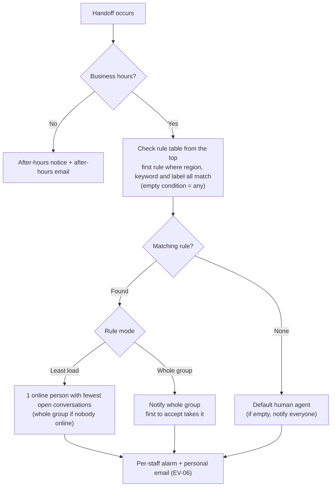

- **Priority is set by rule order.** The planned order "exact match → nationwide by inquiry type → regional shared → all" gives the same result when specific rules go on top and rules with no region go below.
- If the session has no region (signing not built or not sent), rules with a region condition do not match. The conversation goes to a rule with no region or to the default agent. The planned "look up Go2Joy hotel info by hotelId" was not built because there is no Go2Joy API.
- When one person accepts, the other staff alarms for the same conversation close too.


*Figure 3. Default human agent, business hours and after-hours settings in [Tenant settings › Human agent connection]. The routing rules table sits below it (Figure 10).*


*Figure 10. The implemented routing rules editor (live staging screen). Each rule has a name, mode (least load / whole group), region, inquiry type (keywords + labels) and staff. Use ↑↓ to change the order. Re-notification is a tenant-wide setting, not per rule (§6.6).*

---

### 6.6 [EV-06] Notifying the assigned human agent

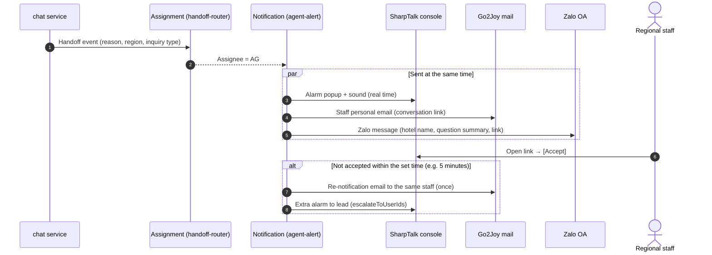

| Channel | Phase 1 plan | Status (10/15) |
|---|---|---|
| SharpTalk console alarm (popup) | Per-staff alarm | **Implemented** — 1 alarm per assigned staff; when one accepts, the rest close. Delivery cycle (10-second check) unchanged |
| Email | **Staff personal email** | **Implemented** — subject `[SharpTalk] Escalation — conversation #<number>`, body has handoff reason, hotel, region, question preview and conversation link |
| Re-notify if not accepted | Re-notify and forward up | **Implemented** — set wait time (minutes) and lead in [Human agent connection]. Tenant-wide, once per conversation |
| Zalo | **Send staff notifications** | **Waiting** — needs Go2Joy Zalo OA and ZNS template approval |
| Web push (browser) | Optional | Not done (out of Phase 1) |
| Slack | Off if Go2Joy does not use it | Unchanged |

Notifications contain only **handoff reason, hotel name, region, question preview and conversation link**, never the full conversation (so conversation text does not go to external messengers). The implemented email follows this rule. The question preview is the start of the customer's question. Zalo notifications will use the same body.

---

### 6.7 [EV-07] Human agent replies to the assigned conversation

Staff open a `Waiting for agent` conversation in console [Live chat]. They see why the AI handed it off and which hotel and region the user belongs to, click [Accept] and reply. In the right panel they can use **AI briefing** (conversation summary), **knowledge lookup** (is the same question in knowledge?) and **AI draft answer**. When done, they [Return] (hand back to AI) or [Close].


*Figure 4. Console live chat. The AI found no evidence for "how to register an account" and moved it to `Waiting for agent`. Staff click [Accept] and reply, using AI briefing and knowledge lookup on the right.*

Phase 1 addition: **hotel name, region and role badges** in the conversation header and list (**implemented**, D5). Handoff reason display (no evidence / confidence / request / policy) is not done yet (remaining work).


*Figure 9. A conversation opened as a signed user (live staging). The header shows `Hotel`, `North` and `Reception` badges. This conversation ran before the default language was set, so it answered a Vietnamese question in English. That is why the default language was set to `vi`.*

---

### 6.8 [EV-09] Saving human agent answers back as knowledge

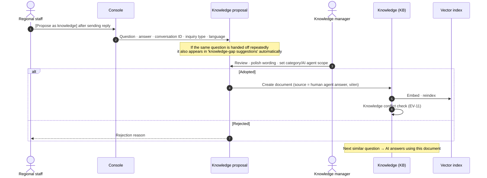

SharpTalk already has four paths for human agent answers to come back as knowledge.

| Path | How it works | Use |
|---|---|---|
| Knowledge proposal | Human agent submits an answer as a knowledge candidate, admin approves | Default path in Phase 1 |
| Knowledge-gap suggestions | Topics with frequent handoffs, intents with no evidence and answers resolved by human agents become candidates automatically | Weekly review |
| Answer reuse | When a question nearly identical to one a human agent answered comes in, the verified answer is replayed (moderation still applies) | Consider turning on |
| Smart Knowledge Board | Organized documents are reviewed on the board and adopted into the KB | Policy and guide updates |


*Figure 5. [Knowledge › Knowledge-gap suggestions]. When the same question goes to human agents many times (frequent handoff), it shows up as a knowledge candidate. Once an admin clicks [Approve as KB document], the AI answers it from then on.*


*Figure 6. Smart Knowledge Board. All knowledge is reviewed on the board before adoption into the KB (204 items on go2joy staging).*

---

### 6.9 [EV-10] Answer accuracy rating (new)

To trust and widen "what the AI can answer", we need records of people judging whether AI answers were right. Before, there was only customer satisfaction (per conversation) and golden question auto-grading. There was no per-message accuracy rating. **Built as D7** (staging, 10/15).

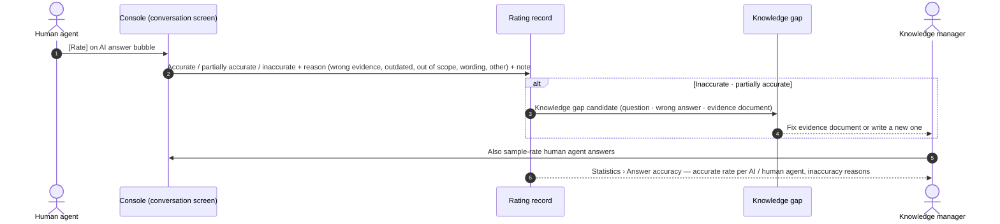


*Figure 11. [Rate] under an AI answer in a console conversation (live staging). Clicking it lets you choose accurate / partially accurate / inaccurate, a reason and a note. After saving, the result stays visible, like 'Inaccurate · Outdated', and you can click again to change it. Inaccurate and partially accurate AI answers go to [Knowledge-gap suggestions] automatically.*


*Figure 12. [Statistics › Answer accuracy] tab. AI and human agent answers are counted separately (one combined rate would hide which side needs fixing). It shows 0% because there is only 1 real data point.*

| Rated item | Who | When | How results are used |
|---|---|---|---|
| AI answers | Human agent who took over the conversation | The last AI answer before handoff (operating rule), plus samples | Inaccurate → knowledge gap, accuracy statistics — **implemented** |
| Human agent answers | Knowledge manager | During knowledge proposal review + weekly samples | Accuracy statistics — **implemented** (coaching link is an operating procedure) |
| Knowledge documents | Knowledge manager | Documents with 2 or more inaccurate ratings | Fix or withdraw — **not implemented** (after Phase 1) |

- One rating per (message, rater). Rating again by the same person overwrites it. Customer messages cannot be rated.
- "The last AI answer before handoff must be rated" is not enforced on screen. It is set as a Go2Joy human agent operating rule.

---

### 6.10 [EV-11] Knowledge conflict check

If new knowledge (especially from human agent answers) says something different from existing policies or guides, the AI answers differently each time. SharpTalk already runs **two-step conflict detection** — ① find similar document pairs by vector similarity, and ② have the AI judge whether they are a "duplicate" or a "contradiction". The admin views both documents side by side and edits one, merges them or ignores the pair.

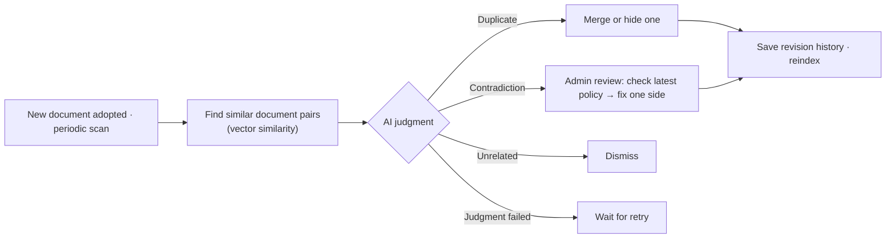


*Figure 7. [Knowledge › Knowledge conflict review]. Shows two documents side by side and lets you edit them directly. go2joy staging has 78 unreviewed items, which must be cleaned up before handover to operations.*

**Triage of the 78 unreviewed items (10/15, checked against source text)** — details: [RPT-261015 Conflict triage](../report/RPT-261015-Go2Joy-KB-Conflict-Triage.md)

| Group | Count | Recommended action |
|---|---:|---|
| Needs fix (facts disagree) | 3 | Fix 6 summary manuals — hourly Flash Sale "choose price" (real screen: first 2-hour price is required), missing confirmation step when stopping a Flash Sale |
| Policy document registered twice | 3 | The same terms were registered on 8/20 and 8/29 — keep only one master copy |
| FAQ with same answer, different questions | 32 | Merge 13 documents into 2, keep the questions as variants |
| Translations per language / summary↔video / genuinely different procedures | 40 | Keep both |

- The AI judgment alone could not be trusted. Two pairs with the same problem were judged "contradiction" for one and "complementary" for the other. In operation too, an admin confirms conflict judgments by reading the source text.
- Also found during triage: customer FAQ and policy categories are open to all AI agents, so the Hotel Admin AI agent also uses customer booking guidance as evidence (§12 D-10).

Phase 1 addition (D6, **not implemented**): when a document from a human agent answer is adopted, run a **conflict check just before adoption** and show a warning on the approval screen if it is a contradiction. Today the check runs only when the admin clicks [Check conflicts].

---

## 7. Gaps vs. current state and Phase 1 development items

| # | Item | Current (before start) | Phase 1 work | Size | Status (10/15) |
|---|---|---|---|---|---|
| D1 | Self-hosted install `sharptalk.go2joy.vn` | VN profile exists (assumes `talk-vn.<domain>`) | Finalize domain and env, install on Go2Joy server with backup and monitoring, move knowledge and settings from staging | M | **Waiting** — server and DNS not provided. Schema for fresh installs (`docker/init-sql`) updated to latest |
| D2 | Signed user attributes | Only `userId` signed | Extend signature to `hotel_id·hotel_name·region·province·role`, save session attributes, show in console | M | **Done** #637 |
| D3 | Region × inquiry type routing rules | Staff list, least load per label | Rule table (settings screen), order-based priority, inquiry type = keywords and labels | L | **Done** #638 |
| D4 | Staff notifications | Console popup, shared email, Slack | Staff personal email, re-notify and forward to lead if not accepted, Zalo OA sending | M | **Done** #639 (Zalo waiting on OA) |
| D5 | Console conversation info | Customer, channel, AI agent | Hotel, region and role badges, handoff reason display | S | **Badges done** #637 / handoff reason remaining |
| D6 | Answer → knowledge | Knowledge proposals, gaps, reuse, board | Write up as Go2Joy operating procedure, conflict check before adoption | S | **Remaining** |
| D7 | Accuracy rating | None (only satisfaction and golden grading) | Per-message rating table, API, console UI, statistics tab | M | **Done** #640 |
| D8 | Knowledge cleanup | 270 KB items, 78 unreviewed conflicts, 1 Notion source error | Clean up conflicts, reconnect Notion sharing, native vi review | M | **In progress** — default language `vi` set, conflict triage done (#644). Cleanup, Notion and vi review follow Go2Joy decisions |
| D9 | Terms notice mode | Widget consent banner (CCPA/GDPR style) | "Consent given via Go2Joy terms" mode | S | **Done** #642 (turned on at handover) |
| D10 | Quality gate | Golden 44-question auto-grading (staging) | Connect auto-grading after deploy to the Go2Joy server | S | **Waiting** — after D1 |

The 4 schema change SQL files (`sql/261015-*.sql`) were applied in advance to Korean staging and production. The Go2Joy server includes them from the start through `docker/init-sql`.

---

## 8. Schedule

> **Decision on 2026-10-15: Phase 1 done = 2026-10-31.** The original plan (12 weeks, opening 2027-01) was cut to 2.5 weeks. Amoeba development can keep pace in parallel. But **if Go2Joy prerequisites (server, DNS, Hotel Admin embed, staff list) are not ready by 10/22, 10/31 becomes a "staging opening" instead.**

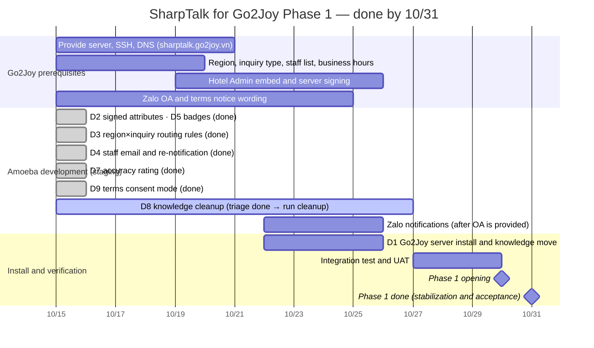

| Milestone | Date | Done when | Status (10/15) |
|---|---|---|---|
| M1 Kickoff | 10/15 | Plan approved, prerequisite requests sent to Go2Joy | **Done** |
| M2 Amoeba features on staging | 10/24 | D2·D3·D4·D5·D7·D9 deployed to staging, golden set 0 failures | **Done (10/15)** — live tests IT-1–8 passed ([TCR-261015](../test/TCR-261015-Go2Joy-Phase1-D2-D7.md)), deploy gate golden 44 questions 0 failures (42 passed, 2 auto-judgment on hold) |
| M3 Go2Joy server install | 10/26 | `https://sharptalk.go2joy.vn` boots and passes smoke test, knowledge moved and reindexed | Waiting — server and DNS needed by 10/22 |
| M4 UAT | 10/29 | EV-01–12 pass live tests through the Hotel Admin embed | Waiting — Hotel Admin signing needed |
| M5 Phase 1 done | 10/31 | Production opening, staff training, operating procedures handed over | Planned |

**Access URLs**
| Environment | Console (human agents, admins) | Widget | Status |
|---|---|---|---|
| Staging (now) | `https://shoptalk.amoeba.site/user/go2joy` | `https://shoptalk.amoeba.site/widget/?mode=app&shop=https%3A%2F%2Fwww.go2joy.vn&agent=hotel-admin` | Available |
| Go2Joy production | `https://sharptalk.go2joy.vn/user/go2joy` | Widget inside Hotel Admin (`https://sharptalk.go2joy.vn/widget/embed.js`) | No DNS as of 10/15 — after Go2Joy provides server and DNS |

Staging console accounts are issued per Go2Joy staff member (after the list arrives). The staging widget starts in Vietnamese if no language is set.

## 9. Success metrics

| Category | Metric | Source |
|---|---|---|
| Efficiency | AI self-resolution rate, handoff rate, cases handled per human agent | Statistics › Journey, handling, agents |
| Speed | AI first response time, assignment → first response (median), count of re-notifications for unaccepted handoffs | Handoff and notification logs |
| Quality | AI answer accuracy (human agent ratings), golden set pass rate, satisfaction | Accuracy rating · golden · CSAT |
| Knowledge growth | New knowledge adopted per month (from human agent answers), knowledge gap resolution rate, fewer repeat handoffs on the same topic | Knowledge › Gaps, board |
| Hygiene | Unresolved knowledge conflicts, share of outdated documents | Knowledge › Conflicts |


*Figure 8. Statistics › Journey (staging, last 30 days). Shows the flow impression → visit → conversation → response/handoff/rating/close on one screen. Accuracy ratings will be counted on this screen once added.*

---

## 10. Privacy and security

| Item | Policy |
|---|---|
| Data residency | Conversations, users, knowledge, logs and backups all stay on the Go2Joy server (Vietnam region). Amoeba accesses only during remote support, with accounts Go2Joy allows |
| External transfer of personal data | No **provision** to third parties. AI answer generation (Anthropic) and embeddings (Voyage) count as **outsourced processing and cross-border transfer**, so the Go2Joy terms and privacy policy name the processors and processing regions. The AI processing region is shown in the widget notice banner (`AI_PROCESSING_REGION`) |
| AI use consent | Go2Joy handles it through the Hotel Admin terms consent process (§1.2 P2). SharpTalk sets the consent mode in [Settings › Privacy notice] to "host app terms" (D9 implemented). In this mode, **only signature-verified Hotel Admin users** are recorded as consented without a consent banner (consent time and notice version are stored). Unsigned visitors still see the banner. A refusal made directly in the widget is never overwritten. Until the terms wording is final, staging keeps the "widget banner" mode |
| Masking before sending to AI | Phone numbers (including +84 and 09xx), emails, account numbers, etc. are masked before going to the AI. Official Go2Joy contacts (footer) are protected values and exempt |
| Outbound control | All AI and human agent messages must pass moderation, blocked on error |
| Access control | Console JWT + rank × work label RBAC, MFA, customer data masked on screen + view audit |
| Retention | Conversation log retention matches the Go2Joy privacy policy (draft 180 days), auto-deleted on expiry |
| Regulation | Vietnam PDPD (Nghị định 13/2023) — cross-border transfer impact assessment, breach notice within 72 hours. **Final wording and filing to be confirmed by Go2Joy legal** |

---

## 11. Future work — Phase 2 and Phase 3

> **Order changed in v1.2 (2026-10-22)** — Phase 2 is Go2Joy Philippines and Phase 3 is per-hotel AI agents. Phase 2 opens the Phase 1 `#Talk-4-Hotel` agent and the booking guest agent in the Philippines, **run by Go2Joy**. Agents run by the hotels themselves (HA menu, reception template, point billing) come in Phase 3.

### 11.0 Channel structure by phase
The three agents in section 1 of the [integration requests and checklist](../../apps/web/public/manual/go2joy/integration.en.md) split across phases as follows.

| Phase | Audience | Agent | Entry | Human handoff |
|---|---|---|---|---|
| Phase 1 (VN) | Hotel staff (B2B) | `#Talk-4-Hotel` (HA Support) | Widget after HA login + signed identify | Hotel region → regional team × inquiry type (CS / Sales) Go2Joy agent |
| Phase 2 (PH) | Hotel staff (B2B) | `#Talk-4-Hotel` (Philippines deployment) | Same as Phase 1 | Philippine region → regional team × inquiry type |
| Phase 2 (PH) | Booking guests (B2C, booking clients) | `Go2Joy-#Talk-4-BookingClient` | Go2Joy app and web (web widget / mobile SDK) | Regional team × CS Go2Joy agent |
| Phase 3 | Booking guests (after booking) | `Hotel-#Talk-4-BookingClient` (per hotel) | Automatic handoff on the booking-confirmed event | Hotel staff (HA #Talk menu) → Go2Joy CS |

### 11.1 Phase 2 — Go2Joy Philippines (booking guest support + Hotel Admin support)
SharpTalk is installed separately on a Go2Joy Philippines server and opens two kinds of support. ① **Hotel Admin support** uses the Phase 1 features as they are. ② **Booking guest (booking client) support** covers questions guests ask about hotels and bookings in the Go2Joy app and web. Conversations follow the booked hotel, and Go2Joy's AI agent and Go2Joy human agents answer them.

| Task | Details |
|---|---|
| Deployment | Separate deployment for the Philippines (one deployment per country rule). New profile `SharpTalk-PH-Go2Joy`, Philippine server and domain. Install steps are the same as the Vietnam Go2Joy server install (schema for new servers, #692) |
| Hotel Admin support (B2B) | Phase 1 `#Talk-4-Hotel` as is — HA signed identify, hotel = business customer registration, conversation continuity per hotel account, region → team routing (#687, #689). Philippine region codes and team mapping are defined anew |
| Booking guest support (B2C) | `Go2Joy-#Talk-4-BookingClient`. Embedded in the Go2Joy app and web via web widget / Android SDK (tested on a real device) / iOS. Logged-in guests are identified by signature and separated from HA staff by a `userId` prefix. The B2B / B2C split exists since #689 (G41) |
| Per-hotel conversations | The booking-confirmed webhook (`bookingSn`, `hotelSn`, guest identity, signature) links to the earlier conversation; bookings at several hotels get one thread per booking (hotel) (G40) |
| Amount and booking lookup | Bookings and rates only pass values from the Go2Joy booking lookup API (no LLM arithmetic) (G41) |
| Human handoff | Regional team × CS Go2Joy agents. To decide: the region basis for booking guests (region of the hotel being searched or booked / guest location) (G42), whether booking changes, cancellations and refunds go to Go2Joy CS, and when conversations close and how long they are kept after checkout (G43) |
| Language | English first. **Filipino (Filipino/Tagalog) is not among the 6 supported languages** → language addition work (shared language list in one place + translation resources) |
| Knowledge | Reuse English versions of shared policies from Vietnam knowledge; write Philippine policies, rates and payment methods separately. Hotel Admin knowledge and booking guest knowledge are split by per-agent knowledge scope (same basis as D-10) |
| Privacy and regulation | Philippine Data Privacy Act (RA 10173) and NPC rules — privacy policy, cross-border transfer notice, breach notice (72 hours). Door lock codes, real names and contacts shown only in authenticated sessions. Add the Go2Joy booking number format to masking |
| Operations | Time zone `Asia/Manila`, routing rules for Philippine regional staff (Luzon/Visayas/Mindanao, etc.), working hours and absence order |
| AI operations | Stay on Level 1 (external AI + RAG). Production AI keys in Go2Joy's name. Add a per-message AI log and per-agent golden evaluation sets (integration checklist S30) |
| To agree with Go2Joy | G40–G43 (webhook, app embed, region basis, post-booking handoff scope and retention), G47 (Zalo channel support). Whether, and when, booking guest support also opens in Vietnam |

### 11.2 Phase 3 — Per-hotel AI agents (hotels answer booking guests)
Each hotel answers inquiries from its own booking guests (Go2Joy app users) directly with an AI agent. **Per-hotel knowledge (facilities, check-in, parking, add-ons)** is layered on top of the Go2Joy shared knowledge built through Phase 2, and hotel staff respond from a SharpTalk menu inside HA.

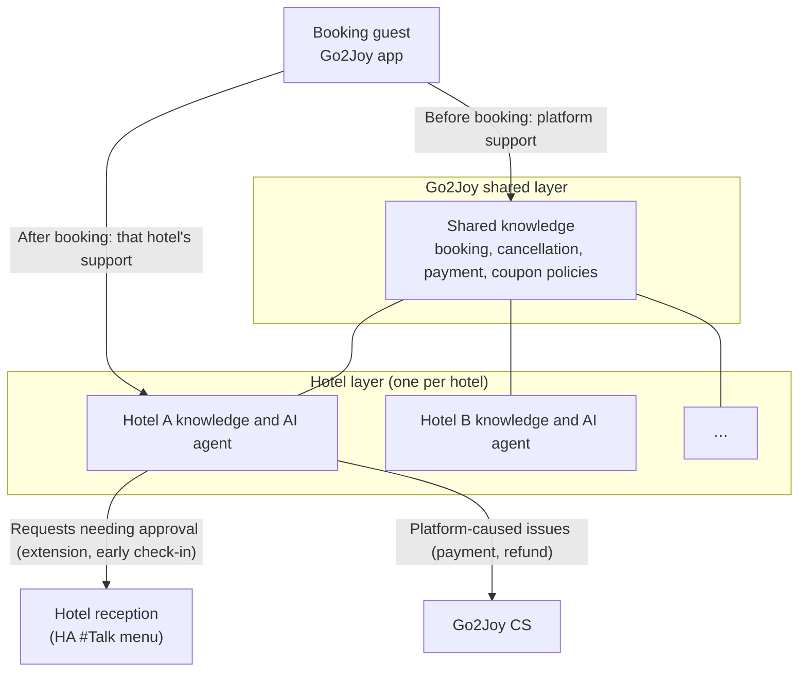

| Task | Details |
|---|---|
| Hotel-level axis | Today there is one tenant = Go2Joy. Decide whether to make about 5,000 hotels into tenants, or add a **hotel scope** inside the tenant (AN-260907 §2.1 — hotel scope recommended) |
| Session ownership transfer | Before booking the platform owns the conversation; after booking ownership moves to that hotel. Reuses the per-booking (hotel) threads from Phase 2 |
| 3-tier handoff | AI → hotel reception (L1) → Go2Joy CS (L2) → specialist team (L3), skip L1 during unstaffed hours |
| HA menu (iframe) | Add a SharpTalk menu to HA (sign-up, persona, knowledge, Inbox). A **short-lived SSO token** issued by the server (the HA token is never passed as is), role mapping (`Quản lý` settings / `Lễ tân` Inbox) (G44) |
| Reception agent operations | Shared template (managed by Go2Joy), sign-up approval, hotel onboarding order (G45) |
| Hotel knowledge onboarding | Turn Hotel Admin hotel info, rooms and add-ons into knowledge automatically; hotels fill in the rest |
| Personal data | Door lock codes, real names and contacts shown only in authenticated sessions (same rule as Phase 2) |
| Business model and billing | Paid add-on per hotel (B2B2C) — REQ-260825 Option 2. Token → point conversion, what happens when points run out (stop / connect staff), where top-up and balance screens live (G46) |
| AI operations | Consider moving to Level 2 with model answers built from agent ratings and adopted answers. Ownership of training outputs is set in the service contract (G7) |
| Countries | Added on top of the Vietnam and Philippines deployments opened through Phase 2. Order by country to be agreed with Go2Joy |

---

## 12. Risks and open decisions

### 12.1 Decisions needed (D-1–D-8 by M1, D-10–D-12 by 10/22)
| ID | Decision | Decided by |
|---|---|---|
| D-1 | Server spec, region, backup storage, remote access method | Go2Joy |
| D-2 | Signed attribute list and Hotel Admin server signing schedule | Go2Joy development |
| D-3 | Region split (3 regions / province-city) and inquiry type list, staff list and business hours per region and inquiry type | Go2Joy CS |
| D-4 | Zalo notification method (Go2Joy Zalo OA and ZNS template approval) | Go2Joy |
| D-5 | AI notice wording in terms and privacy policy, retention period | Go2Joy legal |
| D-6 | AI engine contract owner (Go2Joy's own key / provided by Amoeba) and cost settlement | Both companies |
| D-7 | Pilot target (regions, number of hotels) and opening criteria | Both companies |
| D-8 | Maintenance and update SLA, incident contact chain | Both companies |
| D-9 | Default language and time zone | **Decided (10/15)**: `vi` / `Asia/Ho_Chi_Minh` |
| D-10 | Whether to remove customer FAQ and policy categories from the Hotel Admin AI agent's scope | Go2Joy |
| D-11 | Approve the knowledge conflict cleanup plan — fix 6 summary manuals, policy master copy, merge FAQ 13→2, deactivate BRD-1 draft | Go2Joy |
| D-12 | Inquiry type detection keyword list (Vietnamese) — words per inquiry type such as settlement, rates, account | Go2Joy CS |

### 12.2 Risks
| Risk | Impact | Response |
|---|---|---|
| Hotel Admin signing delayed | Region-based assignment impossible | Sessions without a region go to rules with no region or the default agent (no missed assignments). Looking up the region by hotelId needs a Go2Joy hotel API |
| Knowledge quality (old UI, 78 conflicts) | Wrong answers → loss of trust | Triage of the 78 found 3 real wrong-answer risks (D-11). Fix and vi review before opening, expand the golden set, catch early with accuracy ratings |
| Staff do not respond | Long waits | Re-notify and forward up, after-hours notice, weekly review of response time metrics |
| Conversation content leaking to external messengers | Personal data | Notifications carry only summary and link, no conversation text |
| AI credits run out or engine fails | Answers stop | Engine status monitoring and credit alerts (already built), switch to human agent connection on failure |
| Self-hosted updates delayed | Security and feature gaps | Monthly scheduled update window, advance notice of schema changes |
| Keyword inquiry type detection misses or misjudges | Assigned to the wrong staff | If no rule matches it goes to the default agent, so assignment itself is never missed. During the 2-week pilot, review assignment logs (`handoff routed by rule`) and tune keywords |

---

## Appendix A. Related documents
- Requirements: [REQ-260831 SharpTalk for Go2Joy requirements](../analysis/REQ-260831-SharpTalk-Go2Joy-Requirements.md), [AN-260907 Side impact](../analysis/AN-260907-SharpTalk-Go2Joy-Side-Impact.md), [REQ-260825 Business model](../analysis/REQ-260825-Go2Joy-ChatAgent-BizModel.md)
- Knowledge: [REQ-260829 Video guide KB](../analysis/REQ-260829-Go2Joy-Video-Guide-KB.md), [REQ-261007 FAQ accuracy](../analysis/REQ-261007-Go2Joy-FAQ-Accuracy.md), [REQ-261006 Video links](../analysis/REQ-261006-KB-Video-Links.md)
- Widget and embed: [REQ-261001 Partner widget](../analysis/REQ-261001-Go2Joy-Partner-Widget.md), [Embed SDK guide](../guide/임베드SDK설치가이드_Embed-SDK.ko.md), [Mobile SDK guide](../guide/모바일SDK연동가이드_Mobile-SDK.ko.md)
- Deployment: [VN-Go2Joy setup guide](../guide/GUIDE-260913-SharpTalk-VN-Go2Joy-Staging.md), [Self-hosted install guide](../guide/자체호스팅설치가이드_Self-Hosted-Install.ko.md), `deploy/profiles/SharpTalk-VN-Go2Joy/`
- Privacy: [PROCESSOR-REGISTER](../guide/PROCESSOR-REGISTER.md), [INCIDENT-RESPONSE](../guide/INCIDENT-RESPONSE.md)
- Phase 1 implementation records: [TCR-261015 Tests](../test/TCR-261015-Go2Joy-Phase1-D2-D7.md), [RPT-261015 Implementation and deployment](../implementation/RPT-261015-Go2Joy-Phase1-D2-D7.md), [RPT-261015 Knowledge conflict triage](../report/RPT-261015-Go2Joy-KB-Conflict-Triage.md)
- Integration: [Go2Joy integration requests and checklist](../../apps/web/public/manual/go2joy/integration.en.md) (2026-10-22) — channel structure, requests G1–G47, checklists

## Appendix B. Next steps
2026-10-15 user approval ("Finish Phase 1 by end of October, go ahead"). Because the schedule is 2.5 weeks, no separate REQ/PLN is written per development item. **This document serves as the PLN for D2–D9** (screen changes are the §6 wireframes). Per-item TCR and RPT documents are still kept.

2026-10-15 v1.1: Amoeba development items (D2, D3, D4, D5 badges, D7, D9) were deployed to staging the same day and also released to Korean production. Next steps: ① Go2Joy replies to §12 D-1–D-5 and D-10–D-12 by 10/22 ② install D1 as soon as the server is provided ③ UAT (M4) once Hotel Admin signing is in place.

2026-10-22 v1.2: By user decision, Phase 2 and Phase 3 were swapped — Phase 2 = Go2Joy Philippines (booking guest support + Hotel Admin support), Phase 3 = per-hotel AI agents. Phase 2 starts as a separate REQ once Go2Joy answers the discussion items in §11.1.
