# SharpTalk for Go2Joy — 프로젝트 계획서

> **한 줄 요약** — Go2Joy 서버(`sharptalk.go2joy.vn`)에 SharpTalk을 설치해 **Hotel Admin에 AI 상담원**을 붙인다.
> AI가 1차로 답하고, 지식 범위를 넘는 질문은 **호텔 지역 × 문의 업무**로 정해진 Go2Joy 담당자에게 넘기며,
> 담당자의 답변은 다시 **지식으로 저장**되어 다음부터는 AI가 답한다. 이 고리를 돌릴수록 AI가 답하는 범위가 넓어진다.

| 항목 | 내용 |
|---|---|
| 1단계 범위 | Hotel Admin 로그인 사용자(호텔 직원) 대상 AI 1차 상담 + 지역·업무별 상담원 배정 + 지식 순환 |
| 2단계 범위 | 필리핀 Go2Joy — 호텔별 예약 고객 상담(부킹고객) + Hotel Admin 상담 |
| 3단계 범위 | 호텔별 AI 상담원 — 각 호텔이 예약 고객 문의에 대응 |
| 근거 문서 | [REQ-260831 요구사항](../analysis/REQ-260831-SharpTalk-Go2Joy-Requirements.md) · [AN-260907 사이드임팩트](../analysis/AN-260907-SharpTalk-Go2Joy-Side-Impact.md) · [REQ-260825 비즈모델](../analysis/REQ-260825-Go2Joy-ChatAgent-BizModel.md) · [VN-Go2Joy 세팅 가이드](../guide/GUIDE-260913-SharpTalk-VN-Go2Joy-Staging.md) |
| 연동 요청·체크리스트 | [Go2Joy 연동 요청 사항·작업 체크리스트](../../apps/web/public/manual/go2joy/integration.ko.md)(2026-10-22) — 채널 구조, Go2Joy 요청 G1~G47, 양쪽 작업 목록 |
| 화면 출처 | 한국 스테이징 go2joy 테넌트 실화면(2026-10-15 캡처). 담당자 이메일은 가렸습니다. 그림 9~12는 실측 테스트 때 화면이라 테스트용 이름(`E2E`, `example.com`)이 보입니다 |

### 진행 현황 (2026-10-22 기준)

| 구분 | 상태 |
|---|---|
| 아메바 개발 | **D2·D3·D4·D5·D7·D9 완료**(PR #637~#643, 10/15). 10/19~22 추가 — 위젯 디자인·만족도 설문·언어 고정(#650~#662), 권역 코드·"지역 매칭" 배정(#687), 호텔 = 기업고객 등록·호텔 계정 대화 연속성·B2B/B2C 구분(#689), 새 서버 설치용 스키마(#692). 스테이징 실측 통과, 한국 프로덕션 반영(go2joy 테넌트 없음 → 동작 변화 없음) |
| 지식 정비(D8) | go2joy 기본 언어 `vi`·타임존 `Asia/Ho_Chi_Minh` 설정 완료. 지식 충돌 78건 분류 완료 — 실제 수정 3건, 정리 35건은 Go2Joy 결정 대기([RPT-261015 충돌 분류](../report/RPT-261015-Go2Joy-KB-Conflict-Triage.md)) 10/21 Notion 소스 삭제로 HA 가이드·FAQ가 비활성 — 재등록 대기(G30) |
| Go2Joy 선행 대기 | **10/22 기한까지 받지 못함** — 서버·DNS(G1), HA 서명·임베드(G10·G11), 팀·상담원 명단·업무 기준·부재 처리 순서(G20~G23), 약관·개인정보 고지(G4·G5). §8 결정대로 10/31은 **스테이징 오픈**으로 대체된다. 항목별 상태는 [연동 요청 사항·체크리스트](../../apps/web/public/manual/go2joy/integration.ko.md) |
| 남은 아메바 작업 | D1 설치(서버 받은 뒤), Zalo 알림(OA 받은 뒤), D6 채택 전 충돌 점검, D5 이관 사유 표시, D10 품질 게이트 연결, 메시지 단위 AI 로그(AI 운용 Level 1 보강) |

### 변경 이력
| 버전 | 날짜 | 내용 |
|---|---|---|
| 1.0.0 | 2026-10-15 | 최초 작성, 1단계 10/31 완료 결정 반영 |
| 1.1.0 | 2026-10-15 | 구현 결과 반영 — 서명 속성 키·서명 문자열 확정(§6.3), 업무 판별은 키워드·라벨 기준으로 확정(§6.5.2), 재알림은 테넌트 공통 설정(§6.6), 정확성 평가 화면(§6.9), 충돌 78건 분류 결과(§6.10), 항목별 상태(§7), 진행 현황(§8), 결정 사항 추가(§12) |
| 1.2.0 | 2026-10-22 | 2단계·3단계 순서 변경 — 2단계 = 필리핀 Go2Joy(예약 고객 상담 + Hotel Admin 상담), 3단계 = 호텔별 AI 상담원(§1.4·§11). 연동 요청 사항·체크리스트(10/22)의 채널 구조와 협의 항목 G40~G47 반영, 진행 현황 10/22 기준 갱신 |

---

## 목차
1. [프로젝트 개요](#1-프로젝트-개요)
2. [SharpTalk 서비스 소개](#2-sharptalk-서비스-소개)
3. [개발 스택과 구조](#3-개발-스택과-구조)
4. [서비스 전체 구성](#4-서비스-전체-구성)
5. [사용자와 역할](#5-사용자와-역할)
6. [1단계 사용자 이용 시나리오](#6-1단계-사용자-이용-시나리오)
7. [현행 대비 갭과 1단계 개발 항목](#7-현행-대비-갭과-1단계-개발-항목)
8. [추진 일정](#8-추진-일정)
9. [성과 지표](#9-성과-지표)
10. [개인정보·보안](#10-개인정보보안)
11. [향후 과제 — 2단계·3단계](#11-향후-과제--2단계3단계)
12. [위험과 결정 필요 사항](#12-위험과-결정-필요-사항)

---

## 1. 프로젝트 개요

### 1.1 배경
- Go2Joy는 베트남 시간제 숙박 예약 플랫폼으로 약 5,500개 제휴 숙박업체를 운영한다. 호텔 직원(관리자 `Quản lý`, 리셉션 `Lễ tân`)은 Hotel Admin으로 예약·체크인·정산·요금·쿠폰·광고를 다룬다.
- 호텔 직원 문의는 지금 Go2Joy CS가 사람 손으로 받는다(이메일·Hotline·Zalo, 북부/남부 번호 분리). 같은 질문이 반복되고, **정산 이의제기 기한**이나 **취소 사유 선택**처럼 잘못 안내하면 곧 금전 손실이 되는 문의가 많다.
- SharpTalk은 2026-08부터 한국 스테이징의 go2joy 테넌트로 검증해 왔다. Hotel Admin 영상 가이드 63편·FAQ·운영 규정이 지식(KB 270건, 보드 204건)으로 들어가 있고, 파트너 FAQ 44문항 자동 채점 세트로 답변 품질을 매번 측정한다.

### 1.2 목적
| # | 목적 | 설명 |
|---|---|---|
| P1 | **개인정보 외부 제공 문제를 구조로 해소** | SharpTalk을 Go2Joy 서버에 설치해 Go2Joy 전용으로 운영한다. 대화·호텔 직원 정보·지식은 Go2Joy 인프라 안에 저장되고, 아메바 서버로 나가지 않는다 |
| P2 | **AI 이용 고지·동의는 Go2Joy 약관으로** | Hotel Admin 이용약관·개인정보처리방침에 AI 상담(및 AI 처리 위탁)을 넣고 Go2Joy가 동의 절차를 운영한다. SharpTalk 위젯은 동의 팝업 대신 고지 배너만 보인다 |
| P3 | **CS 부담 감소, 24시간 응대** | 반복 문의는 AI가 즉시 답하고, 사람은 지식 밖의 문의에만 집중한다 |
| P4 | **사람의 답이 회사의 지식이 되는 구조** | 상담원 답변을 지식으로 저장해, 같은 질문이 다시 오면 AI가 답한다. 답변 정확성 평가와 지식 충돌 점검으로 품질을 유지한다 |

### 1.3 달성 목표 (1단계 종료 2026-10-31 이후 첫 달)
| 지표 | 목표(안) | 측정 |
|---|---|---|
| AI 자체 해결률 (이관 없이 끝난 대화) | **70% 이상** | 통계 › 여정·처리 |
| 지식 범위 초과 → 담당자 배정 성공률 | **100%** (미배정 0건) | 이관 로그 |
| 배정 → 상담원 첫 응답 (근무시간) | **중앙값 10분 이내** | 통계 › 상담원 |
| 상담원 답변의 지식 등록 | 이관 해결 건의 **50% 이상**이 지식 후보로 검토됨 | 지식 갭 제안 |
| AI 답변 정확도 (상담원 평가) | **정확 85% 이상** | 신규 정확성 평가 |
| 골든 회귀 세트 | 44문항 중 실패 0 유지 | 배포 후 자동 채점 |

> 목표값은 시범 운영 첫 2주의 실측으로 다시 정한다. 현재 스테이징 30일 값: 대화 149건 중 상담원 이관 18건(12%).

### 1.4 범위
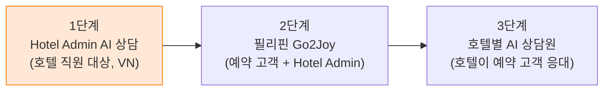

| 포함(1단계) | 제외(후속) |
|---|---|
| `sharptalk.go2joy.vn` 자체 호스팅 설치·운영 이관 | 예약 고객(B2C) 채널·필리핀 배포(2단계), 호텔별 AI 상담원(3단계) |
| Hotel Admin 위젯 임베드 + 서명된 로그인 사용자 정보(호텔·지역·권한) | 예약·정산 데이터를 AI가 직접 조회하는 API 연동(별도 합의 후) |
| AI 1차 응답(vi/en), 지식 범위 판단, 지역 × 업무 배정 | AI가 Hotel Admin 조작을 대신 실행하는 기능(설계상 금지) |
| 상담원 알림(이메일·Zalo·SharpTalk 알람), 상담원 답변 | AI 운용 Level 2·3 전환(모범답안·자체 모델) |
| 답변 → 지식 저장, 정확성 평가, 지식 충돌 점검 | 음성 채널 |

---

## 2. SharpTalk 서비스 소개

SharpTalk(샵톡)은 아메바(BitBiz)가 만든 **멀티테넌트 AI 상담·고객지원 플랫폼**이다. 웹사이트나 앱에 채팅 위젯을 붙이면, AI 상담원이 회사 지식으로 답하고, 답하지 못하는 문의는 사람 상담원에게 넘긴다. 상담원은 콘솔에서 대화를 이어받고, 그 결과를 다시 지식으로 쌓는다.

| 영역 | 주요 기능 | Go2Joy 1단계 사용 |
|---|---|---|
| 채팅 위젯 | 웹 임베드(`embed.js`)·모바일 WebView SDK(Android AAR), 다국어 6종(en/es/ko/vi/ja/zh), 브랜드 테마, 빠른 질문 버튼 | Hotel Admin 웹 임베드, vi/en |
| AI 상담원 | 다중 AI 에이전트(페르소나·인사말·응답 규칙), 하이브리드 검색(RAG), 대화 맥락 12메시지, 출처·영상 링크 표시 | `Hotel Admin` 에이전트 |
| 안전장치 | 모든 AI·상담원 발신 모더레이션(차단 우선), 개인정보 마스킹(로그·AI·화면 3종), deny-list 즉시 이관 | 그대로 사용 |
| 상담원 콘솔 | 실시간 상담, 수락·지정·반려·종료, AI 브리핑·답변 초안, 지식 조회, 이슈 보드 | Go2Joy CS 사용 |
| 지식 관리 | 지식 소스(Notion·Google Drive·파일), Smart Knowledge Board(검토 후 채택), 일괄 등록, **지식 갭 제안**, **지식 충돌 검토**, 개정 이력 | 그대로 사용 |
| 품질·통계 | 고객 여정·질문 분석·노출/접속·채널·상담원·만족도 통계, 골든 질문 자동 채점, AI 코칭 | 그대로 사용 + 정확성 평가 추가 |
| 운영 | 테넌트·요금제·메뉴 권한, 사용자·라벨(RBAC), 감사 로그, MFA, AI 엔진·사용량 계측 | Go2Joy 운영자가 관리 |


*그림 0. [AI 설정]. go2joy 테넌트에는 용도별 AI 에이전트 6종이 있고, 1단계는 `Hotel Admin` 에이전트를 쓴다. 에이전트마다 인사말·페르소나·응답 규칙·빠른 질문 버튼·지식 범위를 따로 둔다.*

---

## 3. 개발 스택과 구조

### 3.1 기술 스택
| 계층 | 기술 |
|---|---|
| 백엔드 API | **NestJS 11 + TypeORM**(Node.js 20), REST `/api/v1`, Swagger `/api/v1/docs` |
| 데이터 | **MySQL 8**(업무 데이터), **Redis**(세션·캐시·속도 제한), **RabbitMQ**(이벤트·비동기 작업), **Qdrant**(벡터 검색) |
| AI | 교체형 AI 게이트웨이 — Anthropic Claude(응답·분류·충돌 판정), Voyage(임베딩). AI 엔진 키는 테넌트별 등록 가능 |
| 프런트엔드 | **React 18 + Vite + Tailwind + Zustand + React Query + react-i18next** — 콘솔(`apps/web`), 위젯(`apps/widget`) |
| 모바일 | Android Kotlin SDK(`sdk/android`, WebView `?mode=app`) |
| 배포 | Docker Compose 자체 호스팅 패키지(`docker/self-hosted`) + 국가/고객 프로필(`deploy/profiles/SharpTalk-VN-Go2Joy`) |
| 보안 | 비밀번호 bcrypt, 자격증명 AES-256-GCM, JWT + RBAC(직급 × 업무 라벨), 위젯 신원 HMAC-SHA256 서명, 감사 로그 |

### 3.2 저장소 구조
```text
btbz-sharptalk/                    Turborepo 모노레포
├─ apps/
│  ├─ api/        NestJS — src/domain/{chat, ai-engine, knowledge, agent, embed, session, ...}
│  ├─ web/        콘솔 (테넌트 콘솔 + 플랫폼 어드민)
│  └─ widget/     채팅 위젯 + 로더 embed.js
├─ packages/
│  ├─ types/      공용 타입·언어 목록(language.ts)
│  └─ common/     권한 매트릭스 등 공용 로직
├─ sdk/android/   Kotlin WebView SDK
├─ docker/self-hosted/   자체 호스팅 compose·nginx·Dockerfile
├─ deploy/profiles/SharpTalk-VN-Go2Joy/   Go2Joy 프로필(env 예시·체크리스트·테넌트 스냅샷)
└─ sql/           스키마 변경 SQL (배포 전 수동 선적용)
```

### 3.3 백엔드 모듈 지도 (1단계 관련)
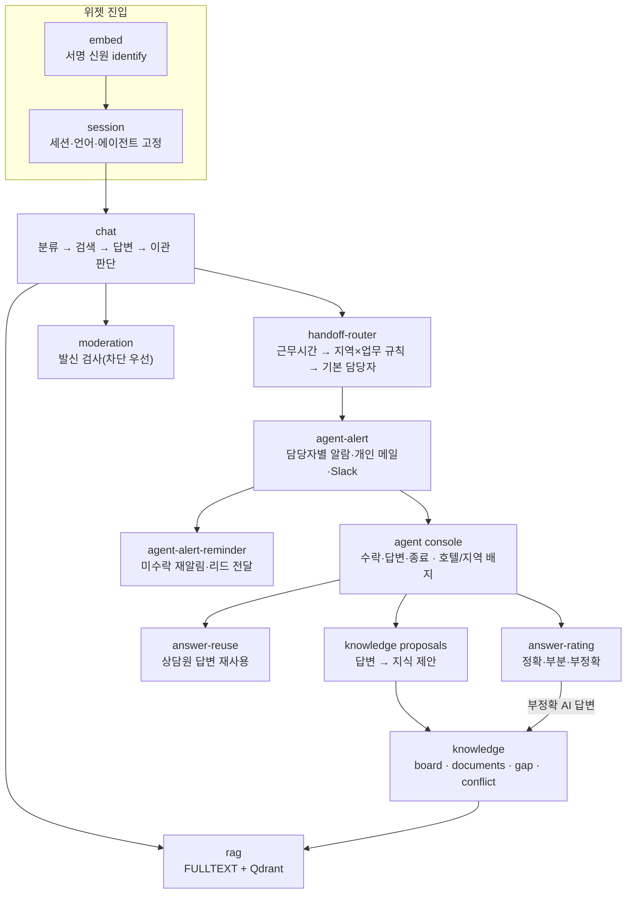

---

## 4. 서비스 전체 구성

### 4.1 시스템 개요도
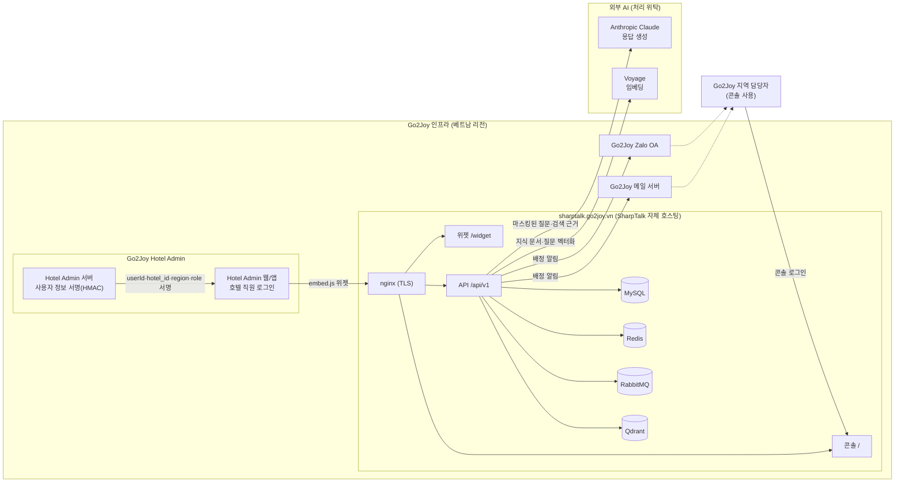

**데이터 경계** — 대화 원문, 호텔 직원 정보, 지식, 감사 로그는 모두 Go2Joy 서버의 MySQL·Qdrant에 저장된다. 외부로 나가는 것은 **AI 답변 생성을 위한 질문 텍스트와 검색 근거**(개인정보 마스킹 후)와 **임베딩용 텍스트**뿐이며, 이 두 곳은 저장하지 않는 처리 위탁(API 호출)이다. 이 처리 위탁을 Go2Joy 약관에 고지한다(§10).

### 4.2 배포 구성
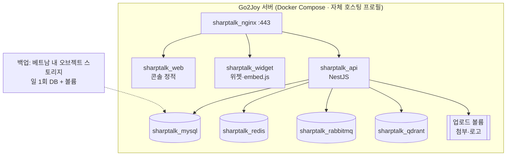

| 항목 | 값(안) |
|---|---|
| 도메인 | `sharptalk.go2joy.vn` — 콘솔 `/`, 위젯 `/widget/`, API `/api/v1` 한 오리진 |
| 서버 사양 | 시범 4 vCPU / 8 GB / 80 GB → 운영 8 vCPU / 16 GB / 200 GB 이상 |
| 설치 | `deploy/profiles/SharpTalk-VN-Go2Joy` 프로필 env 복사 → `--check` 통과 → 스키마 SQL → 부팅 확인(`successfully started`) |
| 운영 이관 | 한국 스테이징 go2joy 테넌트 설정·지식을 스냅샷·일괄 다운로드로 이관(DB 직접 복사 금지) |
| 업데이트 | 아메바가 릴리스 태그 제공 → Go2Joy 서버에서 배포 스크립트 실행(스키마 변경은 SQL 선적용) |

### 4.3 역할 분담
| 업무 | Go2Joy | Amoeba |
|---|---|---|
| 서버·도메인·TLS·백업 | **책임** | 사양·절차 제공 |
| SharpTalk 설치·업데이트 | 승인·실행 환경 | **책임**(원격 지원) |
| Hotel Admin 위젯 임베드·사용자 서명 | **책임**(서버 서명 코드) | 가이드·검증 |
| 약관·AI 이용 동의 | **책임** | 고지 문구 초안 |
| 지역·업무 담당자 지정, 근무시간 | **책임** | 설정 화면 제공 |
| 지식 콘텐츠(정책·가이드·FAQ) | **책임**(내용 확정) | 변환·등록 도구 |
| AI 설정·품질 측정·튜닝 | 검토 | **책임** |
| 장애 1차 대응 | 인프라 | 애플리케이션 |

---

## 5. 사용자와 역할

| 사용자 | 어디서 | 하는 일 |
|---|---|---|
| **호텔 직원** (관리자 `Quản lý` / 리셉션 `Lễ tân`) | Hotel Admin 안 채팅 위젯 | Hotel Admin 사용법·예약·정산·요금·쿠폰·광고 문의 |
| **AI 상담원** `Hotel Admin` 에이전트 | SharpTalk | 지식으로 1차 답변, 범위 밖이면 이관 |
| **지역 담당자** (Go2Joy CS, 인간 상담원) | SharpTalk 콘솔 | 배정된 대화에 답변, 답변을 지식 후보로 제안, AI 답변 평가 |
| **지식 관리자** (Go2Joy CS 리드) | SharpTalk 콘솔 › 지식 | 지식 후보 승인, 지식 충돌 해결, 정확성 평가 검토 |
| **테넌트 관리자** (Go2Joy master) | SharpTalk 콘솔 › 설정 | 배정 규칙·담당자·근무시간·알림 채널 관리 |
| **플랫폼 운영자** (Amoeba) | 플랫폼 어드민 | AI 엔진·업데이트·모니터링 |

---

## 6. 1단계 사용자 이용 시나리오

### 6.0 전체 흐름
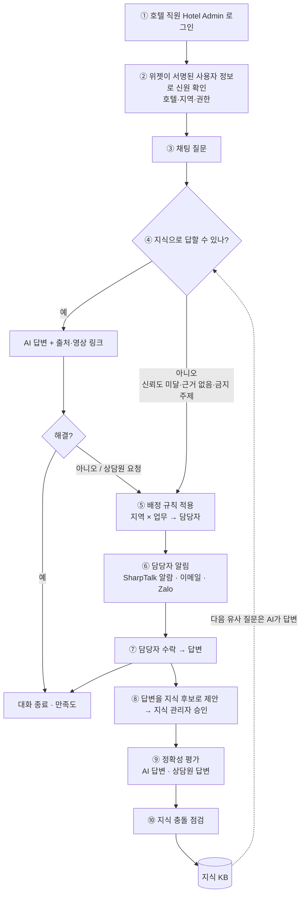

### 6.1 이벤트 시나리오 목록
| EV | 이벤트 | 트리거 | 시스템 처리 | 결과 상태 | 상태(10/15) |
|---|---|---|---|---|---|
| EV-01 | 로그인·위젯 로드 | 호텔 직원이 Hotel Admin 로그인 | Hotel Admin 서버가 `userId + 속성` 서명 → 위젯 `identify` → 세션에 호텔·지역·권한 저장 | 세션 `VERIFIED` | **구현**(D2) — Hotel Admin 서명 구현은 Go2Joy |
| EV-02 | 질문 접수 | 메시지 전송 | 언어 감지 → 의도 분류 → 하이브리드 검색 → 답변 생성 → 모더레이션 | `AI 응답중` | 있음(기본 언어 `vi` 설정 10/15) |
| EV-03 | AI 답변 | 근거 충분, 신뢰도 ≥ 기준 | 답변 + 출처·영상 링크 + 다음 질문 버튼 | `AI 응답중` | 있음 |
| EV-04 | 지식 범위 초과 | 신뢰도 < 기준 / 근거 없음 / deny 주제 / 상담원 요청 | 이관 사유 기록, 사용자에게 연결 안내 | `상담 대기` | 있음 |
| EV-05 | 담당자 배정 | EV-04 | **지역 × 업무 규칙**(위에서부터 첫 일치) → 최소 부하 1명 또는 그룹 전원 → 맞는 규칙 없으면 기본 담당자 | 배정 대상 확정 | **구현**(D3) |
| EV-06 | 담당자 알림 | EV-05 | SharpTalk 알람(콘솔) + 담당자 이메일 + Zalo, 미수락 시 재알림·상위 전달 | 알림 발송 기록 | **구현**(D4) — Zalo는 OA 받은 뒤 |
| EV-07 | 수락·답변 | 담당자 [수락] | 대화 인수, AI 브리핑·지식 조회·답변 초안 활용, 답변 발신(모더레이션) | `상담중` | 있음 |
| EV-08 | 근무시간 외 | EV-05가 근무시간 밖 | 영업외 안내(vi/en) + 다음 근무시간 큐, 지정 메일로 전달 | `상담 대기` | 있음 |
| EV-09 | 답변 → 지식 | 담당자 [지식으로 제안] 또는 해결 종료 | 질문·답변 쌍을 지식 후보로 등록 → 지식 관리자 검토 → 채택 시 재색인 | 지식 `채택` | 있음 |
| EV-10 | 정확성 평가 | 상담원·관리자가 답변 평가 | AI/상담원 답변별 정확·부분·부정확 + 사유, 부정확 AI 답변은 지식 갭으로 | 평가 기록 | **구현**(D7) |
| EV-11 | 지식 충돌 점검 | 지식 채택·정기 스캔 | 유사 문서 쌍 → AI 판정(중복/모순) → 관리자 해결 | 충돌 `해결` | 있음 — 대기 78건 분류 완료(D8) |
| EV-12 | 종료 | 사용자/상담원 종료, 유휴 자동 종료 | 만족도 요청, 통계 집계 | `종료` | 있음 |

### 6.2 대화 상태
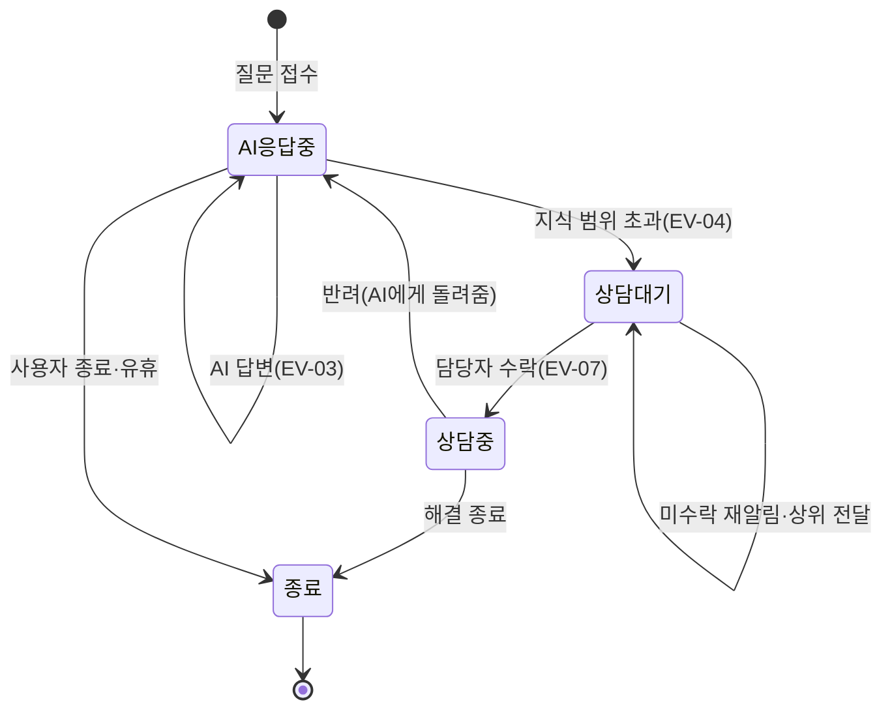

---

### 6.3 [EV-01] 호텔어드민 로그인 → 로그인 사용자 확인

호텔 직원은 SharpTalk에 따로 로그인하지 않는다. Hotel Admin이 이미 아는 사용자 정보를 **Hotel Admin 서버가 서명**해 위젯에 넘기고, SharpTalk이 서명을 검증해 그 사용자로 대화를 연다.

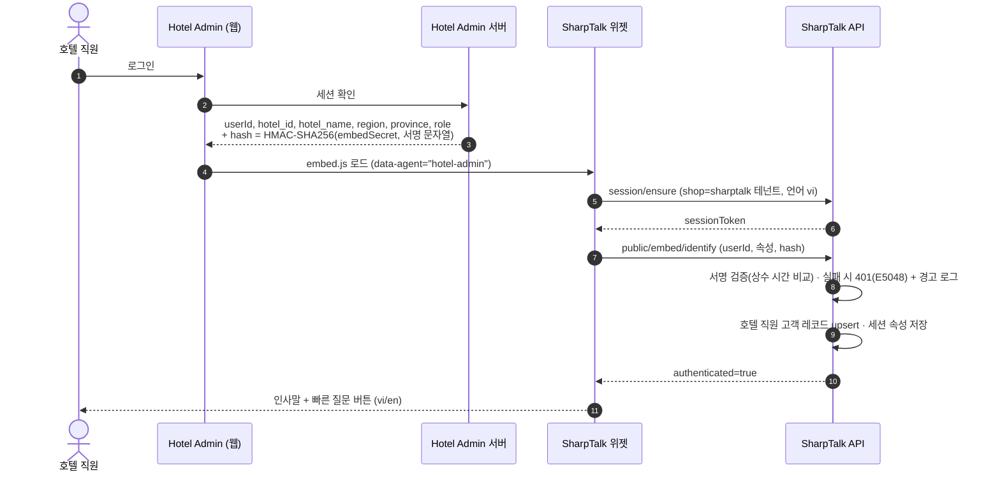

| 넘겨받는 속성 (구현 확정) | 용도 | 비고 |
|---|---|---|
| `userId` | 사용자 식별 | 기존 서명 대상 |
| `hotel_id`, `hotel_name` | 대화 화면 배지, 3단계 호텔 단위 확장 키 | 신규 |
| `region` (`north`/`central`/`south`) | **담당자 배정 기준** | 신규 — Go2Joy가 호텔 주소로 산출해 전달 |
| `province` | 표시·통계용 성/시 | 신규 |
| `role` (`manager`/`reception`) | 대화 화면 배지 | 신규 |

- **서명 문자열**: 속성이 없으면 `userId` 그대로(기존과 같음). 속성이 있으면 `userId` 다음 줄부터 `key=value`를 **키 알파벳순**으로 한 줄씩 붙인다. 예: `u-1024\nhotel_id=H77\nhotel_name=Joy Hotel\nregion=north\nrole=reception`. 형식과 예제 코드는 임베드 SDK 가이드 §3.4에 있다.
- 위 5개 외의 키, 줄바꿈이 든 값, 120자를 넘는 값은 저장하지 않고 버린다. 속성을 보냈는데 `userId`만 서명했으면 401로 거절한다.
- 응답 언어는 속성이 아니라 위젯 `locale`로 정한다. 지정하지 않으면 테넌트 기본 언어 `vi`로 시작한다(10/15 설정).

> 서명 없는 프로필 값(이름·이메일)은 표시용으로만 쓴다. **배정에 쓰는 값은 반드시 서명 대상에 포함**한다(조작된 지역으로 다른 담당자에게 가는 것을 막기 위해).


*그림 1. Hotel Admin 위젯 첫 화면(앱 모드). 상단 AI 고지 배너, Go2Joy 브랜드, 빠른 질문 4개(오늘 예약 보기·체크인 방법·예약 이의제기·정산 문의).*

---

### 6.4 [EV-02·03] 채팅 질문 → AI 답변

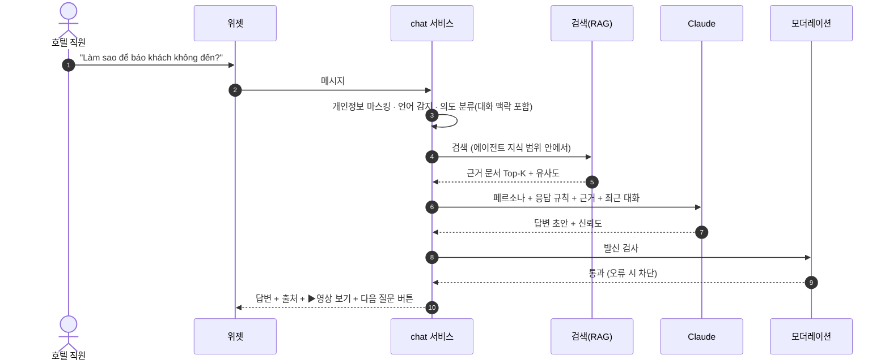

- AI는 **근거가 검색된 내용만** 답한다. 근거가 없으면 지어내지 않고 이관한다(EV-04).
- Hotel Admin 조작(정산 확정, 취소 처리 등)은 **방법만 안내**하고 대신 누르지 않는다.
- 답변 끝에는 Go2Joy 지원 연락처 꼬리말(지역별 번호)이 붙는다.


*그림 2. "노쇼 신고 방법" 질문에 대한 AI 답변. 단계별 절차, 출처(Video 22)와 ▶영상 보기 링크, 지원 연락처 꼬리말, 다음 질문 버튼이 함께 나온다.*

---

### 6.5 [EV-04·05] 지식 범위 초과 → 인간 상담원 배정

#### 6.5.1 지식 범위 초과 판단 (현행 로직 유지)
| 순서 | 조건 | 이관 사유 |
|---|---|---|
| 1 | deny-list 주제(예: 계약 해지, 법적 분쟁, 대규모 환불) | `policy` — 검색 전에 즉시 |
| 2 | 사용자가 상담원 연결을 요청 | `user_request` |
| 3 | 인사·잡담·의미 불명 | 이관하지 않음(되묻기) |
| 4 | 검색 근거 없음 또는 답변 신뢰도 < 0.45 | `low_confidence` |

#### 6.5.2 배정 기준 — 지역 × 담당업무 (신규)
배정 키는 **① 호텔 지역**(EV-01에서 서명된 `region`)과 **② 문의 업무** 두 가지다. 업무는 구현에서 **고객 메시지에 든 키워드**(예: `thanh toán`, `đối soát`) 또는 **deny 규칙이 붙인 업무 라벨**(상담·회계·운영)로 판별한다. 의도 분류 결과를 업무로 바꾸는 매핑은 쓰지 않았다 — 키워드는 Go2Joy 담당자가 화면에서 바로 고칠 수 있기 때문이다.

| 업무 \ 지역 | 북부 (Miền Bắc) | 중부 (Miền Trung) | 남부 (Miền Nam) |
|---|---|---|---|
| 예약·체크인·노쇼 | 북부 운영 담당 A·B | 중부 운영 담당 | 남부 운영 담당 C·D |
| 정산·이의제기 | 정산팀(전국 공용) | 정산팀 | 정산팀 |
| 요금·할인·Flash Sale | 북부 영업 담당 | 중부 영업 담당 | 남부 영업 담당 |
| 쿠폰·광고 | 마케팅(전국 공용) | 마케팅 | 마케팅 |
| 계정·권한·장애 | 기술지원(전국 공용) | 기술지원 | 기술지원 |
| 기타 | 지역 공용 큐 | 지역 공용 큐 | 지역 공용 큐 |

*표의 담당자는 예시. 실제 지역 구분(3권역 또는 성·시 단위)과 업무 분류는 Go2Joy가 확정한다(§12 D-3).*

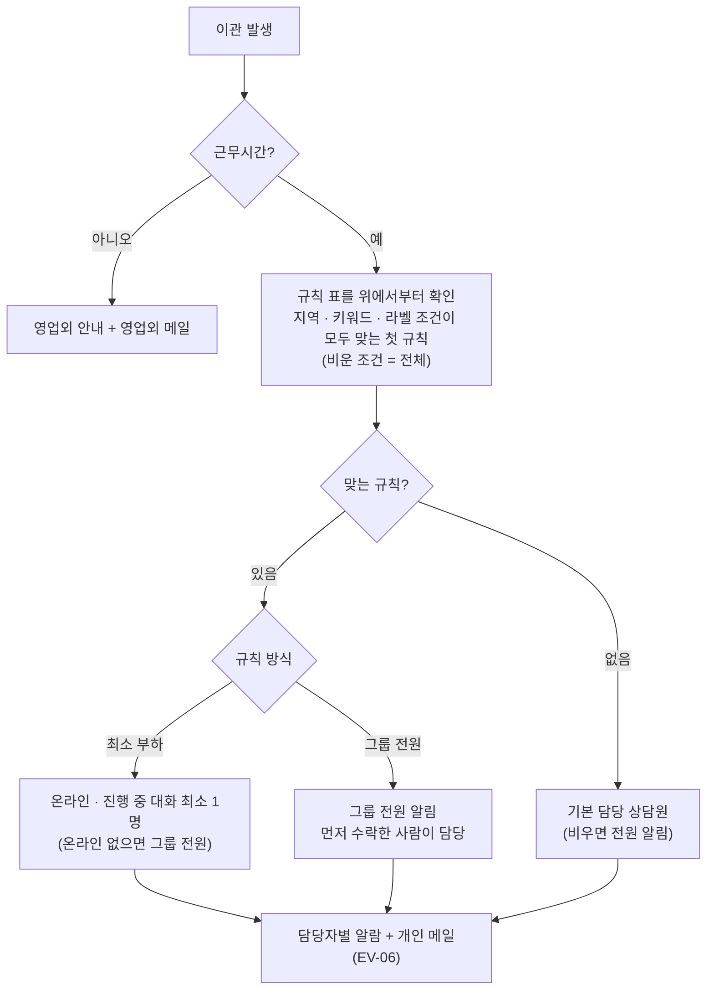

- **우선순위는 규칙 순서로 정한다.** 계획 단계의 "정확 일치 → 업무 전국 공용 → 지역 공용 → 전체"는, 구체적인 규칙을 위에 두고 지역을 비운 규칙을 아래에 두는 방식으로 같은 효과를 낸다.
- 세션에 지역이 없으면(서명 미구현·미전달) 지역 조건이 있는 규칙은 맞지 않고, 지역을 비운 규칙이나 기본 담당자로 간다. 계획에 있던 "hotelId로 Go2Joy 호텔 정보 조회"는 Go2Joy API가 없어 구현하지 않았다.
- 한 명이 수락하면 같은 대화의 다른 담당자 알람도 함께 닫힌다.


*그림 3. [테넌트 설정 › 상담원 연결]의 기본 담당 상담원·근무시간·영업외 설정. 그 아래에 배정 규칙 표가 붙는다(그림 10).*


*그림 10. 구현된 배정 규칙 편집기(스테이징 실측 화면). 규칙마다 이름·방식(최소 부하 / 그룹 전원)·지역·업무(키워드 + 라벨)·담당자를 정하고 ↑↓로 순서를 바꾼다. 재알림은 규칙별이 아니라 테넌트 공통 설정이다(§6.6).*

---

### 6.6 [EV-06] 배정된 상담원에게 알림

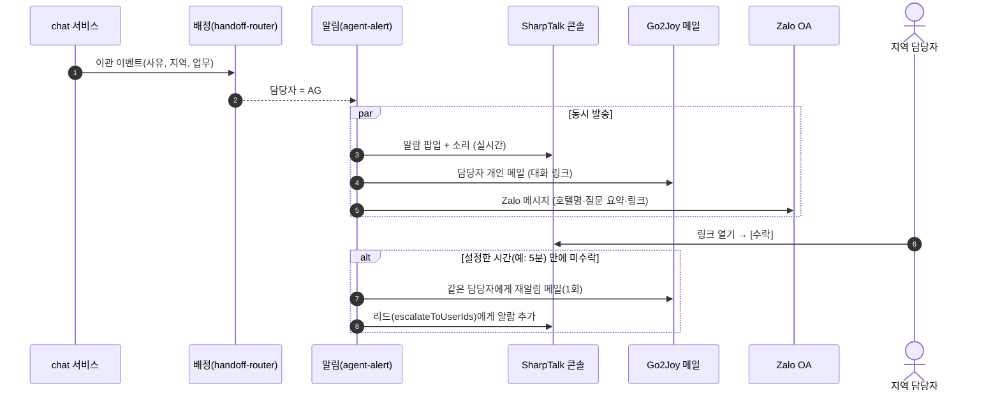

| 채널 | 1단계 계획 | 상태(10/15) |
|---|---|---|
| SharpTalk 콘솔 알람(팝업) | 담당자별 알람 | **구현** — 배정된 담당자마다 알람 1건, 한 명이 수락하면 나머지도 닫힘. 전달 주기(10초 확인)는 그대로 |
| 이메일 | **담당자 개인 메일** | **구현** — 제목 `[SharpTalk] Escalation — conversation #번호`, 본문에 이관 사유·호텔·지역·질문 미리보기·대화 링크 |
| 미수락 재알림 | 재알림·상위 전달 | **구현** — [상담원 연결]에서 대기 시간(분)과 리드 지정. 테넌트 공통, 대화당 1회 |
| Zalo | **담당자 알림 발송** | **대기** — Go2Joy Zalo OA·ZNS 템플릿 승인 필요 |
| 웹 푸시(브라우저) | 선택 | 하지 않음(1단계 제외) |
| Slack | Go2Joy가 쓰지 않으면 끔 | 그대로 |

알림 본문에는 **이관 사유·호텔명·지역·질문 미리보기·대화 링크**만 넣고 대화 전문은 넣지 않는다(외부 메신저로 대화 원문이 나가지 않도록). 구현된 메일도 이 원칙을 따른다. 질문 미리보기는 고객 질문의 앞부분이다. Zalo 알림도 같은 본문을 쓸 예정이다.

---

### 6.7 [EV-07] 배정받은 대화에 인간 상담원 답변

담당자는 콘솔 [실시간 상담]에서 `상담 대기` 대화를 연다. AI가 왜 넘겼는지, 사용자가 어떤 호텔·지역인지 보고 [수락] 후 답한다. 오른쪽 패널에서 **AI 브리핑**(대화 요약), **지식 조회**(같은 질문이 지식에 있는지), **AI 답변 초안**을 쓸 수 있다. 답이 끝나면 [반려](AI에게 돌려줌) 또는 [종료]한다.


*그림 4. 콘솔 실시간 상담. "계정 등록 방법" 질문에 AI가 근거를 찾지 못해 `상담 대기`로 넘겼다. 담당자는 [수락] 후 답하고, 오른쪽에서 AI 브리핑·지식 조회를 쓴다.*

1단계 보강: 대화 헤더와 목록에 **호텔명·지역·권한 배지**를 표시한다(**구현**, D5). 이관 사유(근거 없음/신뢰도/요청/정책) 표시는 아직 하지 않았다(남은 작업).


*그림 9. 서명된 사용자로 연 대화(스테이징 실측). 헤더에 `호텔`·`북부`·`리셉션` 배지가 붙는다. 이 대화는 기본 언어 설정 전이라 베트남어 질문에 영어로 답했고, 이것이 기본 언어를 `vi`로 정한 계기가 됐다.*

---

### 6.8 [EV-09] 상담원 답변을 다시 지식으로 저장

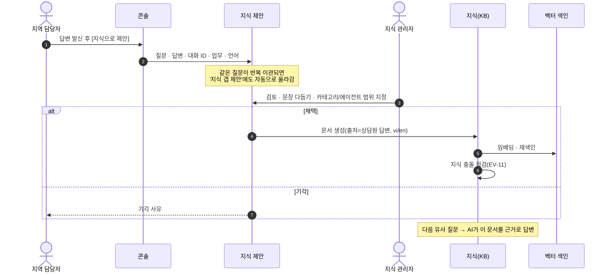

SharpTalk에는 상담원 답변이 지식으로 돌아오는 경로가 이미 네 갈래 있다.

| 경로 | 동작 | 적용 |
|---|---|---|
| 지식 제안 | 상담원이 답변을 지식 후보로 올리고 관리자가 승인 | 1단계 기본 경로 |
| 지식 갭 제안 | 이관이 잦은 주제·근거 없는 의도·상담원 해결 답변을 자동으로 후보화 | 주간 검토 |
| 답변 재사용 | 상담원이 답한 질문과 거의 같은 질문이 오면 검증된 답을 재생(모더레이션 유지) | 켜기 검토 |
| Smart Knowledge Board | 정리된 문서를 보드에서 검토 후 KB로 채택 | 정책·가이드 갱신 |


*그림 5. [지식 › 지식 갭 제안]. 같은 질문이 여러 번 상담원에게 넘어가면(이관 다발) 지식 후보로 올라온다. 관리자가 [KB 문서로 승인]하면 다음부터 AI가 답한다.*


*그림 6. Smart Knowledge Board. 모든 지식은 보드에서 검토를 거쳐 KB로 채택된다(go2joy 스테이징 204건).*

---

### 6.9 [EV-10] 답변 정확성 평가 (신규)

AI 답변이 맞았는지 사람이 판단한 기록이 있어야 "AI가 답하는 범위"를 믿고 넓힐 수 있다. 기존에는 고객 만족도(대화 단위)와 골든 질문 자동 채점만 있었고 메시지 단위 정확성 평가가 없었다. **D7로 구현했다**(10/15 스테이징).

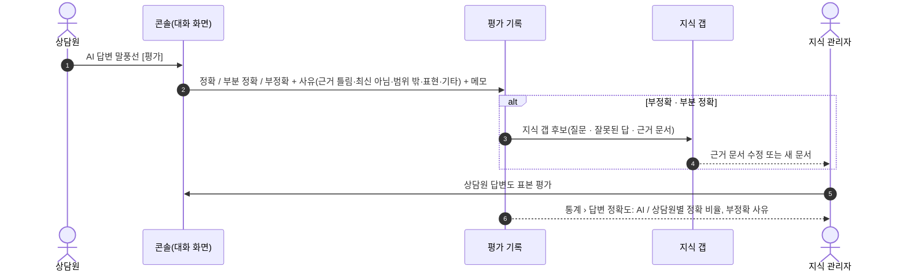


*그림 11. 콘솔 대화의 AI 답변 아래 [평가](스테이징 실측). 누르면 정확 / 부분 정확 / 부정확, 사유, 메모를 고른다. 저장하면 '부정확 · 최신 아님'처럼 결과가 남고, 다시 누르면 고칠 수 있다. 부정확·부분 정확인 AI 답변은 자동으로 [지식 갭 제안]에 올라간다.*


*그림 12. [통계 › 답변 정확도] 탭. AI와 상담원 답변을 따로 집계한다(한 비율로 합치면 어느 쪽을 고쳐야 할지 가려지기 때문). 실측 데이터 1건이라 0%로 보인다.*

| 평가 대상 | 누가 | 언제 | 결과 사용 |
|---|---|---|---|
| AI 답변 | 대화를 인수한 상담원 | 이관 대화의 직전 AI 답변(운영 규칙), 그 외 표본 | 부정확 → 지식 갭, 정확도 통계 — **구현** |
| 상담원 답변 | 지식 관리자 | 지식 제안 검토 시 + 주간 표본 | 정확도 통계 — **구현**(코칭 연결은 운영 절차) |
| 지식 문서 | 지식 관리자 | 부정확 평가가 2회 이상 걸린 문서 | 수정·회수 — **미구현**(1단계 이후) |

- 평가는 (메시지, 평가자)당 1건이다. 같은 사람이 다시 평가하면 덮어쓴다. 고객 메시지는 평가할 수 없다.
- "이관 대화의 직전 AI 답변은 필수 평가"는 화면에서 강제하지 않는다. Go2Joy 상담원 운영 규칙으로 정한다.

---

### 6.10 [EV-11] 지식 충돌 확인

새 지식(특히 상담원 답변에서 온 지식)이 기존 정책·가이드와 다른 말을 하면 AI가 상황마다 다르게 답한다. SharpTalk은 이미 **2단계 충돌 탐지**를 한다 — ① 벡터 유사도로 비슷한 문서 쌍을 찾고 ② AI가 "중복"인지 "모순"인지 판정한다. 관리자는 두 문서를 나란히 보고 하나를 고치거나 합치거나 무시한다.

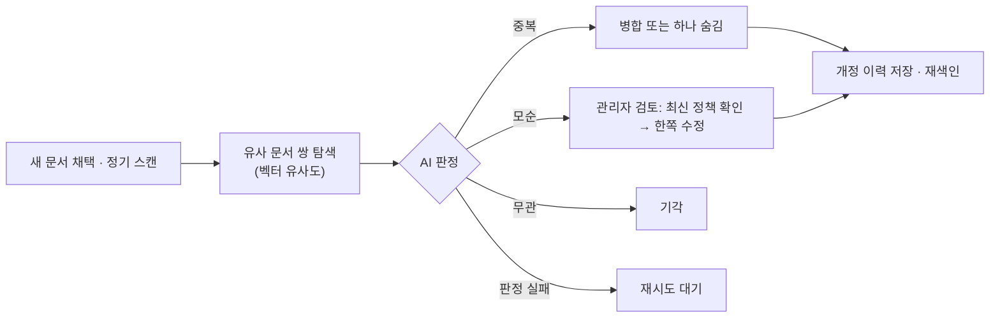


*그림 7. [지식 › 지식 충돌 검토]. 두 문서를 나란히 보여 주고 바로 편집할 수 있다. go2joy 스테이징에 미검토 78건이 있어 운영 이관 전 정리가 필요하다.*

**미검토 78건 분류 결과 (10/15, 원문 대조)** — 상세: [RPT-261015 충돌 분류](../report/RPT-261015-Go2Joy-KB-Conflict-Triage.md)

| 묶음 | 건수 | 권장 조치 |
|---|---:|---|
| 수정 필요(사실 불일치) | 3 | 요약 매뉴얼 6개 수정 — 시간제 플래시 세일 "가격 선택"(실제 화면: 첫 2시간 가격 필수), 플래시 세일 중지 확인 단계 누락 |
| 정책 문서 2벌 | 3 | 같은 약관이 8/20·8/29 두 번 등록 — 기준본 1벌만 남김 |
| FAQ 같은 답, 다른 질문 | 32 | 문서 13개를 2개로 통합, 질문은 변형으로 보존 |
| 언어별 번역본 / 요약↔영상 / 서로 다른 절차 | 40 | 둘 다 유지 |

- AI 판정만 믿을 수 없었다. 같은 문제가 있는 두 쌍을 한 쪽은 "모순", 다른 쪽은 "보완"으로 판정했다. 운영 중에도 충돌 판정은 관리자가 원문을 보고 확정한다.
- 분류 중 함께 발견: 고객용 FAQ·정책 카테고리가 모든 에이전트에 열려 있어 Hotel Admin 에이전트도 고객용 예약 안내를 근거로 쓴다(§12 D-10).

1단계 보강(D6, **미구현**): 상담원 답변에서 온 문서가 채택될 때 **채택 직전에 충돌 점검**을 돌려, 모순이면 승인 화면에 경고를 띄운다. 지금은 관리자가 [충돌 검사]를 눌러야 점검한다.

---

## 7. 현행 대비 갭과 1단계 개발 항목

| # | 항목 | 현행(착수 전) | 1단계 작업 | 규모 | 상태(10/15) |
|---|---|---|---|---|---|
| D1 | 자체 호스팅 설치 `sharptalk.go2joy.vn` | VN 프로필 있음(`talk-vn.<domain>` 가정) | 도메인·env 확정, Go2Joy 서버 설치·백업·모니터링, 스테이징 지식·설정 이관 | 중 | **대기** — 서버·DNS 미제공. 신규 설치용 스키마(`docker/init-sql`)는 최신으로 갱신 |
| D2 | 서명된 사용자 속성 | `userId`만 서명 | `hotel_id·hotel_name·region·province·role` 서명 대상 확장, 세션 속성 저장, 콘솔 표시 | 중 | **완료** #637 |
| D3 | 지역 × 업무 배정 규칙 | 담당자 목록, 라벨별 최소 부하 | 규칙 표(설정 화면), 순서 우선, 업무 = 키워드·라벨 | 대 | **완료** #638 |
| D4 | 담당자 알림 | 콘솔 팝업, 공용 메일, Slack | 담당자 개인 메일, 미수락 재알림·리드 전달, Zalo OA 발송 | 중 | **완료** #639 (Zalo는 OA 대기) |
| D5 | 콘솔 대화 정보 | 고객·채널·에이전트 | 호텔·지역·권한 배지, 이관 사유 표시 | 소 | **배지 완료** #637 / 이관 사유 남음 |
| D6 | 답변 → 지식 | 지식 제안·갭·재사용·보드 | Go2Joy 운영 절차로 정리, 채택 전 충돌 점검 | 소 | **남음** |
| D7 | 정확성 평가 | 없음(만족도·골든 채점만) | 메시지 단위 평가 테이블·API·콘솔 UI·통계 탭 | 중 | **완료** #640 |
| D8 | 지식 정비 | KB 270건, 충돌 미검토 78건, 노션 소스 오류 1건 | 충돌 정리, 노션 공유 재연결, vi 원어민 검수 | 중 | **진행** — 기본 언어 `vi` 설정, 충돌 분류 완료(#644). 정리 실행·노션·vi 검수는 Go2Joy 결정 후 |
| D9 | 약관 고지 모드 | 위젯 동의 배너(CCPA/GDPR형) | "Go2Joy 약관으로 동의 완료" 모드 | 소 | **완료** #642 (운영 이관 때 켬) |
| D10 | 품질 게이트 | 골든 44문항 자동 채점(스테이징) | Go2Joy 서버 배포 후 자동 채점 연결 | 소 | **대기** — D1 후 |

스키마 변경 SQL 4건(`sql/261015-*.sql`)은 한국 스테이징·프로덕션에 선적용했고, Go2Joy 서버는 `docker/init-sql`로 처음부터 포함된다.

---

## 8. 추진 일정

> **2026-10-15 결정: 1단계 완료 = 2026-10-31.** 원래 안(12주, 2027-01 오픈)을 2.5주로 줄였다. 아메바 쪽 개발은 병행으로 맞출 수 있으나, **Go2Joy 쪽 선행 항목(서버·DNS·Hotel Admin 임베드·담당자 명단)이 10/22까지 준비되지 않으면 10/31은 "스테이징 오픈"으로 대체**한다.

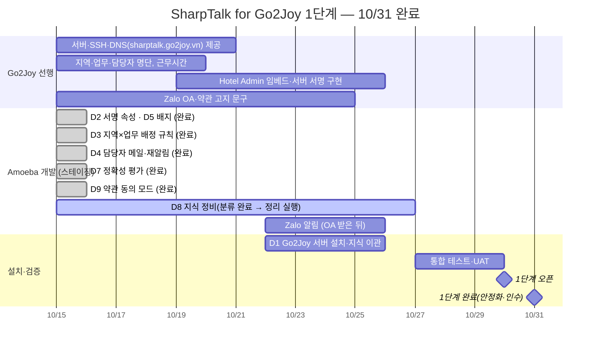

| 마일스톤 | 시점 | 완료 기준 | 상태(10/15) |
|---|---|---|---|
| M1 착수 | 10/15 | 계획 승인, Go2Joy에 선행 요청 전달 | **완료** |
| M2 아메바 기능 스테이징 | 10/24 | D2·D3·D4·D5·D7·D9 스테이징 배포, 골든 세트 실패 0 | **완료(10/15)** — 실측 IT-1~8 통과([TCR-261015](../test/TCR-261015-Go2Joy-Phase1-D2-D7.md)), 배포 게이트 골든 44문항 실패 0(통과 42, 자동 판정 보류 2) |
| M3 Go2Joy 서버 설치 | 10/26 | `https://sharptalk.go2joy.vn` 부팅·스모크, 지식 이관·재색인 | 대기 — 서버·DNS 10/22까지 필요 |
| M4 UAT | 10/29 | Hotel Admin 임베드로 EV-01~12 실측 통과 | 대기 — Hotel Admin 서명 구현 필요 |
| M5 1단계 완료 | 10/31 | 운영 오픈, 담당자 교육, 운영 절차 인수 | 예정 |

**접속 주소**
| 환경 | 콘솔(상담원·관리자) | 위젯 | 상태 |
|---|---|---|---|
| 스테이징(지금) | `https://shoptalk.amoeba.site/user/go2joy` | `https://shoptalk.amoeba.site/widget/?mode=app&shop=https%3A%2F%2Fwww.go2joy.vn&agent=hotel-admin` | 사용 가능 |
| Go2Joy 운영 | `https://sharptalk.go2joy.vn/user/go2joy` | Hotel Admin 안 위젯(`https://sharptalk.go2joy.vn/widget/embed.js`) | 10/15 현재 DNS 없음 — Go2Joy 서버·DNS 제공 후 |

스테이징 콘솔 계정은 Go2Joy 담당자별로 발급한다(명단 받은 뒤). 스테이징 위젯은 언어를 지정하지 않으면 베트남어로 시작한다.

## 9. 성과 지표

| 구분 | 지표 | 산출 |
|---|---|---|
| 효율 | AI 자체 해결률, 이관률, 상담원당 처리 건수 | 통계 › 여정·처리·상담원 |
| 속도 | AI 첫 응답 시간, 배정 → 첫 응답(중앙값), 미수락 재알림 건수 | 이관·알림 로그 |
| 품질 | AI 답변 정확도(상담원 평가), 골든 세트 통과율, 만족도 | 정확성 평가 · 골든 · CSAT |
| 지식 성장 | 월간 신규 채택 지식 수(상담원 답변 출처), 지식 갭 처리율, 동일 주제 재이관 감소 | 지식 › 갭·보드 |
| 위생 | 미해결 지식 충돌 수, 오래된 문서 비율 | 지식 › 충돌 |


*그림 8. 통계 › 여정(스테이징 최근 30일). 노출 → 접속 → 대화 → 응답·이관·평가·종료 흐름을 한 화면에서 본다. 정확성 평가가 추가되면 이 화면에 함께 집계된다.*

---

## 10. 개인정보·보안

| 항목 | 방침 |
|---|---|
| 데이터 상주 | 대화·사용자·지식·로그·백업 모두 Go2Joy 서버(베트남 리전). 아메바는 원격 지원 시에만 Go2Joy가 허용한 계정으로 접근 |
| 개인정보 외부 제공 | 제3자 **제공** 없음. AI 응답 생성(Anthropic)·임베딩(Voyage)은 **처리 위탁·국외 이전**에 해당하므로 Go2Joy 약관·처리방침에 수탁자와 처리 지역을 고지한다. AI 처리 지역은 위젯 고지 배너에 표시(`AI_PROCESSING_REGION`) |
| AI 이용 동의 | Go2Joy가 Hotel Admin 약관 동의 절차로 처리(§1.2 P2). SharpTalk은 [설정 › 개인정보 안내]의 동의 방식을 "호스트 앱 약관"으로 둔다(D9 구현). 이때 **서명 검증된 Hotel Admin 사용자만** 동의 배너 없이 동의로 기록되고(동의 시각·고지 버전 저장), 서명 없는 방문자에게는 배너가 그대로 나온다. 위젯에서 직접 거부한 기록은 덮어쓰지 않는다. 약관 문구 확정 전까지 스테이징은 "위젯 배너" 방식 유지 |
| AI 전송 전 마스킹 | 전화번호(+84·09xx 포함)·이메일·계좌 등은 AI로 보내기 전 마스킹. Go2Joy 공식 연락처(꼬리말)는 보호값으로 예외 |
| 발신 통제 | 모든 AI·상담원 메시지는 모더레이션 통과 필수, 오류 시 차단 |
| 접근 통제 | 콘솔 JWT + 직급 × 업무 라벨 RBAC, MFA, 고객 정보 화면 마스킹 + 열람 감사 |
| 보존 | 대화 로그 보존 기간을 Go2Joy 처리방침과 일치(초안 180일), 만료 자동 삭제 |
| 규제 | 베트남 PDPD(Nghị định 13/2023) — 국외 이전 영향평가 서류, 침해 72시간 통지. **최종 문구·제출은 Go2Joy 법무 확인** |

---

## 11. 향후 과제 — 2단계·3단계

> **v1.2(2026-10-22) 순서 변경** — 2단계는 필리핀 Go2Joy, 3단계는 호텔별 AI 상담원이다. 2단계는 1단계의 `#Talk-4-Hotel`과 예약 고객 에이전트를 **Go2Joy가 운영하는 형태로** 필리핀에 연다. 호텔이 직접 운영하는 상담원(HA 메뉴·리셉션 템플릿·포인트 과금)은 3단계에서 한다.

### 11.0 단계별 채널 구조
[연동 요청 사항·체크리스트](../../apps/web/public/manual/go2joy/integration.ko.md) 1절의 에이전트 3개를 단계로 나누면 다음과 같다.

| 단계 | 대상 | 에이전트 | 진입 | 사람 이관 |
|---|---|---|---|---|
| 1단계 (VN) | 호텔 직원 (B2B) | `#Talk-4-Hotel` (HA Support) | HA 로그인 후 위젯 + 서명 identify | 호텔 권역 → 지역 팀 × 업무(CS / Sales)의 Go2Joy 상담원 |
| 2단계 (PH) | 호텔 직원 (B2B) | `#Talk-4-Hotel` (필리핀 배포) | 1단계와 같음 | 필리핀 권역 → 지역 팀 × 업무 |
| 2단계 (PH) | 예약 고객 (B2C, 부킹고객) | `Go2Joy-#Talk-4-BookingClient` | Go2Joy 앱·웹(웹 위젯 / 모바일 SDK) | 지역 팀 × CS의 Go2Joy 상담원 |
| 3단계 | 예약 고객 (예약 후) | `Hotel-#Talk-4-BookingClient` (호텔별) | 예약 완료 이벤트로 자동 이관 | 호텔 직원(HA #Talk 메뉴) → Go2Joy CS |

### 11.1 2단계 — 필리핀 Go2Joy (예약 고객 상담 + Hotel Admin 상담)
필리핀 Go2Joy 서버에 SharpTalk을 따로 설치해 두 가지 상담을 연다. ① **Hotel Admin 상담**은 1단계 기능을 그대로 쓴다. ② **예약 고객(부킹고객) 상담**은 고객이 Go2Joy 앱·웹에서 호텔과 예약에 대해 묻는 상담이다. 대화는 예약한 호텔 단위로 이어지고, 응대는 Go2Joy의 AI 에이전트와 Go2Joy 상담원이 한다.

| 과제 | 내용 |
|---|---|
| 배포 | 필리핀용 별도 배포(국가 = 배포 1벌 원칙). 새 프로필 `SharpTalk-PH-Go2Joy`, 필리핀 서버·도메인. 설치 절차는 베트남 Go2Joy 서버 설치(새 서버용 스키마 #692)와 같다 |
| Hotel Admin 상담 (B2B) | 1단계 `#Talk-4-Hotel` 그대로 — HA 서명 identify, 호텔 = 기업고객 등록, 호텔 계정 단위 대화 연속성, 권역 → 팀 배정(#687·#689). 필리핀 권역 코드와 팀 매핑은 새로 정한다 |
| 예약 고객 상담 (B2C) | `Go2Joy-#Talk-4-BookingClient`. Go2Joy 앱·웹에 웹 위젯 / Android SDK(실기기 검증됨) / iOS로 임베드한다. 로그인 고객은 서명으로 식별하고 `userId` 접두어로 HA 직원과 나눈다. B2B / B2C 구분은 #689에 있다(G41) |
| 호텔별 대화 | 예약 완료 이벤트 Webhook(`bookingSn`·`hotelSn`·고객 식별·서명)으로 앞선 대화에 잇고, 여러 호텔을 예약하면 예약(호텔)별 스레드로 나눈다(G40) |
| 금액·예약 조회 | 예약·요금은 Go2Joy 예약 조회 API 값만 전달(LLM 산술 금지)(G41) |
| 사람 이관 | 지역 팀 × CS의 Go2Joy 상담원. 예약 고객의 지역 기준(검색·예약 중인 호텔의 지역 / 고객 위치)(G42), 예약 변경·취소·환불을 Go2Joy CS로 넘길지와 체크아웃 후 대화 종료·보관 기간(G43)은 결정 필요 |
| 언어 | 영어 우선. **필리핀어(Filipino/Tagalog)는 현재 지원 6개 언어에 없음** → 언어 추가 작업(공용 언어 목록 1곳 + 번역 리소스) |
| 지식 | 베트남 지식 중 공통 정책은 영어판 재사용, 필리핀 정책·요금·결제 수단은 별도 작성. Hotel Admin용과 예약 고객용 지식은 에이전트별 지식 범위로 나눈다(D-10과 같은 기준) |
| 개인정보·규제 | 필리핀 Data Privacy Act(RA 10173)·NPC 규정 — 처리방침·국외 이전 고지·침해 통지(72시간). 도어락 코드·실명·연락처는 인증된 세션에서만 노출. Go2Joy 예약번호 형식을 마스킹에 추가 |
| 운영 | 타임존 `Asia/Manila`, 필리핀 지역 담당자 배정 규칙(Luzon/Visayas/Mindanao 등), 근무시간·부재 처리 순서 |
| AI 운용 | Level 1(외부 AI + RAG) 유지. 운영용 AI 키는 Go2Joy 명의. 메시지 단위 AI 로그와 에이전트별 골든 평가셋을 갖춘다(연동 체크리스트 S30) |
| Go2Joy 협의 | G40~G43(Webhook·앱 임베드·지역 기준·예약 후 이관 범위와 보관), G47(Zalo 채널 상담). 예약 고객 상담을 베트남에도 열지, 연다면 언제인지 |

### 11.2 3단계 — 호텔별 AI 상담원 (호텔이 예약 고객 응대)
각 호텔이 자기 예약 고객(Go2Joy 앱 사용자)의 문의에 AI 상담원으로 직접 대응한다. 2단계까지 쌓은 Go2Joy 공통 지식 위에 **호텔별 지식(시설·체크인·주차·부가상품)**을 얹고, 호텔 직원은 HA 안의 SharpTalk 메뉴에서 응대한다.

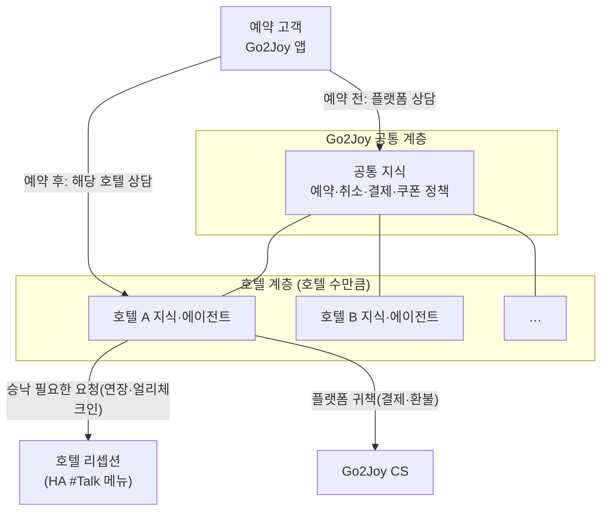

| 과제 | 내용 |
|---|---|
| 호텔 단위 축 | 현재 테넌트 = Go2Joy 하나. 약 5,000개 호텔을 테넌트로 만들지, 테넌트 안에 **호텔 스코프**를 둘지 결정(AN-260907 §2.1 — 호텔 스코프 권장) |
| 세션 소유권 전이 | 예약 전은 플랫폼, 예약 후는 해당 호텔로 대화 소유권 이동. 2단계의 예약(호텔)별 스레드를 그대로 쓴다 |
| 3단 이관 | AI → 호텔 리셉션(L1) → Go2Joy CS(L2) → 전문조직(L3), 무인 시간대 L1 생략 |
| HA 메뉴 (iframe) | HA에 SharpTalk 메뉴(신청·페르소나·지식·Inbox) 추가. 서버가 발급하는 **단기 SSO 토큰**(HA 토큰을 그대로 넘기지 않음), 권한 연동(`Quản lý` 설정 / `Lễ tân` Inbox)(G44) |
| 리셉션 에이전트 운영 | 공통 템플릿(Go2Joy 관리), 신청 승인 절차, 호텔 온보딩 순서(G45) |
| 호텔 지식 온보딩 | Hotel Admin의 호텔 정보·객실·부가상품을 자동으로 지식화, 호텔이 직접 보완 |
| 개인정보 | 도어락 코드·실명·연락처는 인증된 세션에서만 노출(2단계와 같은 기준) |
| 사업 모델·과금 | 호텔별 유료 부가서비스(B2B2C) — REQ-260825 Option 2. 토큰 → 포인트 환산 기준, 포인트 소진 시 처리(중지 / 직원 연결), 충전·잔액 화면 위치(G46) |
| AI 운용 | 상담원 평가·답변 채택으로 쌓인 모범답안으로 Level 2 전환 검토. 학습 결과물 소유권은 서비스 계약에 정한다(G7) |
| 적용 국가 | 2단계까지 연 베트남·필리핀 배포에 얹는다. 국가별 순서는 Go2Joy와 협의 |

---

## 12. 위험과 결정 필요 사항

### 12.1 결정 필요 (D-1~D-8은 M1, D-10~D-12는 10/22까지)
| ID | 결정 사항 | 결정 주체 |
|---|---|---|
| D-1 | 서버 사양·리전·백업 저장소, 원격 접근 방식 | Go2Joy |
| D-2 | 서명 속성 목록과 Hotel Admin 서버 서명 구현 일정 | Go2Joy 개발 |
| D-3 | 지역 구분(3권역 / 성·시)과 업무 분류, 지역·업무별 담당자 명단·근무시간 | Go2Joy CS |
| D-4 | Zalo 알림 수단(Go2Joy Zalo OA·ZNS 템플릿 승인) | Go2Joy |
| D-5 | 약관·처리방침 AI 고지 문구, 보존 기간 | Go2Joy 법무 |
| D-6 | AI 엔진 계약 주체(Go2Joy 직접 키 / 아메바 제공)와 비용 정산 | 양사 |
| D-7 | 시범 운영 대상(지역·호텔 수)과 오픈 기준 | 양사 |
| D-8 | 유지보수·업데이트 SLA, 장애 연락 체계 | 양사 |
| D-9 | 기본 언어·타임존 | **결정됨(10/15)**: `vi` / `Asia/Ho_Chi_Minh` |
| D-10 | 고객용 FAQ·정책 카테고리를 Hotel Admin 에이전트 범위에서 뺄지 | Go2Joy |
| D-11 | 지식 충돌 정리안 승인 — 요약 매뉴얼 6개 수정, 정책 기준본, FAQ 13→2 통합, BRD-1 초안 비활성 | Go2Joy |
| D-12 | 업무 판별 키워드 목록(베트남어) — 정산·요금·계정 등 업무별 단어 | Go2Joy CS |

### 12.2 위험
| 위험 | 영향 | 대응 |
|---|---|---|
| Hotel Admin 서명 구현 지연 | 지역 배정 불가 | 지역 없는 세션은 지역을 비운 규칙·기본 담당자로 간다(배정 누락은 없음). hotelId로 지역을 조회하는 대안은 Go2Joy 호텔 API가 있어야 가능 |
| 지식 품질(구버전 UI·충돌 78건) | 오답 → 신뢰 하락 | 78건 분류 결과 실제 오답 위험 3건(D-11). 오픈 전 수정·vi 검수, 골든 세트 확대, 정확성 평가로 조기 탐지 |
| 담당자 미응답 | 대기 장기화 | 재알림·상위 전달, 영업외 안내, 응답 시간 지표 주간 리뷰 |
| 외부 메신저로 대화 내용 유출 | 개인정보 | 알림은 요약·링크만, 대화 원문 미포함 |
| AI 크레딧 소진·엔진 장애 | 답변 중단 | 엔진 상태 감시·크레딧 알림(기구현), 장애 시 상담원 연결로 전환 |
| 자체 호스팅 업데이트 지연 | 보안·기능 격차 | 월 1회 정기 업데이트 창, 스키마 변경 사전 공지 |
| 키워드 업무 판별의 누락·오판 | 엉뚱한 담당자에게 배정 | 맞는 규칙이 없으면 기본 담당자로 가므로 배정 자체는 빠지지 않음. 시범 2주 동안 배정 로그(`handoff routed by rule`)를 보고 키워드 보정 |

---

## 부록 A. 관련 문서
- 요구사항: [REQ-260831 SharpTalk for Go2Joy 요구사항](../analysis/REQ-260831-SharpTalk-Go2Joy-Requirements.md), [AN-260907 사이드임팩트](../analysis/AN-260907-SharpTalk-Go2Joy-Side-Impact.md), [REQ-260825 비즈니스 모델](../analysis/REQ-260825-Go2Joy-ChatAgent-BizModel.md)
- 지식: [REQ-260829 영상 가이드 KB](../analysis/REQ-260829-Go2Joy-Video-Guide-KB.md), [REQ-261007 FAQ 정확도](../analysis/REQ-261007-Go2Joy-FAQ-Accuracy.md), [REQ-261006 영상 링크](../analysis/REQ-261006-KB-Video-Links.md)
- 위젯·임베드: [REQ-261001 파트너 위젯](../analysis/REQ-261001-Go2Joy-Partner-Widget.md), [임베드 SDK 가이드](../guide/임베드SDK설치가이드_Embed-SDK.ko.md), [모바일 SDK 가이드](../guide/모바일SDK연동가이드_Mobile-SDK.ko.md)
- 배포: [VN-Go2Joy 세팅 가이드](../guide/GUIDE-260913-SharpTalk-VN-Go2Joy-Staging.md), [자체 호스팅 설치 가이드](../guide/자체호스팅설치가이드_Self-Hosted-Install.ko.md), `deploy/profiles/SharpTalk-VN-Go2Joy/`
- 개인정보: [PROCESSOR-REGISTER](../guide/PROCESSOR-REGISTER.md), [INCIDENT-RESPONSE](../guide/INCIDENT-RESPONSE.md)
- 1단계 구현 기록: [TCR-261015 테스트](../test/TCR-261015-Go2Joy-Phase1-D2-D7.md), [RPT-261015 구현·배포](../implementation/RPT-261015-Go2Joy-Phase1-D2-D7.md), [RPT-261015 지식 충돌 분류](../report/RPT-261015-Go2Joy-KB-Conflict-Triage.md)
- 연동: [Go2Joy 연동 요청 사항·작업 체크리스트](../../apps/web/public/manual/go2joy/integration.ko.md)(2026-10-22) — 채널 구조, 요청 G1~G47, 체크리스트

## 부록 B. 다음 절차
2026-10-15 사용자 승인("1단계는 10월 말 완료, 진행"). 일정이 2.5주라 개발 항목별 REQ/PLN을 따로 만들지 않고 **본 문서를 D2~D9의 PLN으로 사용**한다(화면 변경은 §6 와이어프레임). 항목별 TCR·RPT는 그대로 남긴다.

2026-10-15 v1.1: 아메바 개발 항목(D2·D3·D4·D5 배지·D7·D9)을 같은 날 스테이징에 배포하고 한국 프로덕션에도 반영했다. 다음 절차는 ① Go2Joy가 §12 D-1~D-5·D-10~D-12를 10/22까지 회신 ② 서버를 받는 즉시 D1 설치 ③ Hotel Admin 서명이 붙으면 UAT(M4).

2026-10-22 v1.2: 사용자 결정으로 2단계·3단계 순서를 바꿨다 — 2단계 = 필리핀 Go2Joy(예약 고객 상담 + Hotel Admin 상담), 3단계 = 호텔별 AI 상담원. 2단계는 §11.1 Go2Joy 협의 항목의 회신을 받은 뒤 별도 REQ로 시작한다.
