# SharpTalk for Go2Joy — Kế hoạch dự án

> **Tóm tắt một dòng** — Cài đặt SharpTalk trên máy chủ Go2Joy (`sharptalk.go2joy.vn`) để gắn **tư vấn viên AI vào Hotel Admin**.
> AI trả lời trước. Câu hỏi vượt phạm vi tri thức được chuyển cho phụ trách Go2Joy theo **khu vực khách sạn × nghiệp vụ hỏi đáp**.
> Câu trả lời của phụ trách được **lưu lại thành tri thức**, lần sau AI sẽ tự trả lời. Vòng lặp này càng chạy, phạm vi AI trả lời càng rộng.

| Hạng mục | Nội dung |
|---|---|
| Phạm vi giai đoạn 1 | Tư vấn AI tuyến đầu cho người dùng đăng nhập Hotel Admin (nhân viên khách sạn) + phân công nhân viên tư vấn theo khu vực và nghiệp vụ + vòng tuần hoàn tri thức |
| Phạm vi giai đoạn 2 | Tư vấn viên AI riêng cho từng khách sạn — mỗi khách sạn tự phản hồi câu hỏi của khách đặt phòng |
| Phạm vi giai đoạn 3 | Go2Joy Philippines — tư vấn Hotel Admin + tư vấn khách đặt phòng theo từng khách sạn |
| Tài liệu căn cứ | [REQ-260831 Yêu cầu](../analysis/REQ-260831-SharpTalk-Go2Joy-Requirements.md) · [AN-260907 Tác động phụ](../analysis/AN-260907-SharpTalk-Go2Joy-Side-Impact.md) · [REQ-260825 Mô hình kinh doanh](../analysis/REQ-260825-Go2Joy-ChatAgent-BizModel.md) · [Hướng dẫn thiết lập VN-Go2Joy](../guide/GUIDE-260913-SharpTalk-VN-Go2Joy-Staging.md) |
| Nguồn ảnh màn hình | Màn hình thật của tenant go2joy trên staging Hàn Quốc (chụp ngày 2026-10-15). Email của phụ trách đã được che. Hình 9~12 là màn hình lúc kiểm thử thực tế nên có tên dùng để test (`E2E`, `example.com`) |

### Tiến độ hiện tại (tính đến 2026-10-15)

| Phân loại | Trạng thái |
|---|---|
| Phát triển phía Amoeba | **Đã xong D2·D3·D4·D5·D7·D9** — đã triển khai lên staging và đạt kiểm thử thực tế (PR #637~#643), đã áp dụng cả lên production Hàn Quốc (10/15, không có tenant go2joy → không thay đổi hành vi) |
| Chỉnh lý tri thức (D8) | Đã thiết lập ngôn ngữ mặc định `vi` và múi giờ `Asia/Ho_Chi_Minh` cho go2joy. Đã phân loại xong 78 xung đột tri thức — 3 mục cần sửa thật, 35 mục cần dọn dẹp đang chờ Go2Joy quyết định ([RPT-261015 Phân loại xung đột](../report/RPT-261015-Go2Joy-KB-Conflict-Triage.md)) |
| Chờ Go2Joy chuẩn bị trước | Máy chủ·SSH·DNS (chưa có bản ghi `sharptalk.go2joy.vn`), chữ ký phía máy chủ Hotel Admin, danh sách khu vực·nghiệp vụ·phụ trách, Zalo OA, nội dung điều khoản — **trước 10/22** |
| Việc còn lại của Amoeba | Cài đặt D1 (sau khi nhận máy chủ), thông báo Zalo (sau khi nhận OA), D6 kiểm tra xung đột trước khi chấp nhận, D5 hiển thị lý do chuyển cho nhân viên, D10 kết nối cổng chất lượng |

### Lịch sử thay đổi
| Phiên bản | Ngày | Nội dung |
|---|---|---|
| 1.0.0 | 2026-10-15 | Soạn lần đầu, phản ánh quyết định hoàn thành giai đoạn 1 vào 10/31 |
| 1.1.0 | 2026-10-15 | Phản ánh kết quả triển khai — chốt khóa thuộc tính chữ ký và chuỗi ký (§6.3), chốt cách xác định nghiệp vụ theo từ khóa·nhãn (§6.5.2), nhắc lại là thiết lập chung của tenant (§6.6), màn hình đánh giá độ chính xác (§6.9), kết quả phân loại 78 xung đột (§6.10), trạng thái từng hạng mục (§7), tiến độ (§8), bổ sung các mục cần quyết định (§12) |

---

## Mục lục
1. [Tổng quan dự án](#1-tổng-quan-dự-án)
2. [Giới thiệu dịch vụ SharpTalk](#2-giới-thiệu-dịch-vụ-sharptalk)
3. [Công nghệ và cấu trúc phát triển](#3-công-nghệ-và-cấu-trúc-phát-triển)
4. [Cấu trúc tổng thể dịch vụ](#4-cấu-trúc-tổng-thể-dịch-vụ)
5. [Người dùng và vai trò](#5-người-dùng-và-vai-trò)
6. [Kịch bản sử dụng giai đoạn 1](#6-kịch-bản-sử-dụng-giai-đoạn-1)
7. [Khoảng trống so với hiện trạng và hạng mục phát triển giai đoạn 1](#7-khoảng-trống-so-với-hiện-trạng-và-hạng-mục-phát-triển-giai-đoạn-1)
8. [Lịch triển khai](#8-lịch-triển-khai)
9. [Chỉ số hiệu quả](#9-chỉ-số-hiệu-quả)
10. [Dữ liệu cá nhân·Bảo mật](#10-dữ-liệu-cá-nhânbảo-mật)
11. [Nhiệm vụ tiếp theo — Giai đoạn 2·3](#11-nhiệm-vụ-tiếp-theo--giai-đoạn-23)
12. [Rủi ro và các mục cần quyết định](#12-rủi-ro-và-các-mục-cần-quyết-định)

---

## 1. Tổng quan dự án

### 1.1 Bối cảnh
- Go2Joy là nền tảng đặt phòng khách sạn theo giờ tại Việt Nam, vận hành khoảng 5.500 cơ sở lưu trú đối tác. Nhân viên khách sạn (quản lý `Quản lý`, lễ tân `Lễ tân`) dùng Hotel Admin để xử lý đặt phòng, check-in, đối soát, giá, coupon và quảng cáo.
- Hiện nay câu hỏi của nhân viên khách sạn do CS Go2Joy tiếp nhận thủ công (email, Hotline, Zalo, số điện thoại tách riêng miền Bắc/miền Nam). Cùng một câu hỏi lặp lại nhiều lần. Nhiều câu hỏi như **thời hạn khiếu nại đối soát** hay **chọn lý do hủy** nếu hướng dẫn sai sẽ gây thiệt hại tiền ngay.
- Từ 2026-08, SharpTalk đã được kiểm chứng với tenant go2joy trên staging Hàn Quốc. 63 video hướng dẫn Hotel Admin, FAQ và quy định vận hành đã được đưa vào tri thức (KB 270 mục, bảng 204 mục). Chất lượng câu trả lời được đo mỗi lần bằng bộ chấm tự động 44 câu FAQ đối tác.

### 1.2 Mục tiêu
| # | Mục tiêu | Mô tả |
|---|---|---|
| P1 | **Giải quyết vấn đề cung cấp dữ liệu cá nhân ra bên ngoài bằng cấu trúc** | Cài SharpTalk trên máy chủ Go2Joy và vận hành riêng cho Go2Joy. Hội thoại, thông tin nhân viên khách sạn và tri thức được lưu trong hạ tầng Go2Joy, không đi ra máy chủ Amoeba |
| P2 | **Thông báo và đồng ý sử dụng AI qua điều khoản Go2Joy** | Đưa tư vấn AI (và việc ủy thác xử lý AI) vào điều khoản sử dụng và chính sách quyền riêng tư của Hotel Admin. Go2Joy vận hành quy trình đồng ý. Widget SharpTalk chỉ hiện banner thông báo thay cho popup đồng ý |
| P3 | **Giảm tải CS, phản hồi 24 giờ** | AI trả lời ngay các câu hỏi lặp lại. Con người chỉ tập trung vào câu hỏi nằm ngoài tri thức |
| P4 | **Câu trả lời của con người trở thành tri thức của công ty** | Lưu câu trả lời của nhân viên tư vấn thành tri thức. Khi câu hỏi tương tự quay lại, AI sẽ trả lời. Duy trì chất lượng bằng đánh giá độ chính xác và kiểm tra xung đột tri thức |

### 1.3 Mục tiêu cần đạt (tháng đầu tiên sau khi kết thúc giai đoạn 1 ngày 2026-10-31)
| Chỉ số | Mục tiêu (dự kiến) | Đo lường |
|---|---|---|
| Tỷ lệ AI tự giải quyết (hội thoại kết thúc không cần chuyển cho nhân viên) | **Từ 70% trở lên** | Thống kê › Hành trình·Xử lý |
| Vượt phạm vi tri thức → tỷ lệ phân công phụ trách thành công | **100%** (0 trường hợp chưa phân công) | Log chuyển cho nhân viên |
| Phân công → phản hồi đầu tiên của nhân viên tư vấn (giờ làm việc) | **Trung vị dưới 10 phút** | Thống kê › Nhân viên tư vấn |
| Đăng ký câu trả lời của nhân viên tư vấn vào tri thức | **Từ 50% trở lên** số ca chuyển cho nhân viên đã giải quyết được xem xét làm ứng viên tri thức | Đề xuất bổ sung tri thức |
| Độ chính xác câu trả lời AI (nhân viên tư vấn đánh giá) | **Chính xác từ 85% trở lên** | Đánh giá độ chính xác mới |
| Bộ hồi quy vàng | Giữ 0 câu sai trên 44 câu | Chấm tự động sau triển khai |

> Giá trị mục tiêu sẽ được đặt lại dựa trên số đo thực tế 2 tuần đầu vận hành thử. Số liệu 30 ngày hiện tại trên staging: 149 hội thoại, trong đó 18 ca chuyển cho nhân viên tư vấn (12%).

### 1.4 Phạm vi
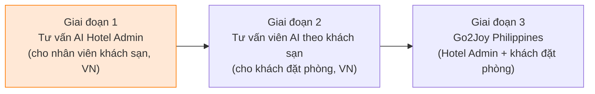

| Bao gồm (giai đoạn 1) | Không bao gồm (giai đoạn sau) |
|---|---|
| Cài đặt tự lưu trữ `sharptalk.go2joy.vn` và chuyển giao vận hành | Tenant theo khách sạn·kênh khách đặt phòng (giai đoạn 2) |
| Nhúng widget vào Hotel Admin + thông tin người dùng đăng nhập có chữ ký (khách sạn·khu vực·quyền) | Kết nối API để AI tự tra cứu dữ liệu đặt phòng·đối soát (sau khi có thỏa thuận riêng) |
| AI trả lời tuyến đầu (vi/en), đánh giá phạm vi tri thức, phân công khu vực × nghiệp vụ | Tính năng để AI thao tác Hotel Admin thay người dùng (bị cấm theo thiết kế) |
| Thông báo cho nhân viên tư vấn (email·Zalo·cảnh báo SharpTalk), nhân viên tư vấn trả lời | Triển khai tại Philippines (giai đoạn 3) |
| Câu trả lời → lưu tri thức, đánh giá độ chính xác, kiểm tra xung đột tri thức | Kênh thoại |

---

## 2. Giới thiệu dịch vụ SharpTalk

SharpTalk (샵톡) là **nền tảng tư vấn AI và hỗ trợ khách hàng đa tenant** do Amoeba (BitBiz) phát triển. Khi gắn widget chat vào website hoặc ứng dụng, tư vấn viên AI sẽ trả lời bằng tri thức của công ty. Câu hỏi AI không trả lời được sẽ được chuyển cho nhân viên tư vấn. Nhân viên tư vấn tiếp nhận hội thoại trên bảng điều khiển (console) và tích lũy kết quả trở lại thành tri thức.

| Lĩnh vực | Tính năng chính | Sử dụng trong giai đoạn 1 Go2Joy |
|---|---|---|
| Widget chat | Nhúng web (`embed.js`)·SDK WebView di động (Android AAR), 6 ngôn ngữ (en/es/ko/vi/ja/zh), giao diện thương hiệu, nút câu hỏi nhanh | Nhúng web Hotel Admin, vi/en |
| Tư vấn viên AI | Nhiều AI agent (persona·lời chào·quy tắc trả lời), tìm kiếm lai (RAG), ngữ cảnh hội thoại 12 tin nhắn, hiển thị nguồn·link video | Agent `Hotel Admin` |
| Cơ chế an toàn | Kiểm duyệt mọi tin nhắn gửi đi của AI và nhân viên tư vấn (ưu tiên chặn), che dữ liệu cá nhân (3 loại: log·AI·màn hình), deny-list chuyển cho nhân viên ngay | Dùng nguyên trạng |
| Bảng điều khiển nhân viên tư vấn | Tư vấn thời gian thực, nhận·chỉ định·trả lại·kết thúc, tóm tắt AI·bản nháp câu trả lời, tra cứu tri thức, bảng vấn đề | CS Go2Joy sử dụng |
| Quản lý tri thức | Nguồn tri thức (Notion·Google Drive·tệp), Smart Knowledge Board (xem xét rồi chấp nhận), đăng ký hàng loạt, **đề xuất bổ sung tri thức**, **xem xét xung đột tri thức**, lịch sử sửa đổi | Dùng nguyên trạng |
| Chất lượng·Thống kê | Thống kê hành trình khách hàng·phân tích câu hỏi·hiển thị/truy cập·kênh·nhân viên tư vấn·mức hài lòng, chấm tự động câu hỏi vàng, coaching AI | Dùng nguyên trạng + bổ sung đánh giá độ chính xác |
| Vận hành | Tenant·gói dịch vụ·quyền menu, người dùng·nhãn (RBAC), log kiểm toán, MFA, AI engine·đo lường sử dụng | Quản trị viên Go2Joy quản lý |


*Hình 0. [Cài đặt AI]. Tenant go2joy có 6 AI agent theo mục đích sử dụng, giai đoạn 1 dùng agent `Hotel Admin`. Mỗi agent có lời chào, persona, quy tắc trả lời, nút câu hỏi nhanh và phạm vi tri thức riêng.*

---

## 3. Công nghệ và cấu trúc phát triển

### 3.1 Công nghệ sử dụng
| Tầng | Công nghệ |
|---|---|
| API backend | **NestJS 11 + TypeORM** (Node.js 20), REST `/api/v1`, Swagger `/api/v1/docs` |
| Dữ liệu | **MySQL 8** (dữ liệu nghiệp vụ), **Redis** (phiên·bộ nhớ đệm·giới hạn tốc độ), **RabbitMQ** (sự kiện·tác vụ bất đồng bộ), **Qdrant** (tìm kiếm vector) |
| AI | Cổng AI có thể thay thế — Anthropic Claude (trả lời·phân loại·phán định xung đột), Voyage (embedding). Có thể đăng ký khóa AI engine riêng cho từng tenant |
| Frontend | **React 18 + Vite + Tailwind + Zustand + React Query + react-i18next** — bảng điều khiển (`apps/web`), widget (`apps/widget`) |
| Di động | Android Kotlin SDK (`sdk/android`, WebView `?mode=app`) |
| Triển khai | Gói tự lưu trữ Docker Compose (`docker/self-hosted`) + hồ sơ theo quốc gia/khách hàng (`deploy/profiles/SharpTalk-VN-Go2Joy`) |
| Bảo mật | Mật khẩu bcrypt, thông tin xác thực AES-256-GCM, JWT + RBAC (cấp bậc × nhãn nghiệp vụ), chữ ký danh tính widget HMAC-SHA256, log kiểm toán |

### 3.2 Cấu trúc kho mã
```text
btbz-sharptalk/                    Monorepo Turborepo
├─ apps/
│  ├─ api/        NestJS — src/domain/{chat, ai-engine, knowledge, agent, embed, session, ...}
│  ├─ web/        Bảng điều khiển (console tenant + admin nền tảng)
│  └─ widget/     Widget chat + loader embed.js
├─ packages/
│  ├─ types/      Kiểu dùng chung·danh sách ngôn ngữ (language.ts)
│  └─ common/     Logic dùng chung như ma trận phân quyền
├─ sdk/android/   Kotlin WebView SDK
├─ docker/self-hosted/   compose·nginx·Dockerfile tự lưu trữ
├─ deploy/profiles/SharpTalk-VN-Go2Joy/   Hồ sơ Go2Joy (mẫu env·checklist·snapshot tenant)
└─ sql/           SQL thay đổi schema (áp dụng thủ công trước khi triển khai)
```

### 3.3 Sơ đồ module backend (liên quan giai đoạn 1)
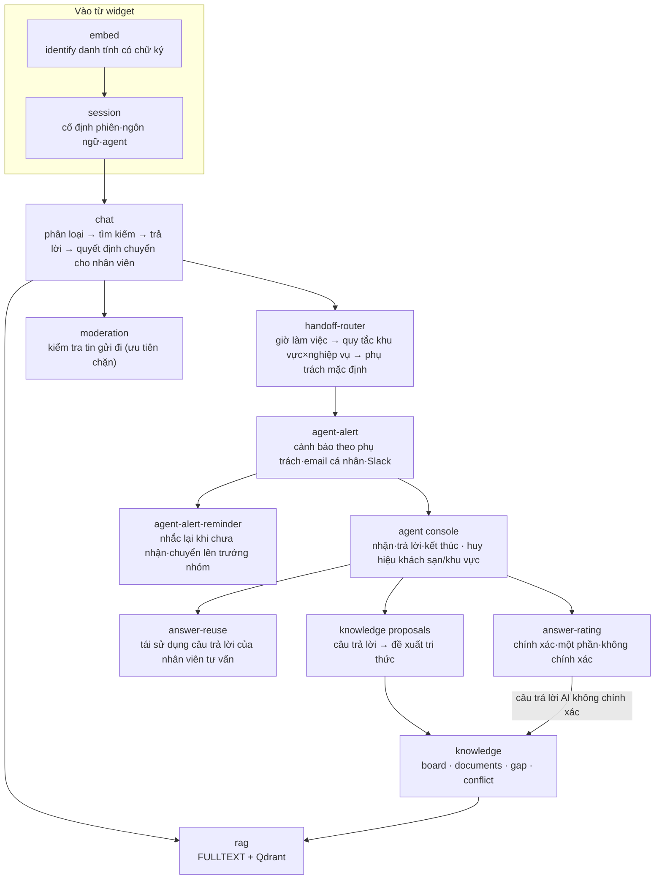

---

## 4. Cấu trúc tổng thể dịch vụ

### 4.1 Sơ đồ tổng quan hệ thống
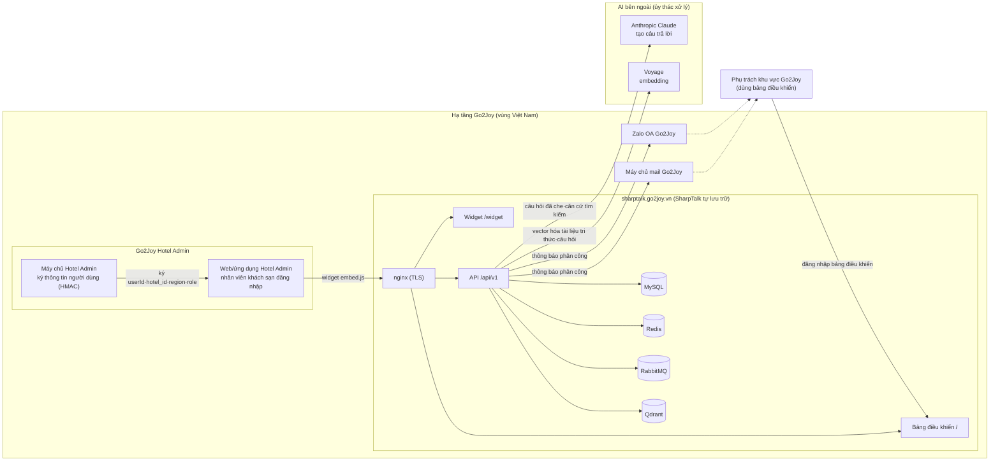

**Ranh giới dữ liệu** — Nguyên văn hội thoại, thông tin nhân viên khách sạn, tri thức và log kiểm toán đều được lưu trong MySQL·Qdrant trên máy chủ Go2Joy. Dữ liệu đi ra ngoài chỉ gồm **văn bản câu hỏi và căn cứ tìm kiếm để AI tạo câu trả lời** (sau khi che dữ liệu cá nhân) và **văn bản dùng cho embedding**. Hai nơi này là ủy thác xử lý (gọi API) và không lưu dữ liệu. Việc ủy thác xử lý này được thông báo trong điều khoản Go2Joy (§10).

### 4.2 Cấu trúc triển khai
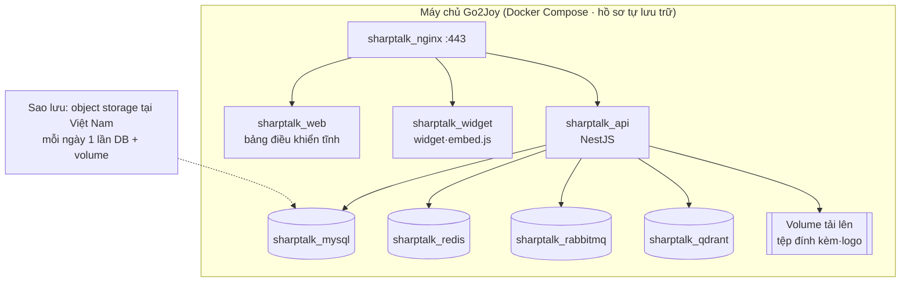

| Hạng mục | Giá trị (dự kiến) |
|---|---|
| Tên miền | `sharptalk.go2joy.vn` — bảng điều khiển `/`, widget `/widget/`, API `/api/v1` trên cùng một origin |
| Cấu hình máy chủ | Thử nghiệm 4 vCPU / 8 GB / 80 GB → vận hành từ 8 vCPU / 16 GB / 200 GB trở lên |
| Cài đặt | Sao chép env của hồ sơ `deploy/profiles/SharpTalk-VN-Go2Joy` → đạt `--check` → SQL schema → xác nhận khởi động (`successfully started`) |
| Chuyển giao vận hành | Chuyển thiết lập và tri thức của tenant go2joy trên staging Hàn Quốc bằng snapshot·tải xuống hàng loạt (cấm sao chép DB trực tiếp) |
| Cập nhật | Amoeba cung cấp tag phát hành → chạy script triển khai trên máy chủ Go2Joy (thay đổi schema thì áp dụng SQL trước) |

### 4.3 Phân công vai trò
| Công việc | Go2Joy | Amoeba |
|---|---|---|
| Máy chủ·tên miền·TLS·sao lưu | **Chịu trách nhiệm** | Cung cấp cấu hình·quy trình |
| Cài đặt·cập nhật SharpTalk | Phê duyệt·môi trường chạy | **Chịu trách nhiệm** (hỗ trợ từ xa) |
| Nhúng widget vào Hotel Admin·ký thông tin người dùng | **Chịu trách nhiệm** (mã ký phía máy chủ) | Hướng dẫn·kiểm chứng |
| Điều khoản·đồng ý sử dụng AI | **Chịu trách nhiệm** | Bản nháp nội dung thông báo |
| Chỉ định phụ trách theo khu vực·nghiệp vụ, giờ làm việc | **Chịu trách nhiệm** | Cung cấp màn hình thiết lập |
| Nội dung tri thức (chính sách·hướng dẫn·FAQ) | **Chịu trách nhiệm** (chốt nội dung) | Công cụ chuyển đổi·đăng ký |
| Thiết lập AI·đo chất lượng·tinh chỉnh | Xem xét | **Chịu trách nhiệm** |
| Xử lý sự cố tuyến 1 | Hạ tầng | Ứng dụng |

---

## 5. Người dùng và vai trò

| Người dùng | Ở đâu | Làm gì |
|---|---|---|
| **Nhân viên khách sạn** (quản lý `Quản lý` / lễ tân `Lễ tân`) | Widget chat trong Hotel Admin | Hỏi về cách dùng Hotel Admin, đặt phòng, đối soát, giá, coupon, quảng cáo |
| **Tư vấn viên AI** agent `Hotel Admin` | SharpTalk | Trả lời tuyến đầu bằng tri thức, ngoài phạm vi thì chuyển cho nhân viên |
| **Phụ trách khu vực** (CS Go2Joy, nhân viên tư vấn) | Bảng điều khiển SharpTalk | Trả lời hội thoại được phân công, đề xuất câu trả lời làm ứng viên tri thức, đánh giá câu trả lời AI |
| **Quản lý tri thức** (trưởng nhóm CS Go2Joy) | Bảng điều khiển SharpTalk › Tri thức | Duyệt ứng viên tri thức, giải quyết xung đột tri thức, xem xét đánh giá độ chính xác |
| **Quản trị tenant** (Go2Joy master) | Bảng điều khiển SharpTalk › Cài đặt | Quản lý quy tắc phân công·phụ trách·giờ làm việc·kênh thông báo |
| **Vận hành nền tảng** (Amoeba) | Admin nền tảng | AI engine·cập nhật·giám sát |

---

## 6. Kịch bản sử dụng giai đoạn 1

### 6.0 Luồng tổng thể
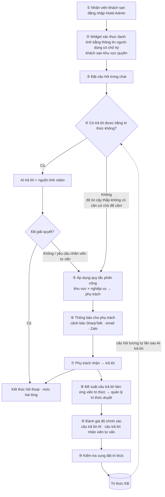

### 6.1 Danh sách kịch bản sự kiện
| EV | Sự kiện | Kích hoạt | Hệ thống xử lý | Trạng thái kết quả | Tình trạng (10/15) |
|---|---|---|---|---|---|
| EV-01 | Đăng nhập·tải widget | Nhân viên khách sạn đăng nhập Hotel Admin | Máy chủ Hotel Admin ký `userId + thuộc tính` → widget `identify` → lưu khách sạn·khu vực·quyền vào phiên | Phiên `VERIFIED` | **Đã triển khai** (D2) — phần ký phía Hotel Admin do Go2Joy làm |
| EV-02 | Tiếp nhận câu hỏi | Gửi tin nhắn | Nhận diện ngôn ngữ → phân loại ý định → tìm kiếm lai → tạo câu trả lời → kiểm duyệt | `AI đang trả lời` | Đã có (thiết lập ngôn ngữ mặc định `vi` ngày 10/15) |
| EV-03 | AI trả lời | Đủ căn cứ, độ tin cậy ≥ ngưỡng | Câu trả lời + nguồn·link video + nút câu hỏi tiếp theo | `AI đang trả lời` | Đã có |
| EV-04 | Vượt phạm vi tri thức | Độ tin cậy < ngưỡng / không có căn cứ / chủ đề deny / yêu cầu nhân viên tư vấn | Ghi lý do chuyển cho nhân viên, báo người dùng đang kết nối | `Chờ tư vấn` | Đã có |
| EV-05 | Phân công phụ trách | EV-04 | **Quy tắc khu vực × nghiệp vụ** (quy tắc khớp đầu tiên từ trên xuống) → 1 người tải thấp nhất hoặc cả nhóm → không có quy tắc khớp thì về phụ trách mặc định | Chốt đối tượng được phân công | **Đã triển khai** (D3) |
| EV-06 | Thông báo cho phụ trách | EV-05 | Cảnh báo SharpTalk (bảng điều khiển) + email phụ trách + Zalo, nếu chưa nhận thì nhắc lại·chuyển lên cấp trên | Ghi nhận đã gửi thông báo | **Đã triển khai** (D4) — Zalo làm sau khi nhận OA |
| EV-07 | Nhận·trả lời | Phụ trách bấm [Nhận] | Tiếp nhận hội thoại, dùng tóm tắt AI·tra cứu tri thức·bản nháp câu trả lời, gửi câu trả lời (kiểm duyệt) | `Đang tư vấn` | Đã có |
| EV-08 | Ngoài giờ làm việc | EV-05 xảy ra ngoài giờ làm việc | Thông báo ngoài giờ (vi/en) + xếp hàng cho giờ làm việc kế tiếp, chuyển tiếp tới email chỉ định | `Chờ tư vấn` | Đã có |
| EV-09 | Câu trả lời → tri thức | Phụ trách bấm [Đề xuất làm tri thức] hoặc kết thúc khi đã giải quyết | Đăng ký cặp câu hỏi·câu trả lời làm ứng viên tri thức → quản lý tri thức xem xét → khi chấp nhận thì lập chỉ mục lại | Tri thức `Đã chấp nhận` | Đã có |
| EV-10 | Đánh giá độ chính xác | Nhân viên tư vấn·quản lý đánh giá câu trả lời | Chính xác·một phần·không chính xác + lý do cho từng câu trả lời AI/nhân viên tư vấn, câu trả lời AI không chính xác đưa vào khoảng trống tri thức | Ghi nhận đánh giá | **Đã triển khai** (D7) |
| EV-11 | Kiểm tra xung đột tri thức | Chấp nhận tri thức·quét định kỳ | Cặp tài liệu tương tự → AI phán định (trùng lặp/mâu thuẫn) → quản lý giải quyết | Xung đột `Đã giải quyết` | Đã có — đã phân loại xong 78 mục tồn (D8) |
| EV-12 | Kết thúc | Người dùng/nhân viên tư vấn kết thúc, tự kết thúc khi không hoạt động | Yêu cầu đánh giá mức hài lòng, tổng hợp thống kê | `Kết thúc` | Đã có |

### 6.2 Trạng thái hội thoại
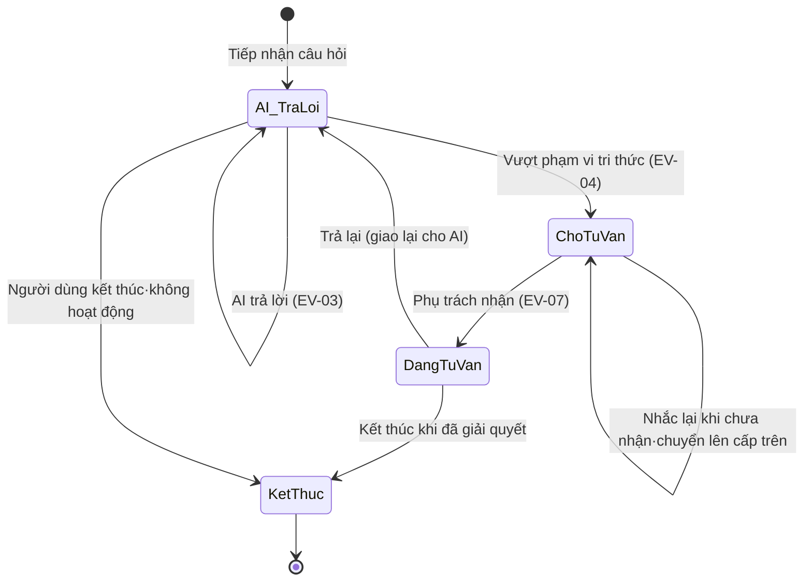

---

### 6.3 [EV-01] Đăng nhập Hotel Admin → xác nhận người dùng đăng nhập

Nhân viên khách sạn không cần đăng nhập riêng vào SharpTalk. **Máy chủ Hotel Admin ký** thông tin người dùng mà Hotel Admin đã biết rồi chuyển cho widget. SharpTalk kiểm tra chữ ký và mở hội thoại với đúng người dùng đó.

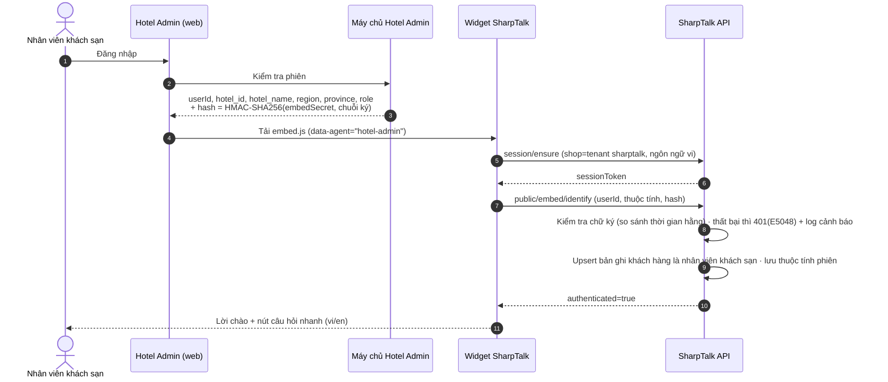

| Thuộc tính nhận được (đã chốt khi triển khai) | Mục đích | Ghi chú |
|---|---|---|
| `userId` | Định danh người dùng | Đã nằm trong nội dung ký từ trước |
| `hotel_id`, `hotel_name` | Huy hiệu trên màn hình hội thoại, khóa mở rộng theo khách sạn ở giai đoạn 2 | Mới |
| `region` (`north`/`central`/`south`) | **Căn cứ phân công phụ trách** | Mới — Go2Joy tính từ địa chỉ khách sạn rồi gửi sang |
| `province` | Tỉnh/thành để hiển thị·thống kê | Mới |
| `role` (`manager`/`reception`) | Huy hiệu trên màn hình hội thoại | Mới |

- **Chuỗi ký**: không có thuộc tính thì dùng nguyên `userId` (như trước). Có thuộc tính thì từ dòng sau `userId`, nối từng dòng `key=value` theo **thứ tự bảng chữ cái của khóa**. Ví dụ: `u-1024\nhotel_id=H77\nhotel_name=Joy Hotel\nregion=north\nrole=reception`. Định dạng và mã ví dụ có trong Hướng dẫn SDK nhúng §3.4.
- Khóa ngoài 5 khóa trên, giá trị chứa ký tự xuống dòng, giá trị dài quá 120 ký tự sẽ bị bỏ, không lưu. Nếu có gửi thuộc tính mà chỉ ký `userId` thì bị từ chối với mã 401.
- Ngôn ngữ trả lời không theo thuộc tính mà theo `locale` của widget. Nếu không chỉ định, hội thoại bắt đầu bằng ngôn ngữ mặc định của tenant là `vi` (thiết lập ngày 10/15).

> Giá trị hồ sơ không có chữ ký (tên·email) chỉ dùng để hiển thị. **Giá trị dùng để phân công bắt buộc phải nằm trong nội dung ký** (để ngăn việc giả mạo khu vực nhằm chuyển sang phụ trách khác).


*Hình 1. Màn hình đầu của widget Hotel Admin (chế độ ứng dụng). Banner thông báo AI ở trên cùng, thương hiệu Go2Joy, 4 câu hỏi nhanh (xem đặt phòng hôm nay·cách check-in·khiếu nại đặt phòng·hỏi về đối soát).*

---

### 6.4 [EV-02·03] Câu hỏi chat → AI trả lời

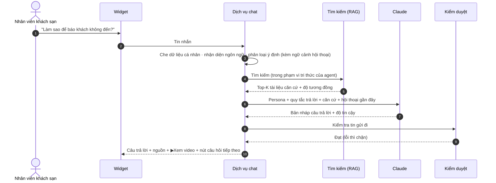

- AI **chỉ trả lời nội dung có căn cứ tìm được**. Không có căn cứ thì không bịa, mà chuyển cho nhân viên (EV-04).
- Thao tác trên Hotel Admin (chốt đối soát, xử lý hủy…) thì AI **chỉ hướng dẫn cách làm**, không bấm thay.
- Cuối câu trả lời có phần chân trang liên hệ hỗ trợ Go2Joy (số điện thoại theo khu vực).


*Hình 2. AI trả lời câu hỏi "Cách báo khách không đến". Câu trả lời gồm quy trình từng bước, nguồn (Video 22) và link ▶Xem video, chân trang liên hệ hỗ trợ, nút câu hỏi tiếp theo.*

---

### 6.5 [EV-04·05] Vượt phạm vi tri thức → phân công nhân viên tư vấn

#### 6.5.1 Xác định vượt phạm vi tri thức (giữ logic hiện hành)
| Thứ tự | Điều kiện | Lý do chuyển cho nhân viên |
|---|---|---|
| 1 | Chủ đề thuộc deny-list (ví dụ: chấm dứt hợp đồng, tranh chấp pháp lý, hoàn tiền quy mô lớn) | `policy` — ngay lập tức, trước khi tìm kiếm |
| 2 | Người dùng yêu cầu kết nối nhân viên tư vấn | `user_request` |
| 3 | Chào hỏi·tán gẫu·không rõ ý | Không chuyển cho nhân viên (hỏi lại) |
| 4 | Không có căn cứ tìm kiếm hoặc độ tin cậy câu trả lời < 0.45 | `low_confidence` |

#### 6.5.2 Tiêu chí phân công — khu vực × nghiệp vụ phụ trách (mới)
Khóa phân công gồm hai yếu tố: **① khu vực khách sạn** (`region` đã ký ở EV-01) và **② nghiệp vụ của câu hỏi**. Khi triển khai, nghiệp vụ được xác định bằng **từ khóa trong tin nhắn của khách** (ví dụ: `thanh toán`, `đối soát`) hoặc **nhãn nghiệp vụ do quy tắc deny gắn** (tư vấn·kế toán·vận hành). Không dùng ánh xạ từ kết quả phân loại ý định sang nghiệp vụ — vì từ khóa thì phụ trách Go2Joy có thể sửa ngay trên màn hình.

| Nghiệp vụ \ Khu vực | Miền Bắc | Miền Trung | Miền Nam |
|---|---|---|---|
| Đặt phòng·check-in·khách không đến | Phụ trách vận hành miền Bắc A·B | Phụ trách vận hành miền Trung | Phụ trách vận hành miền Nam C·D |
| Đối soát·khiếu nại | Nhóm đối soát (dùng chung toàn quốc) | Nhóm đối soát | Nhóm đối soát |
| Giá·giảm giá·Flash Sale | Phụ trách kinh doanh miền Bắc | Phụ trách kinh doanh miền Trung | Phụ trách kinh doanh miền Nam |
| Coupon·quảng cáo | Marketing (dùng chung toàn quốc) | Marketing | Marketing |
| Tài khoản·quyền·sự cố | Hỗ trợ kỹ thuật (dùng chung toàn quốc) | Hỗ trợ kỹ thuật | Hỗ trợ kỹ thuật |
| Khác | Hàng đợi chung của khu vực | Hàng đợi chung của khu vực | Hàng đợi chung của khu vực |

*Phụ trách trong bảng chỉ là ví dụ. Cách chia khu vực thực tế (3 miền hoặc theo tỉnh/thành) và phân loại nghiệp vụ do Go2Joy chốt (§12 D-3).*

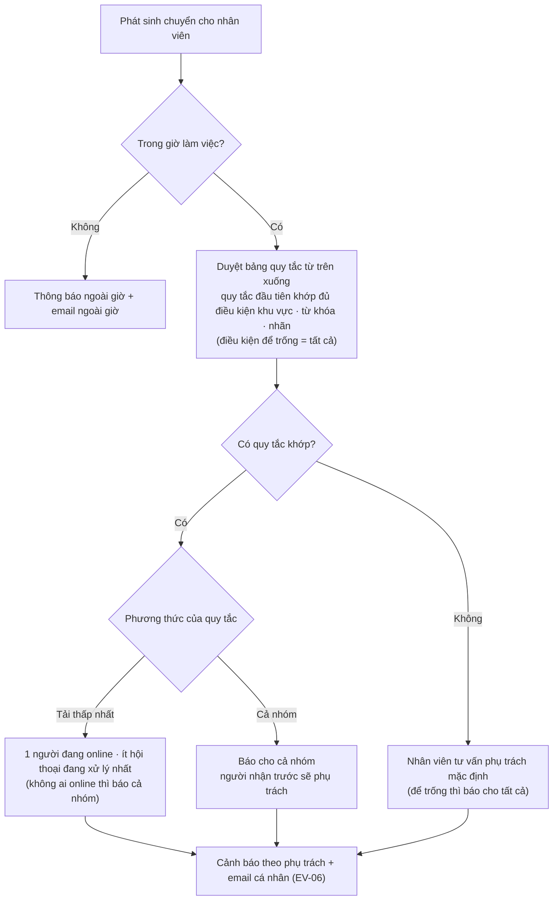

- **Thứ tự ưu tiên được quyết định bởi thứ tự quy tắc.** Trình tự "khớp chính xác → nghiệp vụ dùng chung toàn quốc → dùng chung khu vực → tất cả" ở giai đoạn kế hoạch đạt được cùng hiệu quả bằng cách đặt quy tắc cụ thể lên trên và quy tắc để trống khu vực xuống dưới.
- Nếu phiên không có khu vực (chưa triển khai ký·chưa gửi), quy tắc có điều kiện khu vực sẽ không khớp, hội thoại đi tới quy tắc để trống khu vực hoặc phụ trách mặc định. Phương án "tra cứu thông tin khách sạn Go2Joy bằng hotelId" trong kế hoạch chưa được triển khai vì Go2Joy chưa có API.
- Khi một người nhận, cảnh báo gửi cho các phụ trách khác trong cùng hội thoại cũng được đóng theo.


*Hình 3. Nhân viên tư vấn phụ trách mặc định, giờ làm việc và thiết lập ngoài giờ trong [Cài đặt tenant › Kết nối nhân viên tư vấn]. Bảng quy tắc phân công nằm ngay bên dưới (Hình 10).*


*Hình 10. Trình chỉnh sửa quy tắc phân công đã triển khai (màn hình kiểm thử thực tế trên staging). Mỗi quy tắc có tên, phương thức (tải thấp nhất / cả nhóm), khu vực, nghiệp vụ (từ khóa + nhãn) và phụ trách; dùng ↑↓ để đổi thứ tự. Nhắc lại không đặt theo từng quy tắc mà là thiết lập chung của tenant (§6.6).*

---

### 6.6 [EV-06] Thông báo cho nhân viên tư vấn được phân công

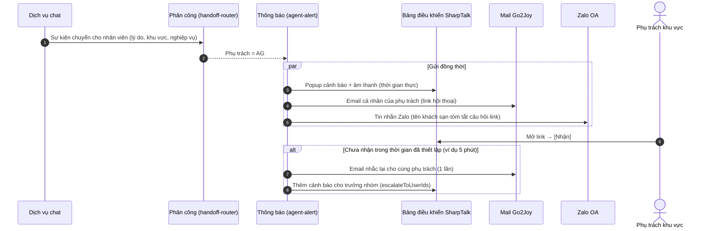

| Kênh | Kế hoạch giai đoạn 1 | Tình trạng (10/15) |
|---|---|---|
| Cảnh báo bảng điều khiển SharpTalk (popup) | Cảnh báo theo từng phụ trách | **Đã triển khai** — mỗi phụ trách được phân công nhận 1 cảnh báo, một người nhận thì các cảnh báo còn lại đóng theo. Chu kỳ chuyển (kiểm tra mỗi 10 giây) giữ nguyên |
| Email | **Email cá nhân của phụ trách** | **Đã triển khai** — tiêu đề `[SharpTalk] Escalation — conversation #<số>`, nội dung gồm lý do chuyển cho nhân viên·khách sạn·khu vực·xem trước câu hỏi·link hội thoại |
| Nhắc lại khi chưa nhận | Nhắc lại·chuyển lên cấp trên | **Đã triển khai** — thiết lập thời gian chờ (phút) và trưởng nhóm tại [Kết nối nhân viên tư vấn]. Dùng chung cho tenant, mỗi hội thoại 1 lần |
| Zalo | **Gửi thông báo cho phụ trách** | **Đang chờ** — cần Zalo OA của Go2Joy và phê duyệt mẫu ZNS |
| Web push (trình duyệt) | Tùy chọn | Không làm (loại khỏi giai đoạn 1) |
| Slack | Tắt nếu Go2Joy không dùng | Giữ nguyên |

Nội dung thông báo chỉ gồm **lý do chuyển cho nhân viên·tên khách sạn·khu vực·xem trước câu hỏi·link hội thoại**, không đưa toàn văn hội thoại (để nguyên văn hội thoại không đi ra messenger bên ngoài). Email đã triển khai cũng tuân theo nguyên tắc này. Phần xem trước câu hỏi là đoạn đầu câu hỏi của khách. Thông báo Zalo cũng sẽ dùng cùng nội dung.

---

### 6.7 [EV-07] Nhân viên tư vấn trả lời hội thoại được phân công

Phụ trách mở hội thoại `Chờ tư vấn` tại [Tư vấn thời gian thực] trên bảng điều khiển. Xem lý do AI chuyển, người dùng thuộc khách sạn·khu vực nào, rồi bấm [Nhận] và trả lời. Ở bảng bên phải có thể dùng **tóm tắt AI** (tóm tắt hội thoại), **tra cứu tri thức** (câu hỏi này đã có trong tri thức chưa) và **bản nháp câu trả lời AI**. Trả lời xong thì bấm [Trả lại] (giao lại cho AI) hoặc [Kết thúc].


*Hình 4. Tư vấn thời gian thực trên bảng điều khiển. Với câu hỏi "Cách đăng ký tài khoản", AI không tìm được căn cứ nên chuyển sang `Chờ tư vấn`. Phụ trách bấm [Nhận] rồi trả lời, dùng tóm tắt AI·tra cứu tri thức ở bên phải.*

Bổ sung giai đoạn 1: hiển thị **huy hiệu tên khách sạn·khu vực·quyền** ở đầu hội thoại và danh sách (**đã triển khai**, D5). Phần hiển thị lý do chuyển cho nhân viên (không có căn cứ/độ tin cậy/yêu cầu/chính sách) chưa làm (việc còn lại).


*Hình 9. Hội thoại mở với người dùng có chữ ký (kiểm thử thực tế trên staging). Đầu hội thoại có huy hiệu `Khách sạn`·`Miền Bắc`·`Lễ tân`. Hội thoại này diễn ra trước khi thiết lập ngôn ngữ mặc định nên câu hỏi tiếng Việt được trả lời bằng tiếng Anh; đây là lý do chọn ngôn ngữ mặc định là `vi`.*

---

### 6.8 [EV-09] Lưu câu trả lời của nhân viên tư vấn trở lại thành tri thức

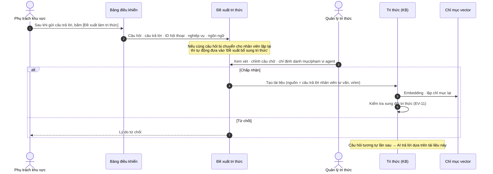

SharpTalk đã có sẵn bốn đường để câu trả lời của nhân viên tư vấn quay lại thành tri thức.

| Đường | Cách hoạt động | Áp dụng |
|---|---|---|
| Đề xuất tri thức | Nhân viên tư vấn đưa câu trả lời lên làm ứng viên tri thức, quản lý duyệt | Đường mặc định giai đoạn 1 |
| Đề xuất bổ sung tri thức | Tự động đưa thành ứng viên các chủ đề hay bị chuyển cho nhân viên·ý định không có căn cứ·câu trả lời nhân viên tư vấn đã giải quyết | Xem xét hằng tuần |
| Tái sử dụng câu trả lời | Khi có câu hỏi gần như giống câu nhân viên tư vấn đã trả lời, phát lại câu trả lời đã kiểm chứng (vẫn kiểm duyệt) | Cân nhắc bật |
| Smart Knowledge Board | Xem xét tài liệu đã chỉnh lý trên bảng rồi chấp nhận vào KB | Cập nhật chính sách·hướng dẫn |


*Hình 5. [Tri thức › Đề xuất bổ sung tri thức]. Khi cùng một câu hỏi bị chuyển cho nhân viên tư vấn nhiều lần (chuyển nhiều), câu hỏi đó được đưa lên làm ứng viên tri thức. Khi quản lý bấm [Duyệt thành tài liệu KB], từ lần sau AI sẽ trả lời.*


*Hình 6. Smart Knowledge Board. Mọi tri thức đều được xem xét trên bảng rồi mới chấp nhận vào KB (204 mục trên staging go2joy).*

---

### 6.9 [EV-10] Đánh giá độ chính xác câu trả lời (mới)

Phải có ghi nhận con người đánh giá câu trả lời AI đúng hay sai thì mới có thể tin tưởng mà mở rộng "phạm vi AI trả lời". Trước đây chỉ có mức hài lòng của khách (theo hội thoại) và chấm tự động câu hỏi vàng, chưa có đánh giá độ chính xác theo từng tin nhắn. **Đã triển khai trong D7** (staging ngày 10/15).

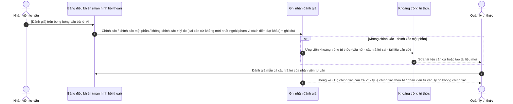


*Hình 11. [Đánh giá] bên dưới câu trả lời AI trong hội thoại trên bảng điều khiển (kiểm thử thực tế trên staging). Bấm vào để chọn chính xác / chính xác một phần / không chính xác, lý do và ghi chú. Sau khi lưu, kết quả hiện lại như 'Không chính xác · Không mới nhất', bấm lại để sửa. Câu trả lời AI bị đánh giá không chính xác·chính xác một phần sẽ tự động được đưa vào [Đề xuất bổ sung tri thức].*


*Hình 12. Tab [Thống kê › Độ chính xác câu trả lời]. Câu trả lời của AI và của nhân viên tư vấn được tổng hợp riêng (gộp thành một tỷ lệ sẽ che mất bên nào cần sửa). Dữ liệu thực tế chỉ có 1 mục nên hiển thị 0%.*

| Đối tượng đánh giá | Ai | Khi nào | Sử dụng kết quả |
|---|---|---|---|
| Câu trả lời AI | Nhân viên tư vấn tiếp nhận hội thoại | Câu trả lời AI ngay trước khi chuyển cho nhân viên (quy tắc vận hành), các trường hợp khác lấy mẫu | Không chính xác → khoảng trống tri thức, thống kê độ chính xác — **đã triển khai** |
| Câu trả lời nhân viên tư vấn | Quản lý tri thức | Khi xem xét đề xuất tri thức + lấy mẫu hằng tuần | Thống kê độ chính xác — **đã triển khai** (kết nối coaching là quy trình vận hành) |
| Tài liệu tri thức | Quản lý tri thức | Tài liệu bị đánh giá không chính xác từ 2 lần trở lên | Sửa·thu hồi — **chưa triển khai** (sau giai đoạn 1) |

- Mỗi (tin nhắn, người đánh giá) chỉ có 1 đánh giá. Cùng một người đánh giá lại thì ghi đè. Không thể đánh giá tin nhắn của khách.
- "Bắt buộc đánh giá câu trả lời AI ngay trước khi chuyển cho nhân viên" không bị ép trên màn hình. Go2Joy quy định bằng quy tắc vận hành cho nhân viên tư vấn.

---

### 6.10 [EV-11] Kiểm tra xung đột tri thức

Nếu tri thức mới (nhất là tri thức đến từ câu trả lời của nhân viên tư vấn) nói khác với chính sách·hướng dẫn hiện có, AI sẽ trả lời khác nhau tùy tình huống. SharpTalk đã có sẵn **phát hiện xung đột 2 bước** — ① tìm cặp tài liệu tương tự bằng độ tương đồng vector, ② AI phán định là "trùng lặp" hay "mâu thuẫn". Quản lý xem hai tài liệu cạnh nhau rồi sửa một bên, gộp lại hoặc bỏ qua.

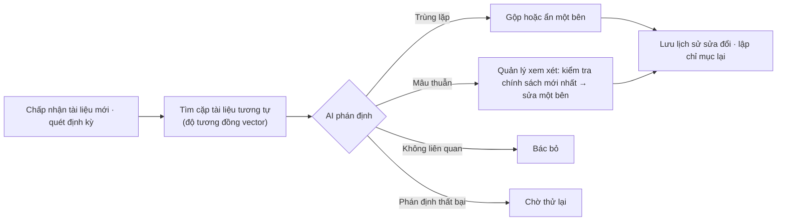


*Hình 7. [Tri thức › Xem xét xung đột tri thức]. Hai tài liệu được hiển thị cạnh nhau và có thể sửa ngay. Staging go2joy có 78 mục chưa xem xét, cần dọn dẹp trước khi chuyển giao vận hành.*

**Kết quả phân loại 78 mục chưa xem xét (10/15, đối chiếu nguyên văn)** — Chi tiết: [RPT-261015 Phân loại xung đột](../report/RPT-261015-Go2Joy-KB-Conflict-Triage.md)

| Nhóm | Số mục | Hành động đề xuất |
|---|---:|---|
| Cần sửa (sai lệch sự thật) | 3 | Sửa 6 tài liệu hướng dẫn tóm tắt — Flash Sale theo giờ "chọn giá" (màn hình thực tế: bắt buộc nhập giá 2 giờ đầu), thiếu bước xác nhận khi dừng Flash Sale |
| Tài liệu chính sách 2 bản | 3 | Cùng một điều khoản được đăng ký hai lần ngày 8/20·8/29 — chỉ giữ 1 bản chuẩn |
| FAQ cùng câu trả lời, khác câu hỏi | 32 | Gộp 13 tài liệu thành 2, giữ các câu hỏi dưới dạng biến thể |
| Bản dịch theo ngôn ngữ / tóm tắt↔video / quy trình khác nhau | 40 | Giữ cả hai |

- Không thể chỉ tin vào phán định của AI. Với hai cặp có cùng vấn đề, AI phán định một cặp là "mâu thuẫn", cặp kia là "bổ sung". Trong vận hành, phán định xung đột cũng do quản lý xem nguyên văn rồi chốt.
- Phát hiện thêm khi phân loại: danh mục FAQ·chính sách dành cho khách hàng đang mở cho mọi agent, nên agent Hotel Admin cũng dùng hướng dẫn đặt phòng dành cho khách làm căn cứ (§12 D-10).

Bổ sung giai đoạn 1 (D6, **chưa triển khai**): khi tài liệu đến từ câu trả lời của nhân viên tư vấn được chấp nhận, **chạy kiểm tra xung đột ngay trước khi chấp nhận**; nếu mâu thuẫn thì hiện cảnh báo trên màn hình duyệt. Hiện tại quản lý phải bấm [Kiểm tra xung đột] thì mới kiểm tra.

---

## 7. Khoảng trống so với hiện trạng và hạng mục phát triển giai đoạn 1

| # | Hạng mục | Hiện trạng (trước khi bắt đầu) | Công việc giai đoạn 1 | Quy mô | Tình trạng (10/15) |
|---|---|---|---|---|---|
| D1 | Cài đặt tự lưu trữ `sharptalk.go2joy.vn` | Đã có hồ sơ VN (giả định `talk-vn.<domain>`) | Chốt tên miền·env, cài đặt·sao lưu·giám sát trên máy chủ Go2Joy, chuyển tri thức·thiết lập từ staging | Vừa | **Đang chờ** — chưa có máy chủ·DNS. Schema cho cài đặt mới (`docker/init-sql`) đã cập nhật bản mới nhất |
| D2 | Thuộc tính người dùng có chữ ký | Chỉ ký `userId` | Mở rộng nội dung ký với `hotel_id·hotel_name·region·province·role`, lưu thuộc tính phiên, hiển thị trên bảng điều khiển | Vừa | **Hoàn thành** #637 |
| D3 | Quy tắc phân công khu vực × nghiệp vụ | Danh sách phụ trách, tải thấp nhất theo nhãn | Bảng quy tắc (màn hình thiết lập), ưu tiên theo thứ tự, nghiệp vụ = từ khóa·nhãn | Lớn | **Hoàn thành** #638 |
| D4 | Thông báo cho phụ trách | Popup bảng điều khiển, email chung, Slack | Email cá nhân của phụ trách, nhắc lại khi chưa nhận·chuyển lên trưởng nhóm, gửi qua Zalo OA | Vừa | **Hoàn thành** #639 (Zalo chờ OA) |
| D5 | Thông tin hội thoại trên bảng điều khiển | Khách hàng·kênh·agent | Huy hiệu khách sạn·khu vực·quyền, hiển thị lý do chuyển cho nhân viên | Nhỏ | **Huy hiệu hoàn thành** #637 / còn lý do chuyển cho nhân viên |
| D6 | Câu trả lời → tri thức | Đề xuất tri thức·khoảng trống·tái sử dụng·bảng | Chuẩn hóa thành quy trình vận hành của Go2Joy, kiểm tra xung đột trước khi chấp nhận | Nhỏ | **Còn lại** |
| D7 | Đánh giá độ chính xác | Chưa có (chỉ có mức hài lòng·chấm câu hỏi vàng) | Bảng đánh giá theo tin nhắn·API·giao diện bảng điều khiển·tab thống kê | Vừa | **Hoàn thành** #640 |
| D8 | Chỉnh lý tri thức | KB 270 mục, 78 xung đột chưa xem xét, 1 lỗi nguồn Notion | Dọn xung đột, kết nối lại chia sẻ Notion, người bản ngữ kiểm tra bản vi | Vừa | **Đang làm** — đã thiết lập ngôn ngữ mặc định `vi`, đã phân loại xong xung đột (#644). Thực hiện dọn dẹp·Notion·kiểm tra vi sau khi Go2Joy quyết định |
| D9 | Chế độ thông báo theo điều khoản | Banner đồng ý trên widget (kiểu CCPA/GDPR) | Chế độ "đã đồng ý qua điều khoản Go2Joy" | Nhỏ | **Hoàn thành** #642 (bật khi chuyển giao vận hành) |
| D10 | Cổng chất lượng | Chấm tự động 44 câu vàng (staging) | Kết nối chấm tự động sau khi triển khai trên máy chủ Go2Joy | Nhỏ | **Đang chờ** — sau D1 |

4 tệp SQL thay đổi schema (`sql/261015-*.sql`) đã được áp dụng trước trên staging·production Hàn Quốc. Máy chủ Go2Joy sẽ có sẵn ngay từ đầu qua `docker/init-sql`.

---

## 8. Lịch triển khai

> **Quyết định ngày 2026-10-15: hoàn thành giai đoạn 1 = 2026-10-31.** Rút phương án ban đầu (12 tuần, mở năm 2027-01) xuống còn 2,5 tuần. Phần phát triển của Amoeba có thể làm song song để kịp tiến độ. Tuy nhiên, **nếu các hạng mục tiên quyết phía Go2Joy (máy chủ·DNS·nhúng Hotel Admin·danh sách phụ trách) chưa sẵn sàng trước 10/22, mốc 10/31 sẽ được thay bằng "mở trên staging"**.

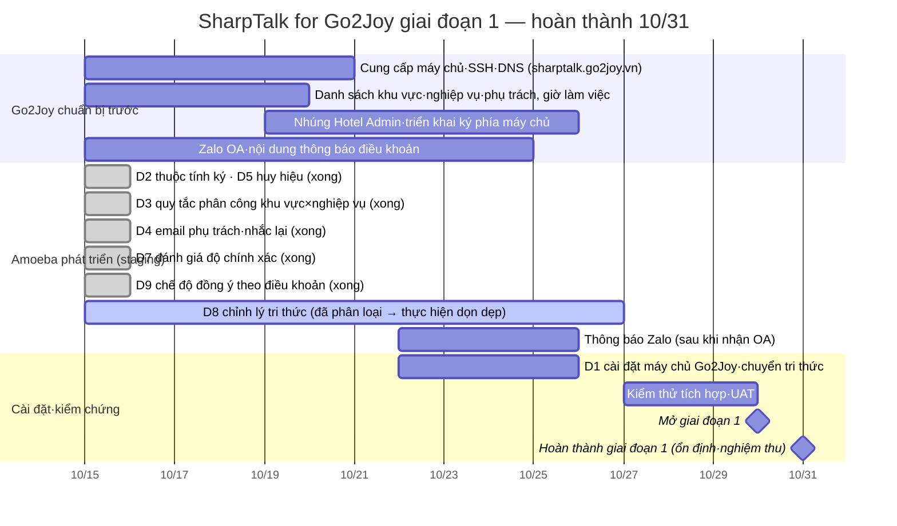

| Mốc | Thời điểm | Tiêu chí hoàn thành | Tình trạng (10/15) |
|---|---|---|---|
| M1 Khởi động | 10/15 | Phê duyệt kế hoạch, gửi yêu cầu chuẩn bị trước cho Go2Joy | **Hoàn thành** |
| M2 Tính năng Amoeba lên staging | 10/24 | Triển khai D2·D3·D4·D5·D7·D9 lên staging, bộ câu hỏi vàng 0 câu sai | **Hoàn thành (10/15)** — đạt kiểm thử thực tế IT-1~8 ([TCR-261015](../test/TCR-261015-Go2Joy-Phase1-D2-D7.md)), cổng triển khai 44 câu vàng 0 câu sai (đạt 42, 2 câu tạm hoãn phán định tự động) |
| M3 Cài đặt máy chủ Go2Joy | 10/26 | `https://sharptalk.go2joy.vn` khởi động·smoke test, chuyển tri thức·lập chỉ mục lại | Đang chờ — cần máy chủ·DNS trước 10/22 |
| M4 UAT | 10/29 | Đạt kiểm thử thực tế EV-01~12 qua nhúng Hotel Admin | Đang chờ — cần Go2Joy triển khai ký phía Hotel Admin |
| M5 Hoàn thành giai đoạn 1 | 10/31 | Mở vận hành, đào tạo phụ trách, nghiệm thu quy trình vận hành | Dự kiến |

**Địa chỉ truy cập**
| Môi trường | Bảng điều khiển (nhân viên tư vấn·quản lý) | Widget | Trạng thái |
|---|---|---|---|
| Staging (hiện tại) | `https://shoptalk.amoeba.site/user/go2joy` | `https://shoptalk.amoeba.site/widget/?mode=app&shop=https%3A%2F%2Fwww.go2joy.vn&agent=hotel-admin` | Dùng được |
| Vận hành Go2Joy | `https://sharptalk.go2joy.vn/user/go2joy` | Widget trong Hotel Admin (`https://sharptalk.go2joy.vn/widget/embed.js`) | Tính đến 10/15 chưa có DNS — sau khi Go2Joy cung cấp máy chủ·DNS |

Tài khoản bảng điều khiển staging được cấp riêng cho từng phụ trách Go2Joy (sau khi nhận danh sách). Widget staging bắt đầu bằng tiếng Việt nếu không chỉ định ngôn ngữ.

## 9. Chỉ số hiệu quả

| Phân loại | Chỉ số | Cách tính |
|---|---|---|
| Hiệu suất | Tỷ lệ AI tự giải quyết, tỷ lệ chuyển cho nhân viên, số ca xử lý trên mỗi nhân viên tư vấn | Thống kê › Hành trình·Xử lý·Nhân viên tư vấn |
| Tốc độ | Thời gian AI phản hồi đầu tiên, phân công → phản hồi đầu tiên (trung vị), số lần nhắc lại khi chưa nhận | Log chuyển cho nhân viên·thông báo |
| Chất lượng | Độ chính xác câu trả lời AI (nhân viên tư vấn đánh giá), tỷ lệ đạt bộ câu hỏi vàng, mức hài lòng | Đánh giá độ chính xác · câu hỏi vàng · CSAT |
| Tăng trưởng tri thức | Số tri thức mới được chấp nhận mỗi tháng (nguồn từ câu trả lời nhân viên tư vấn), tỷ lệ xử lý khoảng trống tri thức, mức giảm chuyển lại cùng chủ đề | Tri thức › Khoảng trống·Bảng |
| Vệ sinh tri thức | Số xung đột tri thức chưa giải quyết, tỷ lệ tài liệu cũ | Tri thức › Xung đột |


*Hình 8. Thống kê › Hành trình (staging 30 ngày gần nhất). Xem trên một màn hình luồng hiển thị → truy cập → hội thoại → phản hồi·chuyển cho nhân viên·đánh giá·kết thúc. Khi bổ sung đánh giá độ chính xác, số liệu sẽ được tổng hợp chung trên màn hình này.*

---

## 10. Dữ liệu cá nhân·Bảo mật

| Hạng mục | Chính sách |
|---|---|
| Nơi lưu trữ dữ liệu | Hội thoại·người dùng·tri thức·log·bản sao lưu đều nằm trên máy chủ Go2Joy (vùng Việt Nam). Amoeba chỉ truy cập bằng tài khoản được Go2Joy cấp phép khi hỗ trợ từ xa |
| Cung cấp dữ liệu cá nhân ra bên ngoài | Không **cung cấp** cho bên thứ ba. Việc tạo câu trả lời AI (Anthropic)·embedding (Voyage) thuộc diện **ủy thác xử lý·chuyển dữ liệu ra nước ngoài**, vì vậy điều khoản·chính sách xử lý của Go2Joy phải thông báo bên nhận ủy thác và khu vực xử lý. Khu vực xử lý AI hiển thị trên banner thông báo của widget (`AI_PROCESSING_REGION`) |
| Đồng ý sử dụng AI | Go2Joy xử lý qua quy trình đồng ý điều khoản Hotel Admin (§1.2 P2). SharpTalk đặt phương thức đồng ý trong [Cài đặt › Thông báo quyền riêng tư] là "điều khoản của ứng dụng chủ" (đã triển khai D9). Khi đó **chỉ người dùng Hotel Admin đã kiểm tra chữ ký** mới được ghi nhận là đã đồng ý mà không cần banner (lưu thời điểm đồng ý·phiên bản thông báo); khách truy cập không có chữ ký vẫn thấy banner như cũ. Ghi nhận từ chối trực tiếp trên widget không bị ghi đè. Cho tới khi chốt nội dung điều khoản, staging vẫn giữ phương thức "banner widget" |
| Che dữ liệu trước khi gửi AI | Số điện thoại (gồm +84·09xx)·email·tài khoản ngân hàng… được che trước khi gửi cho AI. Liên hệ chính thức của Go2Joy (chân trang) là giá trị bảo vệ, được ngoại lệ |
| Kiểm soát tin gửi đi | Mọi tin nhắn của AI·nhân viên tư vấn bắt buộc qua kiểm duyệt, lỗi thì chặn |
| Kiểm soát truy cập | JWT bảng điều khiển + RBAC cấp bậc × nhãn nghiệp vụ, MFA, che thông tin khách hàng trên màn hình + kiểm toán việc xem |
| Lưu giữ | Thời hạn lưu log hội thoại khớp với chính sách xử lý của Go2Joy (dự thảo 180 ngày), tự động xóa khi hết hạn |
| Quy định pháp lý | PDPD Việt Nam (Nghị định 13/2023) — hồ sơ đánh giá tác động chuyển dữ liệu ra nước ngoài, thông báo vi phạm trong 72 giờ. **Nội dung cuối cùng·việc nộp hồ sơ do pháp chế Go2Joy xác nhận** |

---

## 11. Nhiệm vụ tiếp theo — Giai đoạn 2·3

### 11.1 Giai đoạn 2 — Tư vấn viên AI theo khách sạn (phục vụ khách đặt phòng)
Mỗi khách sạn dùng tư vấn viên AI để trả lời câu hỏi của khách đặt phòng của mình (người dùng ứng dụng Go2Joy). Trên nền tri thức chung của Go2Joy tích lũy ở giai đoạn 1, bổ sung **tri thức riêng của từng khách sạn (tiện nghi·check-in·đỗ xe·sản phẩm bổ sung)**.

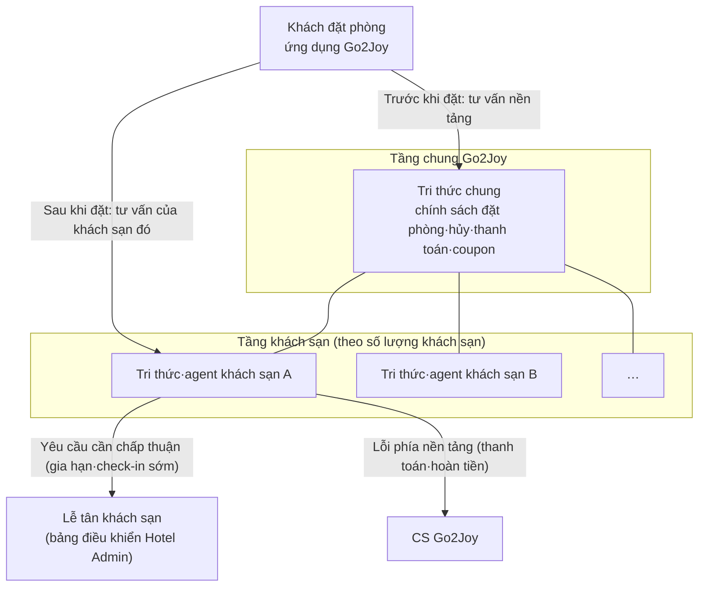

| Nhiệm vụ | Nội dung |
|---|---|
| Trục theo khách sạn | Hiện tại tenant = chỉ một Go2Joy. Cần quyết định tạo 5.500 khách sạn thành tenant, hay đặt **phạm vi khách sạn** bên trong tenant (AN-260907 §2.1 — khuyến nghị phạm vi khách sạn) |
| Chuyển quyền sở hữu phiên | Trước khi đặt thuộc nền tảng, sau khi đặt chuyển quyền sở hữu hội thoại sang khách sạn tương ứng |
| Chuyển cho nhân viên 3 cấp | AI → lễ tân khách sạn (L1) → CS Go2Joy (L2) → bộ phận chuyên môn (L3), khung giờ không có người thì bỏ qua L1 |
| Đưa tri thức khách sạn vào | Tự động chuyển thông tin khách sạn·phòng·sản phẩm bổ sung trong Hotel Admin thành tri thức, khách sạn tự bổ sung |
| Tra cứu số tiền·đặt phòng | Đặt phòng·giá chỉ truyền giá trị tra cứu từ hệ thống (cấm LLM tự tính toán) — kết nối API đặt phòng Go2Joy |
| Dữ liệu cá nhân | Mã khóa cửa·họ tên thật·liên hệ chỉ hiển thị trong phiên đã xác thực |
| Mô hình kinh doanh | Cân nhắc dịch vụ bổ sung có phí theo khách sạn (B2B2C) — REQ-260825 Option 2 |

### 11.2 Giai đoạn 3 — Go2Joy Philippines
| Nhiệm vụ | Nội dung |
|---|---|
| Triển khai | Triển khai riêng cho Philippines (nguyên tắc mỗi quốc gia = 1 bản triển khai). Hồ sơ mới `SharpTalk-PH-Go2Joy`, máy chủ·tên miền tại Philippines |
| Dịch vụ | Giai đoạn 1 (tư vấn Hotel Admin) + giai đoạn 2 (tư vấn khách đặt phòng theo khách sạn) theo cùng thứ tự |
| Ngôn ngữ | Ưu tiên tiếng Anh. **Tiếng Philippines (Filipino/Tagalog) chưa nằm trong 6 ngôn ngữ đang hỗ trợ** → cần bổ sung ngôn ngữ (1 chỗ danh sách ngôn ngữ dùng chung + tài nguyên dịch) |
| Tri thức | Chính sách chung trong tri thức Việt Nam dùng lại bản tiếng Anh; chính sách·giá·phương thức thanh toán của Philippines soạn riêng |
| Quy định pháp lý | Data Privacy Act Philippines (RA 10173)·quy định NPC — chính sách xử lý·thông báo chuyển dữ liệu ra nước ngoài·thông báo vi phạm (72 giờ) |
| Vận hành | Múi giờ `Asia/Manila`, quy tắc phân công phụ trách khu vực Philippines (Luzon/Visayas/Mindanao…) |

---

## 12. Rủi ro và các mục cần quyết định

### 12.1 Cần quyết định (D-1~D-8 tại M1, D-10~D-12 trước 10/22)
| ID | Nội dung cần quyết định | Bên quyết định |
|---|---|---|
| D-1 | Cấu hình máy chủ·vùng·nơi lưu bản sao lưu, phương thức truy cập từ xa | Go2Joy |
| D-2 | Danh sách thuộc tính ký và lịch triển khai ký phía máy chủ Hotel Admin | Đội phát triển Go2Joy |
| D-3 | Cách chia khu vực (3 miền / tỉnh·thành) và phân loại nghiệp vụ, danh sách phụ trách·giờ làm việc theo khu vực·nghiệp vụ | CS Go2Joy |
| D-4 | Phương tiện thông báo Zalo (Zalo OA của Go2Joy·phê duyệt mẫu ZNS) | Go2Joy |
| D-5 | Nội dung thông báo AI trong điều khoản·chính sách xử lý, thời hạn lưu giữ | Pháp chế Go2Joy |
| D-6 | Bên ký hợp đồng AI engine (Go2Joy dùng khóa trực tiếp / Amoeba cung cấp) và thanh toán chi phí | Hai bên |
| D-7 | Đối tượng vận hành thử (khu vực·số khách sạn) và tiêu chí mở | Hai bên |
| D-8 | SLA bảo trì·cập nhật, đầu mối liên lạc khi có sự cố | Hai bên |
| D-9 | Ngôn ngữ mặc định·múi giờ | **Đã quyết định (10/15)**: `vi` / `Asia/Ho_Chi_Minh` |
| D-10 | Có loại danh mục FAQ·chính sách dành cho khách hàng khỏi phạm vi agent Hotel Admin không | Go2Joy |
| D-11 | Phê duyệt phương án dọn xung đột tri thức — sửa 6 tài liệu hướng dẫn tóm tắt, bản chuẩn của chính sách, gộp FAQ 13→2, vô hiệu bản nháp BRD-1 | Go2Joy |
| D-12 | Danh sách từ khóa xác định nghiệp vụ (tiếng Việt) — từ ngữ theo từng nghiệp vụ như đối soát·giá·tài khoản | CS Go2Joy |

### 12.2 Rủi ro
| Rủi ro | Tác động | Đối ứng |
|---|---|---|
| Chậm triển khai ký phía Hotel Admin | Không thể phân công theo khu vực | Phiên không có khu vực sẽ đi tới quy tắc để trống khu vực·phụ trách mặc định (không bỏ sót phân công). Phương án tra cứu khu vực bằng hotelId chỉ khả thi khi có API khách sạn của Go2Joy |
| Chất lượng tri thức (giao diện phiên bản cũ·78 xung đột) | Trả lời sai → giảm niềm tin | Kết quả phân loại 78 mục cho thấy 3 mục có rủi ro trả lời sai thật (D-11). Sửa·kiểm tra bản vi trước khi mở, mở rộng bộ câu hỏi vàng, phát hiện sớm bằng đánh giá độ chính xác |
| Phụ trách không phản hồi | Chờ kéo dài | Nhắc lại·chuyển lên cấp trên, thông báo ngoài giờ, xem xét chỉ số thời gian phản hồi hằng tuần |
| Lộ nội dung hội thoại qua messenger bên ngoài | Dữ liệu cá nhân | Thông báo chỉ có tóm tắt·link, không chứa nguyên văn hội thoại |
| Hết credit AI·sự cố engine | Gián đoạn trả lời | Giám sát trạng thái engine·cảnh báo credit (đã triển khai sẵn), khi có sự cố thì chuyển sang kết nối nhân viên tư vấn |
| Chậm cập nhật bản tự lưu trữ | Chênh lệch bảo mật·tính năng | Khung cập nhật định kỳ mỗi tháng 1 lần, thông báo trước khi thay đổi schema |
| Bỏ sót·xác định sai nghiệp vụ theo từ khóa | Phân công nhầm phụ trách | Không có quy tắc khớp thì về phụ trách mặc định nên bản thân việc phân công không bị bỏ sót. Trong 2 tuần thử nghiệm, xem log phân công (`handoff routed by rule`) để điều chỉnh từ khóa |

---

## Phụ lục A. Tài liệu liên quan
- Yêu cầu: [REQ-260831 Yêu cầu SharpTalk for Go2Joy](../analysis/REQ-260831-SharpTalk-Go2Joy-Requirements.md), [AN-260907 Tác động phụ](../analysis/AN-260907-SharpTalk-Go2Joy-Side-Impact.md), [REQ-260825 Mô hình kinh doanh](../analysis/REQ-260825-Go2Joy-ChatAgent-BizModel.md)
- Tri thức: [REQ-260829 KB video hướng dẫn](../analysis/REQ-260829-Go2Joy-Video-Guide-KB.md), [REQ-261007 Độ chính xác FAQ](../analysis/REQ-261007-Go2Joy-FAQ-Accuracy.md), [REQ-261006 Link video](../analysis/REQ-261006-KB-Video-Links.md)
- Widget·nhúng: [REQ-261001 Widget đối tác](../analysis/REQ-261001-Go2Joy-Partner-Widget.md), [Hướng dẫn SDK nhúng](../guide/임베드SDK설치가이드_Embed-SDK.ko.md), [Hướng dẫn SDK di động](../guide/모바일SDK연동가이드_Mobile-SDK.ko.md)
- Triển khai: [Hướng dẫn thiết lập VN-Go2Joy](../guide/GUIDE-260913-SharpTalk-VN-Go2Joy-Staging.md), [Hướng dẫn cài đặt tự lưu trữ](../guide/자체호스팅설치가이드_Self-Hosted-Install.ko.md), `deploy/profiles/SharpTalk-VN-Go2Joy/`
- Dữ liệu cá nhân: [PROCESSOR-REGISTER](../guide/PROCESSOR-REGISTER.md), [INCIDENT-RESPONSE](../guide/INCIDENT-RESPONSE.md)
- Hồ sơ triển khai giai đoạn 1: [TCR-261015 Kiểm thử](../test/TCR-261015-Go2Joy-Phase1-D2-D7.md), [RPT-261015 Triển khai·phát hành](../implementation/RPT-261015-Go2Joy-Phase1-D2-D7.md), [RPT-261015 Phân loại xung đột tri thức](../report/RPT-261015-Go2Joy-KB-Conflict-Triage.md)

## Phụ lục B. Các bước tiếp theo
Ngày 2026-10-15 người dùng đã phê duyệt ("Giai đoạn 1 hoàn thành vào cuối tháng 10, tiến hành"). Vì lịch chỉ có 2,5 tuần, không lập REQ/PLN riêng cho từng hạng mục phát triển mà **dùng tài liệu này làm PLN cho D2~D9** (thay đổi màn hình xem wireframe ở §6). TCR·RPT theo từng hạng mục vẫn được giữ nguyên.

2026-10-15 v1.1: Các hạng mục phát triển của Amoeba (D2·D3·D4·huy hiệu D5·D7·D9) đã được triển khai lên staging trong cùng ngày và áp dụng cả lên production Hàn Quốc. Các bước tiếp theo: ① Go2Joy phản hồi §12 D-1~D-5·D-10~D-12 trước 10/22 ② cài đặt D1 ngay khi nhận máy chủ ③ UAT (M4) khi đã gắn chữ ký Hotel Admin.
